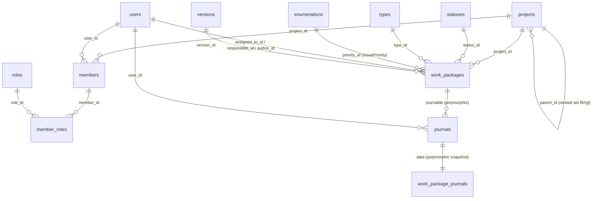
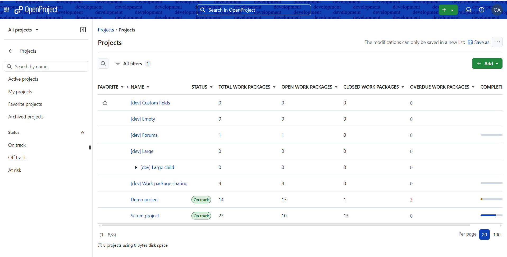
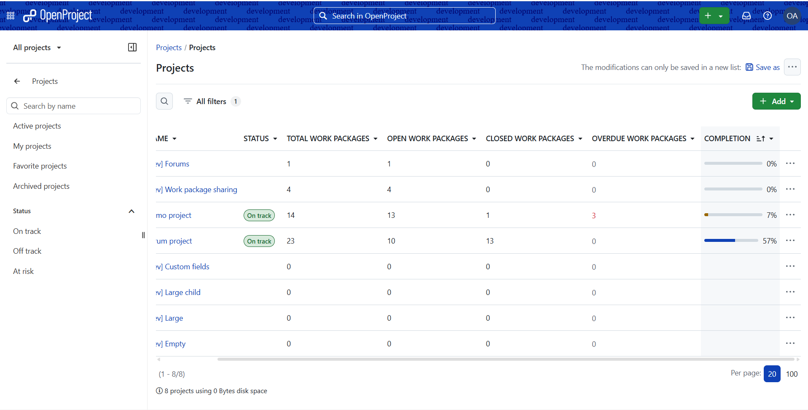
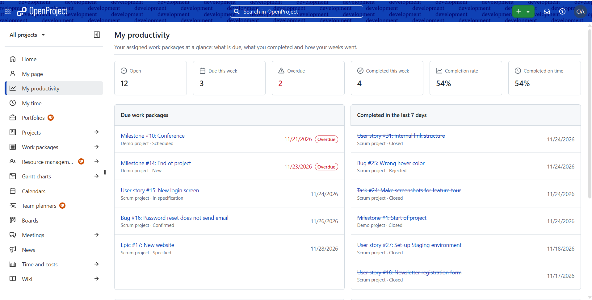
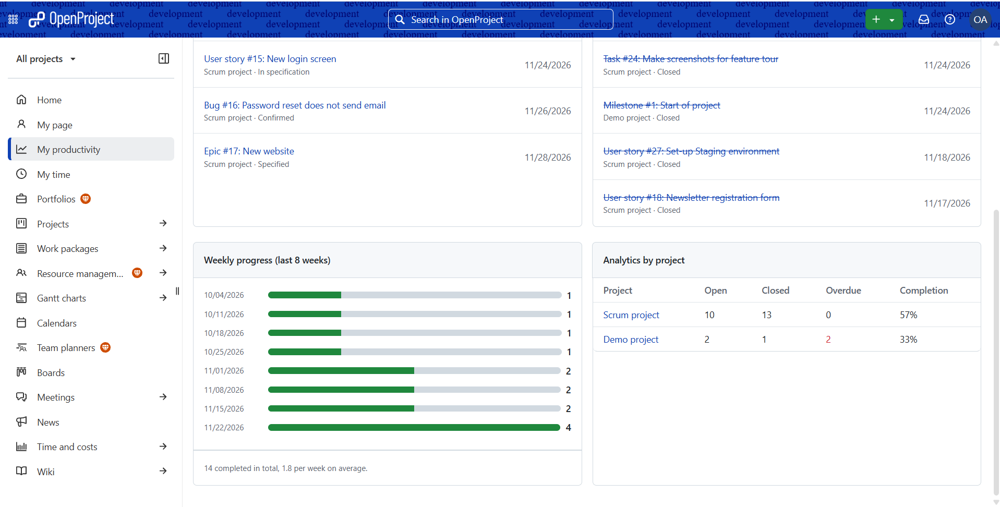

# OpenProject: Project Task Statistics & Personal Productivity Dashboard

Praskla Technology, 2026 Internship Program, Final Technical Round
Candidate: **Vijayavani K** · Base repository: [opf/openproject](https://github.com/opf/openproject) (`dev` branch)

| Task | Requirement | Where to find it |
|---|---|---|
| Modification | Project overview with task statistics, completion percentage, search and sorting | **Projects** list → *Configure view* → add the new work package columns |
| New feature | Personal Productivity Dashboard with due tasks, completed tasks, weekly progress and analytics | Global menu → **My productivity** (`/my/productivity`) |

---

## 1. Project setup

OpenProject is a large Rails + TypeScript monorepo. The officially supported dev setup is Docker, and that is what I used on Windows 11.

### Prerequisites
- Windows 11 with **WSL 2** (Ubuntu) and **Docker Desktop**
- Docker Desktop → *Settings → Resources → WSL integration* → enable **Ubuntu**
- At least 6 GB RAM for WSL. Add this to `C:\Users\<you>\.wslconfig` and run `wsl --shutdown`:
  ```ini
  [wsl2]
  memory=6GB
  swap=8GB
  ```

### Steps (run inside Ubuntu)
```bash
# keep the code on the Linux filesystem, not on /mnt/c or OneDrive: much faster file I/O for Docker
mkdir -p ~/prasklatech && cd ~/prasklatech
git clone https://github.com/vijayavani27-AI/openproject.git
cd openproject

cp .env.example .env                    # set DEV_UID / DEV_GID to the output of `id -u` / `id -g`
cp docker-compose.override.example.yml docker-compose.override.yml
docker network create gateway

bin/compose setup                       # builds images, installs gems + npm packages, migrates and seeds the DB
docker compose up -d backend frontend   # http://localhost:3000  (login: admin / admin)
```

Run the specs added for this work:
```bash
docker compose up -d backend-test
docker compose exec backend-test bundle exec rspec \
  spec/models/projects/work_package_statistics_spec.rb \
  spec/models/queries/projects/orders/work_package_statistic_order_spec.rb \
  spec/models/work_packages/productivity_report_spec.rb
```

---

## 2. Codebase understanding

| Layer | Technology | Where |
|---|---|---|
| Backend | Ruby on Rails (Ruby 4.0) | `app/`, `lib/`, `config/` |
| New UI | Server-rendered HTML with Hotwire (Turbo + Stimulus) and GitHub **Primer** ViewComponents | `app/components/` |
| Legacy UI | Angular, being migrated to custom elements | `frontend/` |
| Plugins | Rails engines (boards, my_page, overviews, costs …) | `modules/` |
| Database | PostgreSQL | `db/migrate/` |
| Tests | RSpec + FactoryBot | `spec/` |

Patterns I followed:
- **Query objects for lists.** The projects list is driven by `ProjectQuery`. Filters, orders and columns ("selects") are small classes registered in `app/models/queries/projects.rb`. A new sortable column = one *Select* + one *Order*, with no change to the controller.
- **Model concerns for computed data.** `Projects::Storage` and `Projects::Activity` add SQL-computed columns to `Project` with a `LEFT JOIN (sub-select)`. My statistics follow the same pattern.
- **ViewComponents + Primer.** UI is built from `Primer::Beta::BorderBox`, `ProgressBar`, `Text`, `Label` etc. instead of hand-written HTML and CSS.
- **Menus** are declared in `config/initializers/menus.rb`. **Translations** live in `config/locales/en.yml` (other languages come from Crowdin).
- **Permissions.** Every work package query goes through `WorkPackage.visible(user)`, so users never see counts of work packages they are not allowed to view.

---

## 3. Database structure and understanding



| Table | Purpose | Columns used in this work |
|---|---|---|
| `projects` | Workspaces (projects, programs, portfolios). The hierarchy is a nested set: `parent_id`, `lft`, `rgt` | `id`, `name`, `active` |
| `work_packages` | Tasks, bugs, features, milestones | `project_id`, `status_id`, `assigned_to_id`, `due_date`, `done_ratio` |
| `statuses` | Workflow states. **`category`** is one of `to_do`, `in_progress`, `closed` (it recently replaced the old `is_closed` boolean) | `category` |
| `members`, `member_roles`, `roles`, `role_permissions` | Who belongs to which project with which permissions | used through `WorkPackage.visible(user)` |
| `journals` | Version history of every journalized object: `journable_type`, `journable_id`, `version`, `user_id`, `created_at`, `data_type`, `data_id` | to find *when* a work package was closed |
| `work_package_journals` | Full snapshot of a work package's attributes for one journal version | `status_id` |

Key insight for the feature: **`work_packages` has no `closed_at` column.** The time of completion has to be reconstructed from the history. For every journal version of a work package I compare its status with the previous version's status using the window function `LAG(status_id) OVER (PARTITION BY journable_id ORDER BY version)`. The newest version where the status moved *into* a closed category is the completion time (a work package can be reopened and closed again, hence `MAX`).

---

## 4. Modification: task statistics on the projects overview

**Before:** the projects list (`/projects`) showed project attributes (status, dates, disk space …) but nothing about the work inside each project.

**After:** five new columns can be added through *Configure view*. Every column is **sortable**, and the list keeps its existing **search** box and **filters**:

| Column | Meaning |
|---|---|
| Total work packages | all visible work packages of the project |
| Open work packages | status category is not `closed` |
| Closed work packages | status category is `closed` |
| Overdue work packages | open and `due_date` before today (in the user's time zone), shown in red |
| Completion | closed / total as a percentage, with a progress bar (orange < 50 %, blue ≥ 50 %, green = 100 %) |

The columns are also included in the CSV / PDF / XLS export of the list.

### Implementation
| File | Change |
|---|---|
| `app/models/projects/work_package_statistics.rb` | **New** concern. `Project.with_work_package_statistics(user)` joins one grouped sub-select over `work_packages` + `statuses` and returns all five numbers with `COUNT(*) FILTER (WHERE …)`: a single query, no N+1. |
| `app/models/queries/projects/selects/work_package_statistic.rb` | **New** select that offers the five columns in *Configure view* |
| `app/models/queries/projects/orders/work_package_statistic_order.rb` | **New** order that makes the columns sortable. Counts use `COALESCE(…, 0)`; for *Completion*, projects without work packages are always listed last (`NULLS LAST`) instead of being mixed with 0 % projects |
| `app/models/queries/projects.rb` | registers the new select and order |
| `app/components/projects/table_component.rb` | loads the statistics only when one of the columns is shown |
| `app/components/projects/row_component.rb` | renders the cells (red overdue count, Primer progress bar) |
| `app/models/projects/exports/query_exporter.rb` | loads the statistics for exports |
| `app/models/project.rb`, `config/locales/en.yml` | include the concern, column captions |

Design decisions:
- Counts respect permissions (`WorkPackage.visible(user)`), so a user without access never learns how many work packages a project has.
- The closed category comes from `Status.categories[:closed]` and "today" from `User#today`. Nothing is hard-coded.
- The extra SQL runs only when a statistic column is selected, so the default list is exactly as fast as before.

---

## 5. New feature: Personal Productivity Dashboard

A new page **My productivity** (`/my/productivity`) in the global sidebar, next to *My page* and *My time*. It is built only from the work packages **assigned to the logged-in user** that they are allowed to see.

| Section | Content |
|---|---|
| Summary cards | Open · Due this week · Overdue (red when > 0) · Completed this week · Completion rate · Completed on time |
| Due work packages | open work packages due up to the end of this week, overdue ones marked with a red *Overdue* label |
| Recently completed | work packages completed in the last 7 days with their completion date |
| Weekly progress | bar chart of completed work packages for each of the last 8 weeks, with total and weekly average |
| Analytics by project | per project: open, closed, overdue, completion % |

### Implementation
| File | Purpose |
|---|---|
| `app/models/work_packages/productivity_report.rb` | **New** report object with all calculations. Completion time comes from journals (see section 3). Weeks start on the instance's configured first day of the week. Dates are converted into the user's time zone. |
| `app/controllers/my/productivity_controller.rb` | **New** controller (login required, global layout) |
| `app/views/my/productivity/show.html.erb` | page layout with the Primer page header |
| `app/components/my/productivity/*` | **New** ViewComponents: summary cards, work package list (reused for due and completed), weekly progress chart, project breakdown table, styles |
| `config/routes.rb`, `config/initializers/menus.rb` | route `my_productivity_path` and sidebar entries |
| `config/locales/en.yml` | all texts (with pluralisation) |

The tunable values (`WEEKS_OF_HISTORY`, `LIST_LIMIT`, `RECENTLY_COMPLETED_DAYS`) are named constants in one place.

---

## 6. Tests
| Spec | Covers |
|---|---|
| `spec/models/projects/work_package_statistics_spec.rb` | counts per project, empty projects, permission filtering |
| `spec/models/queries/projects/orders/work_package_statistic_order_spec.rb` | key matching and generated `ORDER BY` |
| `spec/models/work_packages/productivity_report_spec.rb` | due / overdue lists, completion rate, completion date from journals, weekly progress, on-time rate, project breakdown |

Results on my machine:
- New specs plus the related existing project query specs: **74 examples, 0 failures**
- Regression check over all existing project model, query, export and component specs
  (`spec/models/queries/projects spec/models/projects spec/components/projects`): **1281 examples, 0 failures**
- RuboCop and erb_lint report no offenses in the added or changed code.

Because the dev machine has limited RAM, I ran the model and component specs in a `backend-test` container with only the test database (`--no-deps --entrypoint bash`), without the Selenium grid that the browser feature specs need.

---

## 7. Challenges and how I solved them

| Challenge | Approach |
|---|---|
| Running a huge Rails + Angular app on a Windows laptop with 7 GB RAM | Docker in WSL 2, code kept on the Linux filesystem (not OneDrive), WSL memory raised to 6 GB with swap |
| Docker CLI not available inside Ubuntu | enabled Docker Desktop WSL integration and restarted the engine |
| No `closed_at` column for "completed this week" | rebuilt it from `journals` + `work_package_journals` with the `LAG()` window function |
| `statuses.is_closed` no longer exists on `dev` | used the new `statuses.category` enum through `Status.categories[:closed]` |
| Statistics for many projects without slowing the list | one grouped sub-select joined once, loaded only when the columns are visible |
| Not leaking hidden data | all counts are built on `WorkPackage.visible(user)` |
| Time zones and week start | `User#today`, `User#time_zone` and `OpenProject::Internationalization::Date.beginning_of_week` |
| Seed data is all created "today", so the weekly chart was empty | for the screenshots only, a local script set due dates and back-dated a few completion journals in my dev database (not part of the code) |
| Primer icon names | Octicons use dashes (`issue-opened`), not underscores; found through a 500 error while testing in the browser |
| Test container waited for a Selenium grid | ran model and component specs with the entrypoint bypassed and only the test DB running |

---

## 8. Screenshots

### Modification: project list with task statistics




### New feature: My productivity



