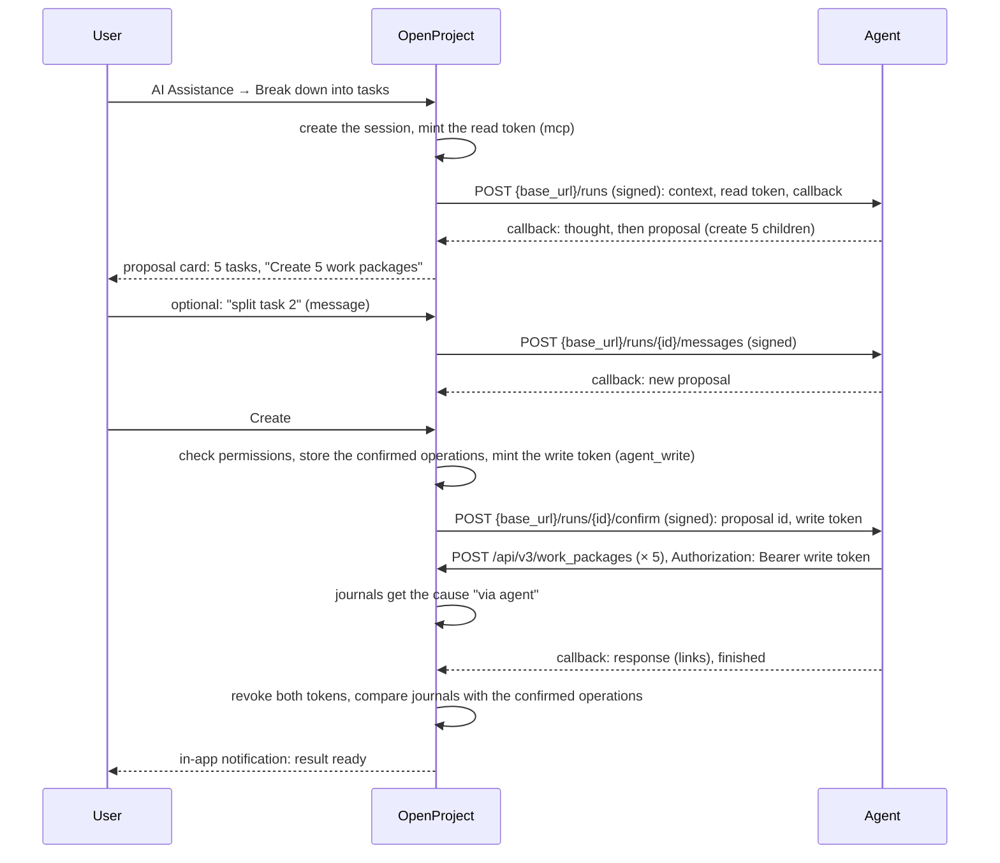

---
sidebar_navigation:
  title: Agent integration
description: How OpenProject starts external AI agents from the AI Assistance menu, how they read and write as the user, and how they run contained
keywords: AI, assistants, agents, opilot, MCP, OAuth, delegation, breakdown, coding agent
---

# Agent integration: OpenProject work

This document describes how OpenProject starts an external AI agent from the AI Assistance menu. The agent reads the work package, can ask questions, proposes changes, and, after the user confirms, writes them through API v3 as the user. The first agent is opilot, but the contract is the same for every agent.

The concept README explains which work goes to an agent and which stays in core (see "Core skills and agent skills" in the [concept](./README.md)). In short: a skill that creates or links several objects, uses tools in a loop, runs for minutes, or reaches systems outside OpenProject is an **agent skill**. A skill that changes fields of one work package with one LLM call is a **core skill**. The user sees no difference.

The first agent skill is **Break down into tasks**: the agent proposes child work packages, and the user creates them with one click. The coding agent (plan, options, questions, pull request) is the second one.

## Decisions

- **The agent acts as the user, and the history names the agent.** OpenProject mints tokens for the user who started the session, issued to the agent connection's OAuth application. The agent can do only what the user can do. Each change shows the user and the agent: "Jane Doe, via opilot". This is the meaning of the `act` claim of RFC 8693 (OAuth Token Exchange), without the exchange grant.
- **Reading and writing use separate tokens.** At the start, the agent gets a read token. It gets a write token only after the user confirms a proposal. The write token has a narrow scope, `agent_write`, and lives about 15 minutes.
- **The user confirms each batch.** The agent sends its plan as a proposal of typed operations, for example "create 5 child work packages". OpenProject renders the card and checks the user's permissions. One click on "Create" confirms the whole batch.
- **The write token is not bound to the confirmed operations.** Within the allowed endpoints and the user's permissions, the agent could do more than the user confirmed until the token expires. This is an accepted risk with mitigations (see "The agent_write scope").
- **Core sends the context.** The start request carries the same work package context as the core skills. The agent can read more through the MCP server when it is available, but it does not need it.
- **The agent is an optional add-on.** Core skills need only an LLM connection. Agent skills appear when an admin adds an agent connection.
- **The agent runs contained.** In the same Docker Compose or Kubernetes stack, it has no route to the database, the cache or the secrets of OpenProject (see "Deployment and containment").

### Prior art

- **Linear** installs an agent with OAuth and `actor=app`. The agent is an app user with its own name and icon. Assigning an issue to it sets it as the **delegate**; the human keeps ownership. An Agent Session has the states pending, active, awaitingInput, complete, error and stale, and the agent sends activities: thought, action, elicitation, response and error. The developer hosts the agent and receives webhooks.
- **GitHub Copilot coding agent** commits as its own bot, with the requesting person as co-author and a link to the session logs. Its token can push only to `copilot/*` branches, and a person must approve its workflows and its pull request.
- **Atlassian Rovo** records a change that a user confirms in the chat as the user's change. Users ask for an agent identity that shows "on behalf of" the user (AUTO-2432).
- **RFC 8693** keeps the user in `sub` and the agent in `act`, so a service can log both.

We follow Linear's session and activity model, GitHub's guardrails (narrow write access, a person confirms), and RFC 8693's attribution.

## Flow: Break down into tasks



## Work items

The items are in the order in which they can be built.

### 1. Agent connections (admin)

An admin configures where an agent runs.

- **Model** `AI::AgentConnection`, table `ai_agent_connections`:
  - `name` (shown in the history: "via <name>"), `base_url`, `active`;
  - `signing_secret`, stored encrypted;
  - an owned Doorkeeper application, through the polymorphic `integration` association (`lib/open_project/patches/doorkeeper_application.rb`), as `ScimClient` does (`app/models/scim_client.rb`, `app/services/scim_clients/create_service.rb`);
  - `skill_types`: the agent skill types it offers, for example `breakdown` and `coding_agent`;
  - `timeout_minutes`, default 60.
- **Contracts and services:** create, update and delete. The create service also creates the Doorkeeper application. The delete service revokes its tokens.
- **Validation of `base_url`:** HTTPS is required, except for `localhost` and internal service names in development.
- **Admin pages:** Administration → Artificial Intelligence (AI) → Agent connections.

### 2. Identity and tokens

OpenProject mints the tokens itself. It needs no token exchange grant: Doorkeeper (`config/initializers/doorkeeper.rb`) has `authorization_code`, `client_credentials` and refresh tokens only.

- **`AI::AgentConnections::MintTokenService`** creates a `Doorkeeper::AccessToken` with the connection's application (the actor), the user who started the session as `resource_owner_id` (the subject), and the scope and lifetime of the token kind.
- **Read token:** scope `mcp`, at most one hour.
- **Write token:** scope `agent_write` only, never together with `api_v3`. Minted after the user confirms a proposal, valid about 15 minutes.
- **An agent application's token is never an ordinary token.** The OAuth strategy refuses it for the `api_v3` scope unless it has `agent_write`, and then only on the allowed endpoints.
- **The read token is read-only on MCP.** The MCP server has write tools (`create_work_package`, `update_work_package`, `create_work_package_comment` and the relation tools; `config/initializers/mcp.rb`), and an admin switches them for the whole instance, not for each client. For a token of an agent application, `lib/api/mcp.rb` offers read-only tools only.
- **`AI::AgentConnections::RevokeTokensService`** revokes tokens when the session finishes, fails, is cancelled or times out.
- **Plaintext tokens** are sent once and are never stored. OpenProject keeps only the token ids.
- **The token in the request.** The OAuth strategy (`lib_static/open_project/authentication/strategies/warden/doorkeeper_oauth.rb`) stores the access token in the Rack env, so later code can find the agent application and the session.

### 3. Agent skill types

- **`breakdown`** (Break down into tasks) and **`coding_agent`** (Build), both conversations.
- **Global assistants only.** The skill form in My account does not offer agent skill types, because the connection and its costs are the admin's.
- **Skill setting:** the agent connection (`agent_connection_id` on `ai_assistant_skills`).
- **Ready check** (`AI::AssistantSkill#ready?`): the connection is active and offers the skill type. An agent skill needs no LLM connection in OpenProject.
- **Menu:** while a session runs, the item shows "Running".

### 4. Agent sessions

- **Model** `AI::AgentSession`, table `ai_agent_sessions`, one for each conversation:
  - `chat_id`, `agent_connection_id`;
  - `state`: `pending`, `active`, `awaiting_input`, `complete`, `error`, `stale` (as in Linear);
  - `external_id`, `read_token_id`, `write_token_id`, `callback_secret_digest`;
  - `last_event_id`, `request_count`, `started_at`, `finished_at`.
- **One running session** for each user, work package and skill.

### 5. Outbound requests

- **`AI::AgentSessions::DispatchJob`** sends the start request, the user's messages, the confirmation and the cancellation, in the background.
- **Signature:** an HMAC-SHA256 of the raw body with the connection's signing secret, in `X-OpenProject-Signature: sha256=<hex>`, with `X-OpenProject-Timestamp`. The agent refuses old requests.
- **Start request** `POST {base_url}/runs`:

  ```json
  {
    "session_id": "…",
    "skill": { "type": "breakdown", "label": "Break down into tasks", "prompt": "…" },
    "instance_url": "https://openproject.example.com",
    "work_package": { "id": 1234, "display_id": "PROJ-12", "url": "…/work_packages/1234" },
    "user": { "id": 5, "name": "Jane Doe", "locale": "en" },
    "message": "the user's text, or empty",
    "context": { "…": "AI::Assistance::WorkPackageContext#to_h, with change_options" },
    "mcp": { "url": "…/mcp", "access_token": "…", "expires_at": "…" },
    "callback": { "url": "…/ai_assistance/agent_sessions/…/events", "secret": "…" }
  }
  ```

  `context` is the context that the core skills get (`app/services/ai/assistance/work_package_context.rb`). `mcp` is present only when the MCP server is enabled.
- **Message** `POST {base_url}/runs/{external_id}/messages` with `{ "message": "…" }`.
- **Confirmation** `POST {base_url}/runs/{external_id}/confirm` with `{ "proposal_id": "…", "api": { "url": "…/api/v3", "access_token": "…", "expires_at": "…" } }`.
- **Cancel** `POST {base_url}/runs/{external_id}/cancel`.
- **Failures:** retry a network error or a 5xx three times with backoff, then mark the session `error`. A 4xx fails at once.
- **Log:** each request and its status become events in the "Details" timeline, without tokens or secrets.

### 6. The callback endpoint

- **Route:** `POST /ai_assistance/agent_sessions/:id/events`, with `Authorization: Bearer <callback secret>`. No user session and no CSRF token. A finished session refuses events.
- **Event body:** `{ "event_id": "…", "kind": "…", "data": { … } }`. A repeated `event_id` is ignored.
- **Event kinds** (aligned with Linear's activities):

  | Kind | Data | Shown as |
  |---|---|---|
  | `thought` | `text` | The newest progress line. The agent sends one within 10 seconds of the start. |
  | `action` | `text`, optional `result` | A line in Details |
  | `elicitation` | `markdown` | An assistant message; the state becomes `awaiting_input` |
  | `proposal` | `id`, `summary`, `operations` | A proposal card |
  | `response` | `markdown`, optional `links` | An assistant message |
  | `error` | `reason` | An error banner; the tokens are revoked |
  | `finished` | `summary` | The state becomes `complete`; the tokens are revoked |

### 7. Proposals with typed operations

```json
{
  "id": "p-2",
  "summary": "Five tasks for the conference",
  "operations": [
    { "id": "op-1", "kind": "create_work_package",
      "attributes": { "subject": "Book the Berlin venue", "description": "…", "type": "Task", "assignee": "Olga Ops" },
      "parent": "self" },
    { "id": "op-2", "kind": "create_relation", "from": "$op-1", "to": 10, "type": "precedes" },
    { "id": "op-3", "kind": "add_comment", "work_package": "self", "text": "…" }
  ]
}
```

- **Vocabulary:** `create_work_package`, `create_relation`, `add_comment`. An operation can refer to an earlier one (`$op-1`).
- **Checks before "Create":** the names resolve (types of the project, assignable users); the user has the permissions of each operation (`add_work_packages`, `manage_subtasks`, `manage_work_package_relations`, `add_work_package_comments`); at most 10 operations.
- **Confirm:** "Create" stores the confirmed operations on the session, mints the write token, and sends the confirmation.
- **Field changes stay in core.** An agent can also propose field changes in the Automations vocabulary (`AI::Proposal`); core applies them through `ApplyProposalService`. The executor depends on the operation, not on the skill.

### 8. The `agent_write` scope

- **Doorkeeper:** `:agent_write` in `optional_scopes`.
- **Strategy:** accepts an `agent_write` token under the `api_v3` warden scope, for agent applications only.
- **Endpoint allowlist** (`lib/api/root_api.rb`): an agent token reaches only
  - `POST /api/v3/work_packages`
  - `POST /api/v3/work_packages/form`
  - `POST /api/v3/work_packages/:id/relations`
  - `POST /api/v3/work_packages/:id/activities`

  Everything else answers 403.
- **Accepted risk: no plan binding.** Within the allowlist and the user's permissions, the agent could do more than the user confirmed until the token expires. Mitigations:
  - the token lives about 15 minutes and is revoked on `finished`;
  - a request cap for each session;
  - an after-the-fact check: core compares the journals with this session's cause against the confirmed operations, and flags differences;
  - every change carries the agent cause.
- **Considered and not chosen:**
  - **Plan binding:** each request matches one confirmed operation exactly. A check of a few fields is not enough, because the create endpoint takes many more attributes. About six cross-cutting changes.
  - **Core executes the confirmed operations:** no write token, about one service for each operation kind. It moves the create logic into core, which this design avoids. It stays the fallback if the after-the-fact check finds misuse.

### 9. Attribution

- **Cause:** `Journal::CausedByAgent`, type `agent`, with `source`, `depth`, `agent_connection_id` and `agent_name`. It is in `VALID_CAUSE_TYPES` and in the cause formatter.
- **Request-scoped default cause:** `Journal::RequestCause`, a thread-local value like `Journal::NotificationConfiguration`, set for each request with an agent token in a block with `ensure`.
- **In the save hook:** `with_ensured_journal_attributes` uses the request cause when `journal_cause` is blank. Services that set their own cause keep it.
- **No merging:** `Journals::CreateService` never merges a journal with an agent cause into another journal, and never merges another journal into it, unless both have the same cause.
- **Activity text:** "Jane Doe, via opilot".
- **Known gaps:** background jobs that a request starts lose the thread-local cause; the parent's derived-attribute journals keep their own cause; notification mails credit the change to the user.

### 10. The dialog

- **Reuse** `ChatDialogComponent`, `ChatComponent` and `ChatFormComponent`, with the same poll path.
- **While the agent works:** a spinner with the newest `thought`. The user can close the dialog; the session keeps running.
- **Proposal card:** the operations as a list, with "Create N work packages", then the links to the results.
- **Stop:** sends the cancel request, marks the session `error`, revokes the tokens.

### 11. Notifications

- A new reason `ai_result_ready`, created with `Notifications::CreateService` on the work package, as reminders do (`app/workers/reminders/schedule_reminder_job.rb`). Sent on `proposal`, `elicitation` and `finished`.

### 12. Timeouts and cleanup

- **`AI::AgentSessions::TimeoutJob`** (cron) marks sessions `stale` after the connection's timeout, or after 15 minutes without an event, and revokes their tokens.

### 13. Permissions and gating

- **Permission:** `use_ai_assistance`, as for core skills.
- **Operation permissions:** checked before the write token is minted, and again by the API on each request.

### 14. Deployment and containment

The agent is an optional part of the Docker Compose files and the Helm chart, off by default. When it is on, it brings its network rules.

**The threat:** the agent's harness runs commands that a model chooses and reads text that users wrote. A prompt injection must not reach the database, the cache, the attachment storage or the secrets of OpenProject.

- **Networks:**
  - the **harness** is on an internal network with the two gateways only;
  - the **runner** reaches the OpenProject web service and the gateways, never the database, the cache or the workers;
  - the **gateways** hold the only egress;
  - **OpenProject** reaches the agent's inbound API, which checks the signature.
- **Docker Compose:** separate networks, `internal: true` for the harness network.
- **Helm:** a separate namespace; default-deny NetworkPolicies (they work only with a CNI that enforces them); `automountServiceAccountToken: false`; the "restricted" Pod Security Standard.
- **No shared secrets or volumes** with OpenProject.
- **Hardened containers:** non-root, read-only root file system, no capabilities, the default seccomp profile, no Docker socket, resource limits. gVisor or Kata are optional for the harness.
- **Tokens:** the session tokens go to the runner only; the harness never sees them.

### 15. Changes in opilot

- A Rack app in the runner ("serve" mode) for `/runs`, `/runs/{id}/messages`, `/runs/{id}/confirm`, `/runs/{id}/cancel` and `/health`, with the signature check.
- A client for each session with a Bearer token.
- mcp-gw with the session's token, set by the runner.
- `OpenProject::CreateWp` reused: the draft becomes a `proposal` event, and the creates run after `confirm` with the write token.
- A callback sink for `OpenProject::Agent#handle_elsewhere`.

## Open questions

- **Hosting:** one agent for several OpenProject instances, or one for each?
- **Enterprise:** do agent connections need an Enterprise feature?
- **Costs:** should OpenProject limit sessions for each user or project per day?
- **Updates:** should `agent_write` later allow updates, and for which fields?
- **No user present:** do scheduled agent runs need a `ServiceAccount`?
- **Plan binding:** should it come later, if the after-the-fact check finds misuse?
- **MCP coverage:** MCP has no tools for meetings, outcomes or descendants.
