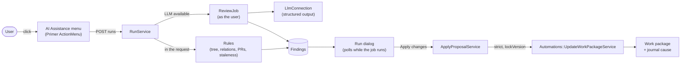

---
sidebar_navigation:
  title: AI Assistance
description: How the AI Assistance menu, its assistants and skills, and Refresh work package work, and how this change is split for review
keywords: AI, assistants, skills, refresh work package, health check, automations, LLM
---

# Development concept: AI Assistance

The "AI Assistance" menu on the work package page offers skills: presets such as "Refresh work package" or "Generate test cases", and a chat. A skill can propose a change set, and the user applies it or dismisses it. Every skill starts with a click, uses the permissions of the user who clicked, and writes nothing until that user applies a change set.

This document describes the design. It also shows how the first pull request is split into smaller pull requests for review.

## Terms

| Term | Meaning |
|---|---|
| **Assistant** | A record (`AI::Assistant`): a name, an icon and an optional model. An admin configures global assistants, and a user can create personal ones (see "Personal assistants"). It is not a user. In the menu, its name is the label next to each of its skills, for example "QA assistance". |
| **Skill type** | Code that defines what a skill does: its rules, the message its AI review sends, and the answer schema. It is registered in `AI::AssistantSkills::Registry`. There are three: `health_check` (a preset with rules, shown as "Refresh work package"), `prompt` (a preset with instructions only) and `chat`. |
| **Skill** | A record (`AI::AssistantSkill`) that attaches a skill type to an assistant, with its label, its prompt (instructions and output rules) and its proposal scope. |
| **Run** | One execution of a skill on one work package for one user (`AI::AssistantRun`). Only that user sees it. |
| **Finding** | One problem that a run found (`AI::AssistantRunFinding`). It has a severity, an area, a text, evidence, and an optional change set. |
| **Change set** | A proposed change in the Automations action vocabulary: a target (only `self` for now) and a list of actions with values, for example `{"target": "self", "actions": [{"key": "description", "values": ["…"]}]}`. Which action keys a change set may use depends on the skill type and its proposal scope (see "Proposal scope and changeable attributes"). The user applies the change set through the Automations services. |

## Flow

1. The Angular toolbar (full view and split view) loads `WorkPackages::AIAssistance::MenusController#show` into a turbo frame. A user without the permission gets an empty frame, and so does every user while no LLM connection with a model is available.
2. The menu frame renders the items with the button. There is one flat item for each skill that is ready (`AI::AssistantSkill#ready?`) of each active assistant, and a "History" item at the end.
3. A Refresh work package item posts to `RunsController#create`. `AI::AssistantRuns::RunService` stores the run, runs the rules in the user's locale, and opens the run dialog. A chat item opens `ChatsController#show`, and a custom prompt item posts to `ChatsController#start` (see "Chat" and "Custom prompt presets").
4. If `LlmConnection.available?` and a model is set, the run gets the status `ai_running` and `AI::AssistantRuns::ReviewJob` starts. The dialog polls `#poll` until the run is finished.
5. The user applies a change set (`FindingsController#apply`) or dismisses a finding, with an optional reason.

## Decisions

- **Assistants are records, not users.** A run always acts with the permissions of the user who started it. The job runs in `User.execute_as(run.user)`.
- **Rules and AI are separate.** The rules are deterministic and always run. The menu is offered only when an LLM connection with a model is available, but Refresh work package without instructions runs only its rules. If the AI review fails, the run lists it under "Not checked", and the rule findings stay.
- **What the AI reads.** It reads only what the user can see (`AI::Assistance::WorkPackageContext`): the project name, the work package, visible descendants and relations, comments filtered by `journals.internal_visible`, and the agendas of the newest 10 visible meetings that have the work package on the agenda or in an outcome. Internal comments are included only when the user may see them. The prompt tells the model that this text is user data, not instructions.
- **Evidence is required.** An AI finding without evidence is dropped. Findings and evidence are shown as escaped text. Only `http(s)` URLs and work package ids become links.
- **Change sets are Automations actions.** `AI::Assistance::ApplyProposalService` looks up each action key in `Automations::Register`. It refuses actions that `ChangeOptions#allowed?` does not allow now: keys outside the skill's proposal scope, and values that are not valid now. It calls `Automations::UpdateWorkPackageService` with `strict: true`, so an invalid action fails the call instead of being dropped.
- **Conflicts use a strict `lockVersion`.** Each finding stores the work package version from which it was made (`base_lock_version`). If the work package changed after that, the apply fails and the user runs the check again. After a successful apply, the other open findings of the same run move to the new version, so a second change set from the same run can apply.
- **Content guard.** A description change that removes an attachment reference, a mention or a macro cannot be applied (`AI::Assistance::ContentGuard`).
- **One AI job at a time** for each user, work package and skill. A second click opens the run that is in progress. An AI review that runs for more than 10 minutes is marked as timed out.
- **Journal cause.** A change set from a run writes `Journal::CausedByAssistantSkill`, and one from a chat or a custom prompt writes `Journal::CausedByAssistantChat`. Both carry `source` and `depth` for the loop protection of a later trigger model.
- **Automations stay the write layer.** Existing Automations do not change. The only change that admins can see is three new action types: Subject, Description and Comment.

## Prompts

The prompt is data, not code: admins edit it on the skill page. The basic data seeder creates the "QA assistance" assistant with three skills and their prompts (`app/seeders/common.yml`): Refresh work package, Chat and "Generate test cases". Each skill stores:

- **Instructions** (`prompt`): what the model does. Without instructions, Refresh work package runs only its rules and lists the AI review as "Not checked", and a chat or a custom prompt is not offered.
- **Output rules** (`output_rules`): how the model answers, for example the language, the changes, and what to do with user text. `{{locale}}` becomes the locale of the user who starts the run.
- **Template** (`template_ref`): the template in a separate prompt registry that the skill was created from. Nothing reads it yet. A later sync from the registry uses it.

The code keeps what is a contract between OpenProject and the model: the message (`HealthCheck::Review#user_message`), the answer schema, and the checks on the answer.

## Chat

The chat is a skill type (`AI::AssistantSkills::Chat::Skill`, key `chat`). An admin adds it to an assistant like any other skill, and the menu shows it among the skills. It opens a private conversation for each user, work package and skill (`ai_assistant_chats.skill_id`, `ai_assistant_chat_messages`), not a run. "New chat" starts an empty one.

- **Prompt:** the skill's instructions, output rules and proposal scope. The model is the assistant's model. Without instructions, the chat is not offered.
- **What the model gets:** the instructions and output rules, the same work package context as Refresh work package (`AI::Assistance::WorkPackageContext`) with `change_options`, and the last 20 turns.
- **Answer:** structured output with `answer` (Markdown, rendered with the normal text formatting) and `changes`. The changes become a proposal in the same shape as a finding's change set (`AI::Proposal`), shown with the same view and applied by the same `ApplyProposalService`. The journal cause is `Journal::CausedByAssistantChat`.
- **Execution:** `SendMessageService` stores the question and a pending answer; `AI::AssistantChats::ReplyJob` answers as the user. The dialog polls until the answer is done or failed. Each answer has its own Details timeline.

## Custom prompt presets

A **Custom prompt** skill (`AI::AssistantSkills::Prompt::Skill`, key `prompt`) is a preset with instructions only, for example "Generate test cases". One click starts a new conversation with the skill's label as the first question, and the answer uses the skill's instructions. The user can then ask follow-up questions. It uses the chat tables and `AI::AssistantChats::Reply`, so it has no findings. Without instructions, it is not offered.

## Personal assistants

A user can create their own assistants with their own skills at **My account → AI assistants** (`My::AIAssistantsController`, `My::AIAssistantSkillsController`).

- **Permission:** the global permission `manage_own_ai_assistants`. An admin gives it through a global role. To give it to all users, add it to the Standard global role.
- **Owner:** `ai_assistants.user_id`. Null means a global assistant. The owner never changes (`attr_readonly`).
- **Menu:** a personal assistant shows only in its owner's menu, after the global assistants. When the owner loses the permission, the assistant stays, but it is not offered (`AI::Assistant#usable?`).
- **Model:** a personal assistant uses the default model of the LLM connection. Only an admin can set a model, also on a personal assistant.
- **Template:** the My account form does not show `template_ref`.
- **Admin:** the admin list shows all assistants with their owner, and filters by owner. The admin edits, deactivates and deletes personal assistants on the same pages.
- **Deletion:** personal assistants are deleted with their owner, together with their skills, runs and chats.
- **Shared pages:** the admin and the My account controllers include `AIAssistance::AssistantsActions` and `AIAssistance::AssistantSkillsActions`, and render the views in `app/views/ai_assistants/` and `app/views/ai_assistant_skills/`. `AIAssistance::Pages` gives the paths and the breadcrumbs of each place.

## Proposal scope and changeable attributes

A skill's proposal scope (`ai_assistant_skills.proposal_scope`) is **Changes** (attribute changes and comments), **Comment only** or **Read-only** (nothing). A comment is the Automations action `Comment`, and it needs only the permission to comment. There is no list of attributes to maintain in the UI: with custom fields, such a list would grow without limit.

| Layer | Set by | Refresh work package |
|---|---|---|
| What the skill type can change (`changeable_attributes`, `ChangeOptions::ATTRIBUTE_KEYS`) | Code | `subject`, `description`, `status`, `priority`, `assigned_to`, `responsible`, `start_date`, `due_date`, and a `comment` |
| The proposal scope | Admin, on the skill page | Changes |
| Which values are valid now (`AI::Assistance::ChangeOptions`) | The workflow and the user's permissions | `assignable_statuses`, `assignable_priorities`, `assignable_assignees`, `assignable_responsibles` of `WorkPackages::UpdateContract` |

The model gets the valid values as `change_options`, with names, not ids. `ChangeOptions#resolve` maps each answer to an id or an ISO date, and drops anything else. `ApplyProposalService` checks every action again with `ChangeOptions#allowed?` before it applies a proposal, so an admin who narrows a skill's scope after a run also blocks its open proposals.

The dialog shows text changes as a diff, and other changes as "old → new".

An assistant can have several skills of the same type, for example "Refresh work package" and "Check scope against comments", each with its own label and prompt.

## Prepared for an Automations trigger model

The code does not have triggers, but it uses the shapes that a trigger model needs:

- **Change set in the action vocabulary.** The same shape can serve an AI proposal, an automation step and the answer of an external service.
- **`Automations::Actions::Base#after_success`.** It is called after a successful save. It is the extension point for actions with an effect outside the work package: run a skill, call a webhook, create a work package.
- **A run records its trigger** (`menu` now; `automation` and `schedule` later) and an optional `automation_id`.
- **Run creation and execution are separate.** `RunService` creates and starts a run; `Execution` runs the rules and starts the AI review, so a job can execute a run without a request.
- **The run's user is the only actor.** Skills, rules, the AI review and apply never read `User.current`. A run that a schedule starts can act as a service account.
- **The journal cause carries `source` and `depth`.**

## Gating

- The feature flag `ai_assistance` (off by default in production). The AI part also needs the `llm_connection` flag, the `llm_features_enabled` setting and a configured connection.
- The project permission `use_ai_assistance` (view level). The seeded Member role gets it. Personal assistants also need the global permission `manage_own_ai_assistants`. Applying a change set also needs `edit_work_packages`, or only `add_work_package_comments` for a comment.
- There is no enterprise gate yet. See "Follow-ups".

## Data model

| Table | Holds |
|---|---|
| `ai_assistants` | name (unique for each owner), description, icon, `model_id` (a string: syncing models replaces `llm_models` rows), position, active, `user_id` (the owner of a personal assistant) |
| `ai_assistant_skills` | `assistant_id`, `skill_key`, label, description, `prompt`, `output_rules`, `template_ref`, `proposal_scope`, position, active |
| `ai_assistant_runs` | skill, user, work package, `work_package_lock_version`, `trigger`, `automation_id`, status, locale, `not_checked`, `events` |
| `ai_assistant_run_findings` | run, source (`rule`/`ai`), `rule_key`, severity, area, text, `evidence`, `change_set`, `base_lock_version`, state, `dismiss_reason` |
| `ai_assistant_chats` | skill, user, work package |
| `ai_assistant_chat_messages` | chat, role, content, status, locale, `change_set`, `base_lock_version`, state, `events` |

Runs, chats and their rows are deleted with their user, their work package or their skill (foreign keys with `on_delete: :cascade`). The basic data seeder creates the "QA assistance" assistant with its three skills when there is no global assistant, also on an upgrade.

## How to try it

1. Enable `ai_assistance` at `/admin/settings/experimental`.
2. Give "Use AI assistance" to a role, or use the seeded Member role.
3. Open a closed work package with an open child, and use **AI Assistance → Refresh work package**.
4. For the AI part, configure an LLM connection with a default chat model, then run the check again. To see a change set, add a comment that changes the scope.
5. Configure assistants at **Administration → Artificial Intelligence (AI) → Assistants**.
6. For personal assistants, add "Manage own AI assistants" to a global role, then open **My account → AI assistants**.

## Split for review

This change comes as one pull request so that it can be tried end to end. Each commit is one review step, except the commit that adds this document. The steps can be cut into separate pull requests in this order, each one stacked on the one before it:

| # | Commit | Contents | Depends on |
|---|---|---|---|
| 1 | Add Subject and Description automation actions and a strict mode | Three Automations action types (Subject, Description, Comment), a text area for text actions, `strict:` and the `after_success` hook in `Automations::UpdateWorkPackageService` | – |
| 2 | Add the ai_assistance flag, permission and journal cause | Feature flag, `use_ai_assistance`, seeded role, `Journal::CausedByAssistantSkill` | – |
| 3 | Add AI assistant, skill, run and finding models | Migration, four models, seeder, factories | 2 |
| 4 | Add the skill registry and the health check tree rules | Registry, `HealthCheck::Context`, four tree rules | 3 |
| 5 | Add the health check relation and staleness rules | Three rules | 4 |
| 6 | Add the health check rules for linked pull requests | GitHub and GitLab rules, "Not checked" entries | 4 |
| 7 | Add the run service, the run controllers and the run dialog | `RunService`, runs and findings controllers, dismiss, Primer dialog and history | 4 |
| 8 | Add the AI Assistance menu to the work package toolbars | Angular slot, menu button and items | 7 |
| 9 | Add the AI review to the health check | Job, review, model choice (`AI::Assistant#effective_model_id`), single-job guard, polling | 7 |
| 10 | Apply proposed changes from AI findings | `ApplyProposalService`, content guard, diff view, toolbar refresh | 1, 9 |
| 11 | Add admin pages for AI assistants and their skills | Admin controllers, Primer forms, menu entry | 3 |
| 12 | Add the AI Assistance chat on work packages | Chat tables and models, reply job, chat skill type, chat dialog, `Journal::CausedByAssistantChat` | 10, 11 |
| 13 | Add custom prompt presets, a comment-only scope and a copy button | Custom prompt skill type, `ChatsController#start`, `proposal_scope`, copy button | 12 |
| 14 | Use "AI review" in the interface | Wording | 9 |
| 15 | Rename the AI judgement to AI review, and move shared proposal classes to AI::Assistance | Renames only | 14 |
| 16 | Clean up AI Assistance after review | Shared LLM call, event log and locale helpers, dead code, seeded prompts, this document | 15 |
| 17 | Add personal AI assistants in My account | Owner column, `manage_own_ai_assistants`, My account pages, shared admin and My controller logic | 11 |

Steps 1 and 2 are useful on their own and can merge first. After step 8, the feature works end to end with rules only.

## Follow-ups

- **Coding agent.** Start an external coding agent (opilot) from the menu. The OpenProject work is in [Coding agent integration](./coding-agent.md).
- **Enterprise gate.** Gate the menu, the runs and the admin pages behind the existing `custom_actions` enterprise feature, as the last step.
- **Specs.** The model, rule, service, request and component specs cover steps 1–9. Steps 10–16 need specs, and the toolbar needs browser specs (full view and split view).
- **Automations can run a skill.** A "Run assistant skill" action type that uses `after_success` and starts a run with `trigger: "automation"`. It gives skills the conditions of Automations, and a path to triggers. The result is still a proposal. The action offers only the skills of global assistants: a personal skill must not run for other users.
- **Edit before apply.** Open a proposed description in the description editor.
- **Retention.** Runs are kept without a limit. A cleanup job can come when usage shows the need.
