---
sidebar_navigation:
  title: AI Assistance
description: How the AI Assistance menu, its assistants and skills, and Refresh work package work, and how this change is split for review
keywords: AI, assistants, skills, refresh work package, health check, automations, LLM
---

# Development concept: AI Assistance

The "AI Assistance" menu on the work package page offers skills, for example "Refresh work package", "Write a test plan" or a chat. Every skill opens a conversation. An answer is text with proposals, and the user applies or dismisses each proposal. Every skill starts with a click, uses the permissions of the user who clicked, and writes nothing until that user applies a proposal.

This document describes the design. It also shows how the first pull request is split into smaller pull requests for review.

## Terms

| Term | Meaning |
|---|---|
| **Assistant** | A record (`AI::Assistant`): a name, an icon, instructions and an optional model. An admin configures global and group assistants, and a user can create personal ones (see "Owners"). It is not a user. In the menu, its name is the label next to each of its skills, for example "OP assistant". |
| **Skill** | A record (`AI::AssistantSkill`) on an assistant: a label, a system prompt, a proposal scope, conditions, and the setting "Answer at once when opened". What it does is in its prompt. |
| **Skill type** | Where a skill runs (`AI::AssistantSkills::Registry`). Core has one, `conversation`. An external agent can be a second one later (see "Core skills and agent skills"). |
| **Chat** | One conversation of a user with a skill about one work package (`AI::AssistantChat`), with its messages (`AI::AssistantChatMessage`). Only that user sees it. |
| **Proposal** | One proposed change in an answer (`AI::AssistantProposal`). A **finding** has a severity, an area and evidence, and an optional change set. A **plain proposal** has a short text and a change set. |
| **Change set** | A proposed change in the Automations action vocabulary: a target (only `self` for now) and a list of actions with values, for example `{"target": "self", "actions": [{"key": "description", "values": ["…"]}]}`. Which action keys it may use depends on the skill's proposal scope (see "Proposal scope and changeable attributes"). The user applies it through the Automations services. |

## Flow

```mermaid
flowchart LR
  U([User]) -->|click| M["AI Assistance menu<br/>(Primer ActionMenu)"]
  M -->|answers at once: POST start| S["SendMessageService"]
  M -->|empty chat: GET show| D
  S --> J["ReplyJob<br/>(as the user)"]
  J --> LLM["LlmConnection<br/>(structured output)"]
  LLM --> P[("Answer + proposals")]
  P --> D["Chat dialog<br/>(polls while the job runs)"]
  D -->|Apply| A["ApplyProposalService"]
  A -->|strict, lockVersion| AU["Automations::UpdateWorkPackageService"]
  AU --> WP["Work package<br/>+ journal cause"]
```

1. The app header has an AI Assistance icon button (`AI::Assistance::HeaderButtonComponent`, rendered by the `view_layouts_base_top_menu` hook). Its Stimulus controller (`ai-assistance--header-button`) reads the work package id from the URL: a split view (`…/details/:id`, also on boards and calendars) first, then the full view (`…/work_packages/:id`). It loads `WorkPackages::AIAssistance::MenusController#show` for that id into a turbo frame, and hides the button on other pages. A user without the permission gets an empty frame, and so does a work package that the user cannot see.
2. The menu frame renders one flat item for each skill that is ready (`AI::AssistantSkill#ready?`) of each active assistant, and a "History" item at the end.
3. A skill that answers at once posts to `ChatsController#start`: a new chat that starts with a start message (role `start`). `#rerun` adds another start to the same chat. Any other skill opens `ChatsController#show`, an empty chat for the user's own question.
4. `AI::AssistantChats::SendMessageService` stores the question or the start and a pending answer, and `ReplyJob` answers as the user. The dialog polls `#poll` until the answer is done or failed.
5. The user applies a proposal or dismisses it, with an optional reason (`ChatsController#apply`, `#dismiss`).

## Decisions

- **Assistants are records, not users.** An answer always acts with the permissions of the user who asked. The job runs in `User.execute_as(chat.user)`.
- **One runtime, one answer format.** Every skill answers in a conversation, and every answer is text with 0..n proposals (`AI::Assistance::AnswerFormat`). Whether a skill lists findings is up to its prompt. There are no built-in rules: the seeded "Refresh work package" asks the model for what rules used to check.
- **What the AI reads.** It reads only what the user can see (`AI::Assistance::WorkPackageContext`, with `AI::Assistance::Visibility`): the project name; the work package, with its default-status flag and last activity; visible descendants, with their parent, status and update time; visible relations, with their status; linked pull requests that the user may read; comments filtered by `journals.internal_visible`; and the agendas of the newest 10 visible meetings that have the work package on the agenda or in an outcome. The prompt tells the model that this text is user data, not instructions.
- **Read-only MCP tools.** For data outside the context, for example other work packages or counts, the model can call OpenProject's read-only MCP tools (`AI::Assistance::McpTool`). They run in-process, through RubyLLM's tool loop, as the chat user, so each tool's own visibility rules apply. No token and no HTTP. Write tools are never offered: changes stay proposals. `search_time_entries` is left out. A model whose `function_calling` verdict is `unsupported` gets no tools. Each skill can opt out with "Use OpenProject MCP tools" (`use_tools`, on by default); the full system prompt on the skill page follows that checkbox. The admin's MCP tool switches apply to external MCP clients only.
- **Tool calls are limited.** RubyLLM has no limit, so `AI::Assistance::ToolCalls` counts them: an identical call gets the earlier result, every call after 20 calls or after three repeated calls gets "answer now", and the answer fails after 25. Each call is a `tool_call` event in "Details", with its name, arguments, time and result size, but not the result. While the answer loads, the dialog lists the calls so far.
- **Evidence is required for findings.** A finding without evidence is dropped, and so is a plain proposal without a valid change. Text and evidence are shown as escaped text. Only `http(s)` URLs and work package ids become links.
- **Stable answers.** Every call uses temperature 0.2, so one work package gives similar answers from run to run.
- **Change sets are Automations actions.** `AI::Assistance::ApplyProposalService` looks up each action key in `Automations::Register`. It refuses actions that `ChangeOptions#allowed?` does not allow now: keys outside the skill's proposal scope, and values that are not valid now. It calls `Automations::UpdateWorkPackageService` with `strict: true`, so an invalid action fails the call instead of being dropped.
- **Conflicts use a strict `lockVersion`.** Each proposal stores the work package version from which it was made (`base_lock_version`). If the work package changed after that, the apply fails and the user asks again. After a successful apply, the other open proposals of the same chat move to the new version, so a second proposal can apply.
- **Content guard.** A description change that removes an attachment reference, a mention or a macro cannot be applied (`AI::Assistance::ContentGuard`).
- **One answer at a time** in each chat. An answer that is still pending after 10 minutes fails.
- **Journal cause.** An applied proposal writes `Journal::CausedByAssistantChat` with the assistant's name, so the activity tab says which assistant proposed the change. It carries `source` and `depth` for the loop protection of a later trigger model. Older journals with the cause `assistant_skill` still render.
- **Automations stay the write layer.** Existing Automations do not change. The only change that admins can see is three new action types: Subject, Description and Comment.

## Prompts

The system prompt of a skill has three parts (`AI::AssistantSkill#system_prompt`):

1. **The assistant prompt** (`ai_assistants.instructions`, optional): what every skill of the assistant shares, for example who it helps and the domain. Edited on the assistant page.
2. **The skill prompt** (`prompt`): what the model does in this skill. Edited on the skill page. Without it, the skill is not offered.
3. **The output rules**, which the code generates (`AI::Assistance::OutputRules`): the answer format and language, findings and plain proposals, the changes that the proposal scope allows, how to use the tools (`TOOLS`, only when tools are sent), and the guard against instructions in the context and the tool results. Admins and users do not edit them, so a skill cannot break the contract with the code.

The work package context (JSON) follows the system prompt. The message is the user's question, with the last 20 turns before it. An earlier answer is sent with a short list of its proposals and their state, so the model knows what it proposed.

The skill page shows the full system prompt under the skill prompt field. It changes while the admin types (`ai-assistance--prompt-preview`), and its tool rule follows "Use OpenProject MCP tools". The "Details" timeline of each answer shows the prompt that was sent. The basic data seeder creates the global "OP assistant" with its instructions and two skills (`app/seeders/common.yml`): Refresh work package and Chat.

## Skills

A skill has one behavior setting, **"Answer at once when opened"** (on by default):

- **On:** opening the skill starts a new chat, and the skill answers at once. The chat shows a start line ("Tom started Refresh work package"), not a question. The LLM gets a fixed, translated request (`ai_assistance.chat.start_request`) as the user turn. "Run again" starts the skill again in the same chat, on the current work package. The user can ask follow-up questions. Examples: Refresh work package, Write a test plan.
- **Off:** opening the skill shows the user's latest chat of this skill, or an empty one, and the user writes the first question. Example: Chat.

"New chat" starts an empty conversation. An assistant can have several skills, each with its own label, prompt, scope and conditions.

## Owners

An assistant has an optional owner, `ai_assistants.principal_id`:

- **None:** a global assistant. Everyone with `use_ai_assistance` sees it.
- **A group:** only the group's direct members see it. An admin chooses the group when creating the assistant (Administration → AI → Assistants).
- **A user:** a personal assistant (see below).

The development data seeds a sample for each owned kind (`DevelopmentData::AiAssistantsSeeder`, data in `app/seeders/standard.yml`). The global one is the basic data's OP assistant.

- **COMMS assistant** (the COMMS team, which builds the communication features; `DevelopmentData::TeamSeeder` seeds the team with the admin user as its member): "Write a test plan".
- **Tom's assistant** (personal, of the admin user): "My next steps".

The owner never changes (`attr_readonly`). Other principal types can be added later (`AI::Assistant::OWNER_TYPES`). The menu shows global assistants first, then owned ones (`AI::Assistant.visible_to`, `.ordered`). Owned assistants are deleted with their principal, together with their skills and chats.

### Personal assistants

A user can create their own assistants with their own skills at **My account → AI assistants** (`My::AIAssistantsController`, `My::AIAssistantSkillsController`).

- **Permission:** the global permission `manage_own_ai_assistants`. An admin gives it through a global role. To give it to all users, add it to the Standard global role.
- **Menu:** a personal assistant shows only in its owner's menu, after the global assistants. When the owner loses the permission, the assistant stays, but it is not offered (`AI::Assistant#usable?`).
- **Model:** `Llm::Runtime` resolves the model of the `:ai_assistance` feature, with the assistant's model as the override. An assistant model that the connection does not offer is ignored. Without an assistant model, the feature binding applies, then the connection default. A personal assistant has no model of its own. Only an admin can set a model, also on a personal assistant.
- **Admin:** the admin list shows all assistants with their owner, and filters by owner (Global, Groups, Personal). The admin edits, deactivates and deletes personal assistants on the same pages.
- **Shared pages:** the admin and the My account controllers include `AIAssistance::AssistantsActions` and `AIAssistance::AssistantSkillsActions`, and render the views in `app/views/ai_assistants/` and `app/views/ai_assistant_skills/`. `AIAssistance::Pages` gives the paths and the breadcrumbs of each place.

## Skill conditions

A skill can be limited to work packages of some types, statuses and projects, and to users with some roles in the work package's project (`ai_assistant_skills.conditions`, a jsonb hash of id lists). An empty list matches all. The menu, and so the chats controller, offer only skills whose conditions match (`AI::AssistantSkill#conditions_fulfilled?`). The skill page edits them under "Where it is offered".

The rules are the same as the conditions of Automations, but the code is separate for now: Automations store them in join tables and filter in SQL. A deleted type, status, project or role stays in the list until the skill is saved again; it then matches nothing.

## Proposal scope and changeable attributes

A skill's proposal scope (`ai_assistant_skills.proposal_scope`) is **Changes** (attribute changes and comments), **Comment only** or **Read-only** (nothing). A comment is the Automations action `Comment`, and it needs only the permission to comment. There is no list of attributes to maintain in the UI: with custom fields, such a list would grow without limit.

| Layer | Set by | Example: Refresh work package |
|---|---|---|
| What a skill can change (`changeable_attributes`, `ChangeOptions::ATTRIBUTE_KEYS`) | Code | `subject`, `description`, `status`, `priority`, `assigned_to`, `responsible`, `start_date`, `due_date`, and a `comment` |
| The proposal scope | Admin, on the skill page | Changes |
| Which values are valid now (`AI::Assistance::ChangeOptions`) | The workflow and the user's permissions | `assignable_statuses`, `assignable_priorities`, `assignable_assignees`, `assignable_responsibles` of `WorkPackages::UpdateContract` |

The model gets the valid values as `change_options`, with names, not ids. `ChangeOptions#resolve` maps each answer to an id or an ISO date, and drops anything else. `ApplyProposalService` checks every action again with `ChangeOptions#allowed?` before it applies a proposal, so an admin who narrows a skill's scope after an answer also blocks its open proposals.

The dialog shows text changes as a diff, and other changes as "old → new".

## Core skills and agent skills

Some skills run in OpenProject (core skills), and some run in an external agent (agent skills). The user does not see the difference.

- **Core skill:** it reads one work package, makes one LLM call through the LLM connection, and proposes changes to that work package in the Automations vocabulary. Refresh work package, Chat and Custom prompt are core skills.
- **Agent skill:** it creates or links several objects, uses tools in a loop, runs for minutes, or reaches systems outside OpenProject. Break down into tasks and the coding agent are agent skills. See [Agent integration](./2026-10-14-agents.md).
- **Neither:** a feature with one correct result, for example PDF generation, stays deterministic code.

**One user experience.** Both kinds are entries in the same menu, use the same dialog, show their proposals on the same cards, and are listed in the same History. Every change in the activity tab names the user and the assistant or agent that proposed it.

**Who decides where something runs:**

1. **The skill type** (admin time): a core skill type runs in core; an agent skill type runs in the agent connection that the admin selects.
2. **The operation** (answer time): a field change or a comment is applied by core through `ApplyProposalService`. Creating work packages and relations is done by the agent after the user confirms.
3. **The apply step** (apply time): core checks the user's permissions before anything runs, also for the agent.

The model and the user never decide it.

**Why not everything in the agent:** every instance would need a running agent, even for a summary; the agent would depend on the MCP server, which is an Enterprise add-on; one LLM call is faster and cheaper than an agent run; and the contract between core and the agent must stay compatible across releases.

## Prepared for an Automations trigger model

The code does not have triggers, but it uses the shapes that a trigger model needs:

- **Change set in the action vocabulary.** The same shape can serve an AI proposal, an automation step and the answer of an external service.
- **`Automations::Actions::Base#after_success`.** It is called after a successful save. It is the extension point for actions with an effect outside the work package: start a skill, call a webhook, create a work package.
- **Sending and answering are separate.** `SendMessageService` stores the question and the pending answer; `ReplyJob` answers it. A job can start a conversation without a request.
- **The chat's user is the only actor.** The reply and apply never read `User.current`. A conversation that a schedule starts can act as a service account.
- **The journal cause carries `source` and `depth`.**
- **Not done yet:** a chat does not record its trigger. A trigger model adds `trigger` (`menu`, `automation`, `schedule`) and `automation_id` to `ai_assistant_chats`.

## Gating

- The feature flag `ai_assistance` (off by default in production). Skills also need the `llm_connection` flag, the `llm_features_enabled` setting and a configured connection with a model.
- The project permission `use_ai_assistance` (view level). The seeded Member role gets it. Personal assistants also need the global permission `manage_own_ai_assistants`. Applying a proposal also needs `edit_work_packages`, or only `add_work_package_comments` for a comment.
- There is no enterprise gate yet. See "Follow-ups".

## Data model

| Table | Holds |
|---|---|
| `ai_assistants` | name (unique for each owner), description, `instructions`, icon, `model_id` (a string: syncing models replaces `llm_models` rows), position, active, `principal_id` (the owner: a user or a group) |
| `ai_assistant_skills` | `assistant_id`, `skill_key` (`conversation`), label, description, `prompt`, `proposal_scope`, `conditions`, `settings` (`answers_at_once`), position, active |
| `ai_assistant_chats` | skill, user, work package |
| `ai_assistant_chat_messages` | chat, role, content, status, locale, `base_lock_version`, `events` |
| `ai_assistant_proposals` | message, position, source, severity, area, text, `evidence`, `change_set`, `base_lock_version`, state, `dismiss_reason` |

Chats, messages and proposals are deleted with their user, their work package or their skill (foreign keys with `on_delete: :cascade`). The basic data seeder creates the "OP assistant" with its two skills when there is no global assistant, also on an upgrade.

## How to try it

1. Enable `ai_assistance` at `/admin/settings/experimental`.
2. Give "Use AI assistance" to a role, or use the seeded Member role.
3. Configure an LLM connection with a default chat model.
4. Open a work package, and use **AI Assistance → Refresh work package**. To see proposals, add a comment that changes the scope, or close the work package while a child is still open.
5. Configure assistants at **Administration → Artificial Intelligence (AI) → Assistants**.
6. For personal assistants, add "Manage own AI assistants" to a global role, then open **My account → AI assistants**.

## Split for review

This change comes as one pull request so that it can be tried end to end. Each commit is one review step, except the commit that adds this document. The steps can be cut into separate pull requests in this order, each one stacked on the one before it:

| # | Commit | Contents | Depends on |
|---|---|---|---|
| 1 | Add Subject and Description automation actions and a strict mode | Three Automations action types (Subject, Description, Comment), a text area for text actions, `strict:` and the `after_success` hook in `Automations::UpdateWorkPackageService` | – |
| 2 | Add the ai_assistance flag, permission and journal cause | Feature flag, `use_ai_assistance`, seeded role, `Journal::CausedByAssistantSkill` | – |
| 3 | Add AI assistant, skill, run and finding models | Migration, four models, seeder, factories | 2 |
| 4 | Add the skill registry and the health check tree rules | Registry, `HealthCheck::Context`, four tree rules | 3 |
| 5 | Add the health check relation and staleness rules | Three rules | 4 |
| 6 | Add the health check rules for linked pull requests | GitHub and GitLab rules, "Not checked" entries | 4 |
| 7 | Add the run service, the run controllers and the run dialog | `RunService`, runs and findings controllers, dismiss, Primer dialog and history | 4 |
| 8 | Add the AI Assistance menu to the work package toolbars | Angular slot, menu button and items | 7 |
| 9 | Add the AI review to the health check | Job, review, model choice (`AI::Assistant#effective_model_id`), single-job guard, polling | 7 |
| 10 | Apply proposed changes from AI findings | `ApplyProposalService`, content guard, diff view, toolbar refresh | 1, 9 |
| 11 | Add admin pages for AI assistants and their skills | Admin controllers, Primer forms, menu entry | 3 |
| 12 | Add the AI Assistance chat on work packages | Chat tables and models, reply job, chat skill type, chat dialog, `Journal::CausedByAssistantChat` | 10, 11 |
| 13 | Add custom prompt presets, a comment-only scope and a copy button | Custom prompt skill type, `ChatsController#start`, `proposal_scope`, copy button | 12 |
| 14 | Use "AI review" in the interface | Wording | 9 |
| 15 | Rename the AI judgement to AI review, and move shared proposal classes to AI::Assistance | Renames only | 14 |
| 16 | Clean up AI Assistance after review | Shared LLM call, event log and locale helpers, dead code, seeded prompts, this document | 15 |
| 17 | Add personal AI assistants in My account | Owner column, `manage_own_ai_assistants`, My account pages, shared admin and My controller logic | 11 |
| 18 | Let a group own an AI assistant | `principal_id` owner, group choice in admin, menu for group members | 17 |
| 19 | Offer skills only where their conditions match | `conditions` on skills, the menu filter, the skill form in sections | 11 |
| 20 | Generate the output rules, and share instructions across an assistant's skills | `AI::Assistance::OutputRules`, `instructions` on assistants, the prompt preview, the assistant form in sections | 11 |
| 21 | Store the proposals of a conversation answer as their own records | `ai_assistant_proposals`, several proposals for each answer, the journal cause names the assistant | 12 |
| 22 | Replace the AI skill types with one conversation type and settings | One `conversation` type, `settings` on skills, the skill form | 21 |
| 23 | Answer with findings in the conversation, and with several proposals | Findings in the chat reply, the answer timeout | 22 |
| 24 | Give AI skills a first message instead of start and answer settings | One answer format (`AnswerFormat`), simpler settings | 23 |
| 25 | Open every AI skill in the conversation, with its proposals as cards | "Answer at once when opened", `ProposalItemComponent`, dismiss in the chat | 24 |
| 26 | Remove AI runs and the built-in rules, and check consistency with the LLM | Runs, findings and rules removed; the context gets pull requests, the default status and activity times; the seeded prompt | 25 |
| – | Add an open filter and a count tool to the MCP work package tools | `open` and a status list on `search_work_packages`, `count_work_packages` with `group_by` | – |
| – | Let AI Assistance skills call the read-only MCP tools | `AI::Assistance::McpTool`, `ToolCalls`, the tool rule, the project id in the context, `tool_call` events | the MCP tool step, 26 |
| – | Show AI tool calls while the answer loads, and stop repeated calls | The poll shows new events while pending, id normalization, the repeat limit | the step before |

Steps 21–26 replace runs with conversations. For review, they are best folded into the steps they change (7, 9, 10, 12 and 13), so that runs, rules and the three skill types never appear. This table is updated when that is done.

Steps 1 and 2 are useful on their own and can merge first.

## Split into a plugin

The code is built so that it can move into a module (`modules/ai_assistance`) without a rewrite. The header button already uses the plugin extension points: a view hook, a dynamic Stimulus controller (module controllers stay in the core `dynamic/` tree), and Angular services through the plugin context. The core files that a split must move or replace:

- `config/initializers/ai_assistance.rb` (loads the hook listener): goes into the engine's `config.to_prepare`.
- `config/initializers/feature_decisions.rb`, `llm_features.rb`, `permissions.rb`, `menus.rb`, `zeitwerk.rb`, `config/routes.rb`, `config/locales/en.yml`: the AI Assistance entries go into the engine's `register` block, initializers, routes and locale file.
- `app/models/principal.rb`, `app/models/user.rb` (associations): engine patches.
- `app/models/journal.rb`, `lib/open_project/journal_formatter/cause.rb` (the `assistant_chat` cause): stay in core, as the meeting cause types do.
- The Automations actions (Subject, Description, Comment, strict mode) and the MCP tool changes: stay in core as their own pull requests.
- The seeders (`basic_data_seeder.rb`, `development_people_seeder.rb`, `common.yml`, `standard.yml`): module seeders or patches.

## Follow-ups

- **Agent skills.** Start an external agent (opilot first) from the menu: Break down into tasks, then the coding agent. The OpenProject work is in [Agent integration](./2026-10-14-agents.md).
- **Enterprise gate.** Gate the menu, the chats and the admin pages behind the existing `custom_actions` enterprise feature, as the last step.
- **Specs.** Model, service, request and component specs cover the chat, the proposals and the admin pages. The toolbar and the chat dialog need browser specs (full view and split view).
- **Automations can start a skill.** A "Run assistant skill" action type that uses `after_success` and starts a conversation with `trigger: "automation"`, and notifies the user. It gives skills the triggers of Automations. The result is still a proposal. The action offers only the skills of global assistants: a personal skill must not run for other users.
- **MCP tools.** Decide the gating: the Enterprise `mcp_server` feature and the admin's per-tool switches apply to `/mcp`, but not yet to the chat. Decide about `search_time_entries`. Tool results are not kept for later turns, so a follow-up question calls the tools again. Weaker models (gpt-4o-mini) use the tools badly: they skip `group_by` and read data that the context holds. Recommend a Sonnet-class model.
- **Edit before apply.** Open a proposed description in the description editor.
- **Retention.** Chats are kept without a limit. A cleanup job can come when usage shows the need.
