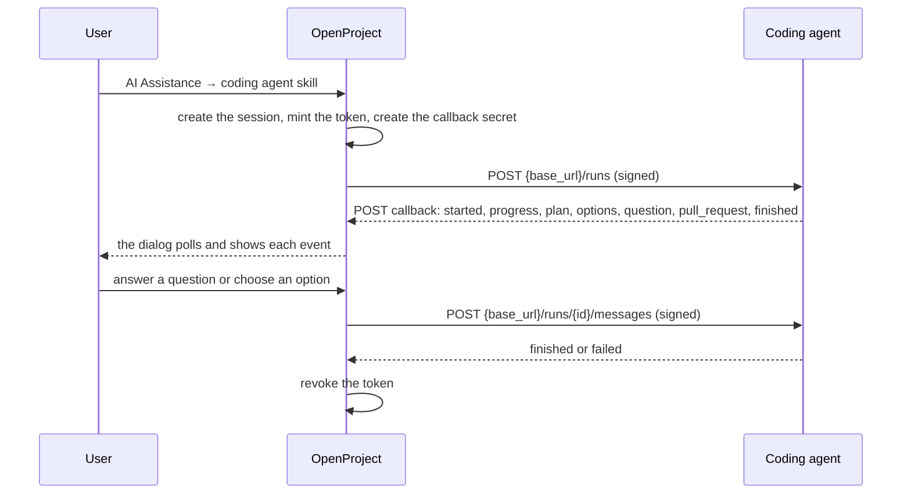

---
sidebar_navigation:
  title: Coding agent integration
description: The OpenProject work needed to start an external coding agent (opilot) from the AI Assistance menu
keywords: AI, assistants, coding agent, opilot, MCP, OAuth, webhook
---

# Coding agent integration: OpenProject work

This document lists the OpenProject work needed to start an external coding agent, for example opilot, from the AI Assistance menu. The agent plans a fix, asks questions, offers options and opens a draft pull request. OpenProject shows each step in the dialog.

The agent's own work (its `serve` mode, its gateways and its pipeline) is not part of this document.

## Decisions

- **The agent reads as the user who started it.** OpenProject mints a short-lived OAuth token for that user with the `mcp` scope only. The token expires after one hour at most, and OpenProject revokes it when the run ends.
- **The agent writes nothing to OpenProject.** It reports through a callback. OpenProject shows the reports, and any change to the work package is a proposal that the user applies, as for the other skills.
- **The agent publishes code as its own contributor account.** OpenProject does not give it GitHub credentials. The pull request links back to the work package, so the GitHub integration shows it on the work package.
- **Only an admin configures where OpenProject sends requests.** A user cannot choose the URL.
- **The agent is a skill type.** It uses the assistants, the skill admin, the skill conditions and the chat dialog that already exist.

## Flow



## Work items

The items are in the order in which they can be built. Each one can be one pull request.

### 1. Agent connections (admin)

An admin configures where the agent runs.

- **Model** `AI::AgentConnection`, table `ai_agent_connections`:
  - `name`, `base_url`, `active`;
  - `signing_secret`, stored encrypted, like the secrets of other integrations;
  - `oauth_application_id`, a Doorkeeper application that the connection owns, as `ScimClient` does;
  - `timeout_minutes`, default 60.
- **Contracts and services:** `CreateContract`, `UpdateContract`, `DeleteContract` and `CreateService`, `UpdateService`, `DeleteService`, as for `AI::TextTransformActions`. The create service also creates the Doorkeeper application. The delete service also revokes its tokens.
- **Validation of `base_url`:** HTTPS is required, except for `localhost` in development.
- **Admin pages:** Administration → Artificial Intelligence (AI) → Agent connections. They show the list, the form, the delete dialog, and a "Test connection" button that calls `GET {base_url}/health` with a signature.
- **Gate:** the `ai_assistance` feature flag. The agent also needs the MCP server, which is an Enterprise add-on, so the menu offers the skill only when the MCP server is enabled.

### 2. Token minting and revocation

- **`AI::AgentSessions::MintTokenService`** creates a `Doorkeeper::AccessToken` with:
  - the connection's application;
  - `resource_owner_id`: the user who started the session;
  - `scopes`: `mcp`;
  - `expires_in`: the shorter of one hour and the connection's timeout.
- **`AI::AgentSessions::RevokeTokenService`** revokes the token. It runs when a session finishes, fails, times out, or when the user starts a new session on the same work package.
- **The plaintext token** is sent once, in the start request, and is never stored. OpenProject keeps only the token's id.
- **Check:** confirm that the MCP endpoint (`lib/api/mcp.rb`) accepts an OAuth token with only the `mcp` scope, and that such a token cannot use the API v3.

### 3. The coding agent skill type

- **Skill type** `AI::AssistantSkills::CodingAgent::Skill`, key `coding_agent`. It is a conversation, like Chat and Custom prompt. Its kind label is "Agent".
- **Global assistants only.** The skill form in My account does not offer this type, because the connection and its costs are the admin's.
- **Skill setting:** the agent connection. Add a nullable `agent_connection_id` to `ai_assistant_skills`, shown on the skill form only for this type.
- **Ready check** (`AI::AssistantSkill#ready?`): the connection is active, and the MCP server is enabled. This skill does not need an LLM connection in OpenProject, because the agent brings its own model.
- **Menu:** a menu item opens the conversation dialog of this skill. While a session runs, the item shows a "Running" label, and a second click opens the running session.

### 4. Agent sessions

- **Model** `AI::AgentSession`, table `ai_agent_sessions`, one for each conversation (`ai_assistant_chats`):
  - `chat_id`, `agent_connection_id`;
  - `status`: `starting`, `running`, `waiting` (for an answer from the user), `finished`, `failed`, `timed_out`;
  - `external_id`: the agent's id for the run;
  - `access_token_id`: the minted token, for revocation;
  - `callback_secret_digest`: the hash of the callback secret, like `Token::HashedToken`;
  - `last_event_id`, `started_at`, `finished_at`.
- **One running session** for each user, work package and skill. A second start opens the running session, as the single-job guard for runs does.

### 5. The outbound requests

- **`AI::AgentSessions::DispatchJob`** sends the start request and each answer of the user. It runs in the background, so a slow agent does not block the request.
- **Signature:** an HMAC-SHA256 of the raw body with the connection's signing secret, in the header `X-OpenProject-Signature: sha256=<hex>`. Add `X-OpenProject-Timestamp` too, and let the agent refuse old requests.
- **Start request** `POST {base_url}/runs`:

  ```json
  {
    "session_id": "…",
    "instance_url": "https://openproject.example.com",
    "work_package": { "id": 1234, "display_id": "PROJ-12", "url": "…/work_packages/1234" },
    "user": { "id": 5, "name": "Jane Doe", "locale": "en" },
    "intent": "build",
    "message": "the user's text, or empty",
    "mcp": { "url": "…/mcp", "access_token": "…", "expires_at": "…" },
    "callback": { "url": "…/ai_assistance/agent_sessions/…/events", "secret": "…" }
  }
  ```

  `intent` is one of `plan`, `build` or `chat`.
- **Answer request** `POST {base_url}/runs/{external_id}/messages`, with `{ "message": "…" }`. Choosing an option sends `{ "option": 2 }`.
- **Failures:** retry a network error or a 5xx three times with backoff. Then mark the session `failed` and show the error in Details. A 4xx fails at once.
- **Log:** each request and its answer status become events on the chat message, in the same "Details" timeline as the LLM calls. They do not hold the token or the secrets.

### 6. The callback endpoint

- **Route:** `POST /ai_assistance/agent_sessions/:id/events`. The request carries `Authorization: Bearer <callback secret>`, and the secret is compared with the stored digest. It needs no user session and no CSRF token. A finished session refuses events.
- **Event body:** `{ "event_id": "…", "kind": "…", "data": { … } }`. A repeated `event_id` is ignored, so the agent can retry safely.
- **Event kinds:**

  | Kind | Data | Shown as |
  |---|---|---|
  | `started` | `external_id` | Session status "running" |
  | `progress` | `text` | The newest progress line, under a spinner |
  | `plan` | `markdown` | An assistant message, rendered as text |
  | `options` | a list of `{ number, title, summary }` | An assistant message with one button for each option |
  | `question` | `markdown` | An assistant message. The session status becomes "waiting", and the question field is open. |
  | `pull_request` | `url`, `repository`, `title` | A link in the conversation |
  | `finished` | `summary` | The last message. The token is revoked. |
  | `failed` | `reason` | An error banner. The token is revoked. |

- **Limits:** the size of each event, the number of events for each session, and text length, like the limits on LLM answers.

### 7. The dialog

- **Reuse** `ChatDialogComponent`, `ChatComponent` and `ChatFormComponent`. The poll path and the `Polling` helper are the same.
- **While the agent works:** a spinner with the newest progress line, and a disabled question field.
- **Options:** one button for each option. A click sends the option and disables the buttons.
- **Questions:** the question field is open while the status is "waiting".
- **Pull request:** a link with the repository name.
- **Stop:** a "Stop" button sends `POST {base_url}/runs/{external_id}/cancel`, marks the session failed, and revokes the token.
- **History:** agent sessions are listed with the skill name and their status.

### 8. Timeouts and cleanup

- **`AI::AgentSessions::TimeoutJob`** (cron, every five minutes) marks sessions `timed_out` when they ran longer than the connection's timeout, or sent no event for 15 minutes. It revokes their tokens.
- **Token cleanup:** expired tokens of agent connections are deleted, as Doorkeeper's own cleanup does.

### 9. Permissions and gating

- **Permission:** a new project permission `use_coding_agent`, which depends on `use_ai_assistance`. Starting an agent spends money and makes code changes outside OpenProject, so admins should give it separately.
- **Enterprise:** the MCP server needs its Enterprise token. Decide whether the agent integration needs one of its own.
- **Visibility:** the agent sees only what the token's user can see through the MCP server. The read-only list of MCP tools is the agent's responsibility. Document that.

### 10. Pull request link

- No OpenProject code is needed if the agent writes the work package link into the pull request description. The GitHub integration then links the pull request to the work package.
- The `pull_request` event shows the link in the conversation at once, before the GitHub webhook arrives.

### 11. Specs

- Model and contract specs for agent connections and sessions.
- Service specs for minting and revoking tokens: scope, expiry, owner, and revocation on every end state.
- A request spec for the MCP endpoint with a minted token, and one that shows that the token cannot use the API v3.
- Job specs for the dispatch, with signature, retries and failures, against a stubbed HTTP server.
- Request specs for the callback: authentication, an unknown session, a finished session, a repeated event and each event kind.
- Component specs for the dialog states, and one browser spec with a fake agent.

### 12. Documentation

- An admin guide for agent connections.
- The request and callback contract (items 5 and 6) as a versioned document for agent authors.
- The concept doc gets a link to this document.

## Open questions

- **Hosting:** does one agent serve several OpenProject instances, with one connection each, or does every instance run its own?
- **Enterprise:** does the integration need its own Enterprise feature, beyond the MCP server?
- **Costs:** should OpenProject limit sessions for each user or project per day?
