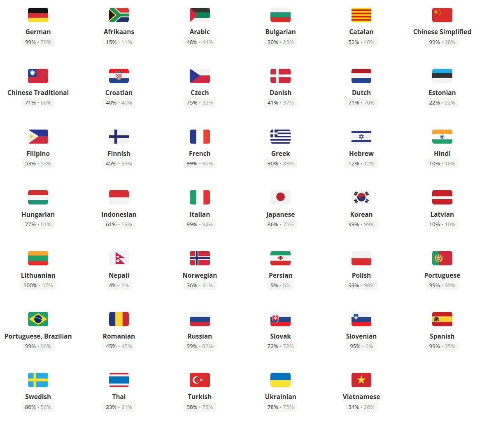

---
sidebar_navigation:
  title: Translations
description: Get an overview of how translations are being used in OpenProject, and how they end up in the frontend
keywords: translations, I18n, localization, locales, languages
---

# Development concept: Translations

OpenProject is currently being translated into over 50 languages. We use a cloud translation service called [Crowdin](https://crowdin.com/project/openproject) for allowing the community and professional translators to contribute translations to OpenProject.

Not all translations are fully translated, and they will fall back to English strings for the untranslated portions.



## Key takeaways

_Translations in OpenProject..._

- depend on the [I18n yaml-based Rails standard](https://guides.rubyonrails.org/i18n.html) for translation files
- are split into backend and frontend strings
- are used with Rails `t` in views and ViewComponents, and with the global `I18n.t` (or the `I18nService` in Angular) in frontend code

## I18n definitions

The OpenProject localizable strings are stored in the [Rails-standard I18n YAML files](https://guides.rubyonrails.org/i18n.html). The core only manages English source strings in `en.yml` and `js-en.yml` files. They can be found at `config/locales/en.yml` and `config/locales/js-en.yml`, respectively.

Additionally, modules can define their own translations, such as `modules/budgets/config/locales/en.yml`.

The `js-en.yml` files are not special on their own, but are simply prefixed with the `js:` key at the beginning of the file. This means all translations within are prefixed with the `js.` key. This is picked up by [`I18n.js`](https://github.com/fnando/i18n-js), a Ruby gem and frontend library that exports translations for the frontend. Only strings that are prefixed with `js.`, plus the `number`, `time` and `date` formats, will end up in the frontend due to the config we applied in [`config/i18n.yml`](https://github.com/opf/openproject/blob/dev/config/i18n.yml). English fallbacks are embedded for untranslated strings.

The translations are output by the rake task `./bin/rails assets:export_locales` to `frontend/src/locales/{language}.json`. `bin/setup_dev` runs this task for you, and in development, [`config/initializers/i18n-js.rb`](https://github.com/opf/openproject/blob/dev/config/initializers/i18n-js.rb) listens for changes to the locale files and re-exports them automatically.

## Using I18n in your Rails code

You are likely familiar already with the `I18n.t` helper provided by Rails. We use this helper to localize strings. Translations are loaded by Rails and available everywhere in the application.

Let's say you want to add a specific label to a work package page and use that in an ERB view. You should go through this way:

You have to add the below rows to the appropriate `en.yml` file. If you're editing a module, add the string to the module's `config/locales/en.yml` file.

You should prefix your string unless it's something very generic:

```yaml
# ...
work_packages:
  my_specific_page:
    my_button: "My localized button label"
```

You can then use the `t()` helper method in the Rails ERB view to translate the string:

```erb
<%= render(Primer::Beta::Button.new(type: :submit, scheme: :primary)) { t("work_packages.my_specific_page.my_button") } %>
```

In ViewComponents, prefer [lazy lookup](https://guides.rubyonrails.org/i18n.html#lazy-lookup) with a leading dot. The key is then scoped to the component, so `t(".heading_description")` in `Settings::UserCustomFields::HeaderComponent` resolves to `settings.user_custom_fields.header_component.heading_description`.

Outside of the views and controllers, you need to use the module function `I18n.t` to be used, for example in Ruby tests:

```ruby
expect(page).to have_selector('button', text: I18n.t('work_packages.my_specific_page.my_button'))
```

The Rails guide on translations will give advanced examples on variable interpolation and the like: [guides.rubyonrails.org/i18n](https://guides.rubyonrails.org/i18n.html)

## Using I18n in your frontend code

The frontend receives all translations prefixed with `js.` (see above) through the `frontend/src/locales/{language}.json` files generated by I18n.js. These locales are loaded early on by [`initializeLocale()`](https://github.com/opf/openproject/blob/dev/frontend/src/app/core/setup/init-locale.ts), which [frontend/src/main.ts](https://github.com/opf/openproject/blob/dev/frontend/src/main.ts) calls to ensure they are present when the page loads. The import happens dynamically so only the language the user has selected is going to be loaded by the bundler.

The loaded translations are available through a global `I18n` object. Stimulus controllers use it directly, e.g., `I18n.t('js.sort.sorted_asc')`.

If you want to create an Angular component named `news` and translate the text of a "save news" button and the author of the news, you should go through this way:

You have to add the below (exemplary) entry to the `js-en.yml` file

```yaml
js:
  # ... other values
  news:
    button_save: "Save news"
    label_added_by: "Added by %{author}"
```

In Angular code, inject the [`I18nService`](https://github.com/opf/openproject/blob/dev/frontend/src/app/core/i18n/i18n.service.ts), which wraps the same `I18n.js` helper, instead of using the global.

In the `news.component.ts`, inject the `I18nService`. Then define a property named `text` used for all static text in your component, and derive dynamic text with `computed`, like below:

```typescript
@Component({ selector: 'op-news', templateUrl: './news.component.html' })
export class NewsComponent {
  readonly authorName = input<string>();

  private readonly I18n = inject(I18nService);

  readonly text = {
    saveButton: this.I18n.t('js.news.button_save'),
  };

  readonly addedBy = computed(() => this.I18n.t('js.news.label_added_by', { author: this.authorName() }));
}
```

Then you can use them as below in your template:

```html
<button type="submit" class="button -primary">{{ text.saveButton }}</button>

@if (authorName()) {
  <div class="news-author">{{ addedBy() }}</div>
}
```

For more information on formatting and other helpers of the `I18n.js` library, see [github.com/fnando/i18n-js](https://github.com/fnando/i18n-js).
