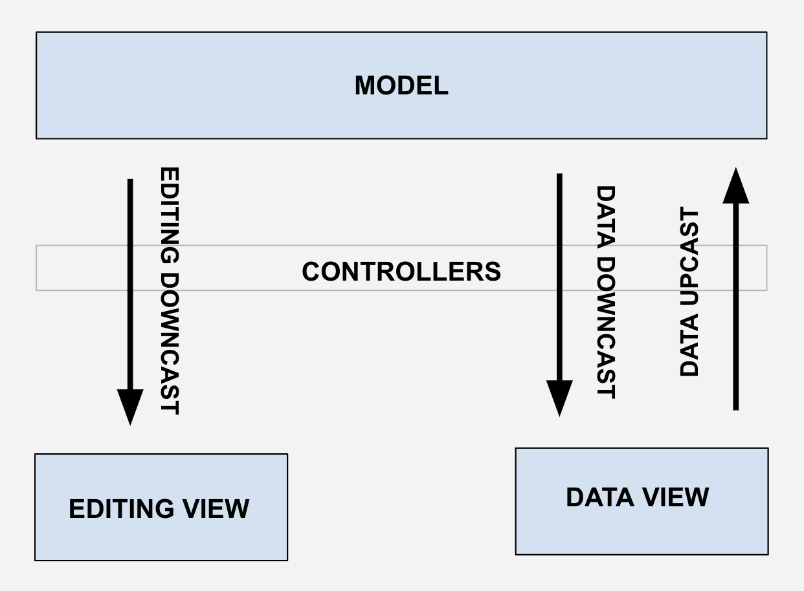
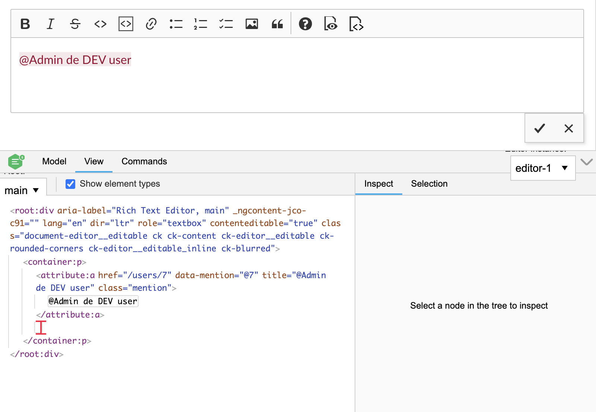

---
sidebar_navigation:
  title: WYSIWYG editor
description: An introduction to the CKEditor-based WYSIWYG editor and how it converts between HTML and Markdown
keywords: WYSIWYG, CKEditor, Markdown, editor, mentions
---

# Development concept: WYSIWYG editor

OpenProject uses the CKEditor 5 WYSIWYG editor. CKEditor is a WYSIWYG framework with a lot of functionality and great flexibility (custom builds, plugins...). OpenProject's custom CKEditor build and plugins are maintained in [opf/commonmark-ckeditor-build](https://github.com/opf/commonmark-ckeditor-build).

CKEditor is used in OpenProject as an input for string fields that require formatting, for example the description of a task, a comment or a wiki page. The collaborative editor of the _Documents_ module is a separate editor based on [BlockNote](https://www.blocknotejs.org/) and is not covered here.

## Building and loading the editor

The build repository bundles CKEditor together with the OpenProject plugins. Running `npm run build` there writes the bundle to `frontend/src/vendor/ckeditor/` in this repository, where it is committed. Changes to the build repository therefore always come with a core pull request containing the new bundle. See the [build repository README](https://github.com/opf/commonmark-ckeditor-build#building) for details and for a watch mode during development.

In the frontend, the [`CKEditorSetupService`](https://github.com/opf/openproject/blob/dev/frontend/src/app/shared/components/editor/components/ckeditor/ckeditor-setup.service.ts) loads the bundle dynamically from `core-vendor/ckeditor/ckeditor` when an editor is first needed.

## TypeScript declarations in OpenProject core

> [!IMPORTANT]
> Import CKEditor declarations with `import type` from version-pinned development dependencies. Runtime code must continue using the vendored build in `frontend/src/vendor/ckeditor/`; do not add runtime imports from the npm packages.
>
> When updating the vendored build, update all direct `@ckeditor/ckeditor5-*` development dependencies in `frontend/package.json` to the exact CKEditor version used by that build and regenerate `frontend/package-lock.json`.

The version is also recorded in the vendored source map's `ckeditor5-utils` source. Run application/spec typechecks and the editor browser specs after updating.

`ckeditor.types.ts` retains only the OpenProject configuration and `createCustomized` and `onEditorError` extensions alongside an alias for the upstream editor type. This is an interim integration until [OP-18993](https://community.openproject.org/wp/OP-18993) provides declarations from the custom build itself.

## Markdown

All formatted string field values are saved in the backend in [Markdown](https://docs.github.com/en/get-started/writing-on-github/getting-started-with-writing-and-formatting-on-github/basic-writing-and-formatting-syntax) format.

The `CommonMarkDataProcessor` class (`src/commonmark/commonmarkdataprocessor.ts` in the build repository) converts between the Markdown of the backend and the HTML that CKEditor needs:

- Its `toView` method turns Markdown into HTML using [markdown-it](https://github.com/markdown-it/markdown-it) (with task list support).
- Its `toData` method turns the HTML output of CKEditor back into Markdown using [Turndown](https://github.com/mixmark-io/turndown) and the `turndown-plugin-gfm` plugin.

Because some elements needed in the editor (macros, mentions...) are not standard Markdown elements, they are not converted to Markdown but placed as HTML strings in the Markdown (`<macro class="embedded-table" data-query-props="..."></macro>`). The conversion from Markdown to HTML will just skip converting them and CKEditor will handle them properly.

## CKEditor mental model

CKEditor follows a particular model-view-controller architecture that could be simplified like this:

### Model

Is the HTML input data once loaded into the editor. CKEditor has a Model "DOM" where the HTML elements are replaced by CKEditor model elements emulating the DOM tree.

### Views

CKEditor has two types of views:

- **Data View:** the editor's input/output, the data imported to the editor and exported from the editor (HTML).
- **Editing View:** the UI, the elements that the user interacts with in the editor's UI.

### Controller

Layer in charge of transforming the elements from the two Views to the Model and the other way around. This means to transform:

- The Data View (input HTML elements) into Model elements and the other way around.
- The Editing View (UI elements) into Model elements and the other way around.

In CKEditor the Model is considered to be above the controllers, while the Views are below. This mental model is key to understanding how the editor works.



## Plugins: Adding functionality

Because OpenProject is using some functionality/elements that are not HTML standards, we need to extend the functionality of CKEditor. This is done by adding Plugins that hook into the editor's operations, which are the following:

### Data Upcast

Import the Data View into the Model (loading the HTML into the editor). We can hook into this process with the method `editor.conversion.for('upcast')`.

### Editing Upcast

Import the Editing View into the Model (translate the elements of the editor's UI into the Model). This is done by the editor features/plugins.

### Data Downcast

Turning the Model into the Data View (the HTML output). We can hook into this process with the method `editor.conversion.for('dataDowncast')`.

### Editing Downcast

Turning the Model into the Editing View (the UI elements that the user manipulates). We can hook into this process with the method `editor.conversion.for('editingDowncast')`.

If we wanted to hook into the Editing Downcast and the Data Downcast at the same time, applying the same transformations to the Model elements in both views, we could hook into the generic method `editor.conversion.for('downcast')`.

## Elements, Attributes and Schemas

CKEditor has a Model "DOM" where the HTML elements are replaced by CKEditor model elements emulating the DOM tree. Like in the DOM, in the CKEditor Model DOM we can place elements and attributes on elements.

In order to work with custom elements (i.e., `<macro>`, `<mention>`...), we'll need to add them to the CKEditor schema.

## Events

CKEditor provides an alternative way to hook into the upcast and downcast (editing downcast and data downcast) pipelines through events.

For example, we could hook on the data downcast whenever a mention attribute is parsed with:

```javascript
editor.conversion.for('dataDowncast').add((dispatcher) => {
  dispatcher.on(
    'attribute:mention',
    (evt, data, conversionApi) => { /* ... */ },
    { priority: 'high' },
  );
});
```

## Debugging

> [!TIP]
> Use CKEditor Inspector to inspect the editor's model and view while debugging plugins.



In order to activate it, install `@ckeditor/ckeditor5-inspector` in the build repository, import it (`import CKEditorInspector from '@ckeditor/ckeditor5-inspector';`) at the beginning of the `src/op-config-customizer.ts` file, and then attach it after the `editorClass.create` call:

```typescript
return editorClass.create({
  ...configuration,
  root: { ...configuration.root, element: wrapper },
}).then((editor) => {
  CKEditorInspector.attach(editor);

  return editor;
});
```

## An example

As an example, let's take a look at our mention feature that allows mentioning colleagues in CKEditor with an autocomplete. The backend will send them as mention tags inside the raw Markdown (i.e., `<mention class="mention" data-type="user" data-id="1" data-text="@userName">@userName</mention>`).

The converters below are simplified excerpts. For the full code, including work package and emoji mentions, see `src/mentions/mentions-caster.ts` and `src/commonmark/commonmarkdataprocessor.ts` in the [build repository](https://github.com/opf/commonmark-ckeditor-build).

In order to get it working, we did the following steps:

### 1 - Markdown to HTML

Define how the Markdown elements are going to be translated to HTML elements. In this case, the backend is going to send the mention elements as tags (`<mention ...>...</mention>`) right inside the Markdown data, so we don't need to make any conversion in order to turn them into the valid HTML that CKEditor needs.

If a conversion were needed, it would be defined in the `toView` method of the `CommonMarkDataProcessor`.

### 2 - Upcast

Define how the mention elements of the HTML input data are going to be represented in CKEditor's Model:

```typescript
editor.conversion
  .for('upcast')
  .elementToAttribute({
    view: {
      name: 'mention',
      classes: 'mention',
    },
    model: {
      key: 'mention',
      value: (viewItem) => {
        const dataId = viewItem.getAttribute('data-id');
        const dataDisplayId = viewItem.getAttribute('data-display-id');
        const type = viewItem.getAttribute('data-type');
        const text = viewItem.getAttribute('data-text');

        // Only used for the link in the editing view, not persisted
        const link = getMentionLink(dataDisplayId || dataId, type);

        // Third party plugin config (https://ckeditor.com/docs/ckeditor5/latest/features/mentions.html)
        return editor.plugins.get('Mention').toMentionAttribute(viewItem, {
          dataId,
          dataDisplayId,
          link,
          text,
          type,
        });
      },
    },
    converterPriority: 'high',
  });
```

Here we say that when CKEditor finds a `mention` element with the CSS class `mention` in the input data (HTML), it should place it in the editor's model as a `mention` attribute with the additional data that we pass. The `link` is computed from the type and ID, as it is not part of the stored HTML.

### 3 - Editing downcast

Define how the mention attribute is going to be represented in CKEditor's UI (Editing View):

```typescript
editor.conversion
  .for('editingDowncast')
  .attributeToElement({
    model: 'mention',
    converterPriority: 'high',
    view: (modelAttributeValue, { writer }) => {
      // Do not convert empty attributes (lack of value means no mention).
      if (!modelAttributeValue) {
        return;
      }

      return writer.createAttributeElement('a', {
        class: 'mention',
        href: modelAttributeValue.link,
        'data-mention': modelAttributeValue.text,
        title: modelAttributeValue.text,
      });
    },
  });
```

Here we say that we want to place the mention attributes of CKEditor's model as links in CKEditor's UI (`<a href="/users/1" class="mention" data-mention="@userName" title="@userName">@userName</a>`).

### 4 - Data downcast

Define how the mention attribute is going to be represented in CKEditor's output (Data View):

```typescript
editor.conversion
  .for('dataDowncast')
  .attributeToElement({
    model: 'mention',
    converterPriority: 'high',
    view: (modelAttributeValue, { writer }) => {
      if (!modelAttributeValue) {
        return;
      }

      const attrs = {
        class: 'mention',
        'data-id': modelAttributeValue.dataId,
        'data-type': modelAttributeValue.type,
        'data-text': modelAttributeValue.text,
      };
      if (modelAttributeValue.dataDisplayId) {
        attrs['data-display-id'] = modelAttributeValue.dataDisplayId;
      }

      return writer.createAttributeElement('mention', attrs);
    },
  });
```

Here we say that we want to place the mention attributes of CKEditor's model as mention tags in CKEditor's output HTML (`<mention class="mention" data-type="user" data-id="1" data-text="@userName">@userName</mention>`).

The model update of the mentions when the user adds or removes a mention is handled by the editor features/plugins (a third party mention plugin in this case).

### 5 - HTML to Markdown

Define how the HTML mention tags are going to be represented in the Markdown. They should be placed as strings, so we need to turn any mention element into its string representation:

```typescript
turndownService.addRule('mentions', {
  filter: (node) => node.nodeName === 'MENTION' && node.classList.contains('mention'),
  replacement: (_content, node) => node.outerHTML,
});
```

This is defined in the `toData` method of the `CommonMarkDataProcessor`. The actual rule additionally collapses single-hash work package mentions into plain Markdown.

### More documentation

For more details about CKEditor, check out its [documentation](https://ckeditor.com/docs/ckeditor5/latest/), in particular the [editing engine architecture](https://ckeditor.com/docs/ckeditor5/latest/framework/architecture/editing-engine.html).

If you're looking for instructions on how to use the WYSIWYG editor in OpenProject, please look at [this page](../../../user-guide/wysiwyg).
