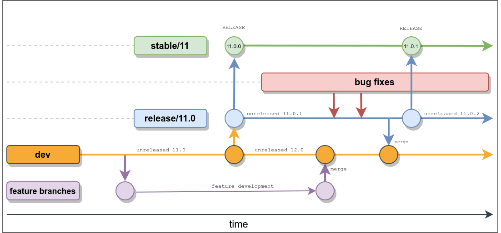

---
sidebar_navigation:
  title: Development workflow
description: How new features and bug fixes are developed at OpenProject
keywords: development workflow, gitflow, git flow
---

# Development workflow

## Development at GitHub

This guide will introduce you to how we at OpenProject develop OpenProject with Git, and how to contribute code. For other ways on how to contribute to OpenProject, [please see the contribution guide](../#contributor-code-of-conduct).

The OpenProject core is developed fully at our [GitHub repository](https://github.com/opf/openproject). In the course of this guide, we assume that you are familiar with Git. If you need a refresher on certain topics, we recommend the [free Pro Git online book](https://git-scm.com/book/en/v2) as a resource for all topics on Git.

## Branching model

OpenProject works with a git branching model similar to Git Flow to organize development and stable branches. The important branches are:

- **`dev`**:  Contains the current development version of OpenProject. Almost all development is made against this branch, with the exception of [bugfixes and minor changes](#bugs-and-hotfixes)
- **`release/X.Y`**:  Multiple of these branches may exist, they are maintenance branches or maintained or stale older releases of OpenProject. These branches will include bugfixes and changes for the next patch release of OpenProject.
- **`stable/X`**:  Multiple of these branches exist containing the latest stable `X.y.z` release of OpenProject. These branches are used for building docker images and packages from and are usually never pushed to directly except during an automated release process.
- **Work branches** (e.g. `feature/…`, `bug/…`): These are temporary branches used by developers to develop features, bug fixes, or other changes. They are opened as a pull request for reviewing and testing, and merged into their target branch when ready. See [branch names](#branch-names) for the naming convention and [features](#features) and [bugs and hotfixes](#bugs-and-hotfixes) for which branch to target.

The following is an overview of the processes that happen during the release of a new major release and the bug fixing phase afterwards leading to patch releases being made.



### Branch names

Name work branches `<type>/<work package ID>-<short-description>`:

- `<type>` mirrors the type of the work package, e.g. `feature/`, `bug/`, `implementation/`, `code-maintenance/`, or `documentation/`.
- `<work package ID>` is the lowercased semantic ID (e.g. `op-19358`) or the numeric ID of the work package.
- `<short-description>` is a few lowercase words separated by hyphens.

For example: `bug/op-19358-popover-values-verbatim`.

## Contribution flow

The basic overview of how to contribute code to OpenProject is as follows.

1. [Fork the OpenProject repository](#fork-openproject) and create a local development branch
2. Develop your change. Please see the sections on [development concepts](../concepts/) for further information on development topics.
3. [Create a pull request](#create-a-pull-request) on our repository.  Please see and review [code style and review](../code-review-guidelines) for guidelines on how to submit a pull request and requirements for getting your changes merged.
4. We will evaluate your pull review and changes.

### Fork OpenProject

For contributing source code, please follow the git workflow below:

- Use GitHub UI to fork the [OpenProject repository](https://github.com/opf/openproject).
- Clone your fork to your development machine:

```shell
git clone git@github.com:<username>/openproject.git
```

Make sure you're on the right branch. The main development branch is `dev`:

```shell
git checkout dev
```

Add the original OpenProject repository as a remote, so you can fetch changes:

```shell
git remote add upstream git@github.com:opf/openproject
```

Update your local git branch to the core branch

```shell
git pull upstream dev
```

Create a branch following the [branch naming convention](#branch-names):

```shell
git checkout -b feature/<work package ID>-<short-description>
```

Make your changes, then push the branch into your **own** repository:

```shell
git push origin <your feature branch>
```

### Create a Pull Request

Create a pull request against a branch of of the `opf/openproject` repository, containing a **clear description** of what the pull request attempts to change and/or fix.

If your pull request **does not contain a description** for what it does and what its intentions are, we will reject it. The pull request should link the [work package](https://community.openproject.org/projects/openproject/work_packages) it addresses in the **Ticket** section of the pull request template, so we can track your work.

The core contributor team will then review your pull request according to our [code review guideline](../code-review-guidelines/). Please note that you can add commits after the pull request has been created by pushing to the branch in your fork.

#### Inactive pull requests

We want to keep the pull request list tidy. Maintainers may close pull requests that have been inactive (no comments, no further pushes) for 30 days or more.

#### Features

New features are always added to the current `dev` branch, which is the development version of the next major or minor OpenProject version.

#### Bugs and hotfixes

Bugfixes for one of the actively supported versions of OpenProject should be issued against the respective branch. For that, we maintain at least one `release/X.Y` branch for OpenProject releases X.Y.Z. For example, the OpenProject release branch for 11.0 would be `release/11.0` and contains all releases between `11.0.0` until `11.0.X` .

During stabilization of a new major or minor release, bugfixes can target a release branch or `dev`. For important bug fixes, you will want to fix a current production release. Name the branch following the [branch naming convention](#branch-names) (e.g. `bug/op-12345-short-description`) and open the pull request against the most recent `release/X.Y` branch, so that the fix is available in the immediate next patch release.

For non-critical bugs or bugs that existed for longer, the default should be the `dev` branch to allow sufficient time for QA to test the bugfix.

Ensure that the version of the corresponding OpenProject bug ticket matches the release branch version. We will try to merge hotfixes into the `dev` branch, but if that is not a trivial task, we might ask you to create another PR for that.

#### Tagging

The stable/X branch with the highest number is the currently supported stable release. Its commits are tagged (e.g. v12.5.8) to pinpoint individual releases.
