# OpenProject 18.0.0

Release date: 2026-12-02

We released [OpenProject 18.0.0](https://community.openproject.org/versions/2250). The release contains several bug fixes and we recommend updating to the newest version.

Take a look at our release video showing the most important features introduced in OpenProject 18.0:

## How to navigate these release notes

OpenProject 18.0 is a particularly feature-rich release, introducing substantial improvements across project management, agile planning, resource management, collaboration, and administration. To make it easier to find the changes most relevant to you, we have organized the release notes into feature areas rather than presenting every improvement individually. At the end, you will find a complete list of all changes and bug fixes.

The overview below introduces the ten main feature areas and provides direct links to individual improvements. Select a feature area to jump to its detailed description, or follow the links to a specific feature. Each detailed section explains what has changed and, where relevant, provides links to the updated OpenProject documentation.

> [!TIP]
> **Upgrading from an earlier version?** Review the [important updates and breaking changes](#important-updates-and-breaking-changes) before upgrading.

## Overview of important feature changes

**1. [Work package types and variants, workflows, and forms](#work-package-types-and-variants-workflows-and-forms)**

OpenProject 18.0 introduces more flexibility in configuring work package types, workflows, and forms to match the needs of different teams and projects. Type variants let projects work with their own version of a type. Forms and workflows can now be reused across types. In addition, project-specific values for work package custom fields are available as a new Enterprise add-on.

This includes:

- [Type variants](#type-variants)
- [Reusable forms and workflows](#reusable-forms-and-workflows)
- [Project-specific values for work package custom fields](#project-specific-values-for-work-package-custom-fields)

**2. [Agile planning and reporting](#agile-planning-and-reporting)**

New agile reporting capabilities make it easier to track sprint progress, evaluate team performance, and understand changes in scope. The sprint report page with burndown and burnup charts is available in the Community edition. Velocity, Created vs. Resolved, and Epic progress charts, as well as detailed work package tables, provide deeper insights in the Professional plan. Improvements to backlog and sprint planning complement these reporting features.

This includes:

- [Sprint report page with burndown and burnup charts](#sprint-report-page-with-burndown-and-burnup-charts)
- [Velocity, Created vs. Resolved, Epic progress charts, and work package tables](#velocity-created-vs-resolved-epic-progress-charts-and-work-package-tables)
- [Backlog and sprint planning improvements](#backlog-and-sprint-planning-improvements)

**3. [AI Text Assistant and MCP Server](#ai-text-assistant-and-mcp-server)**

The new AI Text Assistant helps users proofread, rewrite, and structure text directly in OpenProject. Available in the Professional plan, it supports more efficient content creation and editing without switching between applications. Administrators connect their own LLM in the new AI administration. In addition, the MCP Server is now available in the **Community edition** and can create and update work packages based on your form configuration.

This includes:

- [AI Text Assistant](#ai-text-assistant)
- [MCP Server is now part of the Community edition](#mcp-server-is-now-part-of-the-community-edition)

**4. [Labels for work packages](#labels-for-work-packages)**

Labels provide a new way to categorize and organize work packages across projects. They help users identify related work, add context beyond existing work package attributes, and find relevant items more easily through filtering.

**5. [Resource management and personal planning](#resource-management-and-personal-planning)**

The Resource management module, available in the Premium plan, gets major extensions in OpenProject 18.0. Global resource planners support planning across projects. Placeholder users can be used to define criteria, so you can plan work before you know who will do it. Allocations are now visible directly in work packages, and users see the work allocated to them in My time.

This includes:

- [Global resource planners](#global-resource-planners)
- [Placeholder users and staffing](#placeholder-users-and-staffing)
- [Resource allocations in work packages](#resource-allocations-in-work-packages)
- [Personal allocations in My time](#personal-allocations-in-my-time)

**6. [Accessibility](#accessibility)**

This release improves accessibility across OpenProject, with a particular focus on keyboard navigation and screen reader support. Work package tables and Backlogs are much easier to use with the keyboard and screen readers, charts get accessible descriptions, and administrators can check the contrast of highlighting colors.

This includes:

- [Keyboard and screen reader support in work package tables and Backlogs](#keyboard-and-screen-reader-support-in-work-package-tables-and-backlogs)
- [Color contrast check](#color-contrast-check)

**7. [Meetings](#meetings)**

OpenProject 18.0 includes several improvements to meeting preparation, presentation, and follow-up. Participants can vote on agenda items, presentation mode gets more flexible, and meetings and minutes are easier to find.

This includes:

- [Agenda voting and agenda items](#agenda-voting-and-agenda-items)
- [Presentation mode](#presentation-mode)
- [Finding and managing meetings](#finding-and-managing-meetings)

**8. [Jira Migrator and CSV import](#jira-migrator-and-csv-import)**

Moving to OpenProject gets considerably easier. The Jira Migrator makes major progress: it now officially supports Jira Server and migrates nearly all issue data. In addition, a new CSV import brings in work packages from spreadsheets and other tools.

This includes:

- [Jira Migrator: major progress toward a complete migration](#jira-migrator-major-progress-toward-a-complete-migration)
- [Work package import from CSV](#work-package-import-from-csv)

**9. [Forums](#forums)**

The Forums module has been revived. Teams can follow discussions more easily, mention colleagues, mark topics as solved, and turn conversations directly into work packages.

**10. [GitLab integration](#gitlab-integration)**

The reworked **Code** tab (formerly "GitLab") shows related issues, merge requests, branches, and commits directly in the work package, and GitLab is now configured in the new Repositories section of the administration.

**[More improvements](#more-improvements)**

Beyond the major feature areas, OpenProject 18.0 introduces a wide range of improvements to everyday project work and administration, including:

- [Work package management: status categories, date and time fields, and more](#work-package-management)
- [Documents: work package links, tables, and section anchors](#documents)
- [SquashTM integration: first version for test management](#squashtm-integration)
- [Time tracking and costs: stacked view in My time and rates for placeholder users](#time-tracking-costs-and-budgets)
- [Project portfolio and administration: life cycle states, memberships overview, and permission preview](#project-portfolio-and-administration)
- [Application redesign: new header and refreshed look](#application-redesign)
- [Avatars: emoji, custom letters, and group avatars](#avatars)
- [What's new menu: new features at a glance](#whats-new-menu)

## Important feature changes in detail

### Work package types and variants, workflows, and forms

Until now, a work package type's fields and workflow were configured once and applied the same way in every project that used the type. If one team needed a slightly different process, administrators had to create a separate type, and keeping many similar types in sync quickly became a maintenance burden.

OpenProject 18.0 introduces a new configuration model. **Workflows and forms become standalone objects**: you define them once, give them a clear name, and use them in as many types as needed. On top of that, **type variants** let you create versions of a type with small differences, for example a different workflow or other fields for a specific team, while the type itself stays the same across all projects. Teams moving from Jira will find familiar concepts here: what Jira handles with workflow schemes, screen schemes, and field configuration schemes now maps to reusable workflows, forms, and per-type field settings in OpenProject.

Existing types keep working after the upgrade. Only where projects used project-specific custom field configurations does OpenProject create variants to preserve them. See [migration to type variants](#migration-of-project-specific-work-package-configurations-to-type-variants) for details.

Read more: [Work package types system admin guide](../../system-admin-guide/manage-work-packages/work-package-types/), [Blog article on type variants, workflows, and forms](https://www.openproject.org/blog/type-variants-workflows-forms/)

#### Type variants

A variant is a version of a type with its own configuration. It can use its parent type's workflow and form, pick another existing one, or get its own. Settings such as default description, project attributes, and PDF export template are either taken over from the parent type or configured for the variant.

Each project uses one version of a type at a time: the type itself or one of its variants. Because a variant can have its own workflow and form, projects can follow different processes while still working with the same type. All variants keep their type's name, so work packages can still be grouped and filtered by type across all projects, regardless of the variant.

Instance administrators decide per type whether project administrators may create their own variants. If allowed, project administrators can add variants that are only available in their project, so large organizations can delegate configuration without losing oversight. When switching a project to another variant, a preview shows what will change. If a project-specific variant turns out to be useful elsewhere, an instance administrator can make it available to other projects.

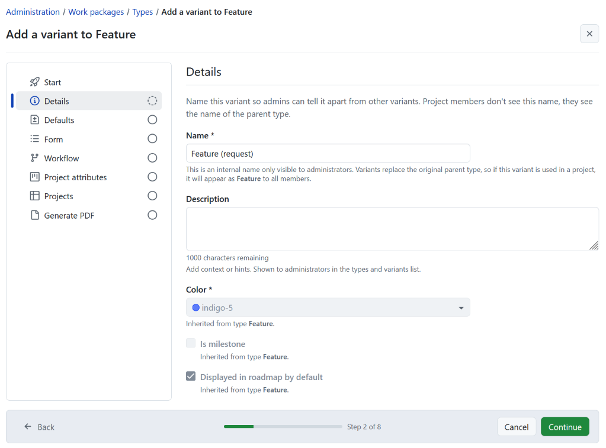

Read more: [Work package types system admin guide](../../system-admin-guide/manage-work-packages/work-package-types/)

#### Reusable forms and workflows

A form defines which fields appear on a work package, including custom fields.

Workflows and forms are no longer bound to a single type. They are created under **Work packages** in the administration and can be used by any number of types and variants. When configuring a type or variant, you either use an existing workflow or form, which stays connected so that changes apply everywhere it is used, or configure a new one, starting from a copy or from scratch.

Without changing the shared form itself, you can still switch individual fields on or off for a type or variant. Whether a field is required is set separately for each type and variant, so it is not inherited from the type.

The new **workflow and form libraries** list all workflows and forms in your instance, the types and variants that use them, and the number of projects they are active in. Before building something new, you can check whether a suitable one already exists.

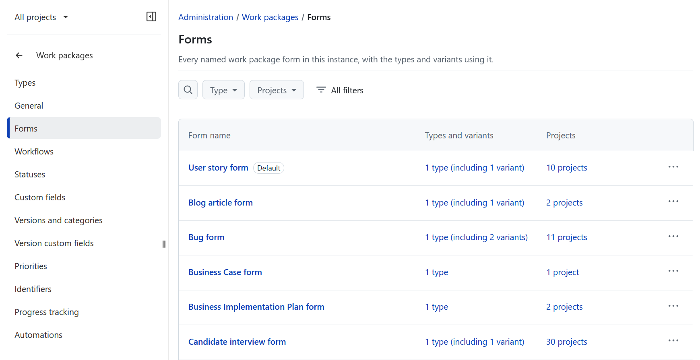

Read more: [Work package forms system admin guide](../../system-admin-guide/manage-work-packages/work-package-forms/), [Work package workflows system admin guide](../../system-admin-guide/manage-work-packages/work-package-workflows/)

#### Project-specific values for work package custom fields

[feature: project_specific_list_values ]

For work package custom fields of the formats List, Hierarchy, and Weighted item list, administrators can now choose which values are available in which project. With an **allow filter**, projects only get the values you activate. With a **block filter**, all values are available except those you deactivate. This way, one custom field can serve the whole organization while each project only sees the values that apply, for example its own departments or product lines.

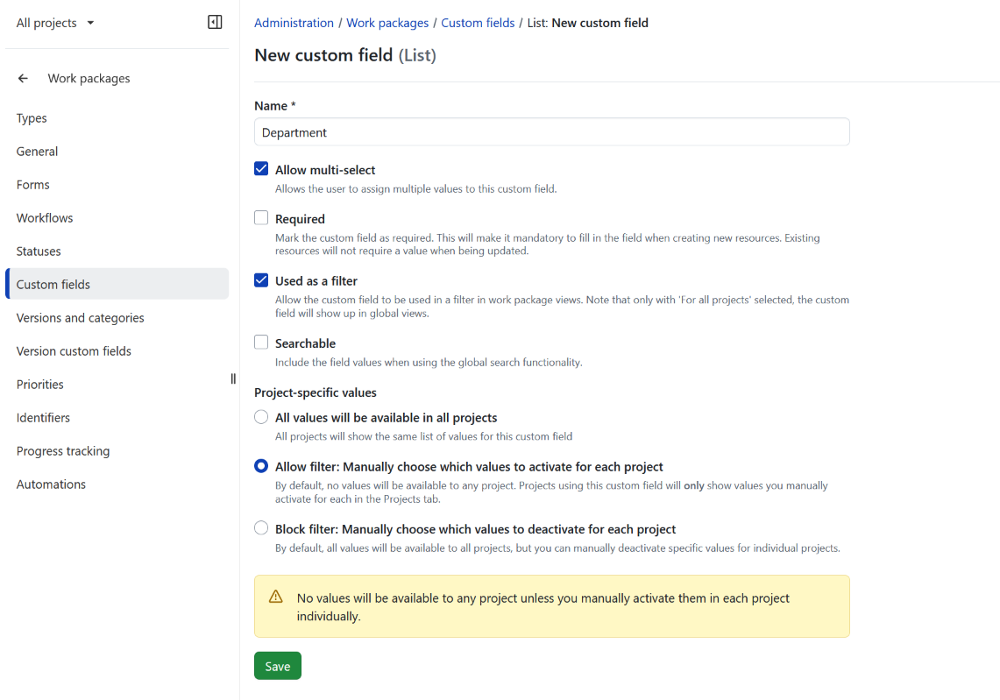

Read more: [Custom fields system admin guide](../../system-admin-guide/custom-fields/)

### Agile planning and reporting

Sprint reviews and retrospectives depend on understanding what actually happened during a sprint: how much work was completed, what was added or removed along the way, and whether the team is keeping up. OpenProject 18.0 brings this information together on a new **sprint report page** for every sprint.

The page and its core charts are available in the Community edition, while the Professional plan adds charts for longer-term insights. Backlog and sprint planning get easier as well.

Read more: [Backlogs and agile user guide](../../user-guide/backlogs-scrum/)

#### Sprint report page with burndown and burnup charts

Each sprint now has its own report page, showing the sprint's status and dates, the sprint goal, an overview of its work packages, and a graph of how they are distributed. You can navigate between sprint reports in chronological order to compare sprints.

The **burndown chart** has been reworked to make sprint progress easier to read. The new **burnup chart** additionally shows the sprint's scope as its own line, so you can see at a glance when work was added to or removed from a sprint. Scope changes are also reflected in the work package overview, including changes to story points.

Under **Project settings → Backlogs**, you can choose the default unit for velocity, effort, and capacity: story points, work time estimate, or none. This setting affects both backlog cards and sprint report charts. If you select **None**, charts use the number of work packages instead, and some sprint report charts are not displayed.

> [!TIP]
> **Reports are frozen once a sprint is completed.** Changing a work package's status, estimate, or sprint afterwards no longer affects the report. This keeps reports reliable for sprint reviews and for looking back over longer periods.

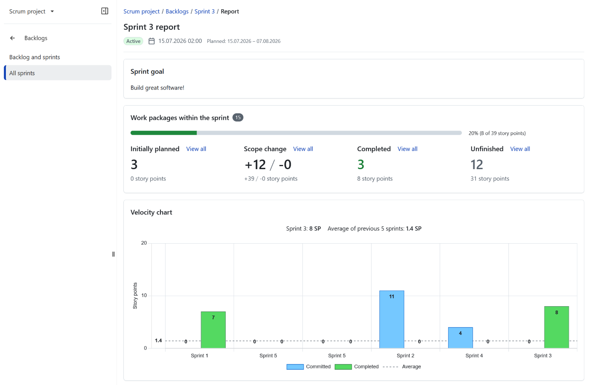

Read more: [Sprint reports user guide](../../user-guide/backlogs-scrum/sprint-reports/)

#### Velocity, Created vs. Resolved, Epic progress charts, and work package tables

[feature: sprint_report_pro_widgets ]

In addition to the core charts, the sprint report offers more insights for planning beyond a single sprint:

- **Velocity chart:** Shows the completed work of the current sprint and the six sprints before it, so teams can use their average velocity for future sprint planning.
- **Created vs. Resolved chart:** Compares how many work packages were added and how many were resolved over time. It shows whether work is piling up, the team is keeping pace, or the backlog is shrinking.
- **Epic progress chart:** Shows the progress of the epics that the sprint's work packages belong to, so you can see how sprint work contributes to larger goals.
- **Work package tables:** The sprint report lists completed, unfinished, added, and removed work packages in separate tables.

#### Backlog and sprint planning improvements

During backlog refinement and sprint planning, you can now **select multiple cards** and move them to a sprint or back to the backlog in one step, using the same selection rules as in the work package table.

Further improvements include a loading state when the backlog is filtered or refreshed, the display of actual start and finish dates, and blank states for reporting charts without data.

Read more: [Backlogs project settings user guide](../../user-guide/projects/project-settings/backlogs-settings/)

### AI Text Assistant and MCP Server

Planning, reporting, and collaboration are only as good as the information in your work packages. Writing complete, well-structured descriptions takes time, and unstructured notes often never make it into a proper work package. The new **AI Text Assistant** helps close that gap.

The AI Text Assistant works directly in OpenProject's text editors. It can proofread text, rewrite it in a different tone, or turn rough notes into a structured description that follows your organization's templates. The assistant runs on an LLM that administrators connect themselves, so organizations stay in control of where their data is processed. In addition, the MCP Server, which connects external AI assistants to OpenProject, gets a new tool and is now available in the Community edition.

Read more: [AI system admin guide](../../system-admin-guide/ai/), [Blog article on the AI Text Assistant](https://www.openproject.org/blog/ai-text-assistant/)

#### AI Text Assistant

[feature: text_assistant ]

Every rich text editor shows an **Assistant** button. The main part of the button runs the action you used last, and the arrow lists all available actions. In work package descriptions, this includes actions configured for that work package type. In other editors, such as comments, wiki pages, forums, and meetings, you see the actions available everywhere. The result appears in a popover, where you can review it before applying it to your text.

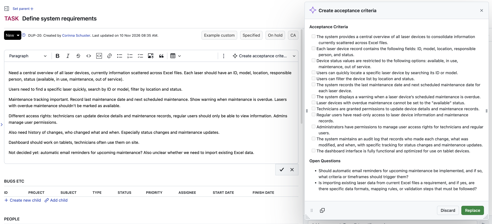

To set up the assistant, administrators use the new **AI** section in the administration, which brings all AI settings together. There, they connect OpenProject to an LLM provider and choose which model each AI feature uses, so AI features run on infrastructure your organization chooses. They also manage the **text actions**: which actions are available in every editor, which only apply to the descriptions of specific work package types, and how they match your organization's templates and writing standards.

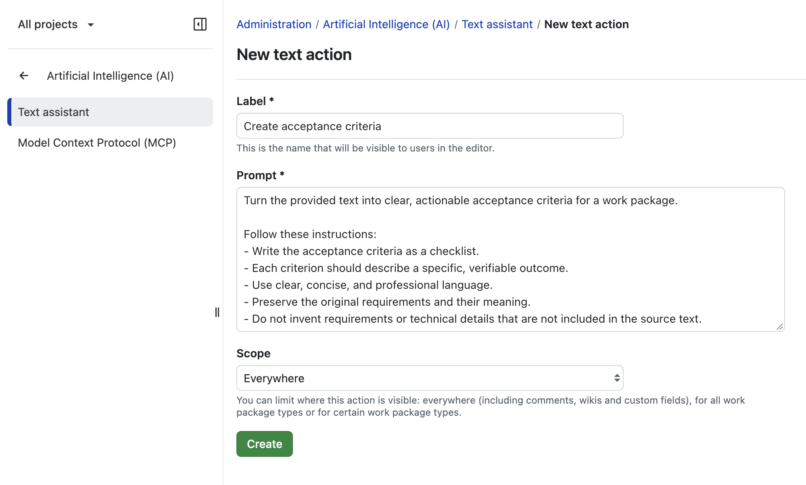

Read more: [Text assistant system admin guide](../../system-admin-guide/ai/text-assistant/)

#### MCP Server is now part of the Community edition

> [!TIP]
> **Good news for Community users:** You can now connect external AI assistants to OpenProject through the [MCP Server](../../system-admin-guide/ai/mcp-server/) and let them create and update work packages based on your form configuration.

A new MCP tool lets AI assistants read the form of a new or existing work package: which fields exist, which are required, and which values and statuses are allowed. This means assistants can create and update work packages with fewer round trips and less guesswork.

Read more: [MCP Server system admin guide](../../system-admin-guide/ai/mcp-server/)

### Labels for work packages

Sometimes you need to group work packages across types and projects, for example by customer request, security topic, or initiative, without creating a new custom field or asking an administrator. **Labels** make this possible.

Any project member who can edit a work package can add one or more labels to it. Labels are available across the instance and suggested as you type, so teams naturally reuse the same labels. Labels appear on the work package page, in the work package table, in exports, and in Gantt charts, and you can filter by them. They are also supported when copying, moving, and bulk editing work packages, and label changes are shown in the activity and in baseline comparisons. Administrators can manage existing labels in the administration. Labels are also available through the API and the MCP Server, and the Jira Migrator now migrates labels from Jira.

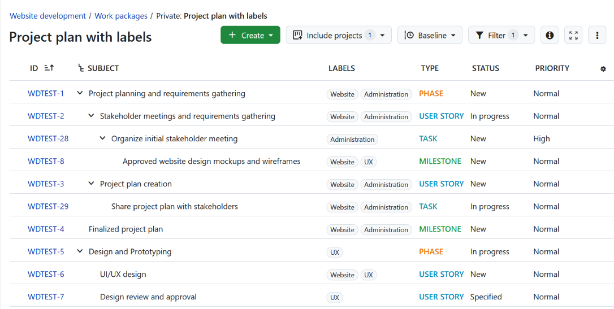

Read more: [Labels system admin guide](../../system-admin-guide/labels/), [Blog article on labels](https://www.openproject.org/blog/labels-work-packages/)

### Resource management and personal planning

[feature: resource_management ]

Planning resources rarely stops at project boundaries. People work on several projects at the same time, and resource managers need to see the full picture to avoid overloading anyone. Often, they also need to plan work before it is clear who will do it. And team members want to know what is expected of them.

With OpenProject 18.0, the **Resource management** module covers all of this. Resource managers can plan across projects with **global resource planners**, use **placeholder users** to define criteria and plan work before it is clear who will do it, and later assign a matching team member in the new **Staffing** view. Project managers see allocations directly in work packages, and users see the work allocated to them in **My time**.

Read more: [Resource management user guide](../../user-guide/resource-management/), [Blog article on resource management](https://www.openproject.org/blog/resource-management-capacity-planning/)

#### Global resource planners

Besides resource planners within a project, you can now create **global resource planners** to plan resources and allocations across several projects. You find them under **Resource management** in the global modules menu.

Global resource planners work like project resource planners, with a few differences: work package views can be filtered by project and show an additional project column, and user views can include any user you are allowed to see, not only members of one project. Allocations always belong to the project of the work package, so only members of that project can be selected. You only see the projects, users, and allocations you have permission to see. Two new global permissions control who can use global resource planners and who can manage public ones.

Read more: [Global resource planners user guide](../../user-guide/resource-management/#global-resource-planners)

#### Placeholder users and staffing

[feature: placeholder_users ]

[Placeholder users](../../system-admin-guide/users-permissions/placeholder-users/) can now be used to **define criteria** and let you **plan work before you know who will do it**. Criteria describe the kind of person needed, for example a job title, key skills, or spoken languages. You allocate the work to such a placeholder user and assign a matching team member later. If no suitable placeholder user exists yet, you can create one with criteria directly from the allocation dialog.

The updated **Staffing** view lists allocations to placeholder users that don't have a user assigned yet. It is now available both per project and globally across projects. When assigning a user, OpenProject suggests project members who match the placeholder user's criteria, together with their available hours in that period. The placeholder user stays recorded on the allocation, so you can still see what was originally requested.

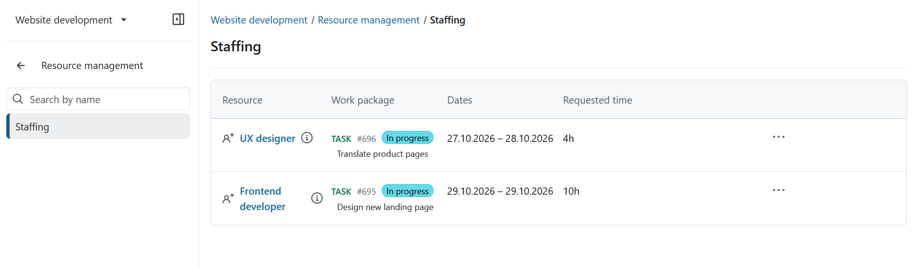

Read more: [Staffing user guide](../../user-guide/resource-management/#staffing), [Placeholder user criteria system admin guide](../../system-admin-guide/users-permissions/placeholder-users/#placeholder-user-criteria)

#### Resource allocations in work packages

If the Resource management module is activated in a project, the **Estimates and progress** section of a work package shows two new attributes:

- **Allocated:** the allocated hours compared to the work of the work package. The bar turns green when exactly the planned work is allocated and red when more is allocated.
- **Allocated resources:** the users and placeholder users the work is allocated to.

Selecting one of these attributes opens the allocation dialog, where you can create, edit, or delete allocations. You can also allocate resources from the work package's more menu or from the context menu in a work package table.

Read more: [Allocations in work packages user guide](../../user-guide/resource-management/#allocations-in-work-packages)

#### Personal allocations in My time

Work allocated to you now appears in all views of **My time**. OpenProject distributes the hours of an allocation over your working days within the allocated dates and subtracts the time you have already logged on the work package, so you see how many hours are still expected each day. If an allocation exceeds your working hours because a resource planner confirmed it as overtime, the extra time is still shown, so no allocated time is silently dropped. From an allocation, you can open the work package, assign it to yourself, or log time with the work package, date, and remaining hours already filled in.

**My time** also remembers your last selected view (Stack, Calendar, or List) and time range (day, workweek, week, or month), so you can pick up where you left off when you return.

Read more: [Resource allocations in My time user guide](../../user-guide/time-and-costs/my-time/#resource-allocations-in-my-time)

### Accessibility

Everyone should be able to use OpenProject, regardless of their abilities or the technologies they rely on. OpenProject 18.0 continues this work with a focus on keyboard navigation, contrast and screen reader support.

The biggest change is in the **work package table**: keyboard and screen reader users can now navigate it, select work packages, and use all context actions without a mouse. Administrators can also check the contrast of highlighting colors before using them. In addition, key areas such as the work package list and details, Backlogs, Boards, and Meetings have been audited with the AXe accessibility testing tool.

Further improvements include:

- **Accessible chart descriptions:** Charts in dashboard widgets and Backlogs now have descriptions for screen reader users.
- **Work packages in documents:** Improved keyboard navigation and screen reader support for work packages embedded in documents.
- **Theme-specific logos:** Administrators can now upload different logos for light, dark, and high contrast modes.

Read more: [Blog article on accessibility in OpenProject 18.0](https://www.openproject.org/blog/accessibility-18-0/)

#### Keyboard and screen reader support in work package tables and Backlogs

Keyboard and screen reader users can now move through rows and cells of the work package table, select one or several work packages, and open their context actions without a pointer. This makes bulk work such as moving, copying, changing the status, or deleting work packages possible in the same way as for mouse users. The table follows the same selection rules as Backlogs, and new context menu actions let you move work packages within the table.

Editable cells can be opened with **Enter** or **F2**. To clear a selection, press **Escape** instead of Ctrl/Cmd+D. If a menu or editor is open, Escape closes it first, and pressing it again clears the selection.

Read more: [Keyboard shortcuts and access keys user guide](../../user-guide/keyboard-shortcuts-access-keys/)

#### Color contrast check

When creating or editing highlighting colors, administrators now see a **preview** of how the color looks in light and dark modes, together with a **contrast check**. This helps choose colors that remain readable for people with visual impairments or color vision deficiencies.

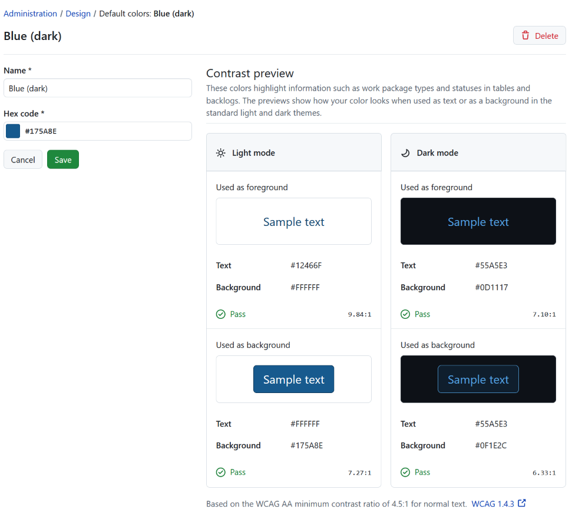

Read more: [Color settings system admin guide](../../system-admin-guide/design/#set-a-new-color)

### Meetings

Good meetings start with a clear agenda and end with clear outcomes. OpenProject 18.0 brings many improvements to the Meetings module, from deciding which topics come first to presenting the agenda and finding past discussions.

The highlights are **vote-based ranking of agenda items**, a more flexible **presentation mode**, and **full-text search in meeting minutes**. Many smaller improvements make preparing and following up on meetings smoother.

Read more: [Meetings user guide](../../user-guide/meetings/)

#### Agenda voting and agenda items

Meeting participants can now **vote on agenda items**. In vote-based sorting mode, items within each section are ranked by their votes, so the most important topics come first. Each participant has one vote per item.

Working with agenda items has also become easier:

- Add a new item directly **above or below** an existing one.
- When copying agenda items to subsequent meetings, you can now **include their outcomes**.
- When moving an agenda item to the next meeting, OpenProject tries to place it in a **matching section**.

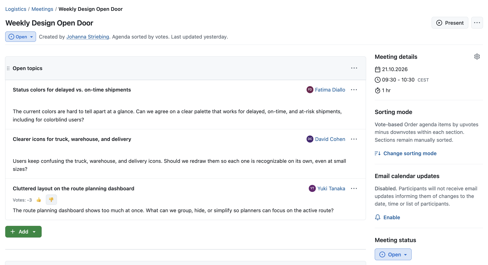

Read more: [Agenda voting user guide](../../user-guide/meetings/meeting-features/meeting-agenda/#sort-agenda-items-and-vote), [Blog article on agenda voting](https://www.openproject.org/blog/voting-agenda-items/)

#### Presentation mode

Long agenda items can now be **split into multiple slides** with a horizontal rule, so you no longer need to scroll during a presentation. You can also move agenda items to the next meeting directly from presentation mode. A small avatar next to the previews of the previous and next agenda items shows when the presenter changes, and agenda items use more of the available width.

Read more: [Presentation mode user guide](../../user-guide/meetings/meeting-features/meeting-modes/#present-a-meeting)

#### Finding and managing meetings

Meeting contents are now included in the **global search**, so you can look up whether and when a topic was discussed. The "Past" page of My meetings shows all past meetings instead of only five, and you can filter past meetings by status.

When cancelling a meeting, organizers can add a **reason** that participants can see. You can also copy a link to a specific meeting section, and the meeting sidebar sections have been reordered.

Read more: [Meetings filters user guide](../../user-guide/meetings/#meetings-filters)

### Jira Migrator and CSV import

Many organizations are moving away from Jira, and a move only works if project data comes along. OpenProject 18.0 makes major progress here: the **Jira Migrator** now officially supports Jira Server and moves nearly all issue data to OpenProject, so teams can continue working with the history and context they are used to. For data from spreadsheets or tools without a dedicated migrator, the new **CSV import** brings work packages into OpenProject as well.

Read more: [Jira migration guide](../../installation-and-operations/jira-migration/), [Jira Migrator overview](https://www.openproject.org/jira-migrator/)

#### Jira Migrator: major progress toward a complete migration

The Jira Migrator now keeps the context your teams rely on: how issues relate to each other, who worked on what, how much time was spent, which sprint an issue belonged to, and how it was resolved. New in this release, the Jira Migrator migrates:

- Issue links, which become relations between work packages
- Sub-tasks, which become child work packages, so the hierarchy is preserved
- Sprint assignments, with the required sprints and sprint attributes
- Labels
- Watchers
- Tracked time (spent time)
- Resolution and Resolution date fields
- Custom datetime fields

Each imported work package keeps the original Jira issue key and internal ID, so you can always trace it back to its source. Jira Server is now officially supported. Connecting to Jira has also become more flexible with Basic Auth support, and the connection test now checks that the token belongs to a Jira administrator. Importing Resolution fields changes how statuses are created. See [breaking changes](#jira-migrator-changed-import-of-resolution-fields).

Read more: [Jira migration guide](../../installation-and-operations/jira-migration/), [Jira field mapping guide](../../installation-and-operations/jira-migration/field-mapping/), [Jira Migrator overview](https://www.openproject.org/jira-migrator/)

#### Work package import from CSV

You can now **import work packages from CSV files**. This helps teams move data from spreadsheets or from tools without a dedicated migrator into OpenProject. OpenProject detects the encoding and separator automatically, provides a downloadable template, and lists any problems so you can fix them before importing.

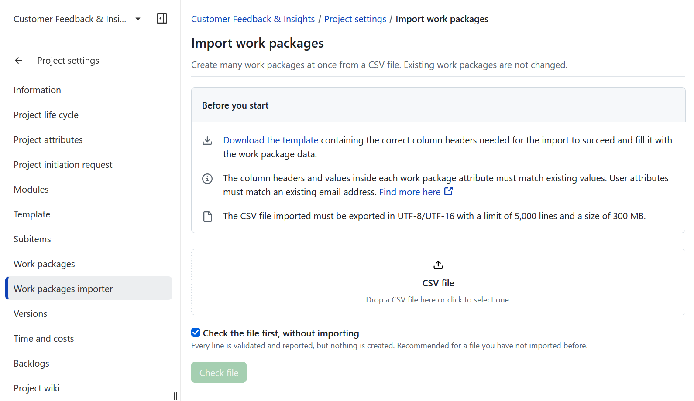

Read more: [Work package import user guide](../../user-guide/work-packages/importing/)

### Forums

The Forums module has been revived. A new browsing experience with pagination makes it easier to follow discussions. You can **mention** team members, **mark a topic as solved**, and **create a work package** directly from a conversation, turning discussions into action.

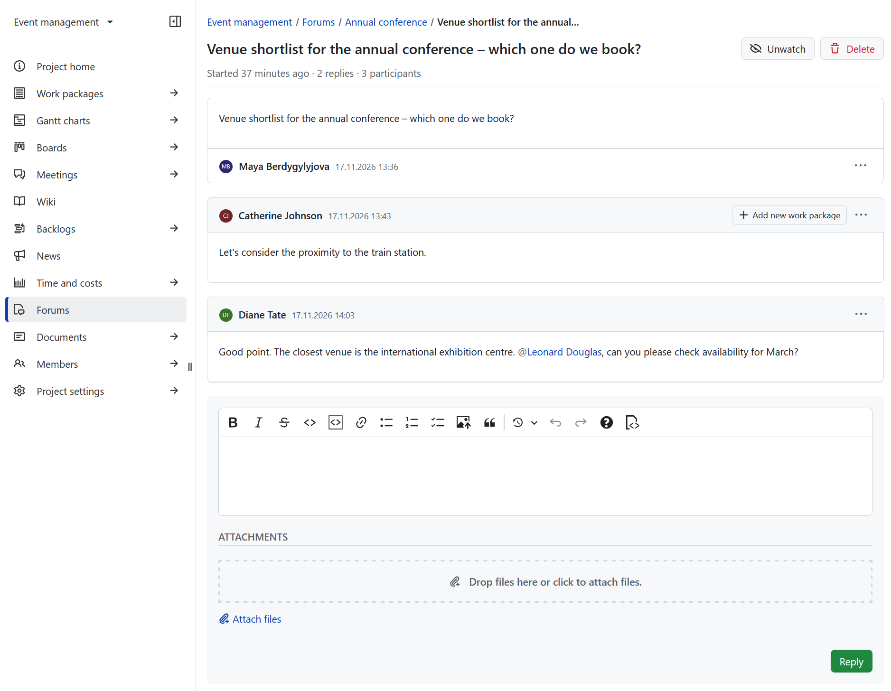

Read more: [Forums user guide](../../user-guide/forums/), [Blog article on the revived Forums](https://www.openproject.org/blog/passion-project-forums-module/)

### GitLab integration

What should be implemented is defined in work packages, while the implementation lives in GitLab. The reworked **Code** tab (formerly "GitLab") shows the related issues, merge requests, branches, and commits directly in the work package. Developers can find code to review, project managers can see whether work is merged, and QA can see where to test.

GitLab is now configured in the new **Repositories** section of the administration, which also supports connecting multiple GitLab instances. The GitHub integration is still configured under **Integrations**.

Placeholder for the screenshot alt-text: Code tab of a work package in OpenProject showing related GitLab merge requests and commits (openproject_release_notes_18.0_code_tab_gitlab.png )

Read more: [GitLab integration system admin guide](../../system-admin-guide/integrations/gitlab-integration/), [Repositories system admin guide](../../system-admin-guide/repositories/), [GitLab integration overview](https://www.openproject.org/integrations/gitlab/)

### More improvements

Besides the major feature areas, OpenProject 18.0 contains many improvements to everyday work. Documents gain new ways to work with work packages, the SquashTM integration is available in a first version, creating and editing XWiki pages from OpenProject has become easier, and time tracking gets a clearer overview.

For administrators, there are new portfolio features, a central overview of memberships, and more transparency about permissions. The application also gets a refreshed design with a new header, and users have more freedom in designing their avatars.

Read more: [OpenProject user guide](../../user-guide/), [XWiki integration system admin guide](../../system-admin-guide/integrations/xwiki/)

#### Work package management

**Status categories** add a common meaning to your statuses, however they are named. Administrators assign each status to one of three categories:

- **To-do:** Work that has not yet started.
- **In progress:** Work that is actively being worked on.
- **Closed:** Work that has been completed.

A new custom field format, **Date and time**, lets you record exact points in time such as deadlines, appointments, or deployment windows. Values are shown in each user's time zone and format.

Further improvements include:

- Copy a work package's ID from its more menu.
- Filter work packages by their semantic identifier (e.g. PROJ-42) in API v3.
- Work package descriptions can be rendered as Markdown.
- The Relations tab scrolls to a newly created child automatically.
- A new user setting lets inline fields open for editing only on double click.

Read more: [Date and time custom field system admin guide](../../system-admin-guide/custom-fields/#date-and-time-custom-field)

#### Documents

Documents get several new ways to work with work packages: insert **work package attributes** with a slash command, create **work package link blocks** with the #### command, and **create new work packages** from a search in a document. Documents also support **advanced tables** and **anchors at headings**, so you can copy a link to a specific section and share it. New documents, as well as meetings and boards, can now be created directly from the **+** button in the header.

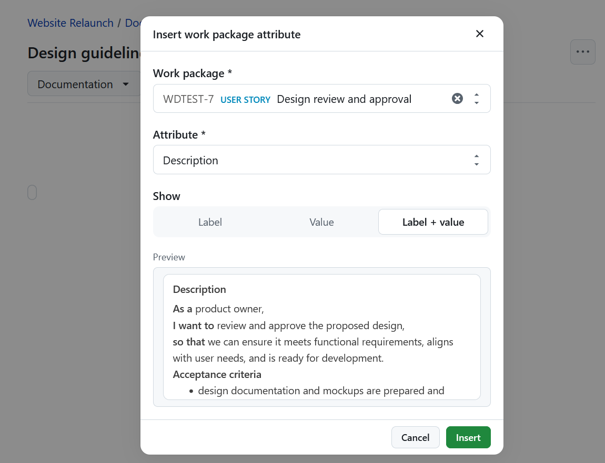

Read more: [Documents user guide](../../user-guide/documents/)

#### SquashTM integration

OpenProject 18.0 includes a first version of the integration with the test management tool **SquashTM**. Administrators set up the connection and enable it per project, and work packages get a new SquashTM tab.

Read more: [SquashTM integration system admin guide](../../system-admin-guide/integrations/squashtm/)

#### Time tracking, costs, and budgets

My time has a new **stacked view** that lists each day's time entries, which is especially helpful if you don't log start and end times. The My spent time widget on My page has been replaced with the same modern calendar.

Placeholder users can now have **hourly rates** and can be selected in the planned costs of a budget, so you can plan costs before staffing is final. The time log form has been refined, and cost reports use a new standard query.

Read more: [My time user guide](../../user-guide/time-and-costs/my-time/#stack-view), [Placeholder user hourly rates system admin guide](../../system-admin-guide/users-permissions/placeholder-users/#hourly-rates)

#### Project portfolio and administration

**[Project life cycle phases](../../user-guide/projects/project-home/project-life-cycle/)** now have a state: Open, In progress, or Completed. The state is set manually on the project overview and shows which phase is currently active. It does not change the phase dates.

**[Weighted item lists](../../system-admin-guide/custom-fields/#weighted-list-custom-field-enterprise-add-on)** used as project attributes now support multiple selections. Calculated values can process them with the new MUL and COUNT functions, for example to score projects by several strategic reasons at once.

For projects following PMflex, **wiki pages** can now be included in artefact exports. In addition, the new **project hover card** and a redesigned project status badge make it easier to identify projects.

For administrators:

- A new **Memberships** page lists all memberships across projects, including archived ones, and can be filtered.
- A **permission preview** shows what a role grants wherever roles are assigned.
- When deleting a role, OpenProject shows which members still use it.
- Creating **OAuth applications** has been improved.

Read more: [Project life cycle user guide](../../user-guide/projects/project-home/project-life-cycle/), [Weighted item list project attributes system admin guide](../../system-admin-guide/projects/project-attributes/#weighted-list-project-attribute-enterprise-add-on), [PM² and PMflex use case](../../use-cases/project-management-pm2-pmflex/), [Roles and permissions system admin guide](../../system-admin-guide/users-permissions/roles-permissions/)

#### Application redesign

OpenProject has a refreshed look: the **application header** uses the new primary blue, and UI elements in the work package view have aligned rounded corners. The login screen has been modernized as well. In addition, many administration pages have been migrated to our Primer design system for a more consistent interface.

#### Avatars

Users can now choose an **emoji or custom letters** as their avatar, with a background color of their choice. Administrators can also give **groups** an avatar, which makes them easier to recognize.

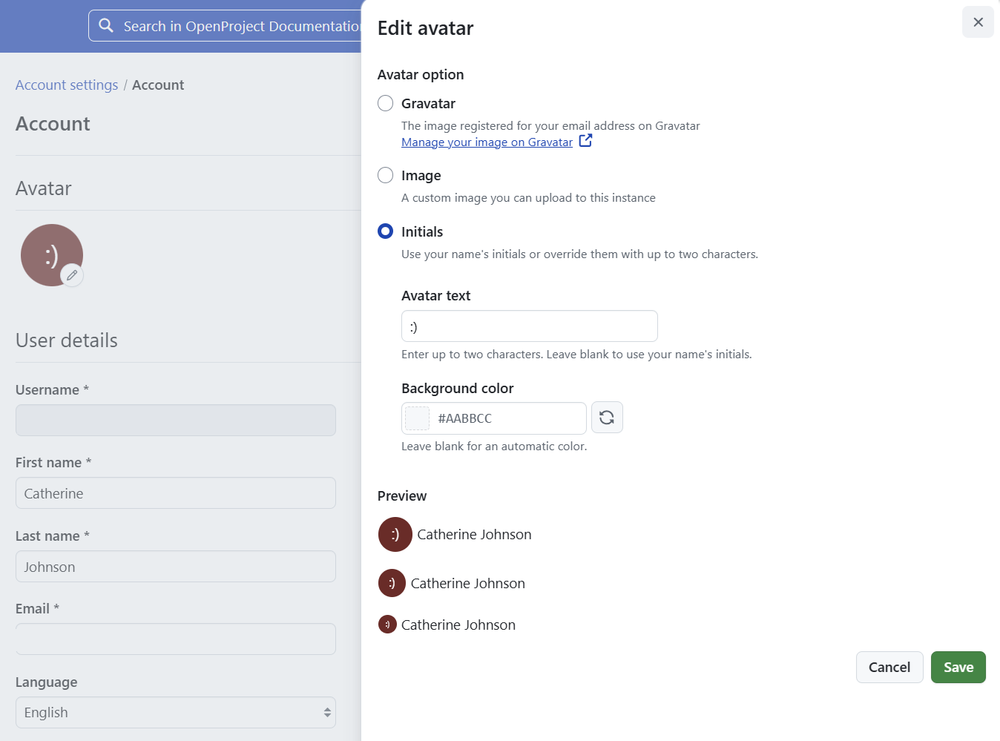

Read more: [Avatars system admin guide](../../system-admin-guide/users-permissions/avatars/)

#### What's new menu

A new **gift icon** in the header opens the **What's new** menu, which lists the most important features of the current release with links to the documentation, blog posts, or the release video. A red dot on the icon shows when a new release is available, so users learn about new features right after an upgrade.

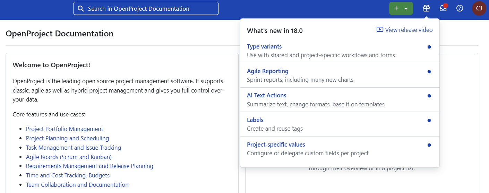

Read more: [What's new user guide](../../user-guide/home/#whats-new), [Blog article on What's new](https://www.openproject.org/blog/passion-project-whats-new-release/)

## Important updates and breaking changes

OpenProject 18.0 introduces changes to existing configuration options, administration terminology, and certain technical interfaces. While many improvements are available immediately after upgrading, some changes may require administrators to review their configurations or update existing integrations. We recommend reviewing the following information before upgrading, particularly if your organization uses project-specific work package configurations, the Jira Migrator, or integrations with the OpenProject API.

### Migration of project-specific work package configurations to type variants

With the introduction of work package type variants, OpenProject 18.0 changes how project-specific work package configurations are managed. During the upgrade, OpenProject automatically creates variants where necessary to preserve existing project-specific custom field configurations. These variants are marked as **Migrated** in the work package type administration. Administrators should review them after upgrading. A migrated variant can be removed once no project uses it anymore: switch the affected projects to a different variant or type, then delete the migrated variant.

Read more: [Work package types system admin guide](../../system-admin-guide/manage-work-packages/work-package-types/)

### Set up status categories

With OpenProject 18.0, every work package status belongs to a category: To-do, In progress, or Closed. During the upgrade, closed statuses are assigned to the Closed category automatically. All other statuses remain without a category until an administrator assigns one. A system message reminds administrators to complete this setup.

Read more: [Work package status system admin guide](../../system-admin-guide/manage-work-packages/work-package-status/)

### Jira Migrator: changed import of Resolution fields

The Jira Migrator now maps each combination of Jira status and resolution to its own closed status in OpenProject (for example, "Done - Fixed" and "Done - Rejected"). As a result, imports create more statuses than before. A new administration setting restores the previous behavior.

Read more: [Jira field mapping guide](../../installation-and-operations/jira-migration/field-mapping/)

### Changes to existing configuration and interfaces

- **Custom fields** are now managed in the area of the administration they belong to, for example work package custom fields under **Work packages**. The **Custom fields** section remains, but only offers an overview with links to these areas.
- The **Copy to other types** workflow action has been removed. Workflows can now be reused across types and variants instead.
- The **Boards** module is now enabled automatically when Backlogs is enabled in a project.
- The **Meetings API** now returns durations in ISO 8601 format instead of numbers. Integrations that read meeting durations need to be updated.

Several existing features have also been renamed. **Custom actions** are now called **Automations**, **Form configuration** is now **Form**, **My time tracking** is now **My time**, and the **GitLab** tab in work packages is now called **Code**.

Read more: [Work package forms system admin guide](../../system-admin-guide/manage-work-packages/work-package-forms/), [Work package automations system admin guide](../../system-admin-guide/manage-work-packages/work-package-automations/), [API documentation](../../api/)

<!-- BEGIN SECURITY FIXES AUTOMATED SECTION -->

<!-- END SECURITY FIXES AUTOMATED SECTION -->
<!--more-->

## Bug fixes and changes

<!-- Warning: Anything within the below lines will be automatically removed by the release script -->

<!-- BEGIN AUTOMATED SECTION -->

- Feature: Burndown chart \[[#40132](https://community.openproject.org/wp/40132)\]
- Feature: Provide sprint reports for active and completed sprints \[[#71891](https://community.openproject.org/wp/71891)\]
- Feature: Epic progress chart \[[#76462](https://community.openproject.org/wp/76462)\]
- Feature: AI Text Assistant \[[#69622](https://community.openproject.org/wp/69622)\]
- Feature: Labels for work packages \[[#32181](https://community.openproject.org/wp/32181)\]
- Feature: Trash bin for deleted work packages \[[#40015](https://community.openproject.org/wp/40015)\]
- Feature: GitLab code activity in work packages tab \[[#79704](https://community.openproject.org/wp/79704)\]
- Feature: Unify integration of source code management tools \[[#80928](https://community.openproject.org/wp/80928)\]
- Feature: Create work packages by sending emails to helpdesk address \[[#60505](https://community.openproject.org/wp/60505)\]
- Feature: Jira Migrator imports relationships between work items. \[[#72423](https://community.openproject.org/wp/72423)\]
- Feature: Add support for additional Jira versions including Jira Server \[[#78182](https://community.openproject.org/wp/78182)\]
- Feature: Work package import from CSV \[[#24449](https://community.openproject.org/wp/24449)\]
- Feature: Automation to create PM²/PMflex artefacts \[[#69055](https://community.openproject.org/wp/69055)\]
- Feature: SquashTM-OpenProject integration phase 1 \[[#72787](https://community.openproject.org/wp/72787)\]
- Feature: Introduce burnup charts \[[#71381](https://community.openproject.org/wp/71381)\]
- Feature: Provide created vs. resolved chart \[[#71764](https://community.openproject.org/wp/71764)\]
- Feature: Provide velocity charts \[[#71903](https://community.openproject.org/wp/71903)\]
- Feature: Add possibility to order backlog buckets and sprints manually \[[#73610](https://community.openproject.org/wp/73610)\]
- Feature: Multi-select cards within backlog and sprints \[[#73729](https://community.openproject.org/wp/73729)\]
- Feature: Project setting for choosing unit of velocity, effort and capacity \[[#74098](https://community.openproject.org/wp/74098)\]
- Feature: Seed data for backlogs demo project \[[#74169](https://community.openproject.org/wp/74169)\]
- Feature: Sprint report page with burndown chart widget  \[[#76118](https://community.openproject.org/wp/76118)\]
- Feature: Sprint goal on sprint report page \[[#76120](https://community.openproject.org/wp/76120)\]
- Feature: Work package overview on sprint report page \[[#76308](https://community.openproject.org/wp/76308)\]
- Feature: Work package tables (completed, unfinished, added, removed) on sprint report page \[[#76309](https://community.openproject.org/wp/76309)\]
- Feature: Rework burndown chart \[[#76439](https://community.openproject.org/wp/76439)\]
- Feature: Quick navigation between sprint reports in a chronological order \[[#77649](https://community.openproject.org/wp/77649)\]
- Feature: Work packages graph on sprint report page \[[#77798](https://community.openproject.org/wp/77798)\]
- Feature: Provide epic progress chart within the sprint report \[[#78522](https://community.openproject.org/wp/78522)\]
- Feature: Enterprise banner on reports page \[[#78620](https://community.openproject.org/wp/78620)\]
- Feature: Use the sprint completion date (and time) over the planned sprint end date on charts of the reporting page \[[#78631](https://community.openproject.org/wp/78631)\]
- Feature: Seed data for agile reporting \[[#79016](https://community.openproject.org/wp/79016)\]
- Feature: Make selection and context actions in Backlogs fully accessible to assistive technology \[[#80733](https://community.openproject.org/wp/80733)\]
- Feature: Modify the bucket\_ids and sprint\_ids filter format to align it with the other backlog filters \[[#80898](https://community.openproject.org/wp/80898)\]
- Feature: Scope change on work package overview widget counting story point changes \[[#80966](https://community.openproject.org/wp/80966)\]
- Feature: Screenreader compatible description of charts \[[#81787](https://community.openproject.org/wp/81787)\]
- Feature: Support read-only work packages tables on sprint report page \[[#82247](https://community.openproject.org/wp/82247)\]
- Feature: Display actual start and finish dates in the UI \[[#82445](https://community.openproject.org/wp/82445)\]
- Feature: Add LLM connection settings to admin AI configuration \[[#66020](https://community.openproject.org/wp/66020)\]
- Feature: Admin UI: manage description assistant actions \[[#77781](https://community.openproject.org/wp/77781)\]
- Feature: CKEditor dropdown to trigger AI-Actions \[[#77784](https://community.openproject.org/wp/77784)\]
- Feature: Show results of AI-Actions in AI result popover \[[#79020](https://community.openproject.org/wp/79020)\]
- Feature: Work package type template available through the MCP \[[#80724](https://community.openproject.org/wp/80724)\]
- Feature: Documentation link at the work package type template setting \[[#80894](https://community.openproject.org/wp/80894)\]
- Feature: Text actions enterprise banner in admin settings \[[#81265](https://community.openproject.org/wp/81265)\]
- Feature: Project Phases and Project initiation request data available via MCP \[[#81327](https://community.openproject.org/wp/81327)\]
- Feature: Remove toggle in text assistant admin settings \[[#82348](https://community.openproject.org/wp/82348)\]
- Feature: Administrators can define and manage global type variants \[[#76542](https://community.openproject.org/wp/76542)\]
- Feature: Reuse a type&#39;s workflow \[[#76543](https://community.openproject.org/wp/76543)\]
- Feature: Reuse a type&#39;s form configuration \[[#76544](https://community.openproject.org/wp/76544)\]
- Feature: Reuse a type&#39;s PDF and subject configuration \[[#76545](https://community.openproject.org/wp/76545)\]
- Feature: Grouped types index page \[[#76546](https://community.openproject.org/wp/76546)\]
- Feature: Type variants are shown everywhere using their parent type&#39;s name \[[#76547](https://community.openproject.org/wp/76547)\]
- Feature: Project-level activation of type variants \[[#76548](https://community.openproject.org/wp/76548)\]
- Feature: Switching the active type variant in a project with a preview \[[#76565](https://community.openproject.org/wp/76565)\]
- Feature: Allow project administrators to manage their own type variants \[[#76571](https://community.openproject.org/wp/76571)\]
- Feature: Convert a project-owned type variant to a global one \[[#76573](https://community.openproject.org/wp/76573)\]
- Feature: Wizard-like creation flow for type variants \[[#76619](https://community.openproject.org/wp/76619)\]
- Feature: Add filters in types index page \[[#77197](https://community.openproject.org/wp/77197)\]
- Feature: Move workflows as a tab under type edit \[[#77228](https://community.openproject.org/wp/77228)\]
- Feature: Rename &quot;Sub-type&quot; to &quot;Variant&quot; \[[#77721](https://community.openproject.org/wp/77721)\]
- Feature: Remove &quot;Copy to other types&quot; workflow action \[[#77799](https://community.openproject.org/wp/77799)\]
- Feature: Variants can disable fields in the form configuration screen (when using linked mode) \[[#77879](https://community.openproject.org/wp/77879)\]
- Feature: Variants can disable fields in the project attributes configuration screen (when using linked mode) \[[#77881](https://community.openproject.org/wp/77881)\]
- Feature: Allow deletion of variants still in use \[[#78048](https://community.openproject.org/wp/78048)\]
- Feature: Allow setting on a type to allow or disallow project-specific variants \[[#78127](https://community.openproject.org/wp/78127)\]
- Feature: Create migrated variants for previous custom field selections \[[#78218](https://community.openproject.org/wp/78218)\]
- Feature: Improve project selection for type variants \[[#78258](https://community.openproject.org/wp/78258)\]
- Feature: Comparison view of variants \[[#78260](https://community.openproject.org/wp/78260)\]
- Feature: Variants Tab under a type lists all variants \[[#78510](https://community.openproject.org/wp/78510)\]
- Feature: Central overview of all workflows \[[#78586](https://community.openproject.org/wp/78586)\]
- Feature: New design for configuration modes (inherited/manual) and showing dependent types \[[#78792](https://community.openproject.org/wp/78792)\]
- Feature: Rename Custom Actions to Automations without additional functionality \[[#75927](https://community.openproject.org/wp/75927)\]
- Feature: Rename &quot;Form configuration&quot; to &quot;Form&quot; \[[#79202](https://community.openproject.org/wp/79202)\]
- Feature: Add a purpose description to every aspect of type or variant configuration \[[#79204](https://community.openproject.org/wp/79204)\]
- Feature: &quot;Name&quot; attribute of a type variant should indicate it is not public \[[#79221](https://community.openproject.org/wp/79221)\]
- Feature: Navigate from statuses to workflows \[[#79267](https://community.openproject.org/wp/79267)\]
- Feature: Primerize Status administration \[[#79416](https://community.openproject.org/wp/79416)\]
- Feature: Make &quot;Types&quot; the first selected element for Work package administration \[[#79491](https://community.openproject.org/wp/79491)\]
- Feature: Add configuration overview tab to show configuration mode and dependents overview on types and variants \[[#79535](https://community.openproject.org/wp/79535)\]
- Feature: Allow mandatory work package fields per type \[[#79589](https://community.openproject.org/wp/79589)\]
- Feature: On the custom field, show which forms, types &amp; variants use this field \[[#79727](https://community.openproject.org/wp/79727)\]
- Feature: Allow deletion of types if they are active in a project, but not used in work packages \[[#79770](https://community.openproject.org/wp/79770)\]
- Feature: Combine hierarchy and list into a single &quot;List custom field&quot; \[[#80362](https://community.openproject.org/wp/80362)\]
- Feature: Implement Allow-list approach for customizing List, Hierarchy and Weighted fields \[[#80363](https://community.openproject.org/wp/80363)\]
- Feature: Handle deletion of named workflows  \[[#80516](https://community.openproject.org/wp/80516)\]
- Feature: New design for switching between reusing workflow and creating a new workflow \[[#80577](https://community.openproject.org/wp/80577)\]
- Feature: Named forms that can be reused across multiple types and variants \[[#80604](https://community.openproject.org/wp/80604)\]
- Feature: Design tweaks \[[#80721](https://community.openproject.org/wp/80721)\]
- Feature: Update the Start page of the Create wizard for types and variants \[[#80961](https://community.openproject.org/wp/80961)\]
- Feature: Inform users about which variants we created as a migration \[[#81136](https://community.openproject.org/wp/81136)\]
- Feature: Improve role selection in workflows \[[#81527](https://community.openproject.org/wp/81527)\]
- Feature: Edit forms and workflow: Add inset boxes to inform admins of reusable objects \[[#81933](https://community.openproject.org/wp/81933)\]
- Feature: Implement Block-list approach for customizing List, Hierarchy and Weighted fields \[[#81978](https://community.openproject.org/wp/81978)\]
- Feature: Confirm switching of multiple variants \[[#81919](https://community.openproject.org/wp/81919)\]
- Feature: Consistent behavior of project-specific forms and workflows \[[#82224](https://community.openproject.org/wp/82224)\]
- Feature: Create work package via search in a document \[[#78338](https://community.openproject.org/wp/78338)\]
- Feature: Create work package link block via hash command \[[#79399](https://community.openproject.org/wp/79399)\]
- Feature: Support new datetime custom field in create work package dialog \[[#81766](https://community.openproject.org/wp/81766)\]
- Feature: Activity tab: Auto-mark all work package notifications as read when you write a new comment \[[#57359](https://community.openproject.org/wp/57359)\]
- Feature: Improve accessibility (keyboard navigation &amp; screen reader support) for WPs in BlockNote \[[#77296](https://community.openproject.org/wp/77296)\]
- Feature: Labels API \[[#79592](https://community.openproject.org/wp/79592)\]
- Feature: Labels for work package show page \[[#79596](https://community.openproject.org/wp/79596)\]
- Feature: Labels for work package table + exports + Gantt charts \[[#79953](https://community.openproject.org/wp/79953)\]
- Feature: Support labels in work package operations (copy + move + bulk edit) \[[#79962](https://community.openproject.org/wp/79962)\]
- Feature: Support labels in journal-based operations (activity + baseline) \[[#79963](https://community.openproject.org/wp/79963)\]
- Feature: Support labels in auto-generated subjects \[[#79964](https://community.openproject.org/wp/79964)\]
- Feature: Labels administration \[[#79965](https://community.openproject.org/wp/79965)\]
- Feature: Labels for MCP server \[[#79971](https://community.openproject.org/wp/79971)\]
- Feature: Enable advanced table support in BlockNote on documents \[[#81052](https://community.openproject.org/wp/81052)\]
- Feature: Anchors at headings, and possibility to copy link to some section at the document  \[[#80174](https://community.openproject.org/wp/80174)\]
- Feature: Use semantic identifiers by default \[[#81986](https://community.openproject.org/wp/81986)\]
- Feature: Show a branded offline page in the installed application when the connection drops \[[#81176](https://community.openproject.org/wp/81176)\]
- Feature: Install OpenProject as a desktop application from the browser \[[#81302](https://community.openproject.org/wp/81302)\]
- Feature: Show the unread notification count on the installed application&#39;s icon \[[#81303](https://community.openproject.org/wp/81303)\]
- Feature: API v3: allow filtering work packages by their semantic identifier (e.g. PROJ-42) in the id filter \[[#82068](https://community.openproject.org/wp/82068)\]
- Feature: Introduce a standard query that we can use in the cost reports \[[#59964](https://community.openproject.org/wp/59964)\]
- Feature: Primerize time tracking project settings \[[#61300](https://community.openproject.org/wp/61300)\]
- Feature: Fine-tune structure of time log form \[[#61312](https://community.openproject.org/wp/61312)\]
- Feature: Migrate the Hourly Rates Section to primer and give it proper Services and Contracts \[[#80083](https://community.openproject.org/wp/80083)\]
- Feature: Add an API to manage hourly rates \[[#80089](https://community.openproject.org/wp/80089)\]
- Feature: Implement Stacked View for My Time Tracking \[[#80501](https://community.openproject.org/wp/80501)\]
- Feature: Replace the current &quot;My Spent Time Widget&quot; with the primerized FullCalendar version \[[#80505](https://community.openproject.org/wp/80505)\]
- Feature:     Add hourly rates to placeholder users \[[#78542](https://community.openproject.org/wp/78542)\]
- Feature: Allow selecting placeholder users in planned costs of a budget \[[#78543](https://community.openproject.org/wp/78543)\]
- Feature: Possibility to change logo used in high contrast or dark mode \[[#56190](https://community.openproject.org/wp/56190)\]
- Feature: Primerise Branding tab of Admin/Design page \[[#56340](https://community.openproject.org/wp/56340)\]
- Feature: Primerise PDF export tabs of Admin/Design page \[[#56342](https://community.openproject.org/wp/56342)\]
- Feature: Make avatars more distinguishable by allowing users to pick their avatar color themselves \[[#57335](https://community.openproject.org/wp/57335)\]
- Feature: Split screen nav bar: add a fading background to the right-side actions \[[#57524](https://community.openproject.org/wp/57524)\]
- Feature: WorkPackage split screen should go full height like in the notification center (by removing uiRouter) \[[#67012](https://community.openproject.org/wp/67012)\]
- Feature: Migrate and cleanup blocks on the Homepage \[[#67340](https://community.openproject.org/wp/67340)\]
- Feature: Harmonize phrasing and icons for Copy, Copy to URL and Duplicate actions \[[#68824](https://community.openproject.org/wp/68824)\]
- Feature: Primerise the user settings page in the administration \[[#73151](https://community.openproject.org/wp/73151)\]
- Feature: Harmonize user data in WP auto completer \[[#78556](https://community.openproject.org/wp/78556)\]
- Feature: Provide accessible descriptions for dashboard widgets containing charts \[[#80033](https://community.openproject.org/wp/80033)\]
- Feature: Make selection and existing context actions in the Work Packages table fully accessible to keyboard and assistive-technology users \[[#80153](https://community.openproject.org/wp/80153)\]
- Feature: Primerize announcement page \[[#80344](https://community.openproject.org/wp/80344)\]
- Feature: Primerize plugin pages in the administration \[[#80346](https://community.openproject.org/wp/80346)\]
- Feature: Port KeybindingHint component from Primer React \[[#80734](https://community.openproject.org/wp/80734)\]
- Feature: Project hover card \[[#80883](https://community.openproject.org/wp/80883)\]
- Feature: Provide move context menu actions in the Work Packages table \[[#80979](https://community.openproject.org/wp/80979)\]
- Feature: Provide drag-and-drop styling for sortable groups of Border Boxes \[[#80982](https://community.openproject.org/wp/80982)\]
- Feature: Provide accessible descriptions for backlog graphs \[[#81012](https://community.openproject.org/wp/81012)\]
- Feature: Primerize deploy targets page \[[#81148](https://community.openproject.org/wp/81148)\]
- Feature: Migrate administration work package and project settings towards Primer \[[#81150](https://community.openproject.org/wp/81150)\]
- Feature: Create Primer ColorField component and color\_field form input \[[#81157](https://community.openproject.org/wp/81157)\]
- Feature: Update custom field labels in form configuration for types and variants  \[[#80396](https://community.openproject.org/wp/80396)\]
- Feature: Migrate placeholder user table to Primer components \[[#81365](https://community.openproject.org/wp/81365)\]
- Feature: Redesign application header with new primary blue \[[#81366](https://community.openproject.org/wp/81366)\]
- Feature: Align border radius of UI elements in the work package view with Primer style (6px) \[[#81367](https://community.openproject.org/wp/81367)\]
- Feature: Use color picker when designing the application in the administration \[[#81435](https://community.openproject.org/wp/81435)\]
- Feature: ♿🚹🌐🤝 Audit every component and page for accessibility with AXe \[[#80717](https://community.openproject.org/wp/80717)\]
- Feature: Improve file uploading UX through the app \[[#81633](https://community.openproject.org/wp/81633)\]
- Feature: Preview highlighting colors and check contrast \[[#81127](https://community.openproject.org/wp/81127)\]
- Feature: Introduce commits list \[[#79736](https://community.openproject.org/wp/79736)\]
- Feature: Improve merge requests list \[[#79737](https://community.openproject.org/wp/79737)\]
- Feature: Improve issues list \[[#79738](https://community.openproject.org/wp/79738)\]
- Feature: Display linked GitLab branches on work packages GitLab tab \[[#79739](https://community.openproject.org/wp/79739)\]
- Feature: Create a new UI for GitLab tab \[[#79760](https://community.openproject.org/wp/79760)\]
- Feature: Generalize storage and display of metadata to be provider-agnostic \[[#80929](https://community.openproject.org/wp/80929)\]
- Feature: New admin UI for Github and Gitlab \[[#81426](https://community.openproject.org/wp/81426)\]
- Feature: Origin Key and Origin Internal ID for imported work packages  \[[#68610](https://community.openproject.org/wp/68610)\]
- Feature: Support migration inline images in descriptions \[[#72811](https://community.openproject.org/wp/72811)\]
- Feature: Jira Migrator  imports parent-child relationships (subtasks) \[[#73994](https://community.openproject.org/wp/73994)\]
- Feature: Jira Migrator imports issue links as relationships \[[#73995](https://community.openproject.org/wp/73995)\]
- Feature: Migrate Jira tracked time values (Spent time) \[[#75156](https://community.openproject.org/wp/75156)\]
- Feature: Migrate Jira Labels \[[#75607](https://community.openproject.org/wp/75607)\]
- Feature: Support JIRA \`Resolution\` and \`Resolution Date\` fields \[[#78021](https://community.openproject.org/wp/78021)\]
- Feature: Migrate watchers  \[[#78618](https://community.openproject.org/wp/78618)\]
- Feature: Support Basic Auth in Jira Migrator \[[#78976](https://community.openproject.org/wp/78976)\]
- Feature: Jira importer imports web links / remote links \[[#79505](https://community.openproject.org/wp/79505)\]
- Feature: Update migrator after hierarchy and list custom fields were combined \[[#80413](https://community.openproject.org/wp/80413)\]
- Feature: Jira connection test and run should check that PAT is an admin PAT \[[#80959](https://community.openproject.org/wp/80959)\]
- Feature: Import user&#39;s time zone from Jira \[[#81890](https://community.openproject.org/wp/81890)\]
- Feature: Support migration of custom datetime fields \[[#81891](https://community.openproject.org/wp/81891)\]
- Feature: Show information about Resolution import in &quot;Import Scope&quot; UI section \[[#82037](https://community.openproject.org/wp/82037)\]
- Feature: Add meetings, boards and documents as options in the &quot;+&quot; button in the navigation bar \[[#48014](https://community.openproject.org/wp/48014)\]
- Feature: Add options &quot;Add item above&quot; and &quot;Add item below&quot; to meeting agenda more dropdown \[[#58660](https://community.openproject.org/wp/58660)\]
- Feature: The &#39;Past&#39; page of My meetings only shows me 5 items \[[#63272](https://community.openproject.org/wp/63272)\]
- Feature: Allow adding a reason to cancelled meetings \[[#66007](https://community.openproject.org/wp/66007)\]
- Feature: Add &quot;Copy link to clipboard&quot; for a meeting section \[[#70177](https://community.openproject.org/wp/70177)\]
- Feature: Improve Meeting API by adding a separate endpoint for &#39;Moving agenda item to the next meeting&#39; \[[#76311](https://community.openproject.org/wp/76311)\]
- Feature: Allow moving agenda items to next meeting from presentation mode \[[#76932](https://community.openproject.org/wp/76932)\]
- Feature: Add full text search for meeting minutes \[[#49490](https://community.openproject.org/wp/49490)\]
- Feature: Try and match sections when moving an agenda item to the next meeting \[[#80932](https://community.openproject.org/wp/80932)\]
- Feature: Update the meeting status labels to use the new muted style \[[#81122](https://community.openproject.org/wp/81122)\]
- Feature: Allow splitting one agenda item into multiple slides using a separator \[[#81164](https://community.openproject.org/wp/81164)\]
- Feature: Reorder sidebar sections \[[#81765](https://community.openproject.org/wp/81765)\]
- Feature: Change text in success message after requesting quote in Enterprise cloud \[[#35847](https://community.openproject.org/wp/35847)\]
- Feature: When deleting a role, show which members are still using it \[[#36834](https://community.openproject.org/wp/36834)\]
- Feature: Add new Custom Field Type: DateTime \[[#39102](https://community.openproject.org/wp/39102)\]
- Feature: Add icon to &quot;include projects&quot; button in toolbar \[[#49709](https://community.openproject.org/wp/49709)\]
- Feature: Avatars for groups \[[#52565](https://community.openproject.org/wp/52565)\]
- Feature: All open view with default sort order to show the latest on top (ID descending) \[[#57962](https://community.openproject.org/wp/57962)\]
- Feature: Dark mode: Improve visibility of relations in Gantt chart \[[#61478](https://community.openproject.org/wp/61478)\]
- Feature: Relocate administration of custom fields for work packages \[[#62183](https://community.openproject.org/wp/62183)\]
- Feature: Improve and modernize the login screen / dropdown \[[#63849](https://community.openproject.org/wp/63849)\]
- Feature: Filter for status of past meetings \[[#64232](https://community.openproject.org/wp/64232)\]
- Feature: Built-in types that are available in all installations \[[#66428](https://community.openproject.org/wp/66428)\]
- Feature: Display full work package name for column titles on boards \[[#66468](https://community.openproject.org/wp/66468)\]
- Feature: Allow CollapsibleSection to be locked in the open state \[[#67183](https://community.openproject.org/wp/67183)\]
- Feature: Meeting presentation mode: Indicate change of presenter \[[#69653](https://community.openproject.org/wp/69653)\]
- Feature: Primerize reCAPTCHA Admin Settings \[[#70723](https://community.openproject.org/wp/70723)\]
- Feature: Copy agenda items including outcomes to subsequent meetings \[[#74535](https://community.openproject.org/wp/74535)\]
- Feature: Increased width of agenda item in meeting presentation mode \[[#75530](https://community.openproject.org/wp/75530)\]
- Feature: Show the job title in the user hover card \[[#76716](https://community.openproject.org/wp/76716)\]
- Feature: OP Administration: Show custom field name in delete confirmation \[[#76890](https://community.openproject.org/wp/76890)\]
- Feature: Load projects asynchronously in the project selector \[[#77481](https://community.openproject.org/wp/77481)\]
- Feature: Add &quot;required&quot; option to filters to prevent them from being manually removed \[[#79035](https://community.openproject.org/wp/79035)\]
- Feature: Include Wiki page into PMflex artefact export \[[#79192](https://community.openproject.org/wp/79192)\]
- Feature: Global admin memberships page \[[#80025](https://community.openproject.org/wp/80025)\]
- Feature: Show an overview of different custom field objects in Administration &gt; Custom fields \[[#80133](https://community.openproject.org/wp/80133)\]
- Feature: Allow previewing permissions in all areas where roles are mentioned \[[#80147](https://community.openproject.org/wp/80147)\]
- Feature: Add quick filters to Project settings &gt; Versions page \[[#80157](https://community.openproject.org/wp/80157)\]
- Feature: Clear work package selection with Escape instead of Ctrl/Cmd+D \[[#80722](https://community.openproject.org/wp/80722)\]
- Feature: Primerize custom fields index pages \[[#81050](https://community.openproject.org/wp/81050)\]
- Feature: Migrate the AttributeHelpText page to Primer \[[#81149](https://community.openproject.org/wp/81149)\]
- Feature: What&#39;s new in: a popover to inform users about new features in every new release \[[#81195](https://community.openproject.org/wp/81195)\]
- Feature: Add a user setting that inline edit fields only get edited when double clicking \[[#81255](https://community.openproject.org/wp/81255)\]
- Feature: API endpoint for work package PDF generation \[[#81263](https://community.openproject.org/wp/81263)\]
- Feature: Enable turbo navigation for submenus \[[#81274](https://community.openproject.org/wp/81274)\]
- Feature: Remove project summary page/link from work package default filters. \[[#81290](https://community.openproject.org/wp/81290)\]
- Feature: Vote-based ranking of meeting agenda items \[[#81162](https://community.openproject.org/wp/81162)\]
- Feature: Browse forums with new UX and pagination system \[[#81142](https://community.openproject.org/wp/81142)\]
- Feature: Create a work package from a conversation \[[#81200](https://community.openproject.org/wp/81200)\]
- Feature: Mark a topic as solved \[[#81202](https://community.openproject.org/wp/81202)\]
- Feature: Mention a team member in a message \[[#81230](https://community.openproject.org/wp/81230)\]
- Feature: Change avatar to emoji or custom letters and color \[[#77207](https://community.openproject.org/wp/77207)\]
- Feature: Improve OAuth application creation \[[#77238](https://community.openproject.org/wp/77238)\]
- Feature: Use placeholder users for resource allocations \[[#78798](https://community.openproject.org/wp/78798)\]
- Feature: Show resource allocations in work package details \[[#79546](https://community.openproject.org/wp/79546)\]
- Feature: My Work section for personal day planning based on resource allocations \[[#79547](https://community.openproject.org/wp/79547)\]
- Feature: Create global resource planners \[[#79552](https://community.openproject.org/wp/79552)\]
- Feature: Also put overscheduled hours in the My Work allocation plan \[[#81067](https://community.openproject.org/wp/81067)\]
- Feature: Relations tab: Auto-scroll to a newly-created child \[[#61143](https://community.openproject.org/wp/61143)\]
- Feature: New design for project status badge \[[#58452](https://community.openproject.org/wp/58452)\]
- Feature: Add &quot;Portfolio&quot; and &quot;Program&quot; icons to the &quot;Include subprojects&quot; modal \[[#69700](https://community.openproject.org/wp/69700)\]
- Feature: States for project lifecycle phases \[[#80964](https://community.openproject.org/wp/80964)\]
- Feature: Support multiple selection in weighted lists \[[#82433](https://community.openproject.org/wp/82433)\]
- Feature: Show correct whiteboard icon for whiteboards in file tabs \[[#74136](https://community.openproject.org/wp/74136)\]
- Feature: Admin UI for SquashTM \[[#78163](https://community.openproject.org/wp/78163)\]
- Feature: SquashTM tab on work packages \[[#78164](https://community.openproject.org/wp/78164)\]
- Feature: SquashTM projects settings \[[#82200](https://community.openproject.org/wp/82200)\]
- Feature: UX improvements for edit and create actions of wiki pages \[[#77859](https://community.openproject.org/wp/77859)\]
- Bugfix: Starting a sprint fails with HTTP 422 and generic error banner \[[#75958](https://community.openproject.org/wp/75958)\]
- Bugfix: &quot;Search&quot; placeholder is missing on the dropdown on sprints and backlog buckets \[[#76641](https://community.openproject.org/wp/76641)\]
- Bugfix: Display deleted custom field journals in the Project activities \[[#78432](https://community.openproject.org/wp/78432)\]
- Bugfix: Display the correct activity message when the user doesn&#39;t have the permission to see admin only custom field journals. \[[#78439](https://community.openproject.org/wp/78439)\]
- Bugfix: Work package table in baseline mode between two dates is not in readonly mode \[[#79028](https://community.openproject.org/wp/79028)\]
- Bugfix: Historic/baseline WP cache shares store with current records \[[#79767](https://community.openproject.org/wp/79767)\]
- Bugfix: Project attribute removed from projects after update of attribute section in administration \[[#79591](https://community.openproject.org/wp/79591)\]
- Bugfix: Boards, Sprints and backlog buckets should be sorted by name naturally \[[#80041](https://community.openproject.org/wp/80041)\]
- Bugfix: &quot;Shared with user&quot; filter only offers project members as options \[[#80712](https://community.openproject.org/wp/80712)\]
- Bugfix: Sprint report automatically opens when we move a wp to a sprint if sprint report was previously opened \[[#80946](https://community.openproject.org/wp/80946)\]
- Bugfix: Sprint report: reference dates are missing on View all link \[[#81170](https://community.openproject.org/wp/81170)\]
- Bugfix: Remove grey background in project phase date input fields. \[[#81429](https://community.openproject.org/wp/81429)\]
- Bugfix: Work Packages graph widget switches to decimal scale with a few work packages. \[[#82036](https://community.openproject.org/wp/82036)\]
- Bugfix: Velocity chart: information are incorrect when sprint is In planning mode \[[#82411](https://community.openproject.org/wp/82411)\]
- Bugfix: Sprint report initially planned is incorrect when sprint finished with incomplete work packages. \[[#82432](https://community.openproject.org/wp/82432)\]
- Bugfix: Velocity chart: story points are not bolded on two places \[[#82443](https://community.openproject.org/wp/82443)\]
- Bugfix: Sprint reporting: when sprint is in planning and starts today, reports show wrong number of wps \[[#82480](https://community.openproject.org/wp/82480)\]
- Bugfix: Velocity chart is hidden when the sprint doesn&#39;t have dates, unlike other reports that do show with blansklates \[[#82507](https://community.openproject.org/wp/82507)\]
- Bugfix: Fix description of tools so that LLM understand that filters can be an array of IDs \[[#75407](https://community.openproject.org/wp/75407)\]
- Bugfix: Position of extra actions relative to the SubHeader \[[#80397](https://community.openproject.org/wp/80397)\]
- Bugfix: Rename Text transform actions to Text actions in the administration \[[#80893](https://community.openproject.org/wp/80893)\]
- Bugfix: &quot;Remove key&quot; button next to the stored API key field on the LLM connection page looks out of place \[[#82342](https://community.openproject.org/wp/82342)\]
- Bugfix: LLM Settings caption changes \[[#82346](https://community.openproject.org/wp/82346)\]
- Bugfix: Enabling a variant via the Types -&gt; Projects tab shows a 500 error \[[#78245](https://community.openproject.org/wp/78245)\]
- Bugfix: Seeded roles cannot be moved \[[#80020](https://community.openproject.org/wp/80020)\]
- Bugfix: Wrong banner on project variant form page \[[#82227](https://community.openproject.org/wp/82227)\]
- Bugfix: Accumulation of labels of type/variant form wizard step look stuffy on regular sized screens \[[#82248](https://community.openproject.org/wp/82248)\]
- Bugfix: In read-only workflow table, the status blankslate is weird \[[#82285](https://community.openproject.org/wp/82285)\]
- Bugfix: Unable to close dropdown for required custom fields (except for clicking anywhere else) \[[#80062](https://community.openproject.org/wp/80062)\]
- Bugfix: Documents: In create work package modal, automatic subject placeholder text is cut off on small screens \[[#80569](https://community.openproject.org/wp/80569)\]
- Bugfix: Translations missing after repo &amp; Crowdin move \[[#81662](https://community.openproject.org/wp/81662)\]
- Bugfix: Wrong selection when /wp is called between work package link cards \[[#81980](https://community.openproject.org/wp/81980)\]
- Bugfix: Duplicate blue outline when selecting a WP link card with arrow keys \[[#81981](https://community.openproject.org/wp/81981)\]
- Bugfix: Blue selection square sometimes when cursor is beneath work package links \[[#81985](https://community.openproject.org/wp/81985)\]
- Bugfix: Copy+Paste of work package link card includes only 3 hashes \[[#82031](https://community.openproject.org/wp/82031)\]
- Bugfix: User doesn&#39;t see system updates in their chosen language \[[#64273](https://community.openproject.org/wp/64273)\]
- Bugfix: Error when creating a new work package after uploading an attachment to the previous one that was opened in details view \[[#67980](https://community.openproject.org/wp/67980)\]
- Bugfix: Documents: editors list cut off on mobile \[[#69750](https://community.openproject.org/wp/69750)\]
- Bugfix: User has to click on the active editors hyperlink to close the list \[[#71363](https://community.openproject.org/wp/71363)\]
- Bugfix: Documents: tooltip on user&#39;s cursor cut off \[[#75682](https://community.openproject.org/wp/75682)\]
- Bugfix: &quot;Changes were retracted&quot; info should not have a &#39;edit&#39; option \[[#66118](https://community.openproject.org/wp/66118)\]
- Bugfix: Updating a document title does not update the browser page title \[[#77618](https://community.openproject.org/wp/77618)\]
- Bugfix: Searching for a project by its identifier in the project selector or filter should find the correct result \[[#78292](https://community.openproject.org/wp/78292)\]
- Bugfix: Project identifier field does not autocapitalise input \[[#78435](https://community.openproject.org/wp/78435)\]
- Bugfix: Unable to add emoji reactions to/open the action menu for activity comments sometimes \[[#80079](https://community.openproject.org/wp/80079)\]
- Bugfix: PDF export WorkPackages::ExportJob#perform : undefined method &#39;version&#39; for an instance of WorkPackage \[[#80056](https://community.openproject.org/wp/80056)\]
- Bugfix: IntegerOutOf64BitRange on GET::API::V3::WorkPackages::WorkPackagesAPI#/work\_packages/ \[[#80938](https://community.openproject.org/wp/80938)\]
- Bugfix: Pasting image in a description displays a broken link \[[#80962](https://community.openproject.org/wp/80962)\]
- Bugfix: Numeric ids are shown instead of semantic ones in baseline view between two past dates \[[#81169](https://community.openproject.org/wp/81169)\]
- Bugfix: Observed-in versions keep current values when a baseline request ends at a historic timestamp \[[#81735](https://community.openproject.org/wp/81735)\]
- Bugfix: Long names overflow in the list of editors \[[#81940](https://community.openproject.org/wp/81940)\]
- Bugfix: Changing default past rate does not update budget/cost report as expected \[[#49669](https://community.openproject.org/wp/49669)\]
- Bugfix: Cost report opens with preselected work package filter everywhere (once it was opened from Estimates and time section) \[[#51853](https://community.openproject.org/wp/51853)\]
- Bugfix: Moving a WorkPackage from one Project to another does not update the user&#39;s hourly rate \[[#79968](https://community.openproject.org/wp/79968)\]
- Bugfix: No hint when using a user in a budget and no rate is set up \[[#80065](https://community.openproject.org/wp/80065)\]
- Bugfix: \[Accessibility\] Color blind users cannot distinguis the overview graph bars \[[#64237](https://community.openproject.org/wp/64237)\]
- Bugfix: \[Accessibility\] Card should be saved when leaving focus \[[#64238](https://community.openproject.org/wp/64238)\]
- Bugfix: Unnecessary loading indicator and success message on going from team planner to work packages list \[[#76534](https://community.openproject.org/wp/76534)\]
- Bugfix: Updating the &#39;Custom touch icon&#39; actually update the &#39;Custom favicon&#39; \[[#79757](https://community.openproject.org/wp/79757)\]
- Bugfix: Help menu is not available in the mobile header \[[#80029](https://community.openproject.org/wp/80029)\]
- Bugfix: Work package subject is missing from the heading hierarchy \[[#80030](https://community.openproject.org/wp/80030)\]
- Bugfix: Keyboard focus indicator in the application header has insufficient contrast \[[#80032](https://community.openproject.org/wp/80032)\]
- Bugfix: Emails do not show correct heading tag \[[#81279](https://community.openproject.org/wp/81279)\]
- Bugfix: Left side panel logo is duplicated in dark mode  \[[#81401](https://community.openproject.org/wp/81401)\]
- Bugfix: Change html title for project list \[[#81533](https://community.openproject.org/wp/81533)\]
- Bugfix: Highlighting dots are squeezed on the global search \[[#81627](https://community.openproject.org/wp/81627)\]
- Bugfix: Screenreader announces work package IDs twice in the work package table \[[#81736](https://community.openproject.org/wp/81736)\]
- Bugfix: Long workflow names cause controls to overflow on the type workflow tab \[[#82167](https://community.openproject.org/wp/82167)\]
- Bugfix: &quot;Target&quot; and &quot;Observed in&quot; version form fields behave differently  \[[#79524](https://community.openproject.org/wp/79524)\]
- Bugfix: Certain hooks not supported as System Hook \[[#79769](https://community.openproject.org/wp/79769)\]
- Bugfix: Gitlab integration is missing some statuses \[[#79405](https://community.openproject.org/wp/79405)\]
- Bugfix: KeyError: key not found: object\_kind in Webhooks::Incoming::HooksController#handle\_hook in (Gitlab webhook) \[[#79404](https://community.openproject.org/wp/79404)\]
- Bugfix: Fix the format of the GitLab Commit Text in the OpenProject Comments \[[#58270](https://community.openproject.org/wp/58270)\]
- Bugfix: Import aborts if user name with , is encountered \[[#78609](https://community.openproject.org/wp/78609)\]
- Bugfix: Statuses not properly cleaned up when reverting import \[[#79206](https://community.openproject.org/wp/79206)\]
- Bugfix: Jira import errors are not legible in dark mode \[[#79584](https://community.openproject.org/wp/79584)\]
- Bugfix: Alignment issues on Jira import tables \[[#79587](https://community.openproject.org/wp/79587)\]
- Bugfix: Import fails with unique constraint violation \[[#80036](https://community.openproject.org/wp/80036)\]
- Bugfix: Headerless tables are not converted \[[#80836](https://community.openproject.org/wp/80836)\]
- Bugfix: Race condition when creating statuses \[[#80910](https://community.openproject.org/wp/80910)\]
- Bugfix: Jira API logging fails with Encoding::CompatibilityError \[[#81259](https://community.openproject.org/wp/81259)\]
- Bugfix: Custom field values are silently dropped when a type&#39;s form configuration changes in the same request or job \[[#81726](https://community.openproject.org/wp/81726)\]
- Bugfix: Wrong advice from Jira migrator in case of project identifier conflict \[[#81729](https://community.openproject.org/wp/81729)\]
- Bugfix: Jira migrator creates a new numbered custom field on every import run instead of reusing the one it created before \[[#81730](https://community.openproject.org/wp/81730)\]
- Bugfix: Jira due date is automatically adjusted to the next working day on migration \[[#82256](https://community.openproject.org/wp/82256)\]
- Bugfix: Jira configuration form is fully reset when PAT is removed \[[#82259](https://community.openproject.org/wp/82259)\]
- Bugfix: Changing meeting status should not be proposed if &quot;Edit meeting&quot; permission is missing \[[#80291](https://community.openproject.org/wp/80291)\]
- Bugfix: Allow invited users to be added as meeting participants \[[#81017](https://community.openproject.org/wp/81017)\]
- Bugfix: Deleting a WP agenda item meeting outcome doesn&#39;t remove the WP activity entry \[[#81464](https://community.openproject.org/wp/81464)\]
- Bugfix: Cannot create a meeting series via the new global create option \[[#81973](https://community.openproject.org/wp/81973)\]
- Bugfix: Work package label and attribute not aligned \[[#34799](https://community.openproject.org/wp/34799)\]
- Bugfix: Example missing in Create Time Entry API documentation \[[#38751](https://community.openproject.org/wp/38751)\]
- Bugfix: Subject is shown incorrectly when its a mix of RTL and LTR \[[#44068](https://community.openproject.org/wp/44068)\]
- Bugfix: Aria label for internal comments is misleading \[[#64012](https://community.openproject.org/wp/64012)\]
- Bugfix: Code highlighting is broken in dark mode \[[#67468](https://community.openproject.org/wp/67468)\]
- Bugfix: Keyboard navigation in Treeview partially broken \[[#68235](https://community.openproject.org/wp/68235)\]
- Bugfix: Meetings API: duration indicated as number instead of ISO 8601 duration \[[#68582](https://community.openproject.org/wp/68582)\]
- Bugfix: APIv3 indicates fields accepting a Principal as type User \[[#70047](https://community.openproject.org/wp/70047)\]
- Bugfix: Unable to change date after type change \[[#72720](https://community.openproject.org/wp/72720)\]
- Bugfix: Export WP list to CSV open the CSV in new tab when using S3 storage \[[#74374](https://community.openproject.org/wp/74374)\]
- Bugfix: Long WP type name breaks layout in several cases \[[#76673](https://community.openproject.org/wp/76673)\]
- Bugfix: Related work package table configuration shows two non-clickable tabs \[[#77073](https://community.openproject.org/wp/77073)\]
- Bugfix: GitLab integration shows wrong pusher name in push notifications (always shows integration user instead of actual commit author) \[[#77322](https://community.openproject.org/wp/77322)\]
- Bugfix: Branding logo still displayed after being removed \[[#78622](https://community.openproject.org/wp/78622)\]
- Bugfix: XLS export produces cells with General type. \[[#78984](https://community.openproject.org/wp/78984)\]
- Bugfix: Migration from 17.3.1 to 17.8 fails \[[#79482](https://community.openproject.org/wp/79482)\]
- Bugfix: Wrong forum link on the “My Activity” page \[[#79880](https://community.openproject.org/wp/79880)\]
- Bugfix: PDF export fails with S3/Fog attachment storage \[[#80134](https://community.openproject.org/wp/80134)\]
- Bugfix: ActiveRecord::RecordNotUnique on POST::Webhooks::Incoming::HooksController#handle\_hook \[[#80323](https://community.openproject.org/wp/80323)\]
- Bugfix: Unable to create backup with PostgreSQL 18: mismatch pg\_dump version with postgres server version \[[#80330](https://community.openproject.org/wp/80330)\]
- Bugfix: PDF export: some fields are visible in the file but invisible on the work package itself \[[#80331](https://community.openproject.org/wp/80331)\]
- Bugfix: 500er when accessing budget details page \[[#80076](https://community.openproject.org/wp/80076)\]
- Bugfix: Cannot filter with 2 criteria on admin memberships page \[[#80504](https://community.openproject.org/wp/80504)\]
- Bugfix: Wiki module&#39;s sidebar&#39;s font color changed after software update \[[#80523](https://community.openproject.org/wp/80523)\]
- Bugfix: Border Box Table rows push the action menu off screen for long names on phones \[[#80579](https://community.openproject.org/wp/80579)\]
- Bugfix: Archived projects should be clearly distinguishable when adding projects in projects selector \[[#80610](https://community.openproject.org/wp/80610)\]
- Bugfix: Logos of OP predefined themes should only be used in light standard theme \[[#80710](https://community.openproject.org/wp/80710)\]
- Bugfix: Collapsing a hierarchy in one embedded table hides rows in another \[[#80729](https://community.openproject.org/wp/80729)\]
- Bugfix: Keyboard context menu includes an unselected work package in bulk actions \[[#80730](https://community.openproject.org/wp/80730)\]
- Bugfix: Switching a work-package table to cards after resizing throws a timeline error \[[#80731](https://community.openproject.org/wp/80731)\]
- Bugfix: Collapsed group shows its sums row again after a column change \[[#81082](https://community.openproject.org/wp/81082)\]
- Bugfix: Context menu opens for the unsaved inline-create row \[[#81083](https://community.openproject.org/wp/81083)\]
- Bugfix: Baseline: version filters match current instead of historic versions \[[#81089](https://community.openproject.org/wp/81089)\]
- Bugfix: Flickering of page and menu bar when changing to any page \[[#81209](https://community.openproject.org/wp/81209)\]
- Bugfix: Annoying spinner in the global search input. \[[#81225](https://community.openproject.org/wp/81225)\]
- Bugfix: Autocompleter (ng-select) caret does not take up full height \[[#81269](https://community.openproject.org/wp/81269)\]
- Bugfix: SSRF protection errors not understandable to users \[[#81342](https://community.openproject.org/wp/81342)\]
- Bugfix: SAML Metadata cannot be easily refreshed \[[#81364](https://community.openproject.org/wp/81364)\]
- Bugfix: Storages: Manually managed folder not shown after it&#39;s configured \[[#81388](https://community.openproject.org/wp/81388)\]
- Bugfix: Storages: Error label shown after disabling AMPF \[[#81389](https://community.openproject.org/wp/81389)\]
- Bugfix: Use of \`OPENPROJECT\_DATABASE\_\_CIPHER\_\_KEY\` has no support for long secrets \[[#81416](https://community.openproject.org/wp/81416)\]
- Bugfix: Disabled menu items are difficult to distinguish visually \[[#81433](https://community.openproject.org/wp/81433)\]
- Bugfix: Import from CSV: Inconsistent capitalization/pluralization rules in Import summary \[[#81529](https://community.openproject.org/wp/81529)\]
- Bugfix: Import from CSV: Unclear message when user lacking permissions to assign versions tries to assign one \[[#81530](https://community.openproject.org/wp/81530)\]
- Bugfix: Import from CSV: not all errors are shown at once \[[#81540](https://community.openproject.org/wp/81540)\]
- Bugfix: Import from CSV: impossible to import a work package with a mandatory custom field \[[#81558](https://community.openproject.org/wp/81558)\]
- Bugfix: Recurring meeting keeps a stale first occurrence after its schedule changes \[[#81601](https://community.openproject.org/wp/81601)\]
- Bugfix: Repository browser ignores the selected tag \[[#81602](https://community.openproject.org/wp/81602)\]
- Bugfix: Board list &quot;Click to remove this list&quot; link is not keyboard accessible \[[#81603](https://community.openproject.org/wp/81603)\]
- Bugfix: Import from CSV: imported work packages are ordered by ID descending \[[#81634](https://community.openproject.org/wp/81634)\]
- Bugfix: Generated avatars with 2 emojis do not properly scale in small sizes \[[#81642](https://community.openproject.org/wp/81642)\]
- Bugfix: Baseline: choosing &quot;-&quot; keeps the time input visible \[[#81649](https://community.openproject.org/wp/81649)\]
- Bugfix: PDF export shows restricted attributes of related work packages \[[#81653](https://community.openproject.org/wp/81653)\]
- Bugfix: Not possible to open all meetings of a meeting series \[[#81663](https://community.openproject.org/wp/81663)\]
- Bugfix: Slow project overview page due to members widget loading data slowly  \[[#81738](https://community.openproject.org/wp/81738)\]
- Bugfix: Pages flash the light theme before switching to the OS-synced dark theme \[[#81752](https://community.openproject.org/wp/81752)\]
- Bugfix: Fix further accessibility issues in Angular templates detected by ESLint \[[#81906](https://community.openproject.org/wp/81906)\]
- Bugfix: wrong button for +work package in Forum on small screens \[[#81959](https://community.openproject.org/wp/81959)\]
- Bugfix: Boards: some long titles are not correctly truncated \[[#81983](https://community.openproject.org/wp/81983)\]
- Bugfix: Boards: long titles are cut off on Firefox (Ubuntu only) \[[#81993](https://community.openproject.org/wp/81993)\]
- Bugfix: Keyboard focus stops on invisible elements in the work package list toolbar \[[#82205](https://community.openproject.org/wp/82205)\]
- Bugfix: Access keys not usable (Chromium Browser) \[[#82415](https://community.openproject.org/wp/82415)\]
- Bugfix: Template defects in project include list, sort dialog, custom text and graphs \[[#82438](https://community.openproject.org/wp/82438)\]
- Bugfix: Group sums are typed as numbers but carry durations \[[#82464](https://community.openproject.org/wp/82464)\]
- Bugfix: Resource allocations that were for a placeholder user and then get staffed to a real user lose staffing on edit \[[#81024](https://community.openproject.org/wp/81024)\]
- Bugfix: Resource Allocations are not destroyed when the work package is deleted \[[#81072](https://community.openproject.org/wp/81072)\]
- Bugfix: Staff member allocation date field in resource management module prevents selecting a single day \[[#81171](https://community.openproject.org/wp/81171)\]
- Bugfix: Storage health page needs browser reload to be displayed correctly \[[#80562](https://community.openproject.org/wp/80562)\]
- Bugfix: Old Entra OIDC providers unable to login \[[#80973](https://community.openproject.org/wp/80973)\]
- Bugfix: SetAttributesService for OIDC sets invalid default issuer \[[#80974](https://community.openproject.org/wp/80974)\]
- Bugfix: NameError when hiding an inactive SharePoint managed folder \[[#81038](https://community.openproject.org/wp/81038)\]
- Bugfix: Can&#39;t connect from XWiki to OpenProject with credentials seeded from environment \[[#81344](https://community.openproject.org/wp/81344)\]

<!-- END AUTOMATED SECTION -->
<!-- Warning: Anything above this line will be automatically removed by the release script -->

## Contributions
A very special thank you goes to our sponsors for this release.
Also a big thanks to our Community members for reporting bugs and helping us identify and provide fixes.
Special thanks for reporting and finding bugs go to Sonita Soth, Fahad A.

Last but not least, we are very grateful for our very engaged translation contributors on Crowdin, who translated quite a few OpenProject strings!
Would you like to help out with translations yourself?
Then take a look at our translation guide and find out exactly how you can contribute.
It is very much appreciated!
