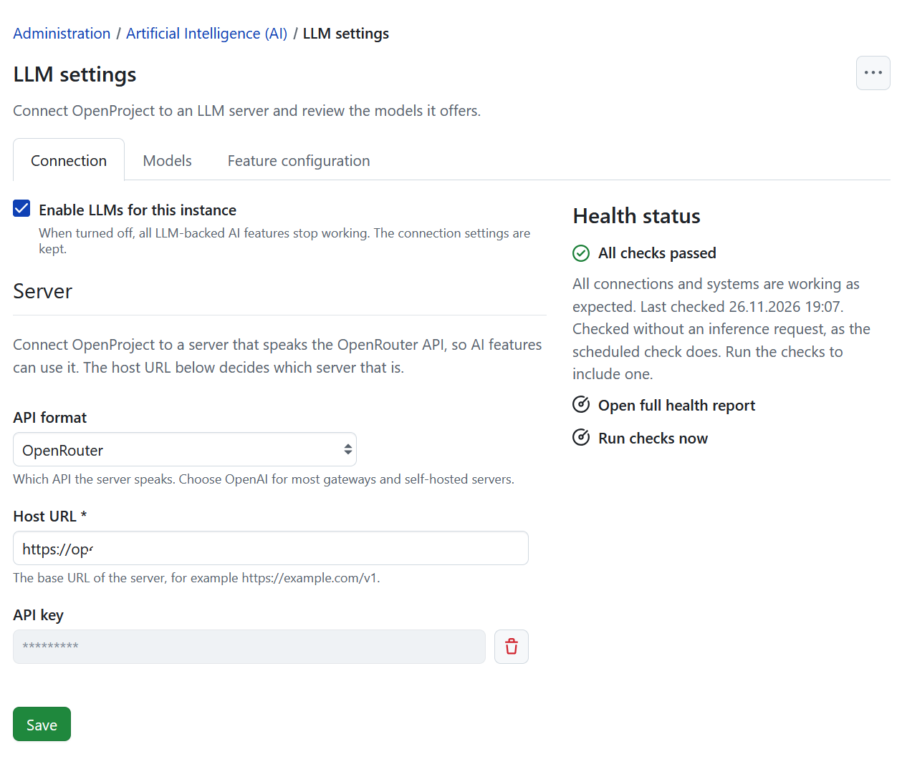
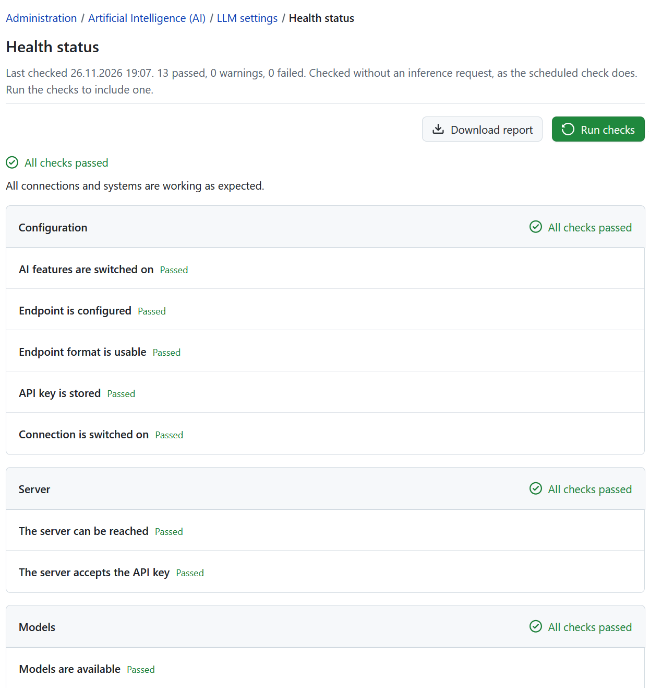
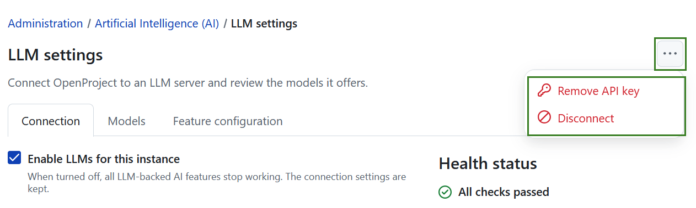
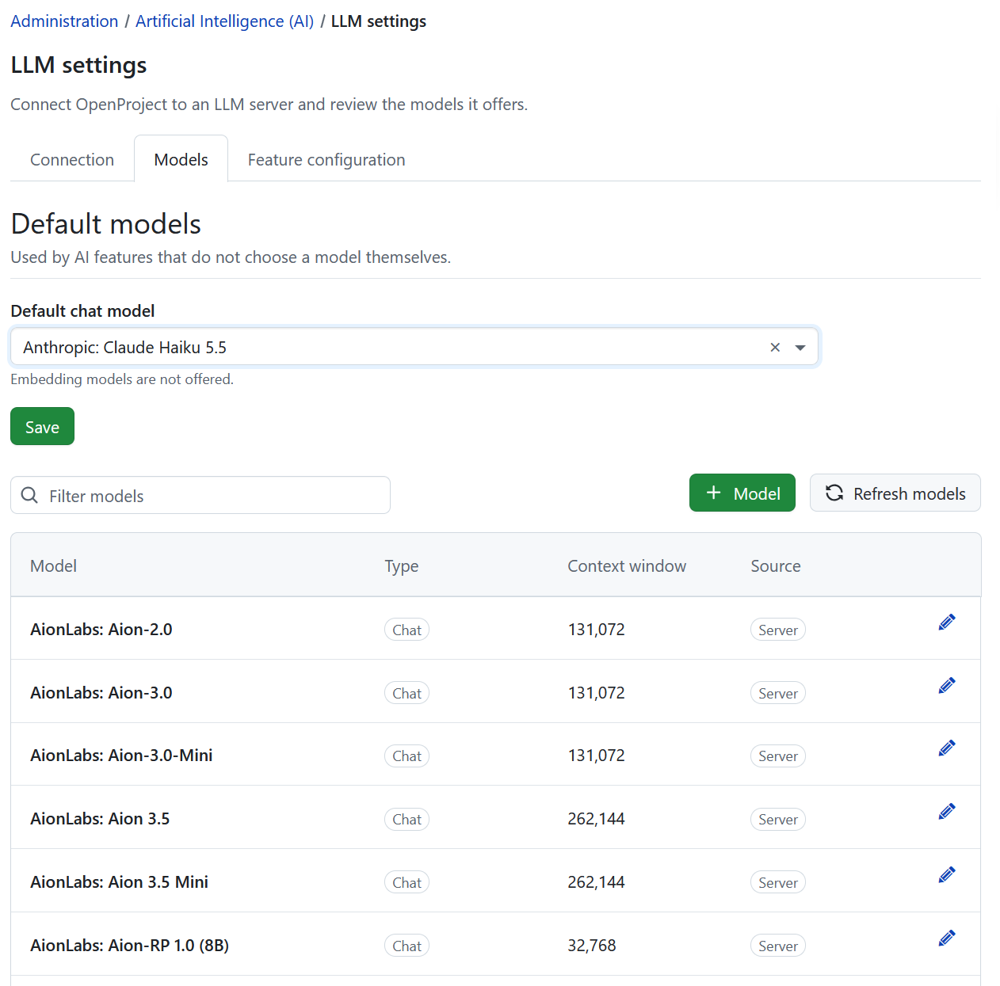
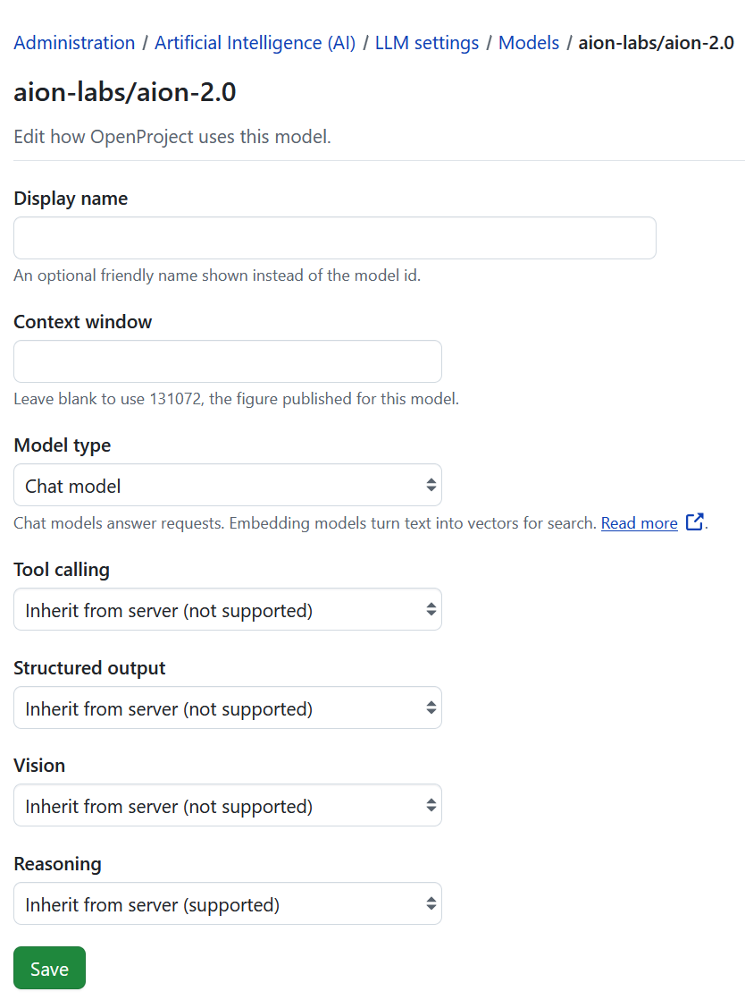
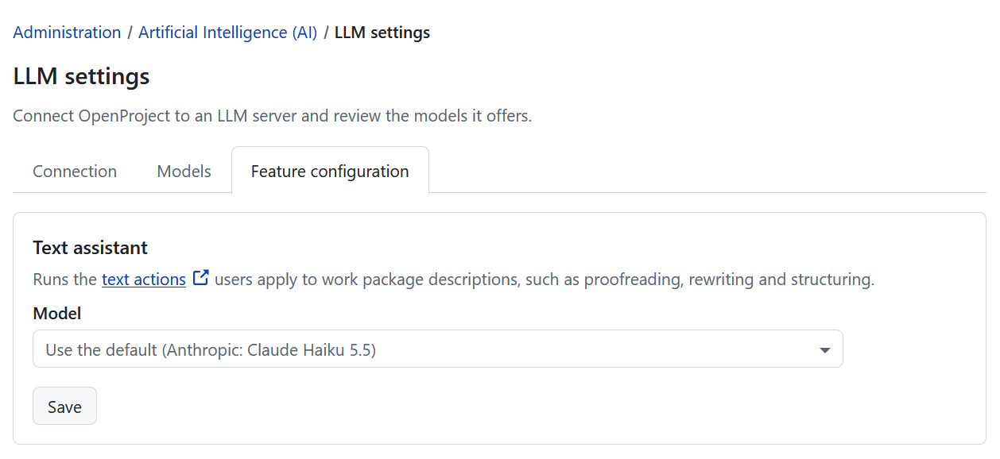

---
sidebar_navigation:
  title: LLM settings
  priority: 950
description: Connect OpenProject to an LLM server and configure the models used by AI features.
keywords: AI, LLM, large language model, models, health status

---

# LLM settings

Under _Administration_ > _Artificial Intelligence (AI)_ > _LLM settings_, you connect OpenProject to an LLM server and review the models it offers. The page has three tabs: **Connection**, **Models**, and **Feature configuration**.

## Connection

On the **Connection** tab, you configure the server that OpenProject uses for its AI features:

- **Enable LLMs for this instance:** Turns all LLM-backed AI features on or off. When turned off, these features stop working, but the connection settings are kept. You can only turn this on after a connection has been configured.
- **API format:** The API the server speaks. Choose **OpenAI** for most gateways and self-hosted servers.
- **Host URL:** The base URL of the server, including the API version, for example `https://example.com/v1`. Enter it exactly as your provider documents it.
- **API key:** The key OpenProject uses to authenticate with the server. The key is optional, since self-hosted servers may not require one. Once a key is stored, it is no longer shown. Leave the field blank to keep the stored key, or enter a new one to replace it.

Click **Save** to save the settings. OpenProject then contacts the server to check the connection and load the list of available models. If the server cannot be reached or rejects the API key, the settings are not saved, and the error is shown below the respective field.

### Health status

OpenProject regularly checks whether the connection to the LLM server works. The **Health status** panel next to the settings shows the result of the latest check and when it was run. Scheduled checks run without sending a request to a model. To include such a request, click **Run checks now**.

Click **Open full health report** to see all checks in detail. The report shows how many checks passed, returned a warning, or failed, and lists each check with its result, grouped into categories such as:

- **Configuration**, for example whether AI features are switched on, the endpoint is configured, and an API key is stored
- **Server**, for example whether the server can be reached and accepts the API key

In the top right corner, you can **Run checks** again or **Download report**.

> [!TIP]
> If you are experiencing issues with the LLM connection, download the health status report and include it in your support request. This will help us diagnose the problem more efficiently.

### Remove the API key or disconnect

Use the **More** (**…**) menu in the top right corner of the page to:

- **Remove API key:** OpenProject stops sending a key with its requests to the server.
- **Disconnect:** OpenProject stops using the LLM server. The server settings, the model list, and the model chosen for each feature are kept. Only the stored API key is removed.

Both options ask for confirmation.

## Models

The **Models** tab shows the models offered by the connected server.

Under **Default models**, choose the **Default chat model**. It is used by all AI features that do not choose a model themselves. Embedding models cannot be selected as the default chat model. Click **Save** to apply your choice.

Below, the list shows all available models with their **Type**, **Context window**, and **Source**. Depending on your server, the list can be long:

- Use **Filter models** to find a model by its name.
- Click **Refresh models** to load the current list from the server. Models you added manually are kept.
- Click **+ Model** to add a model manually, for example if your server does not publish a model list. Enter the model name exactly as the server expects it.

### Edit a model

To change how OpenProject uses a model, click the **Edit** (pencil) icon next to it. You can set the following options:

- **Display name:** An optional friendly name that is shown instead of the model ID.
- **Context window:** Leave this blank to use the value published for the model, which is shown below the field. Enter a value only if you want to override it.
- **Model type:** **Chat model** or **Embedding model**. Chat models answer requests. Embedding models turn text into vectors for search.
- **Tool calling**, **Structured output**, **Vision**, and **Reasoning:** By default, each capability is inherited from the server, and the value reported by the server is shown in brackets. You can override it if the server reports a capability incorrectly.

Click **Save** to apply your changes.

## Feature configuration

On the **Feature configuration** tab, you choose which model each AI feature uses. Currently, this applies to the [text assistant](../text-assistant/).

For each feature, select either **Use the default**, which uses the default chat model from the **Models** tab, or a specific model. Click **Save** to apply your choice.