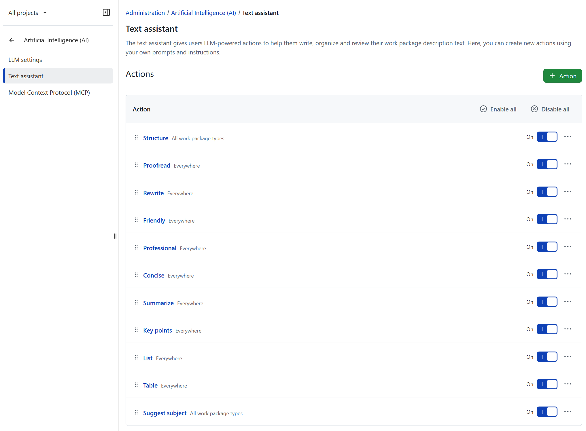
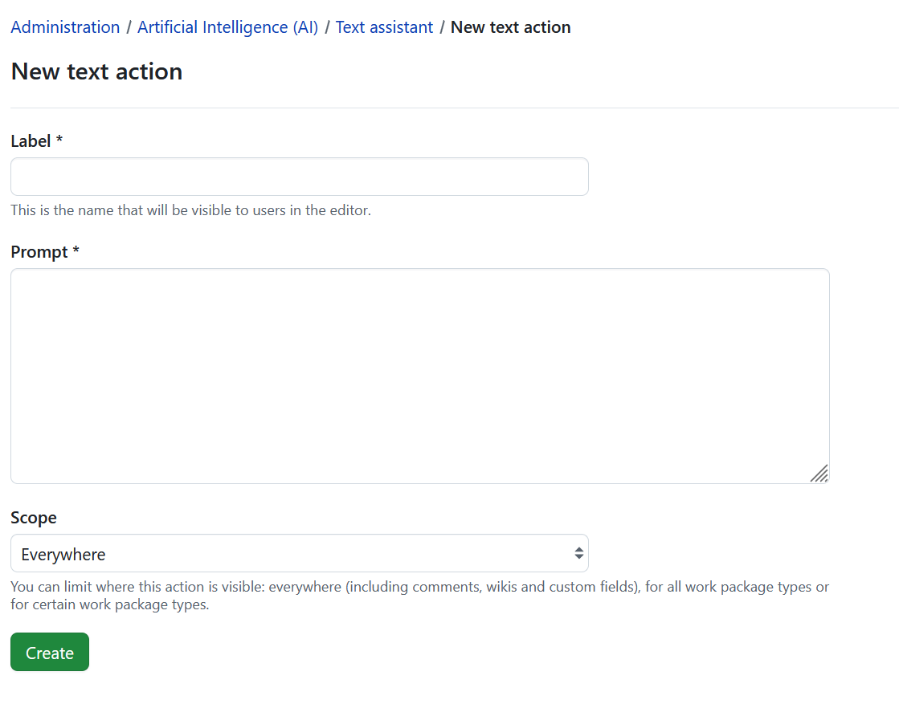
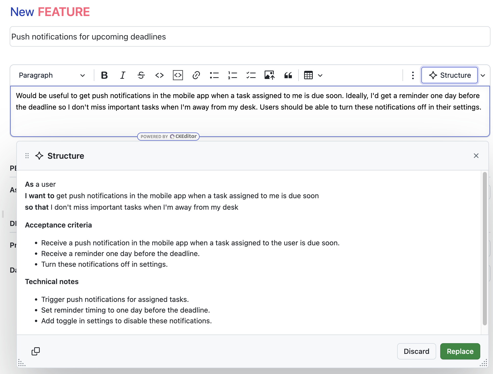

---
sidebar_navigation:
  title: Text assistant
  priority: 900
description: Configure the AI Text Assistant in OpenProject.
keywords: AI, text assistant, text actions, writing assistance
---

# Text assistant

[feature: text_assistant ]

The text assistant gives users LLM-powered actions that help them write, organize, and review text directly in OpenProject, for example to proofread a description or turn notes into acceptance criteria. Administrators decide which actions are available and where, and can create their own actions with custom prompts and instructions.

The text assistant requires a connection to an LLM server. Before you set up text actions, configure the connection under [LLM settings](../llm-settings/).

## Manage text actions

To manage the text actions, navigate to _Administration_ > _Artificial Intelligence (AI)_ > _Text assistant_.

The **Actions** list shows all text actions. For each action, you see its name and its scope, for example **Everywhere**. You can:

- **Turn individual actions on or off** with the toggle next to an action. Users only see actions that are turned on.
- **Turn all actions on or off at once** with **Enable all** and **Disable all** in the list header.
- **Change the order** by dragging an action by its handle on the left. Users see the actions in the same order in the editor.
- **Edit or delete an action** via the **More** (**…**) menu next to it. Alternatively, click the name of an action to edit it.

### Built-in text actions

OpenProject comes with a set of built-in text actions that you can use right away:

| Action | Scope | Purpose |
| --- | --- | --- |
| **Structure** | All work package types | Organizes the text according to the description template of the work package type. |
| **Proofread** | Everywhere | Checks spelling and grammar. |
| **Rewrite** | Everywhere | Improves the wording of the text. |
| **Friendly** | Everywhere | Makes the tone friendlier. |
| **Professional** | Everywhere | Makes the tone more professional. |
| **Concise** | Everywhere | Shortens the text. |
| **Summarize** | Everywhere | Captures the main points of the text. |
| **Key points** | Everywhere | Presents the text as key points. |
| **List** | Everywhere | Presents the text as a list. |
| **Table** | Everywhere | Presents the text as a table. |
| **Suggest subject** | All work package types | Suggests a subject for the work package. |

The **Structure** action always uses the description template of the respective work package type. If a project uses a [type variant](../../manage-work-packages/work-package-types/) with its own description template, the action uses that template. You do not need to create separate actions for different types or projects.

You can edit the built-in actions, for example to change their prompt or scope, and turn off the ones you do not need.

### Create a text action

To create a new text action, click **+ Action** and fill in the form:

- **Label:** The name of the action. Users see this name in the editor.
- **Prompt:** The instructions the LLM follows when a user runs the action, for example what to do with the text and which rules to follow.
- **Scope:** Where the action is available:
  - **Everywhere:** In all rich text editors, including comments, wiki pages, and custom fields.
  - **All work package types:** Only in work package descriptions.
  - **Specific work package types:** Only in the descriptions of the selected work package types. All variants of a selected type are included automatically.

Click **Create** to add the action to the list.

> [!TIP]
> Write the prompt as clear instructions, for example as a list of rules. Describe the expected result and what the LLM should not do, such as inventing requirements that are not included in the original text.

### Edit or delete a text action

To edit a text action, click its name or select **Edit** in the **More** (**…**) menu. Change the label, prompt, or scope and click **Save**.

To delete a text action, select **Delete** in the **More** (**…**) menu.

## Use the text assistant

Users can run text actions in OpenProject's rich text editors. Every editor in which at least one action is available shows an **Assistant** button in the toolbar:

- Click the main part of the button to run the action you used last.
- Click the arrow to see all available actions and select one.

Which actions are listed depends on where you write:

- In **work package descriptions**, you see all actions that can run for that work package, including actions limited to work packages or to specific work package types.
- In **other editors**, such as comments, wiki pages, forums, and meetings, you only see actions that are available **Everywhere**.

The **Assistant** button is not shown if no action is available, if no LLM connection is configured, or in editors you are not allowed to edit.

### Review the result

When you run an action, the result appears in a popover. The popover shows the name of the action and which text is used as input, for example the selected text or the whole work package description. While the result is being generated, you can stop the action with **Cancel**.

When the result is ready, you can:

- **Replace:** Apply the result. If you selected text, only the selected text is replaced. Otherwise, the whole text in the editor is replaced.
- **Copy:** Copy the result to your clipboard.
- **Discard:** Close the popover without changing your text.

You can drag the popover to another position, for example to see the text underneath. If the action fails, the popover shows an error message.

