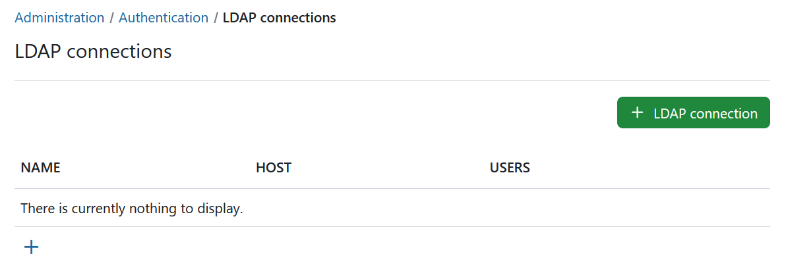
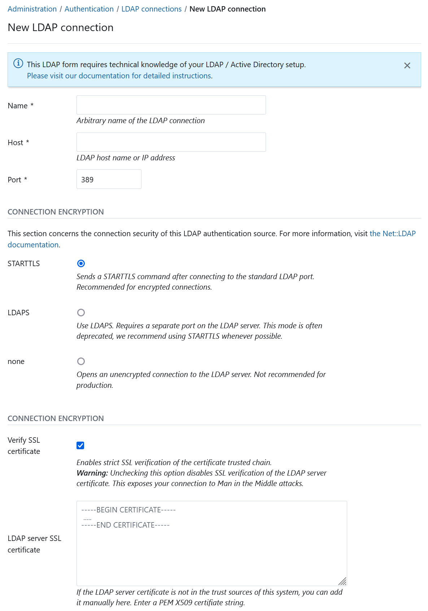
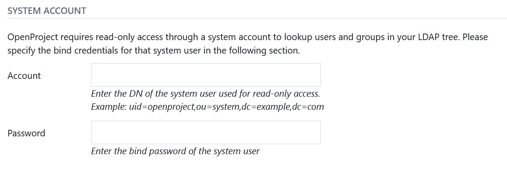
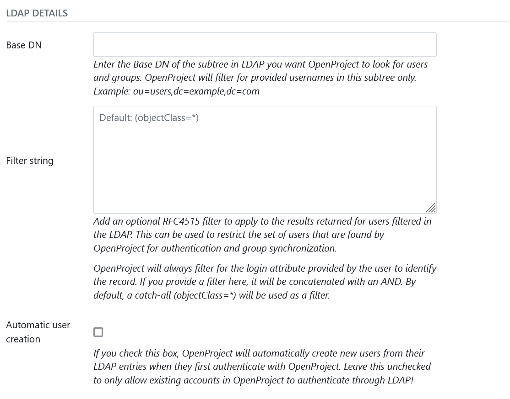
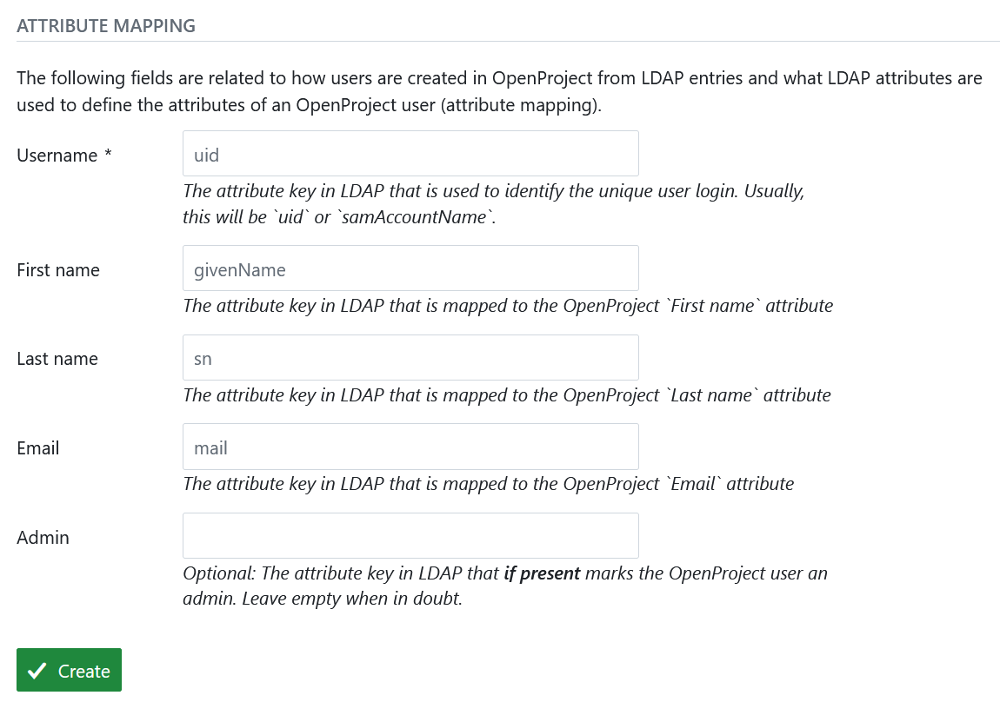
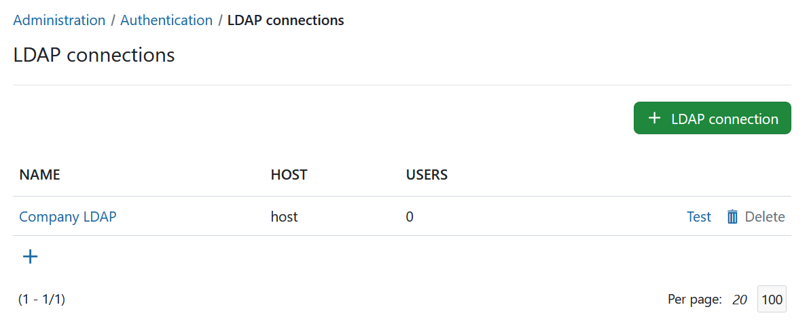

---
sidebar_navigation:
  title: LDAP connections
  priority: 600
description: Manage LDAP Authentication in OpenProject.
keywords: ldap authentication
---

# Manage LDAP connections

> [!NOTE]
> In order to be able to access the administration panel and manage LDAP authentication you need to be a system admin.

To see the list of all available LDAP (Lightweight Directory Access Protocol) authentications navigate to _Administration -> Authentication -> LDAP connections_. You will see the list of all available connections already created.

> [!NOTE]
> LDAP password authentication is subject to the [Password login policy](../login-registration-settings/#single-sign-on-sso-settings). With **Disallow for SSO users**, SSO-linked users cannot authenticate with an LDAP password unless they are included in the break-glass allowlist. With **Disallow for everyone**, password authentication is disabled except for break-glass principals and the **LDAP connections** administration menu is hidden.

## Add a new LDAP connection

To create a new LDAP connection, click on the respective icon.



You will then be able to specify the LDAP configuration. This can be  any directory service compatible with the LDAPv3 standard, such as  Microsoft Active Directory or openLDAP. The configuration depends on the specific database/applications, through which the authentication with  OpenProject is intended.

The following screenshots contain an exemplary configuration for a  new LDAP authentication mode. In the following, we will go through all  available options.

### LDAP connection details and security



In the upper section, you have to specify the connection details of your LDAP server as well as the connection encryption to use.

- **Name:** Arbitrary identifier used to show which authentication source a user is coming from (e.g., in the [Administration > Users view](../../users-permissions/users/))
- **Host:** Full hostname to the LDAP server
- **Port :** LDAP port. Will usually be 389 for LDAP and StartTLS and 636 for LDAP over SSL connections.
- **Connection encryption**: Select the appropriate connection encryption.
  - **Recommended option**: `STARTTLS` will issue an TLS connection upgrade to encrypt the connection after connecting to the LDAP server on the unencrypted PORT (`389` by default).
  - For LDAPS connections (LDAP over SSL), use `LDAPS` , this is an SSL encryption pattern that uses SSL certificates and connects to a separate port on the LDAP server. Some older LDAP servers only support this option, but this option is deprecated in most ldap servers favoring the STARTTLS method of operation.
  - For unencrypted connections, select `none`  . No TLS/SSL connection will be established, your connection will be insecure and no verification will be made.
  - [Click here to read more details into what these options mean for connection security.](https://www.rubydoc.info/gems/ruby-net-ldap/Net/LDAP)

- **SSL encryption options**: Provides additional options for LDAPS and STARTTLS connections. Be aware that these options do not apply for the connection encryption `none` option.

  - **Verify SSL certificate**: By default, for STARTTLS and LDAPS, SSL certificate trust chains will be verified during connection. As many LDAP servers in our experience use self-signed certificates, checking this option without providing the SSL certificate will fail. However, we recommend you enable this checkbox for any LDAP connections used in production.

  - **LDAP server SSL certificate**: If the LDAP server's certificate is not trusted on the system that the OpenProject server runs on, you have the option to specify one or multiple PEM-encoded X509 certificates. This certificate might be the LDAP server's own certificate, or an intermediate or root CA that you trust for the sake of this connection.

### LDAP system user credentials



Next, you will need to enter a system user that has READ access to the users for identification and synchronization purposes. Note that most operations to the LDAP during authentication will not be using these credentials, but the user-provided credentials in the login form in order to perform a regular user bind to the LDAP.

- **Account:** The full DN of a system users used for  looking up user details in the LDAP. It must have read permissions under the Base DN. This will not be used for the user bind upon  authentication.
- **Password:** The bind password of the system user’s DN above.

### LDAP details



Next you can define what sections OpenProject will look for in the LDAP and also if users should be created automatically in OpenProject when they are accessing it. Let's look at the available options:

- **Base DN**: Enter the Base DN to search within for users and groups in the LDAP tree
- **Filter string**: Enter an optional [LDAP RFC4515 filter string](https://datatracker.ietf.org/doc/html/rfc4515) to further reduce the returned set of users. This allows you to restrict access to OpenProject with a very flexible filter. This filter also determines whether a user is found during [LDAP user status synchronization](#enable-status-synchronization). To lock accounts that are deactivated or locked in your directory, configure this filter to exclude them.
- **Automatic user creation:** Check to automatically  create users in OpenProject when they first login in OpenProject. It  will use the LDAP attribute mapping below to fill out required  attributes. The user will be forwarded to a registration screen to  complete required attributes if they are missing in the LDAP.

#### Filter Examples

```text
(memberof=CN=OpenProject,OU=Rollen,OU=Gruppen,DC=intern)
```

### Attribute mapping



The attribute mapping is used to identify attributes of OpenProject with attributes of the LDAP directory. At least the _login_ attribute is required to create DNs from the login credentials.

- **Login:** The login attribute in the ldap. Will be used to construct the DN from `login-attribute=value,`. Most often, this will be _uid._
- **First name:** The attribute name in the LDAP that maps to first name. Most often, this will be _givenName._ If left empty, user will be prompted to enter upon registration if **automatic user creation** is true.
- **Last name:** The attribute name in the LDAP that maps to last name. Most often, this will be _sn._ If left empty, user will be prompted to enter upon registration if **automatic user creation** is true.
- **Email:** The attribute name in the LDAP that maps to the user’s mail address. This will usually be _mail._ If left empty, user will be prompted to enter upon registration if **automatic user creation** is true.
- **Admin:** Specify an attribute that if it has a truthy value, results in the user in OpenProject becoming an admin account.  Leave empty to never set admin status from LDAP attributes.

Lastly, click on _Create_ to save the LDAP authentication  mode. You will be redirected to the index page with the created  LDAP connection. Click the _test_  button to create a test connection using the system user’s bind credentials.



With the [OpenProject Enterprise edition](https://www.openproject.org/enterprise-edition/) it is possible to [synchronize LDAP and OpenProject groups](./ldap-group-synchronization).

## Multiple LDAP connections

OpenProject supports multiple LDAP connections to source users from. The user's authentication source is remembered the first time it is created (but can be switched in the administration backend). This ensures that the correct connection / LDAP source will be used for the user.

Duplicates in the unique attributes (login, email) are not allowed and a second user with the same attributes will not be able to login. Please ensure that amongst all LDAP connections, a unique attribute is used that does not result in conflicting logins.

## LDAP connections through seeding / Environment variables

OpenProject allows you to define an LDAP connection (and optionally, synchronized group filters for enterprise editions) through a configuration or environment variable.

Please see the [advanced configuration guide](../../../installation-and-operations/configuration/) for more information.

## LDAP user synchronization

By default, OpenProject synchronizes mapped user account details (such as name and email) from LDAP through a background worker job every 24 hours. This job updates existing users linked to an LDAP connection. Account status synchronization is **disabled by default** and must be enabled separately.

LDAP user synchronization is available in both Community and Enterprise editions. [LDAP group synchronization](./ldap-group-synchronization/) is a separate Enterprise add-on.

### Enable status synchronization

Enable account status synchronization using one of the following [configuration options](../../../installation-and-operations/configuration/):

- `ldap_users_sync_status: true`
- Or the environment variable `OPENPROJECT_LDAP__USERS__SYNC__STATUS=true`

When enabled, OpenProject determines the account status based on the result of an LDAP search for each linked user's login, using the connection's **Base DN**, **Login** attribute, and **Filter string**:

| LDAP search result | Effect on the linked OpenProject account |
| --- | --- |
| The user is found and their mapped attributes are successfully updated. | The account is activated, including accounts that were previously locked. |
| The user is not found, for example because the entry was deleted, moved outside the Base DN, or excluded by the filter. | The account is locked. |

OpenProject does not map an LDAP status attribute directly to the OpenProject account status. **Deactivating or locking a user in your directory only locks their OpenProject account if the LDAP search no longer returns that user.** If the entry still matches the search, the account remains active or is reactivated during synchronization.

> [!NOTE]
> Status synchronization also reactivates accounts that were manually locked in OpenProject if the user is still found in LDAP and their attributes can be updated. To keep such an account locked, make sure it's excluded from the LDAP search as well.

### Exclude inactive users with the LDAP filter

In _Administration -> Authentication -> LDAP connections_, edit the connection's **Filter string** so that it returns only users who should have active OpenProject accounts. Include conditions that exclude deactivated or locked accounts based on your directory's schema. Combine these conditions with any existing restrictions, such as group membership, using LDAP filter syntax.

For example, if your directory exposes an `accountStatus` attribute with the value `active` for active accounts, you could combine it with a group restriction:

```text
(&(memberOf=CN=OpenProject,OU=Rollen,OU=Gruppen,DC=intern)(accountStatus=active))
```

The `accountStatus` attribute and value in this example are illustrative. Use the attributes, values, and matching rules supported by your LDAP server. The LDAP system user configured under **Account** must have permission to evaluate the filter conditions.

Set this filter on the **LDAP connection**, rather than only on an LDAP group synchronization filter. Group filters select groups to synchronize; the connection's user filter determines whether the status synchronization finds a user.

When a user is reactivated or unlocked in the directory and matches the connection's filter again, the next user synchronization reactivates their OpenProject account after successfully updating their mapped attributes. Changes take effect on synchronization, which runs every 24 hours by default.

### Users covered by synchronization

User synchronization only processes OpenProject accounts linked to the LDAP connection. Where available, you can check a user's **Authentication source** in [Administration -> Users](../../users-permissions/users/#authentication). For SSO accounts where this field is hidden, you can check the link in a [Rails console](../../../installation-and-operations/operation/control/):

```ruby
User.find_by!(login: "example-user").ldap_auth_source&.name
```

This returns the LDAP connection's name, or `nil` if the user is not linked to an LDAP connection.

Users created through LDAP authentication or LDAP group synchronization are linked to the connection that created them. Users created through another login method, such as OpenID Connect through Keycloak, are **not automatically linked** to an LDAP connection, even if their username matches an LDAP entry.

LDAP group synchronization can add existing users to groups, but it does not link those existing accounts to the LDAP connection. If a user first signs in through OpenID Connect before group synchronization creates their account, LDAP user status synchronization does not cover that account. Verify the LDAP authentication source for existing accounts before relying on LDAP to manage their status.

### Verify status synchronization

1. Confirm that the OpenProject user is linked to the intended LDAP connection and that status synchronization is enabled.
2. Using the connection's LDAP system user, Base DN, login attribute, and filter, verify that an active user is returned by the LDAP search.
3. Deactivate or lock a test user in the directory and verify that the same search no longer returns their entry.
4. Wait for the next user synchronization, or run it manually as shown below. Confirm that the OpenProject account is locked.
5. Reactivate or unlock the test user in the directory, confirm that the search returns their entry again, and synchronize again. Confirm that the OpenProject account is active.

To synchronize a single linked user immediately, run the following rake task in your [OpenProject environment](../../../installation-and-operations/operation/control/), replacing the connection name and login:

```shell
bundle exec rake ldap:sync name="My LDAP connection" logins="example-user"
```

If the status does not change, check the LDAP link, filter results, configuration, and background worker. Check the application logs for LDAP connection errors or failures to update the user's attributes.

### Disable the synchronization job

To disable the scheduled synchronization of both user attributes and account status, set one of the following options:

- `ldap_users_disable_sync_job: true`
- Or the environment variable `OPENPROJECT_LDAP__USERS__DISABLE__SYNC__JOB=true`

Leave this option at its default value of `false` if you rely on the background job for status synchronization.
