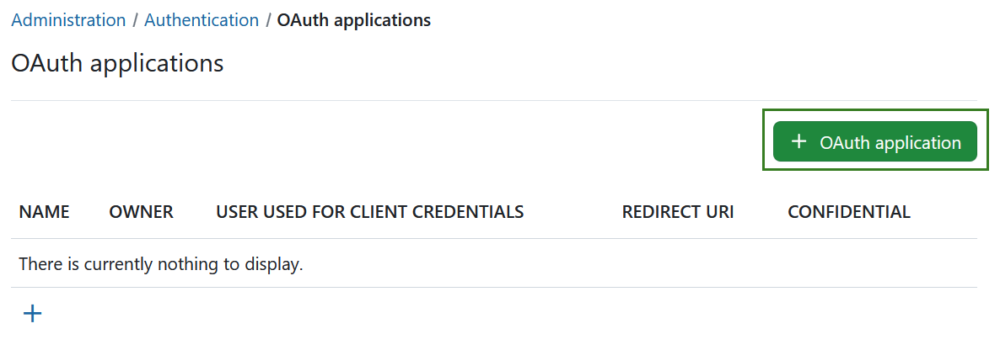
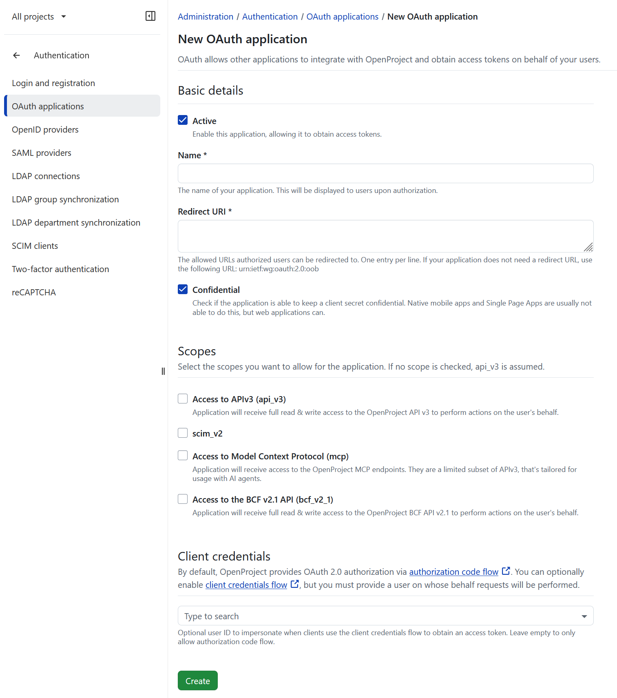
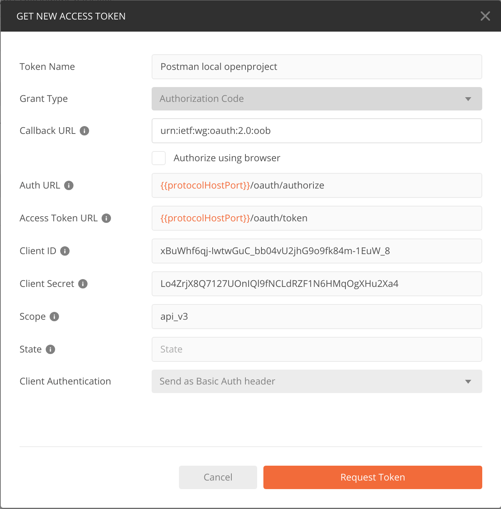

---
sidebar_navigation:
  title: OAuth applications
  priority: 900
description: OAuth application settings in OpenProject.
keywords: OAuth application settings
---
# OAuth applications

OAuth allows other applications to integrate with OpenProject and obtain access tokens on behalf of your users. To configure OpenProject to act as a server to an OAuth client application, please navigate to _Administration_ -> _Authentication_ -> _OAuth applications_.

## Add a new authentication application for OAuth

To add a new OAuth application, click the green **+ OAuth application** button.



The form for a new OAuth application is divided into three sections.

Under **Basic details**, configure the following options:

1. **Active:** Enable the application, allowing it to obtain access tokens. This option is selected by default.
2. **Name:** The name of your OAuth application. It is displayed to users when they authorize the application.
3. **Redirect URI:** The URLs that users can be redirected to after they have authorized OAuth2 access in OpenProject. Enter one URL per line. These URLs are provided by your client application. If your application does not need a redirect URL, use the URL shown below the field: `urn:ietf:wg:oauth:2.0:oob`.
   For a locally running Postman, you can also use this special string. Postman 9.6 and higher also provides a web URL that you can use: `https://oauth.pstmn.io/v1/callback`.
4. **Confidential:** Selected by default. Keep it checked if the application is able to keep a client secret confidential. Web applications can usually do this, while native mobile apps and single-page apps usually cannot.

Under **Scopes**, select what the OAuth client application will be able to access. Most scopes are shown with a short explanation. Multiple selection is possible. If no scope is checked, **api_v3** is assumed. The available scopes are:

- **Access to APIv3 (api_v3):** Full read and write access to the standard OpenProject API on behalf of the user.
- **scim_v2:** Access to the [SCIM API](../scim/).
- **Access to Model Context Protocol (mcp):** Access to the [MCP Server](../../ai/mcp-server/) endpoints, a limited subset of APIv3 tailored for AI agents.
- **Access to the BCF v2.1 API (bcf_v2_1):** Full read and write access to the [BCF API](../../../api/bcf-rest-api) on behalf of the user. This scope is specific to the BIM edition of OpenProject.

Under **Client credentials**, you can optionally choose a user on whose behalf requests are performed when clients use the client credentials flow to obtain an access token. Leave the field empty to only allow the authorization code flow.

Click **Create** to add your OAuth application.



After the application is created, its details page shows the **Client ID**, the **Client secret**, and the OAuth endpoints, such as the **Auth URL** and the **Access token URL**. Use the copy icon next to a value to copy it to your clipboard.

> [!IMPORTANT]
> The client secret is only shown once, right after the application has been created. Copy it and keep it secure, since it cannot be retrieved later. Treat it like a password.

## OAuth endpoints

The authentication endpoints of OpenProject OAuth2 server are:

- Auth URL: `https://example.com/oauth/authorize`
- Access Token URL: `https://example.com/oauth/token`

## Obtaining OAuth2 access token

### Authorization code flow example

#### Request authorization code

Request an authorization code. Please adopt the following URL replacing:

- `example.com` with the IP/host name of your OpenProject instance,
- `<Client ID>` with your OAuth2 client ID, and
- `<Redirect URI>` with the redirect URI as configured above.
- `<scope>` with list of scope values separated with `%20`. e.g. `scim_v2%20api_v3`

`https://example.com/oauth/authorize?response_type=code&client_id=<Client ID>&redirect_uri=<Redirect URI>&scope=<scope>&prompt=consent`

This requests redirects you to a URL that holds a `code` parameter
which is the authentication code.

Typically the server that was requested with that redirect will save
the authorization code and use it to obtain API token, with which
the server can then act on behalf of the current user.

In this example we skip that server side implementation and just
copy the value of the `code` parameter from the URL that you see
in your browser.

#### Request OAuth access token

With the authorization code that you obtained above you can now
request an API token.

We do this manually in the command line using cURL. Please replace:

- `example.com` with the IP/host name of your OpenProject instance,
- `<Client ID>` with your OAuth2 client ID,
- `<Client secret>` with your OAuth2 client secret,
- `<Authentication code>` with the code you obtained above,
- and `<Redirect URI>` with the redirect URI as configured above.

```shell
$ curl --request POST \
  --url 'https://example.com/oauth/token' \
  --header 'content-type: application/x-www-form-urlencoded' \
  --data grant_type=authorization_code \
  --data client_id=<Client ID> \
  --data client_secret=<Client secret> \
  --data code=<Authentication code> \
  --data 'redirect_uri=<Redirect URI>'
```

The response will look like this:

```json
{
  "access_token": "Ize6vvCIeENQ_suzd9kBJ6BxDNpxcumfTfweZQaOoJc",
  "token_type": "Bearer",
  "expires_in": 7200,
  "refresh_token": "kDQ5pxzOE_4kCSKzONZaI1ogcyjcXk97_KhBS0JfCw4",
  "scope": "api_v3",
  "created_at": 1652112852
}
```

The response contains the bearer token ("access_token") and a refresh token that you will need when working with the API.
Please copy the tokens for reference.

### Client credentials flow example

#### Request OAuth access token

With client credentials you can request an API token directly from `/oauth/token` endpoint.

We do this manually in the command line using cURL. Please replace:

- `example.com` with the IP/host name of your OpenProject instance,
- `<Client ID>` with your OAuth2 client ID,
- `<Client secret>` with your OAuth2 client secret,
- `<scope>` with list of scope values separated with `%20`. e.g. `scim_v2%20api_v3`

```shell
$ curl --request POST \
  --url 'https://example.com/oauth/token' \
  --header 'content-type: application/x-www-form-urlencoded' \
  --data grant_type=client_credentials \
  --data client_id=<Client ID> \
  --data client_secret=<Client secret> \
  --data scope=<scope>
```

The response will look like this:

```json
{
  "access_token": "Ize6vvCIeENQ_suzd9kBJ6BxDNpxcumfTfweZQaOoJc",
  "token_type": "Bearer",
  "expires_in": 7200,
  "refresh_token": "kDQ5pxzOE_4kCSKzONZaI1ogcyjcXk97_KhBS0JfCw4",
  "scope": "scim_v2 api_v3",
  "created_at": 1652112852
}
```

The response contains the bearer token ("access_token") and a refresh token that you will need when working with the API.
Please copy the tokens for reference.

### Using Postman to obtain access tokens

You can exercise the flows above using Postman.
Just create a new request:

```text
GET {{protocolHostPort}}/api/v3/projects
```

with {{protocolHostPort}} corresponding to your server and port,
for example `http://localhost:3000`. Then go to the
Authorization tab and select **Type**: OAuth2 2.0. On the right
side you will see a form similar to the one below.
Please fill in your specific Client ID and Client Secret from above.



Clicking on "Request Token" will initiate the same flow as above
and complete with a success screen. Please click on "Use Token"
to use this token for authenticating your `/api/v3/projects` request.

Please note that your Bearer token will expire after two hours (default)
and you will have to click on "Request Token" again. Otherwise your
API request will return an error message.

## Performing a request to the OpenProject API with OAuth2 access token

With the token that you obtained above you can now make API calls to the OpenProject instance on behalf of the current user.

For example, the following cURL command fetches all projects from the API V3. Please replace:

- `example.com` with the IP/host name of your OpenProject instance, and
- `<Token>` with the bearer token you obtained above.

```shell
$ curl --request GET 'https://example.com/api/v3/projects' \
  --header 'Authorization: Bearer <Token>'`
```

### CORS headers

By default, the OpenProject API is _not_ responding with any CORS headers.
If you want to allow cross-domain AJAX calls against your OpenProject instance, you need to enable CORS headers being returned.

Please see [our API settings documentation](../../../system-admin-guide/api-and-webhooks/) on
how to selectively enable CORS.
