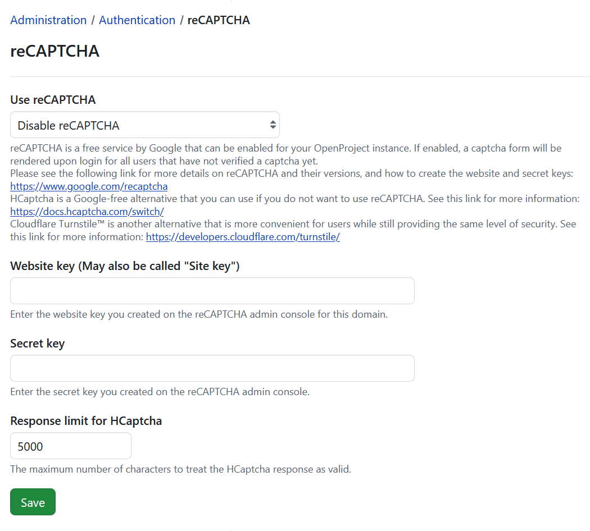

1. 

2. ---
   sidebar_navigation:
     title: reCAPTCHA
     priority: 300
   description: Configure reCAPTCHA for OpenProject.
   keywords: reCAPTCHA, turnstile, hcaptcha
   ---

   # reCAPTCHA configuration

   To activate and configure reCAPTCHA for OpenProject, navigate to _Administration_ -> _Authentication_ -> _reCAPTCHA_.

   If enabled, a captcha form will be rendered upon login for all users that have not verified a captcha yet. OpenProject supports reCAPTCHA by Google, HCaptcha as a Google-free alternative, and Cloudflare Turnstile.

   Please see the following link for more details on reCAPTCHA and their versions, and how to create the website and secret keys: [https://www.google.com/recaptcha](https://www.google.com/recaptcha).

   You can configure the following options:

   1. Under **Use reCAPTCHA**, select the captcha you want to use: **reCAPTCHA v2**, **reCAPTCHA v3**, **HCaptcha**, or **Cloudflare Turnstile™**. Select **Disable reCAPTCHA** to turn it off.
   2. Enter the **Website key**, which may also be called "Site key".
   3. Enter the **Secret key**.
   4. If you use HCaptcha, enter the **Response limit for HCaptcha**, the maximum number of characters to treat the HCaptcha response as valid.
   5. Click **Save** to save your changes.

   

   ## Cloudflare Turnstile configuration

   To use Cloudflare Turnstile with OpenProject, you first need to create a site key and a secret key in the Cloudflare dashboard. Please see the following link for more details on Cloudflare Turnstile and how to configure it: [https://developers.cloudflare.com/turnstile/](https://developers.cloudflare.com/turnstile/).

   Once you have created the keys, you can configure OpenProject to use them:

   1. Under **Use reCAPTCHA**, select **Cloudflare Turnstile™**.
   2. Enter the **Website key**.
   3. Enter the **Secret key**.
   4. Click **Save** to save your changes.
