---
sidebar_navigation:
  title: Custom fields
  priority: 960
description: Learn how to create and configure custom fields in OpenProject, including available formats, validation rules, and field settings.
keywords: manage custom fields, custom field, custom fields, custom field formats, hierarchy, weighted item list, required fields
---

# Manage custom fields

Custom fields allow you to extend OpenProject with additional attributes that reflect your organization's needs. You can use them to record information such as customer references in work packages, budget information in projects, or additional details about users.

Depending on the resource and custom field format, you can define default values, restrict allowed values, make fields mandatory, and use them to filter and organize information.

## Where to manage custom fields

Starting with OpenProject 18.0, custom fields are managed directly within the relevant sections of the system administration rather than in a central Custom fields overview.

For instructions on managing custom fields in different areas of OpenProject, see the following guides:

- [Work package custom fields](../manage-work-packages/work-package-custom-fields/)
- [Version custom fields](../manage-work-packages/version-custom-fields/)
- [Project attributes](../projects/project-attributes/)
- [User attributes](../users-permissions/user-attributes/)
- [Time and costs](../time-and-costs/)
- [Groups](../users-permissions/groups/)

This page explains the available custom field formats and their configuration options. The available formats and settings vary depending on where the custom field is used.

## Add a new custom field

Navigate to the relevant section in the system administration, create a new custom field, and select the format that best suits the information you want to collect. The selected format determines which values users can enter and which configuration options are available.

The following example shows the settings for a work package custom field of the **Text** format.

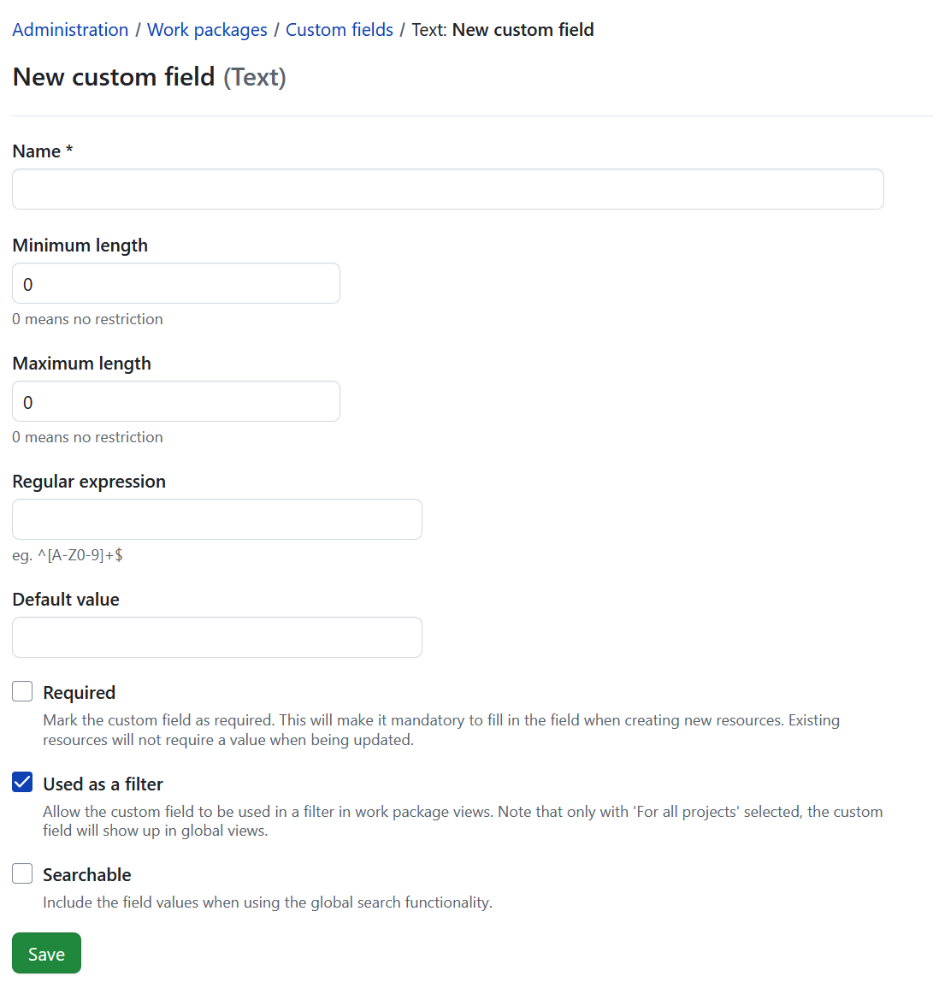

Depending on the resource and format, you can configure the following settings:

- **Name:** The name displayed alongside the custom field.
- **Minimum and maximum length:** Restrict the number of characters users can enter. A value of `0` means that no length restriction is applied.
- **Regular expression:** Restrict input to values matching a specified pattern.
- **Default value:** Define a value that is initially provided when creating a resource.
- **Required:** Make the custom field mandatory when creating new resources.
- **For all projects:** Activate the custom field for all projects without having to activate it individually.
- **Used as a filter:** Make the custom field available as a filter.
- **Searchable:** Include custom field values in the global search.

Once you have configured the custom field, click **Save**.

### Validation rules

Depending on the custom field format, you can define validation rules to ensure that users enter values within an expected range or format.

For example, an **Integer** custom field can have a **Minimum value** and a **Maximum value**. You might restrict a percentage field to values between `0` and `100`.

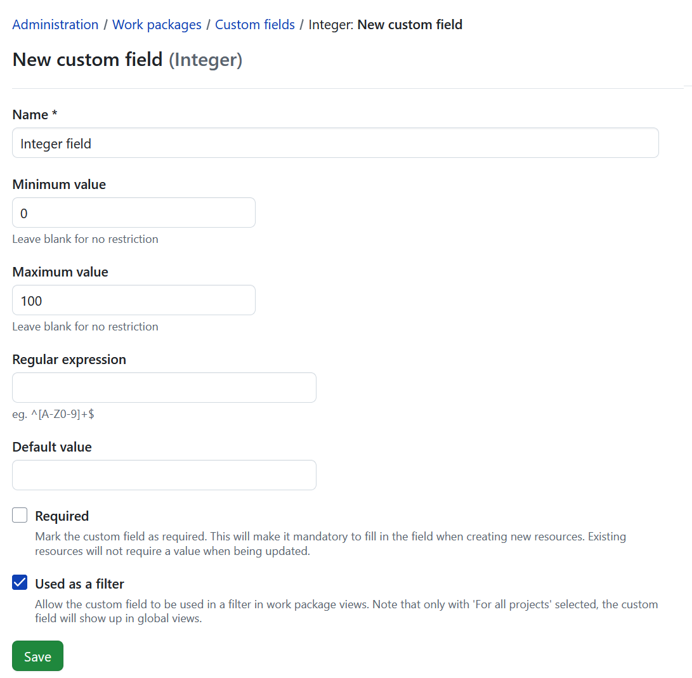

For **Float** custom fields, the minimum and maximum values can also be decimal numbers, such as `0.1234`. Text custom fields can use length restrictions or regular expressions to ensure that entered values follow a particular format.

## Custom field formats

OpenProject supports the following custom field formats. The available formats depend on where the custom field will be used.

| Format | Description |
| --- | --- |
| **Boolean** | A true or false value, represented by a checkbox. |
| **Date** | A date selected using a date picker. |
| **Date and time** | A date together with a time of day. Available for work packages. |
| **Float** | A numerical value that can contain decimal places. |
| **Hierarchy (Enterprise add-on)** | One or more values selected from a hierarchical structure. |
| **Integer** | A whole number. |
| **Link (URL)** | A URL linking to an external or internal resource. |
| **List** | One or more values selected from a predefined flat list. |
| **Text** | Text that can be subject to length restrictions and validation rules. |
| **Long text** | Longer text, such as detailed notes or descriptions. |
| **User** | One or more users who have access to the resource containing the custom field. |
| **Version** | One or more versions. |
| **Weighted item list (Enterprise add-on)** | One or more items from a hierarchical structure, with an underlying numerical weight assigned to each item. |

### Date and time custom field

A **Date and time** custom field stores a specific point in time, for example when an incident was detected. It is available for work packages only.

Each user enters and views the value in their own time zone, as configured in their [account settings](../../user-guide/account-settings/language-and-region/#change-your-time-zone). This means that users in different time zones may see different local times for the same event.

When filtering work packages, the operators **on** and **between** select whole days in the user's time zone. Exports also contain the date and time in the time zone of the user who creates the export.

Date and time custom fields do not support default values, regular expressions, or length restrictions and cannot be used in the global search.

### Hierarchy custom field (Enterprise add-on)

[feature: custom_field_hierarchies ]

Hierarchy custom fields allow you to organize selectable values into multiple levels. For example, you could create a hierarchy of departments and teams, geographical regions and locations, or product categories and subcategories.

To create a hierarchy custom field, select the **Hierarchy** format when creating a new custom field. Enter a name and configure the available settings, such as whether users can select multiple values or whether the field is required. Click **Save** to proceed.

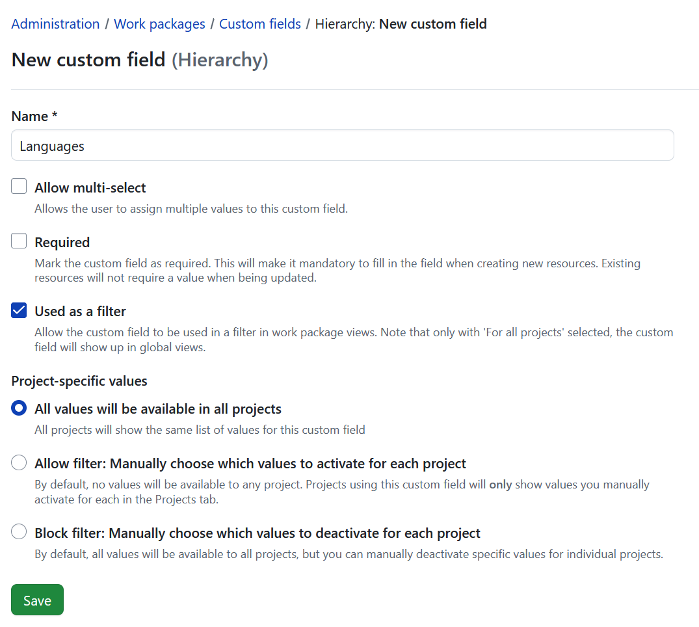

You can return to the **Details** tab at any time to edit the name and configuration of the custom field.

#### Add hierarchy items

Open the **Items** tab to define the values users can select. The list is initially empty. Click **+ Item** to add the first item.

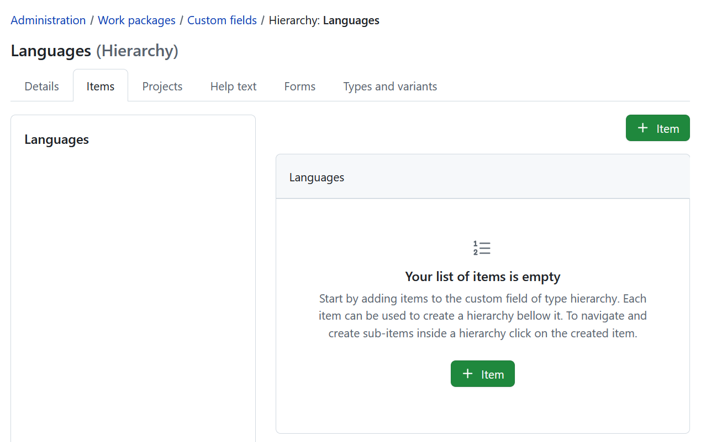

Each item has a **Label** and an optional **Short name**. The short name can be used as an abbreviation or an alternative description and is displayed in brackets next to the item label.

> [!TIP]
> Short names are searchable in work package forms, making it easier to find the correct value in large hierarchies.

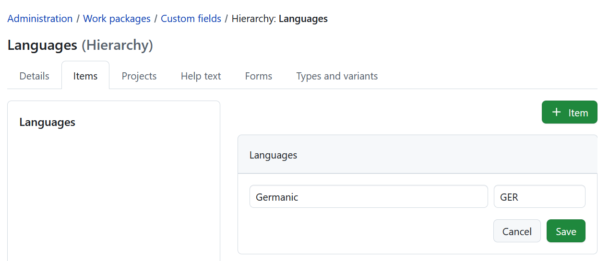

Items added at the same level are displayed together in the hierarchy tree on the left. You can edit, reorder, or delete items using their **More (three dots)** menu. You can also rearrange items using drag and drop.

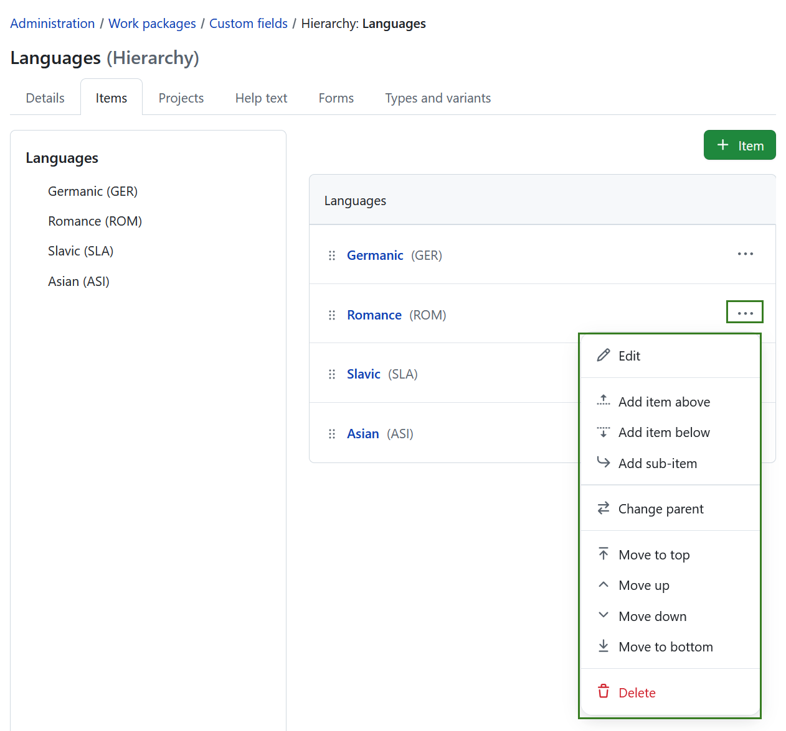

#### Add further hierarchy levels

To create a nested level, click the name of an existing item and add further items in the same way as at the first level. This allows you to build a hierarchy that reflects your organization's structure.

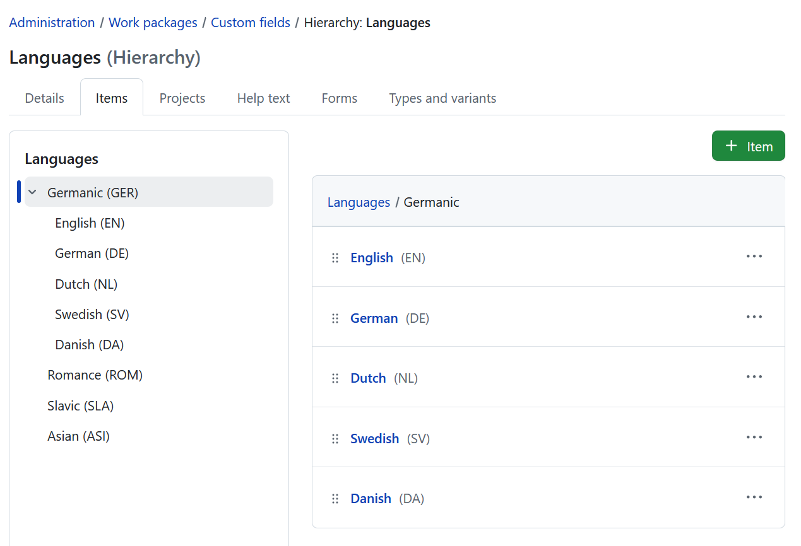

Once you have added sub-items, the number of nested items is displayed next to the parent item. In the hierarchy tree, an arrow next to an item indicates that it contains sub-items. Click the arrow to expand or collapse the corresponding level.

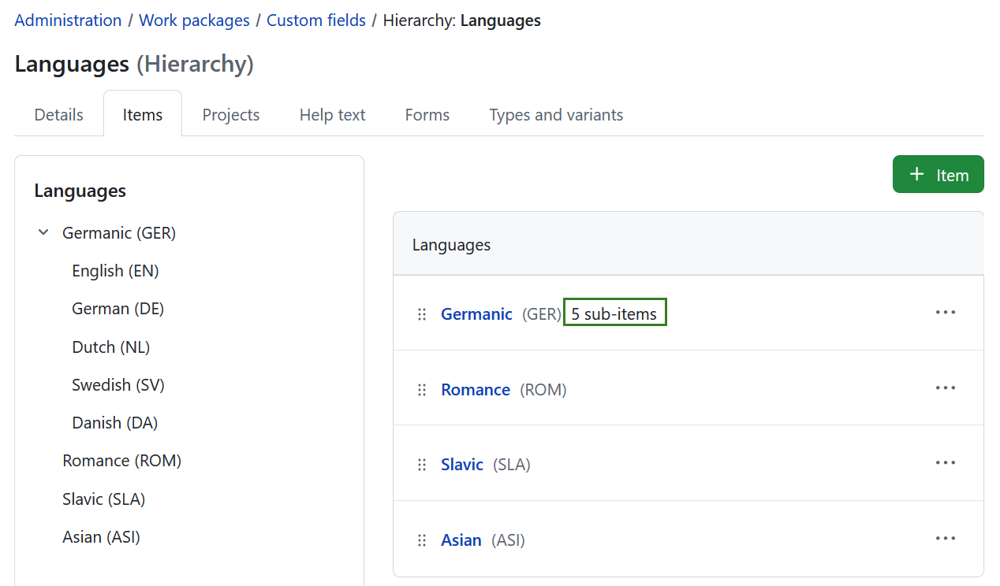

You can add further items and levels as needed. To navigate between levels, use the hierarchy tree on the left or the navigation path displayed above the items.

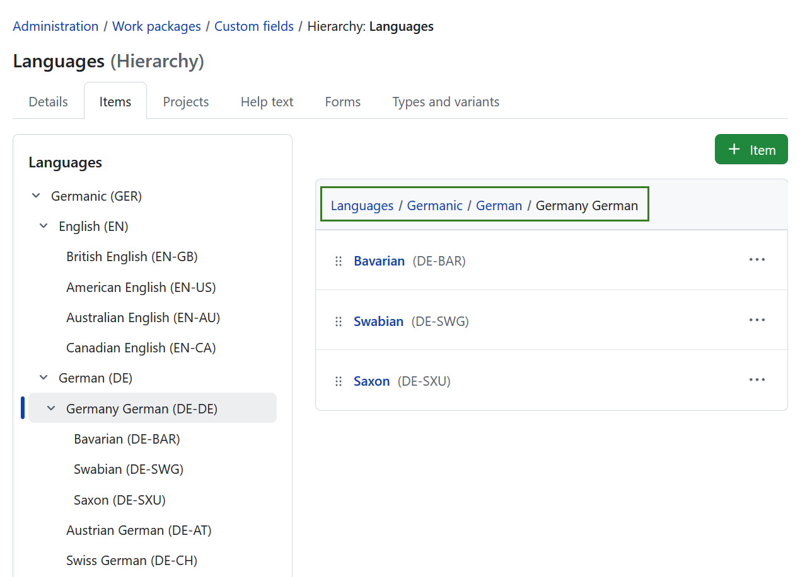

Once you have configured the hierarchy, make the custom field available for the relevant resources. For work packages, see [Make custom fields available in work packages](../manage-work-packages/work-package-custom-fields/#make-custom-fields-available-in-work-packages).

### Weighted item list custom field (Enterprise add-on)

[feature: weighted_item_lists ]

Weighted item list custom fields work similarly to hierarchy custom fields, allowing you to organize selectable values into multiple levels. However, instead of an optional short name, each item has a mandatory numerical **Weight**.

To create a weighted item list custom field, select the **Weighted item list** format. You can create, edit, and arrange items in the same way as described for [hierarchy custom fields](#hierarchy-custom-field-enterprise-add-on).

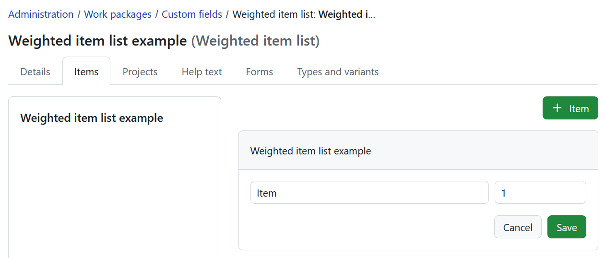

The underlying numerical values can be used in calculations, for example when evaluating projects using a [Calculated value project attribute](../projects/project-attributes/). Weighted item lists can also be configured to allow multiple selections.

## Required custom fields

You can make a custom field mandatory by selecting the **Required** checkbox in its settings. Users must then provide a value when creating new resources to which the custom field applies.

If you make an existing custom field required, resources that do not yet contain a value can still be updated without filling in the field. This allows you to introduce new requirements without interrupting ongoing work.

> [!NOTE]
> Boolean custom fields cannot be marked as required.

## Create a multi-select custom field

Some custom field formats allow users to select multiple values instead of a single value. For work package custom fields, this option is available for the **List**, **User**, **Version**, **Hierarchy**, and **Weighted item list** formats.

To enable multiple selections, select the **Allow multi-select** checkbox when configuring the custom field.

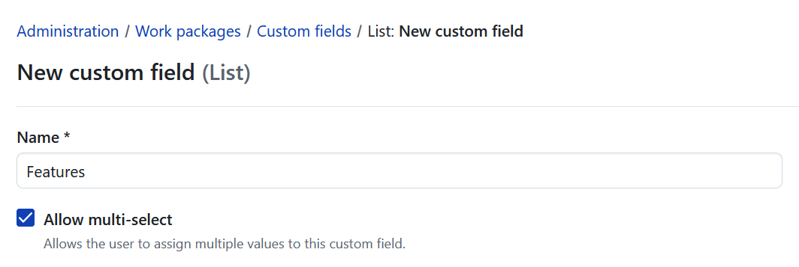

When filling in a multi-select custom field, users can select several values. To remove a value from the selection, click the cross icon next to it. Click the check mark to save the changes.

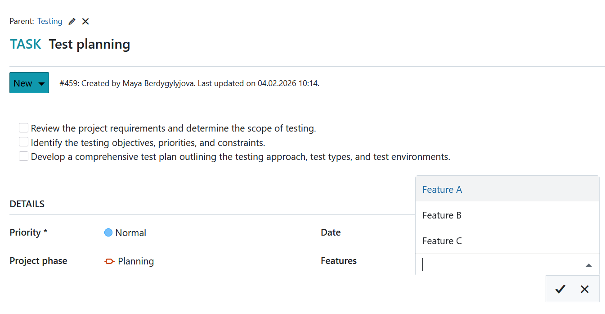

## Edit or remove a custom field

To edit an existing custom field, navigate to the administration section where it is managed and click its name. You can then update its available settings.

To remove a custom field that is no longer needed, use the delete action in the corresponding custom fields overview.

## Define custom field help text

Help text provides additional context to users when filling in a custom field. It can explain what information is expected, clarify terminology, or provide examples of suitable values.

To configure help text, open an existing custom field and navigate to the **Help text** tab, where available. You can configure the following:

- **Caption:** A short description displayed alongside the field. Captions are currently displayed for project attributes only.
- **Help text:** A more detailed explanation that users can access through the question mark next to the field name. This is a required field when configuring help text.
- **Attachments:** Files or images that provide additional guidance or illustrate the information expected.

> [!IMPORTANT]
> Text and images added to custom field help texts are visible to all logged-in users.

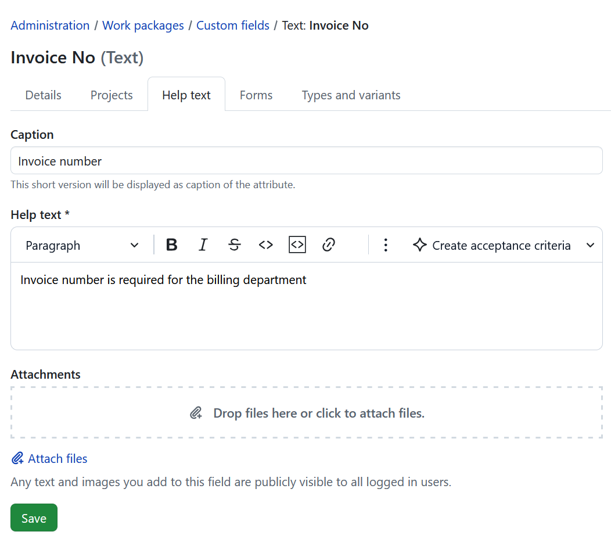
