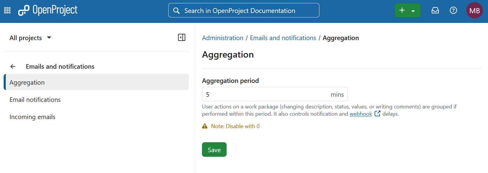
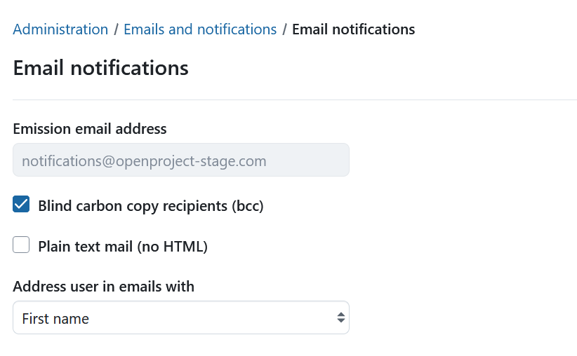
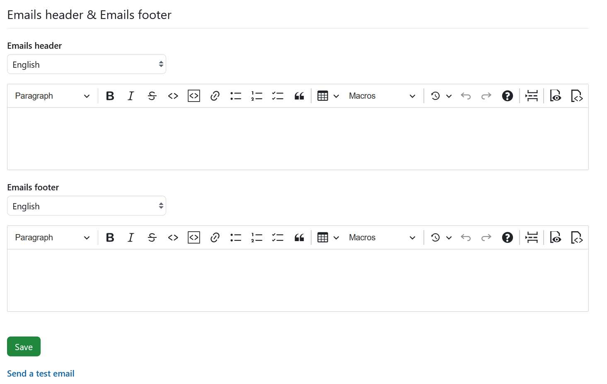
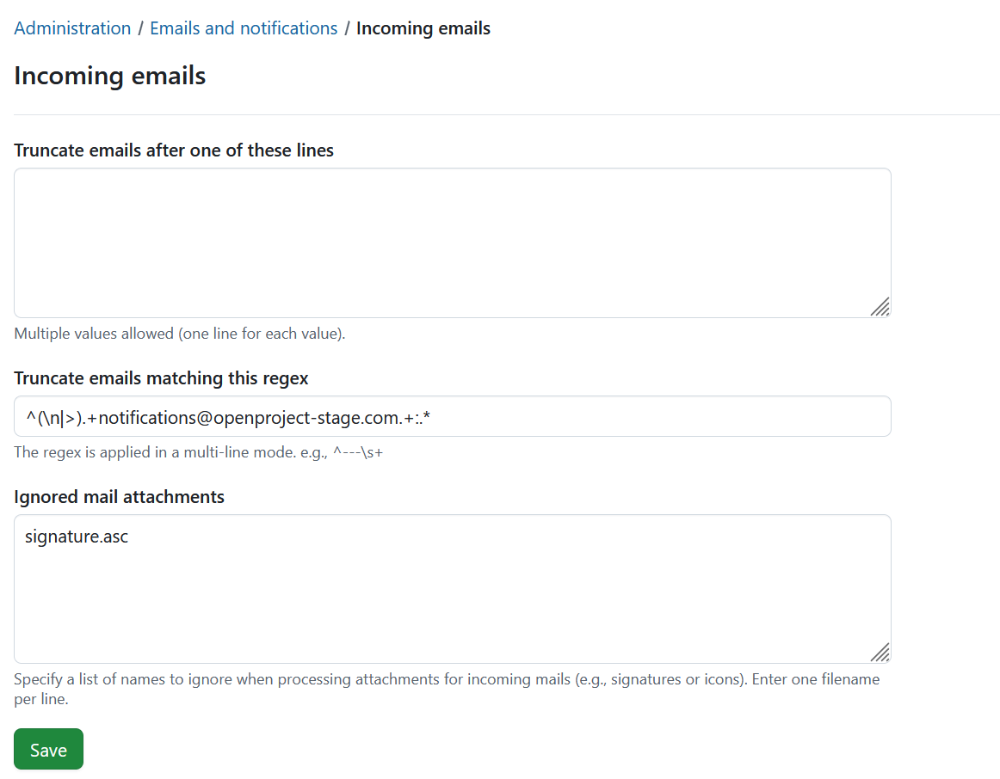

---
sidebar_navigation:
  title: Emails and notifications
  priority: 910
description: manage notifications and emails.
keywords: incoming and outgoing notifications emails
---
# Emails and notifications

Configure **Emails and notifications settings** in OpenProject, i.e. email notifications and incoming email configuration.

Navigate to **Administration → Emails and notifications**.

| Topic                                                | Content                                                      |
| ---------------------------------------------------- | ------------------------------------------------------------ |
| [Aggregation](#aggregation)                          | Configure how individual actions are aggregated into a single action. |
| [Email notifications](#email-notifications-settings) | How to configure outgoing email notifications.               |
| [Incoming emails](#incoming-emails-settings)         | How to configure settings for inbound emails.                |
| [Browser push notifications](#browser-push-notifications) | How to let users receive push notifications in the installed desktop application. |

## Aggregation



The setting **User actions aggregated within** specifies a time interval in which all notifications regarding a specific user's actions are bundled into one single notification. Individual actions of a user (e.g. updating a work package twice) are aggregated into a single action if their age difference is less than the specified time span. They will be displayed as a single action within the application. This will also delay notifications by the same amount of time reducing the number of emails being sent.

## Email notifications settings



1. **Emission email address**. This email address will be shown as the sender for the email notifications sent by OpenProject (for example, when a work package is changed).
2. Activate **blind carbon copy recipients** (bcc).
3. Define if the email should be formatted in **plain text** (no HTML).
4. Define if the users in emails should be **addressed with their first names or full names**.

The frequency of sending e-mails per work package can be set [here](../calendars-and-dates/#date-format).

### Configure email header and email footer

Configure your notification email header and footer which will be sent out for email notifications from the system.



1. **Formulate header and/or footer** for the email notifications. These are used for all the email notifications from OpenProject (e.g. when creating a work package).
2. **Choose a language** for which the email header and footer will apply.
3. **Send a test email**. Please note: This test email does _not_ test the notifications for work package changes etc. Find out more in [this FAQ](../../installation-and-operations/installation-faq/#i-dont-receive-emails-test-email-works-fine-but-not-the-one-for-work-package-updates-what-can-i-do).
4. Do not forget to **save** your changes.

## Incoming emails settings

To configure **Incoming emails** in OpenProject, navigate to **Administration → Emails and notifications → Incoming emails**. You can adjust the following:



1. **Define after which lines an email should be truncated**. This setting allows shortening email after the entered lines.
2. Specify a **regular expression** to truncate emails.
3. **Ignore mail attachment** of the specified names in this list.
4. Do not forget to **save** the changes.

**To set up incoming email**, please visit our [Operations guide](../../installation-and-operations/configuration/incoming-emails).

**To configure individual email reminders**, please visit our [User guide](../../user-guide/account-settings/notification-and-email/#email-reminders).

## Browser push notifications

Navigate to **Administration → Emails and notifications → Browser push notifications**. The page has a checkbox, **Browser push notifications**, which is enabled by default. It also has a reachability check and a VAPID key section, both described below.

The page is only available while the **Progressive web app** feature flag is active under **Administration → Experimental features**.

When the setting is enabled, users who have installed OpenProject as a desktop application can turn on browser push for each of their devices under **My account → Notifications → Browser push**. This works in Chrome, Edge and Safari on macOS. Firefox on desktop does not install web applications, but it supports browser push from a normal browser tab while Firefox is running. When a subscribed user has unread notifications, the instance sends a push that wakes the application. The application then shows a notification and updates the badge on its icon.

The operating system notification shows the actor and the work package subject of the latest unread notification. Projects with sensitive work package subjects may prefer to keep the setting off.

The instance sends at most one push per user per minute. Each push is sent with low urgency and a time to live of one hour.

**To enable browser push on a device**, please visit our [User guide](../../user-guide/account-settings/notification-and-email/#browser-push).

### Data protection

The push carries no content, not even a count. It is an empty wake-up signal. The installed application fetches the unread count from the instance itself over the user's own session.

The vendor push services (Google, Mozilla, Microsoft, Apple) do see the following:

- The subscription endpoint, a per-device identifier the browser created.
- The outgoing IP address of the instance.
- The VAPID public key of the instance.
- The time of each push.

### Network requirements

The instance must be able to reach the following hosts over HTTPS:

- `fcm.googleapis.com`
- `notify.windows.com`
- `updates.push.services.mozilla.com`
- `push.apple.com`

Subdomains of these hosts are included. Operators can extend the list with the `OPENPROJECT_WEB__PUSH__SERVICE__HOSTS` environment variable, as a comma separated list of hosts.

Click **Check reachability** to test this from the instance. The results show **Reachable** or **Unreachable** for each host, with a reason for every host that cannot be reached.

Air-gapped instances cannot use browser push. The checkbox can stay enabled without harm; nothing is sent until a user subscribes a device.

### Subscription lifecycle

Switching the setting off deletes every stored subscription immediately.

A subscription is also removed when:

- the user signs out,
- the user's session expires or is revoked under **My account → Session management**,
- the user is locked or deleted,
- the push service reports that the endpoint is gone.

Pausing reminders in **My account** also pauses browser push.

### VAPID key

The instance signs each push with a VAPID key. The key is generated on first use and stored encrypted in the database.

To supply your own key, set the environment variable `OPENPROJECT_WEB__PUSH__VAPID__PRIVATE__KEY` to the base64 encoding of a PKCS#8 DER P-256 private key. The following command generates a suitable value:

```shell
openssl ecparam -name prime256v1 -genkey -noout | openssl pkcs8 -topk8 -nocrypt -outform DER | base64 -w0
```

Each push is signed with a subject, the contact the instance presents to the push services. It is an https URL or a mailto: address and defaults to the root URL of your instance. Apple's push service only accepts a subject on a publicly registered domain, so Safari users on an instance with an intranet hostname receive no pushes. In that case set the environment variable `OPENPROJECT_WEB__PUSH__VAPID__SUBJECT` to a public https URL or a mailto: address on your public domain. Chrome, Edge and Firefox accept any subject.

Changing or rotating the key invalidates every subscription. Users then enable push again on each device.

If the stored key can no longer be read, for example after the instance secret key base changed, the page shows a banner and browser push stays unavailable to users. Click **Regenerate key** to create a new key. You can also use this button to rotate the key on purpose. Regenerating the key deletes every subscription, so users need to enable push again on each of their devices.

### Storage

Subscriptions are stored in an unlogged database table, like sessions. They do not survive an unclean database restart. Users then enable push again on each device.

### Troubleshooting

**Pushes reach Chrome but not Safari on macOS.** If the log shows a warning such as `Push service web.push.apple.com answered 403 for subscription 12`, Apple rejected the signed push because the subject's domain is not publicly registered, which is the case for intranet hostnames. Set `OPENPROJECT_WEB__PUSH__VAPID__SUBJECT` to a public https URL or a mailto: address on a public domain, as described under [VAPID key](#vapid-key).
