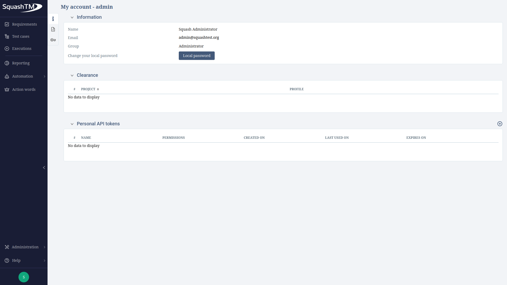
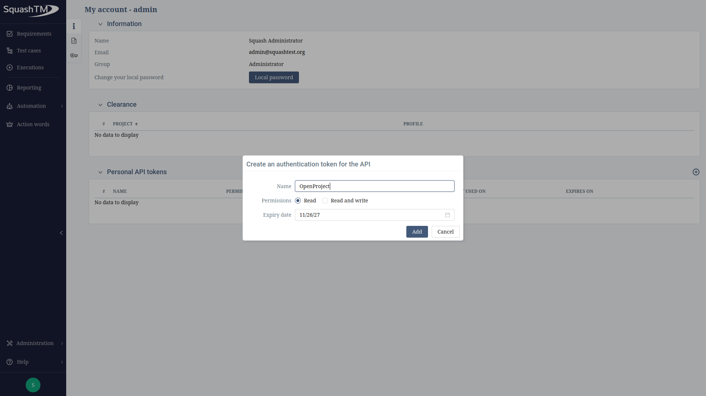
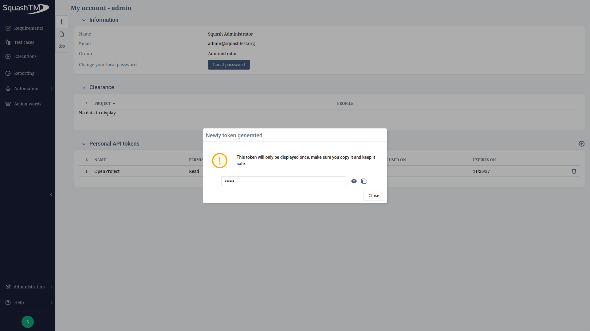
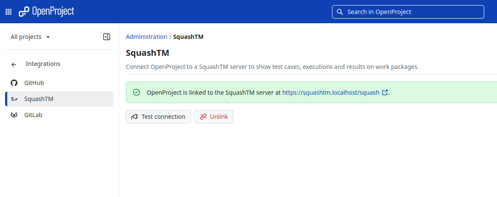
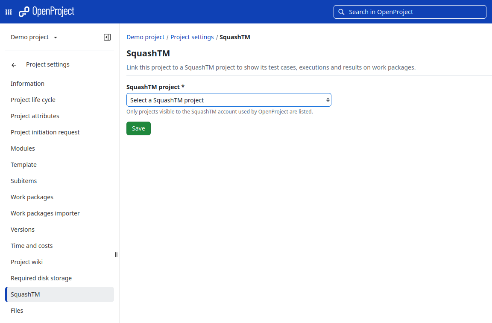
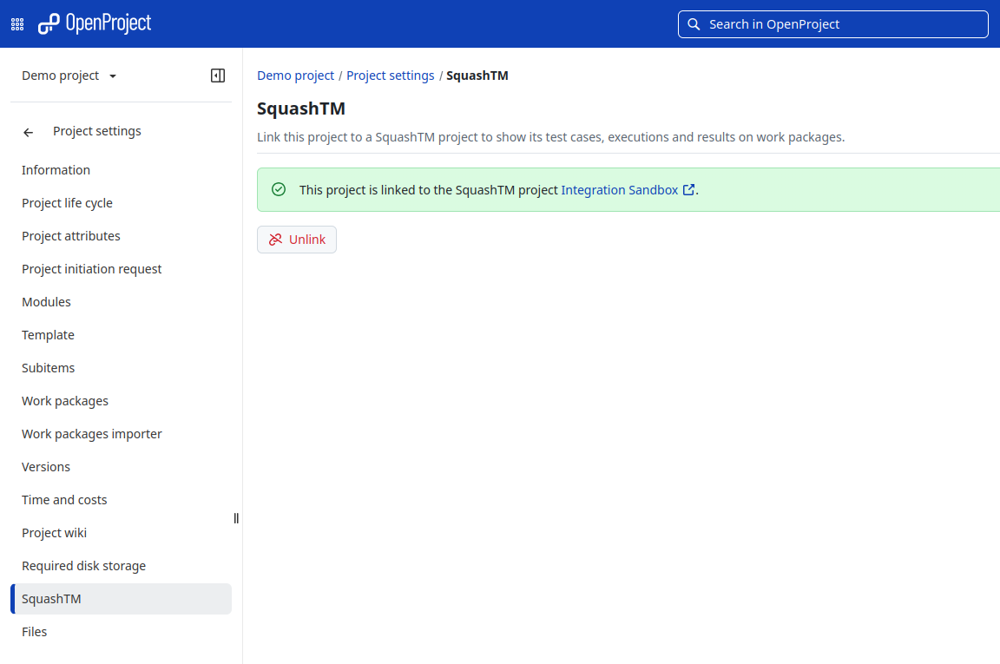
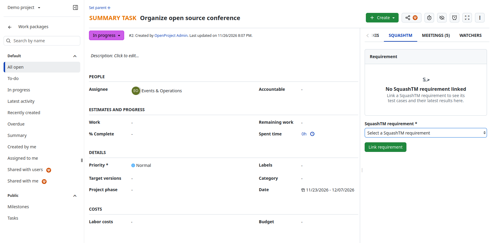

---
sidebar_navigation:
  title: SquashTM integration setup
  priority: 300
description: Set up SquashTM as a test management solution for your OpenProject instance
keywords: squashtm, test, test management
---

# SquashTM integration setup

[SquashTM](https://www.squashtest.com/) is an open source test management tool. With the SquashTM integration, you can link an OpenProject project to a SquashTM project and link work packages to SquashTM requirements. The test cases, executions, and results of a linked requirement are then shown directly in the work package.

The integration is set up in four steps:

1. Create a personal access token in SquashTM.
2. Connect OpenProject to your SquashTM server.
3. Configure the SquashTM permissions in OpenProject.
4. Link OpenProject projects to SquashTM projects.

Afterwards, users can [link work packages to requirements](#link-a-work-package-to-a-requirement).

## Prerequisites

To set up SquashTM, you will need the following:

1. OpenProject must be able to reach your SquashTM server.
2. You will need a read-only [personal access token](https://tm-en.doc.squashtest.com/v12/user-guide/general-introduction/squash-workspaces.html#personal-api-tokens) for SquashTM. We recommend setting up a [dedicated user in SquashTM](https://tm-en.doc.squashtest.com/v12/admin-guide/manage-users/manage-users.html) for this.
3. If your SquashTM server is hosted on a non-public IP address, you must configure [SSRF protection](../../../installation-and-operations/configuration/ssrf-protection/) to allow accessing the SquashTM server.
4. If your SquashTM server uses a TLS certificate that is not issued by a generally trusted certificate authority, you need to [import the root certificate into OpenProject](../../../installation-and-operations/installation/docker/#import-self-signed-root-certificate).

> [!IMPORTANT]
> SquashTM personal access tokens are limited to a 1-year expiry. We recommend setting a reminder to renew the token after one year.

## 1. Create a personal access token in SquashTM

Log in to SquashTM with the user that OpenProject should use and open the **My account** page. In the **Personal API tokens** section, click the **+** icon on the right.

In the dialog, enter a **Name** for the token, for example *OpenProject*, select the **Read** permission, and set an **Expiry date**. Then click **Add**.

SquashTM displays the new token. Copy it and keep it safe, since it is only displayed once. Then click **Close**.

## 2. Connect OpenProject to your SquashTM server

The SquashTM connection is configured on the OpenProject administration level, while the individual project connections are set up on a per-project basis. To configure the connection, navigate to *Administration* → *Integrations* → *SquashTM*.

Enter the URL of your SquashTM server and the personal access token you created in step 1. Make sure that the SquashTM server URL contains the full address including the context path, for example `https://your.squashtm.server.example.com/squash` instead of `https://your.squashtm.server.example.com/`. Then click **Save**.

Once the connection is established, OpenProject confirms that it is linked to your SquashTM server. Click **Test connection** to check the connection again at any time, or **Unlink** to remove it.

## 3. Configure permissions

SquashTM has its own permissions in OpenProject. New installations come with pre-configured SquashTM permissions. In installations upgraded from an earlier version, these permissions are not granted automatically, so you need to configure them manually.

To configure SquashTM permissions, navigate to *Administration* → *Users and permissions* → *Roles and permissions*. For the default configuration, enable the following permissions for the **Project admin** role:

- **View SquashTM**
- **Manage SquashTM requirements**
- **Manage SquashTM integration**

Also enable the following permissions for the **Member** role:

- **View SquashTM**
- **Manage SquashTM requirements**

## 4. Link an OpenProject project to a SquashTM project

Open the **Project settings** of the project you want to link to a SquashTM project. Select **Modules**, enable the **SquashTM** module, and click **Save**.

If you have the **Manage SquashTM integration** permission, the **SquashTM** entry now appears in the project settings menu. Select the SquashTM project you want to link and click **Save**.

> [!IMPORTANT]
> Only SquashTM projects that are visible to the SquashTM account of the access token from step 1 are shown in the dropdown.

You can only link one SquashTM project to an OpenProject project. You can also remove the link here. Removing a link also removes the SquashTM requirement links from all work packages in the OpenProject project.

## Link a work package to a requirement

If you have the **View SquashTM** permission, you can open a work package and select the **SquashTM** tab.

If you have the **Manage SquashTM requirements** permission, you can select a requirement from SquashTM to link. Once the requirement is linked, the test cases associated with that requirement are shown on this tab.

To remove the requirement link, click the **More** (three dots) menu in the requirement box and select **Unlink**.
