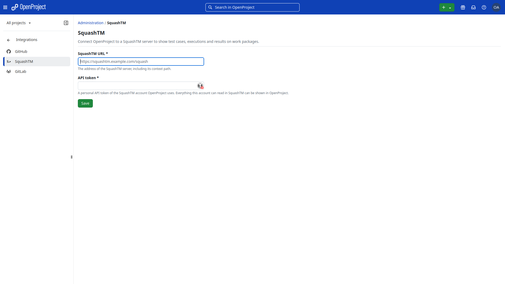
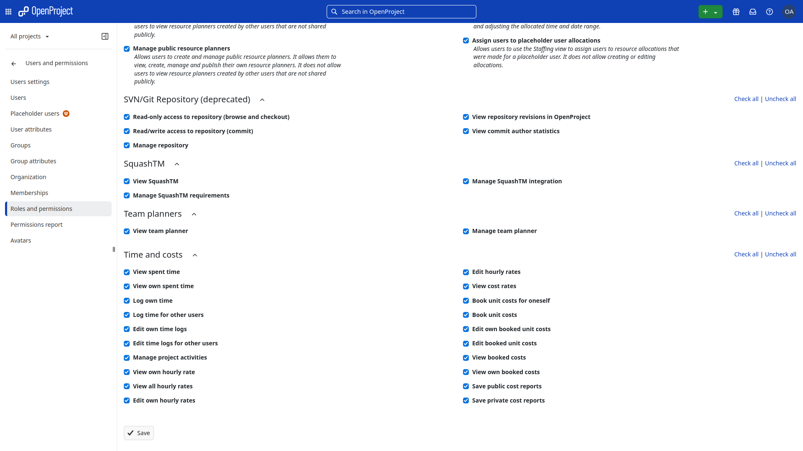
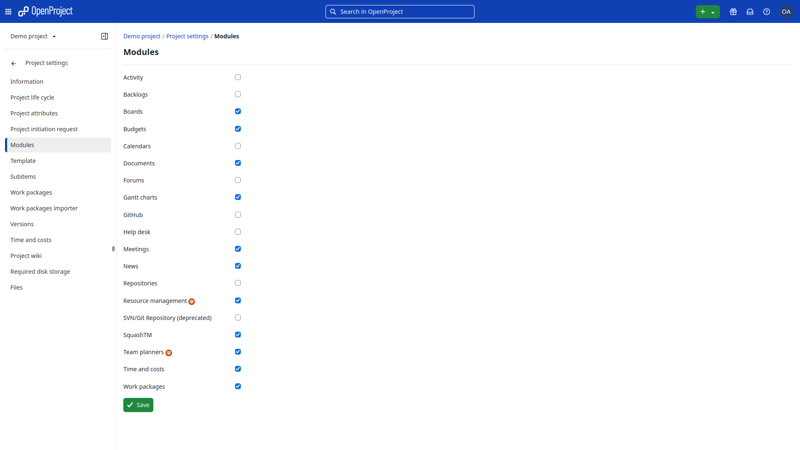
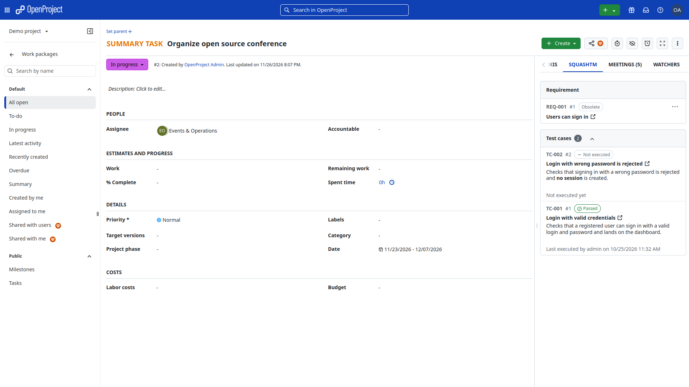

---
sidebar_navigation:
  title: SquashTM integration setup
  priority: 300
description: Set up SquashTm as a test management solution for your OpenProject instance
keywords: squashtm, test, test management
---

# SquashTM integration setup

To set up SquashTM, you will need the following:

1. OpenProject must be able to reach your SquashTM server.
2. You will need a read-only [personal access token](https://tm-en.doc.squashtest.com/v12/user-guide/general-introduction/squash-workspaces.html#personal-api-tokens) for SquashTM. We recommend setting up a [dedicated user in SquashTM](https://tm-en.doc.squashtest.com/v12/admin-guide/manage-users/manage-users.html) for this.
3. If your SquashTM server is hosted on a non-public IP address, you must configure [SSRF protection](https://www.openproject.org/docs/installation-and-operations/configuration/ssrf-protection/) to allow accessing the SquashTM server.
4. If your SquashTM uses a TLS certificate that is not issued by a generally trusted certificate authority, you need to inject the CA certificate into OpenProject. Please read the [installation instructions](../../../installation-and-operations/) for details.

> [!IMPORTANT]
> SquashTM Personal Access Tokens are limited to a 1-year expiry. We recommend setting a reminder to renew the token after one year.

## 1. Configuring the instance-wide SquashTM integration in OpenProject

The SquashTM connection is configured on the OpenProject administration level, while the individual project
connections are set up on a per-project basis. To configure the connection, head to your OpenProject administration
settings, then select *Integrations* → *SquashTM*.

Here you can configure the SquashTM server URL and the API token. Please make sure that your SquashTM server URL contains the full address including the context path (`https://your.squashtm.server.example.com/squash` instead of `https://your.squashtm.server.example.com/`). Complete the form with your personal access token and then press the

## 2. Configuring permissions

OpenProject 18.x brings new permissions for SquashTM. While new installations already bring pre-configured SquashTM permissions, upgraded installations from 17.x do not automatically grant additional permissions to users on upgrade and you need to configure them manually.

To configure SquashTM permissions, go to *Users and permissions* → *Roles and permissions*. For the default configuration, enable the following permissions for a **Project admin**:

- View SquashTM
- Manage SquashTM requirements
- Manage SquashTM integration

Also set up the following permissions for the **Member** role:

- View SquashTM
- Manage SquashTM requirements

## 3. Enabling the SquashTM module and linking an OpenProject project to a SquashTM project

You can now go to the **project settings** for the project you wish to link to a SquashTM project. Select the *Modules* option and enable the SquashTM module, then click *Save*.

If you have the *Manage SquashTM integration* permission, you will now see the SquashTM option on the left side. Here you can select the SquashTM project you wish to link and click *Save*.

> [!IMPORTANT]
> Only projects visible to SquashTM account with the access token set up in step 1 are shown in the dropdown.

You can only link one SquashTM project to an OpenProject project. If you want to remove the linking, you can do so here as well. Keep in mind that removing a linking also removes the SquashTM requirement linking from all work packages in the OpenProject project. 

## 4. Linking a work package to a requirement

If you have the "View SquashTM" permission, you can now go to a work package of your choice and open the SquashTM tab.

If you have the "Manage SquashTM requirements" permission, you can select as *requirement* from SquashTM to link. Once the requirement is linked, the test cases associated with that requirement will be shown on this tab.

If you would like to remove the requirement linking, click the three dots in the requirement box.
