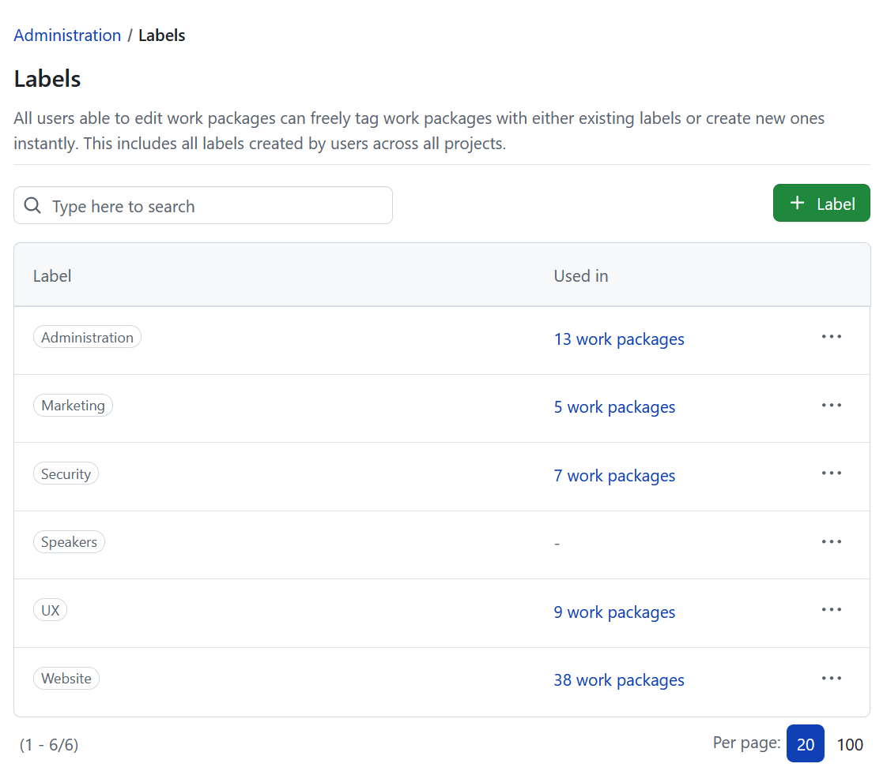
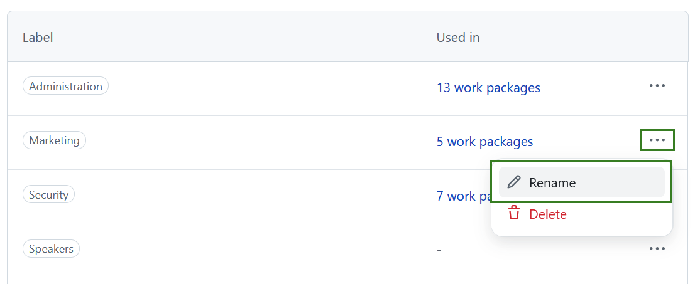
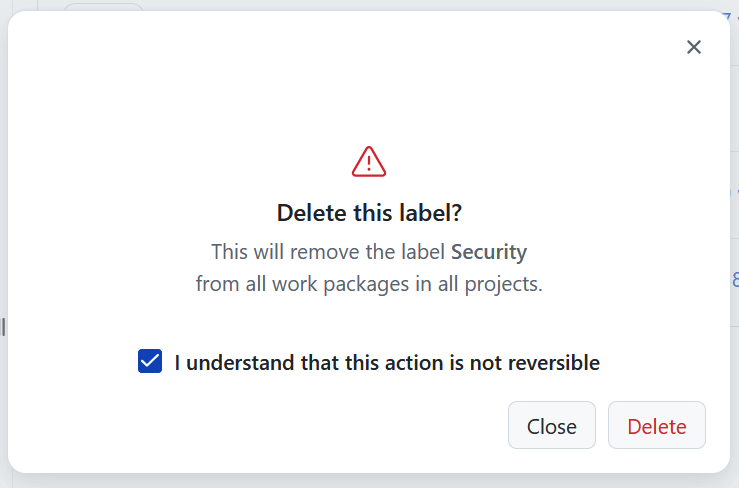

---
sidebar_navigation:
  title: Labels
  priority: 955
description: Work package labels in OpenProject.
keywords: work package, labels
---

# Manage labels

Labels allow users to categorize and organize work packages in OpenProject. Users with permission to edit work packages can assign existing labels or create new ones directly within a work package.

Labels are available globally across all projects. This means that labels created in one project can also be used in other projects.

System administrators can view and manage all existing labels under **Administration → Labels**.

## View and search labels

To view all existing labels, navigate to **Administration → Labels**.

The page displays an overview of all labels created across the OpenProject instance, including labels created directly by users in work packages.

Use the **search bar** to find a specific label.

The table contains the following columns:

- **Label:** The name of the label.
- **Used in:** The number of work packages currently using the label.

Click the number in the **Used in** column to open a work package table filtered by the respective label in a new browser tab.

## Create a label

System administrators can create labels directly from the administration area.

1. Navigate to **Administration → Labels**.
2. Click the **+ Label** button in the top-right corner.
3. Enter a name for the label.
4. Confirm to create the label.

The newly created label becomes available to all users across all projects.

> [!NOTE]
> Users with permission to edit work packages can also create labels directly within a work package. These labels are available globally across all projects and appear in the administration overview.

Labels created by administrators remain available even when they are not assigned to any work package. Labels created directly in work packages are automatically removed when they are no longer used.

## Rename a label

To rename an existing label:

1. Navigate to **Administration → Labels**.
2. Find the label you want to rename, using the search bar if necessary.
3. Click the **More** menu (three dots) at the end of the corresponding row.
4. Select **Rename**.
5. Enter the new name and confirm.

The label is renamed globally, including in all work packages where it is currently used.

> [!NOTE]
> Label names must be unique, regardless of capitalization. For example, `Development` and `development` cannot exist as separate labels.

## Delete a label

System administrators can delete labels that are no longer needed.

1. Navigate to **Administration → Labels**.
2. Find the label you want to delete.
3. Click the **More** menu (three dots) at the end of the corresponding row.
4. Select **Delete**.
5. Review the confirmation dialog showing how many work packages currently use the label.
6. Check **I understand that this action is not reversible**.
7. Click **Delete** to confirm.

The label is permanently deleted and removed from all work packages where it was assigned.

> [!IMPORTANT]
> Deleting a label cannot be undone.