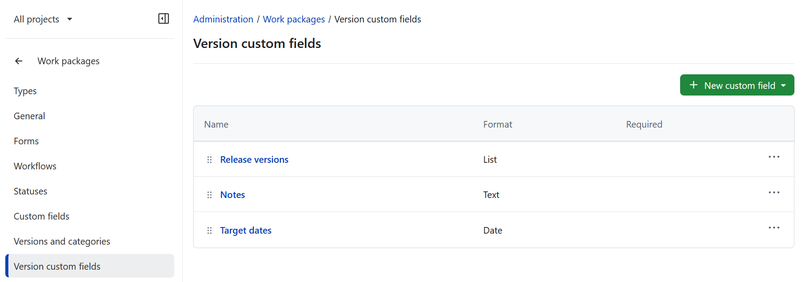
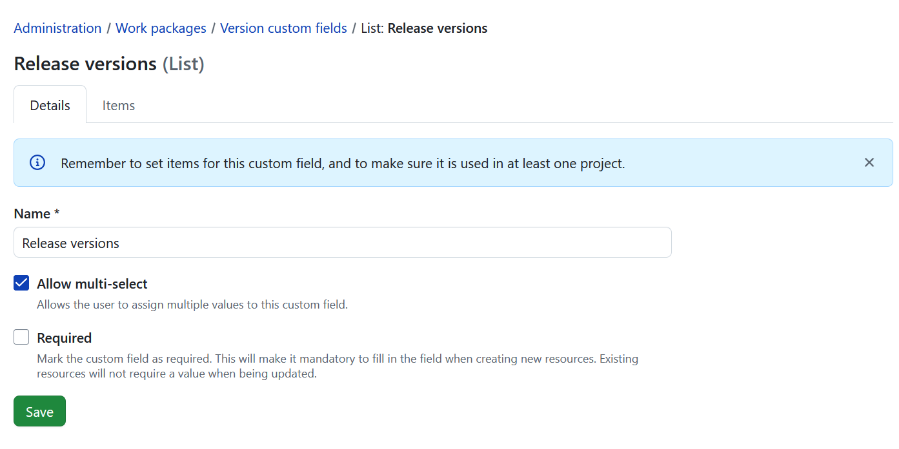

---
sidebar_navigation:
  title: Version custom fields
  priority: 649
description: Create, manage, and configure custom fields for versions in OpenProject.
keywords: version custom fields, version attributes, custom fields, versions, release management
---

# Manage version custom fields

Version custom fields allow you to record additional information about versions in OpenProject. For example, you might want to record a release reference, an external release date, or the person responsible for a release.

Unlike work package custom fields, version custom fields describe the versions themselves rather than the work packages assigned to them.

To manage version custom fields, navigate to *Administration → Work packages → Version custom fields*.

## Overview of version custom fields

The Version custom fields overview lists all existing custom fields for versions, their formats, and whether they are required.

Click a custom field's name to edit its configuration or open the **More (three dots)** menu at the end of its row to access the following actions:

- **Edit:** Update the custom field's configuration.
- **Move:** Change the position of the custom field in the list.
- **Delete:** Remove a custom field that is no longer needed.

You can also rearrange custom fields directly using drag and drop.

## Create a version custom field

To create a version custom field, click **+ New custom field** and select a format from the dropdown menu. The format determines what kind of information users can enter and which configuration options are available.

The following formats are available for version custom fields:

- Boolean
- Date
- Float
- Integer
- List
- Text
- Long text
- User
- Version

Enter a name for the custom field and configure the available settings. Depending on the selected format, you can make the field required or allow users to select multiple values.

The following example shows the configuration options for a version custom field of the **List** format.

Click **Save** to create the custom field.

For custom fields of the **List** format, an additional **Items** tab is available after saving, where you can define and manage the values users can select.

For more information on configuring custom fields and managing selectable values, see [Manage custom fields](../../custom-fields/).

## Required version custom fields

You can make a version custom field mandatory by selecting the **Required** checkbox in its settings. Users must then provide a value when creating new versions.

If you make an existing custom field required, versions that do not yet contain a value can still be updated without filling in the field. This allows you to introduce new requirements without having to update all existing versions.

## Further reading

- [Manage custom fields](../../custom-fields/)
- [Manage work package custom fields](../work-package-custom-fields/)
- [Versions and categories](../versions-and-categories/)
