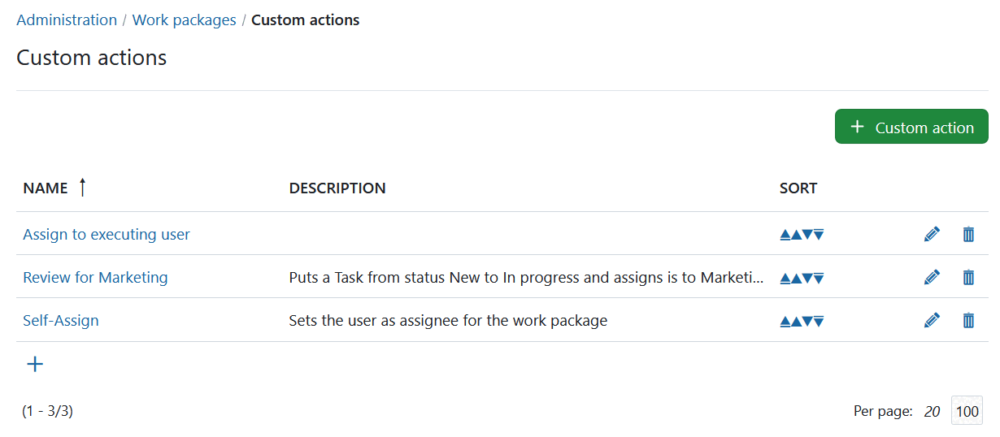
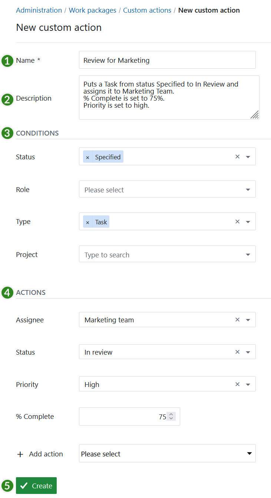
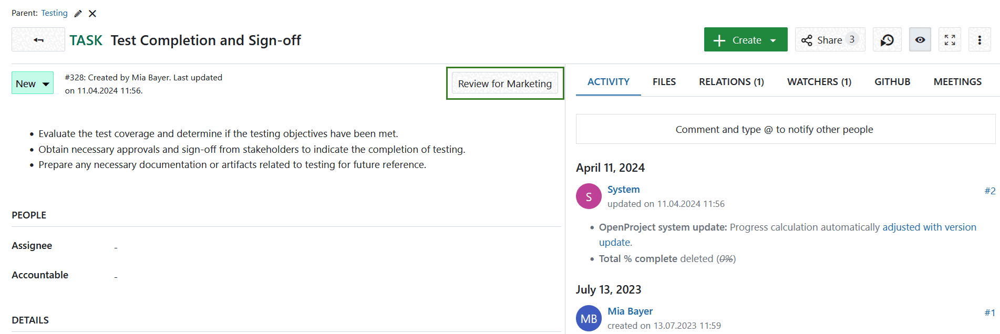
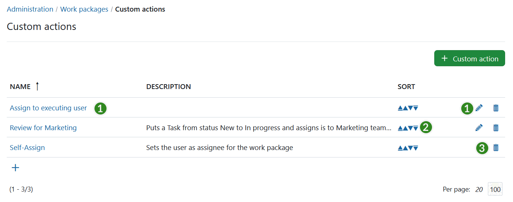

---

sidebar_navigation:
  title: Automations
  priority: 100
description: Intelligent workflows with automated actions.
keywords: custom actions, automations, automated workflow
---

# Work package automations (Enterprise add-on)

Automations let you update multiple work package attributes with a single click. Administrators configure the conditions under which an automation is available and the changes it applies.

You can use automations to standardize your workflows, avoid errors and reduce manual work for updates.

[feature: custom_actions ]

Watch the following video to see how to configure an automation (recorded when the feature was called Custom actions):

## Create automations

Navigate to **Administration → Work packages → Automations**.

To create an automation, click **+ Automation**.

You can now configure the **Conditions** and **Actions** for the automation.

1. Enter a **name** for the automation button. This name will then appear on the button on the work package.
2. Set a **description** (i.e. what are the conditions and actions).
3. Set the **conditions** for which the automation button should apply, e.g. in which status, for which role, what type or in which project should the automation button appear.
4. Set the **actions** what should happen after pressing the automation button, e.g. status transitions, and changes to any other attribute.
5. **Save** your changes.

If a work package is then in the defined condition, the button will appear on top of a work package and will apply the actions and changing the attributes of a work package as defined in the configuration when clicking on the button.

## Update, sort or delete automations

1. Click an automation's name or pencil icon to edit it.
2. Use the arrow icons to change the order in which automation buttons appear on work packages.
3. Delete an automation when it is no longer needed.

> [!TIP]
>
> Read this [blog article](https://www.openproject.org/blog/custom-action-self-assign/) for an example of an automation used within the OpenProject team to quickly self-assign a work package.
