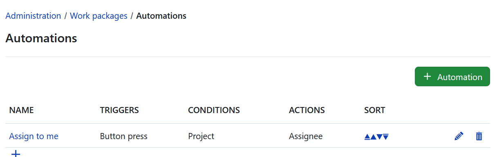
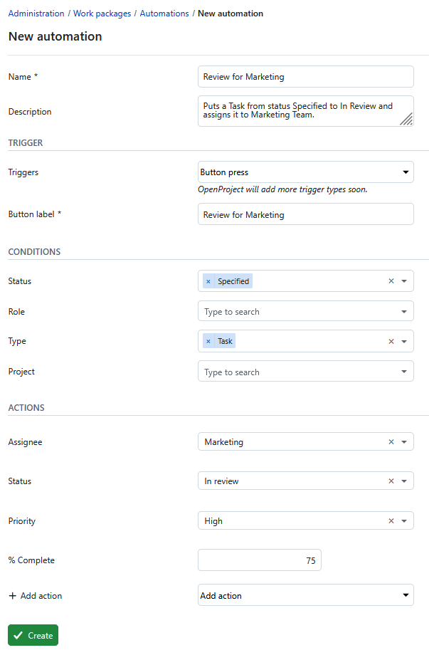
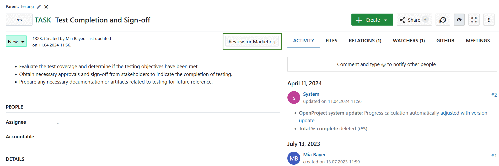

---
sidebar_navigation:
  title: Automations
  priority: 100
description: Configure work package automations to update multiple attributes with a single click in OpenProject.
keywords: custom actions, automations, automated workflows, triggers, conditions, actions
---

# Work package automations (Enterprise add-on)

Automations let you update multiple work package attributes with a single click. Administrators configure the conditions under which an automation is available and the changes it applies.

You can use automations to standardize your workflows, avoid errors, and reduce manual work.

> [!NOTE]
> Prior to OpenProject 18.0, automations were called custom actions.

[feature: custom_actions ]

Watch the following video to see how to configure an automation (recorded when the feature was called Custom actions):

## Create an automation

Navigate to *Administration → Work packages → Automations*.

The overview lists existing automations, their triggers, conditions, and actions.

To create an automation, click **+ Automation**.

Configure the automation as follows:

1. Enter a **Name** to identify the automation in the system administration.
2. Optionally, enter a **Description** explaining its purpose.
3. Under **Trigger**, select how the automation is triggered. Currently, **Button press** is the available trigger.
4. Enter a **Button label**. This is the text displayed on the automation button in a work package.
5. Under **Conditions**, specify when the automation should be available. You can define conditions based on the work package status, user role, work package type, and project.
6. Under **Actions**, use **+ Add action** to define what should happen when the automation is triggered, such as changing the status, assignee, or other work package attributes.
7. Click **Create**.

When a work package meets the configured conditions, the automation button appears at the top of the work package. Clicking the button applies the configured actions and updates the corresponding work package attributes.

## Edit, sort or delete automations

Navigate to *Administration → Work packages → Automations* to manage existing automations.

- Click the name of an automation or the **Edit (pencil)** icon to change its configuration.
- Use the arrow icons in the **Sort** column to change the order in which automation buttons appear on work packages.
- Click the **Delete (trash)** icon to remove an automation that is no longer needed.

> [!TIP]
> Read this [blog article](https://www.openproject.org/blog/custom-action-self-assign/) for an example of an automation used within the OpenProject team to quickly self-assign a work package.