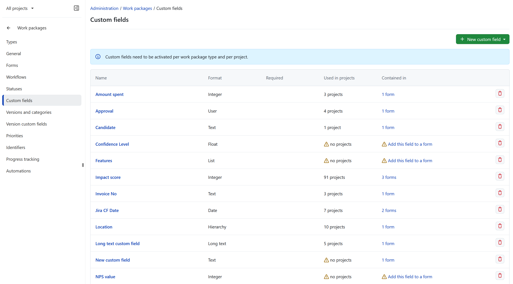
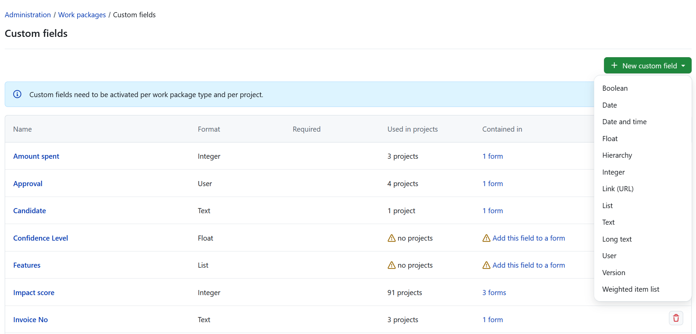
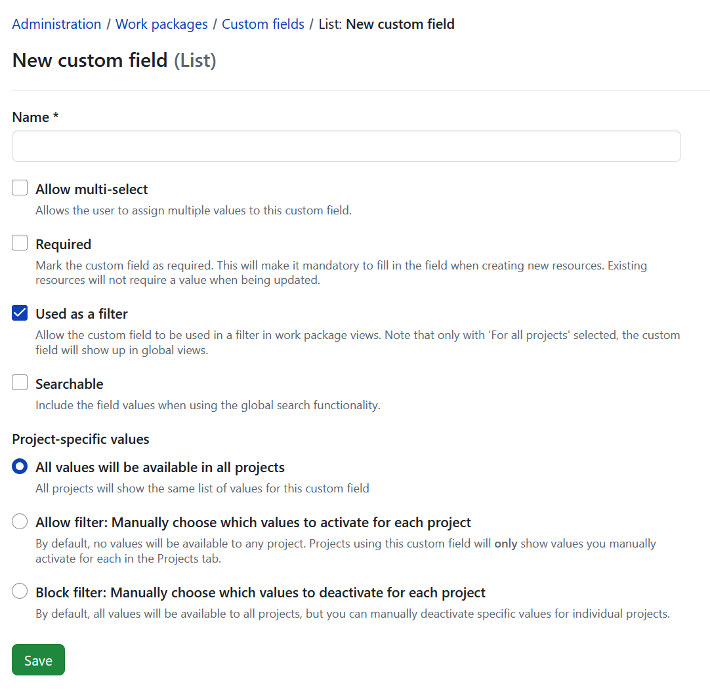
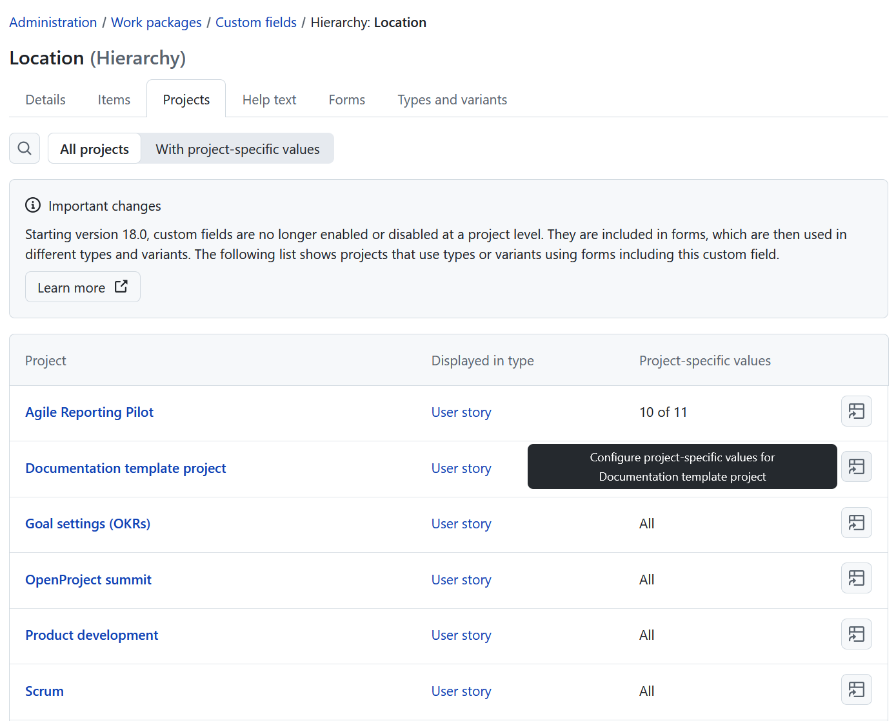
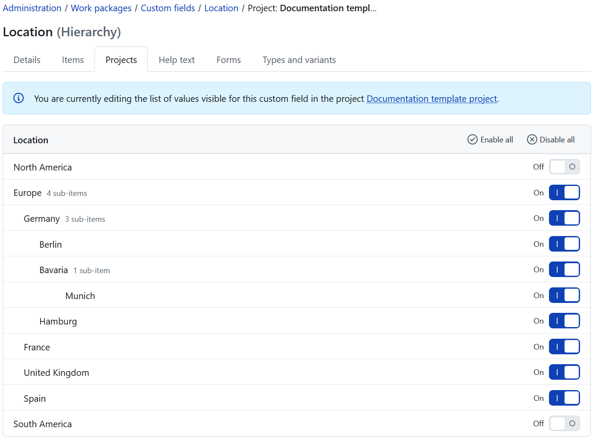
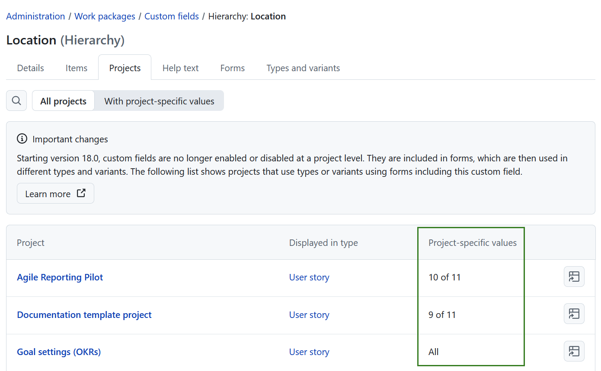
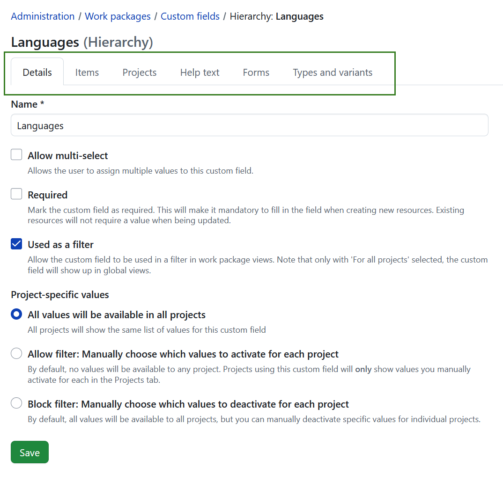
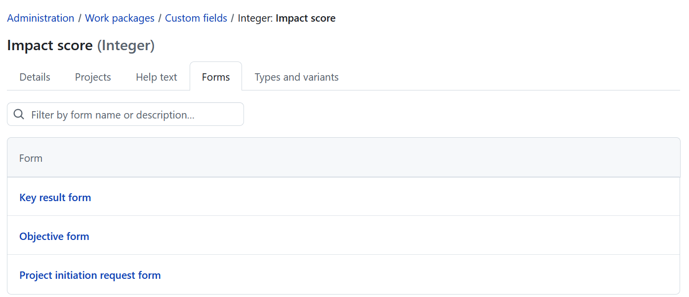
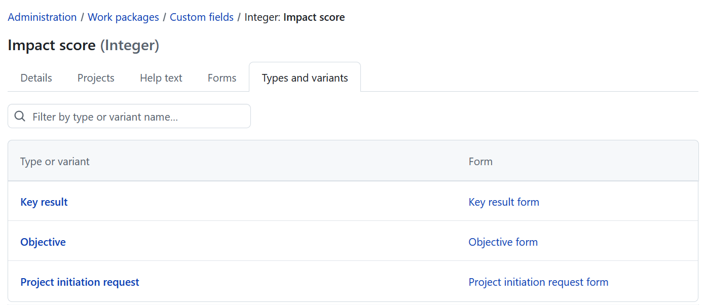
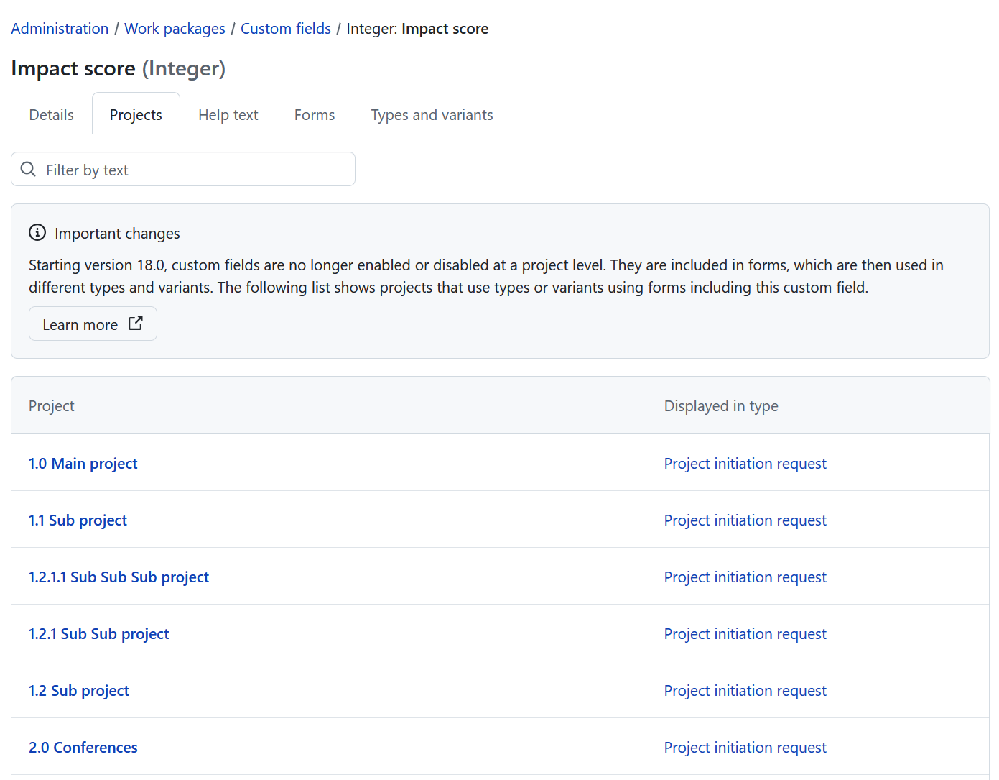

---
sidebar_navigation:
  title: Custom fields
  priority: 300
description: Create, manage, and configure custom fields for work packages in OpenProject.
keywords: work package custom fields, custom fields, required fields, work package types, variants, forms, project-specific values
---

# Manage work package custom fields

Custom fields allow you to extend work packages with additional attributes specific to your organization's needs. For example, you might want to record a customer reference, an estimated cost, or an incident classification. Depending on their format and configuration, custom fields can also be used to filter, sort, and group work packages.

To manage work package custom fields, navigate to *Administration → Work packages → Custom fields*.

## Overview of work package custom fields

The Custom fields overview lists all existing work package custom fields, their formats, and where they are used. You can see at a glance whether a field is required, how many projects it is used in, and how many forms contain it.

The **Used in projects** and **Contained in** columns help you identify custom fields that are not yet in use. If a field is not used in any projects or has not been added to any forms, a warning icon is displayed in the corresponding column.

Click a custom field's name to edit its settings. To delete a custom field, use the delete icon at the end of its row.

## Create a custom field

To create a work package custom field, click **+ New custom field** and select a format from the dropdown menu. The format determines what kind of information users can enter and which configuration options are available.

Enter a name for the custom field and configure its settings. Depending on the selected format, you can define default values and validation rules, allow multiple values, make the field required, or enable its use in filters and global search. Click **Save** to create the custom field.

The following example shows the configuration options for a custom field of the **List** format.

For more information about the available formats and their configuration options, see [Custom field formats](../../custom-fields/#custom-field-formats).

## Project-specific values (Enterprise add-on)

[feature: project_specific_list_values ]

For work package custom fields of the **List**, **Hierarchy**, and **Weighted item list** formats, you can control which values are available in individual projects. This allows you to use the same custom field across your organization while offering different sets of selectable values depending on the project, such as departments, product lines, or locations.

Under **Project-specific values**, select one of the following options:

- **All values will be available in all projects:** All projects using the custom field have access to the same values.
- **Allow filter: Manually choose which values to activate for each project:** Only the values you activate for a project are available.
- **Block filter: Manually choose which values to deactivate for each project:** All values are available except those you deactivate for a project.

### Configure values for individual projects

To manage the available values for individual projects, open the custom field's **Projects** tab. Use the search option to find a specific project and click the **Configure project-specific values** button at the end of the corresponding project's row.

Use the toggle next to each item to enable or disable individual values for the selected project. You can also use **Enable all** or **Disable all** to change the availability of all values at once.

The following example shows the configuration of project-specific values for a custom field of the **Hierarchy** format.

When you return to the **Projects** tab, the **Project-specific values** column reflects your changes. If all values are available in a project, the column displays **All**. Otherwise, it shows the number of enabled values out of the total number of values, for example, **10 of 11**.

You can switch between **All projects** and **With project-specific values** to review all projects using the custom field or only those with customized values.

These settings determine which values users can select in a project, rather than whether the custom field itself is available. Changes to the available values in one project do not affect other projects.

## Configure an existing custom field

To review or update the configuration of a custom field, click its name in the Custom fields overview.

Work package custom fields have five tabs: **Details**, **Projects**, **Help text**, **Forms**, and **Types and variants**. Custom fields with selectable items, such as List, Hierarchy, and Weighted item list, also have an **Items** tab immediately after **Details**, where you can manage the available values.

You can find detailed instructions on configuring custom field formats, validation rules, selectable values, and help text in the general [Custom fields guide](../../custom-fields/).

## Make custom fields available in work packages

Starting with OpenProject 18.0, custom fields are no longer activated or deactivated individually for each project. Instead, their availability is determined by the forms used by work package types and variants.

Creating a custom field does not automatically make it available in work packages. The field must be included in a form used by a work package type or variant. It will then be available in all projects where the corresponding type or variant is enabled.

### Add a custom field to a form

Navigate to *Administration → Work packages → Forms* and open the relevant form. Drag the custom field from the available attributes into the appropriate section of the form.

Since forms are reusable, adding a custom field to a shared form affects all types and variants using that form.

For detailed instructions, see [Configure a work package form](../work-package-forms/#configure-a-work-package-form).

### Review where a custom field is used

The **Used in projects** and **Contained in** columns in the Custom fields overview show how many projects and forms use each custom field. To review these associations in more detail, open the custom field and select one of the following tabs:

- **Forms:** Shows the forms that contain the custom field.

  

- **Types and variants:** Shows the work package types and variants that use a form containing the custom field.

  

- **Projects:** Shows the projects in which the custom field is available and the work package types and variants through which it is used. You can search for specific projects. For supported custom field formats, you can also [configure project-specific values](#configure-values-for-individual-projects) directly from this tab.

  

## Required custom fields

You can make a custom field mandatory by selecting the **Required** checkbox in its settings. Users must then provide a value when creating new work packages to which the custom field applies.

If you make an existing custom field required, work packages that do not yet contain a value can still be updated without filling in the field. This allows you to introduce new requirements without interrupting ongoing work.

## Further reading

- [Manage custom fields](../../custom-fields/)
- [Manage work package forms](../work-package-forms/)
- [Manage work package types](../work-package-types/)
- [Work package settings in a project](../../../user-guide/projects/project-settings/work-packages/)