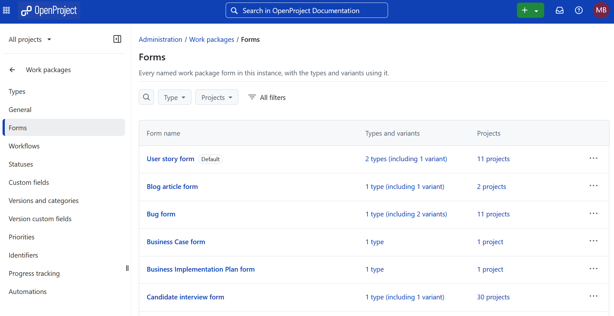
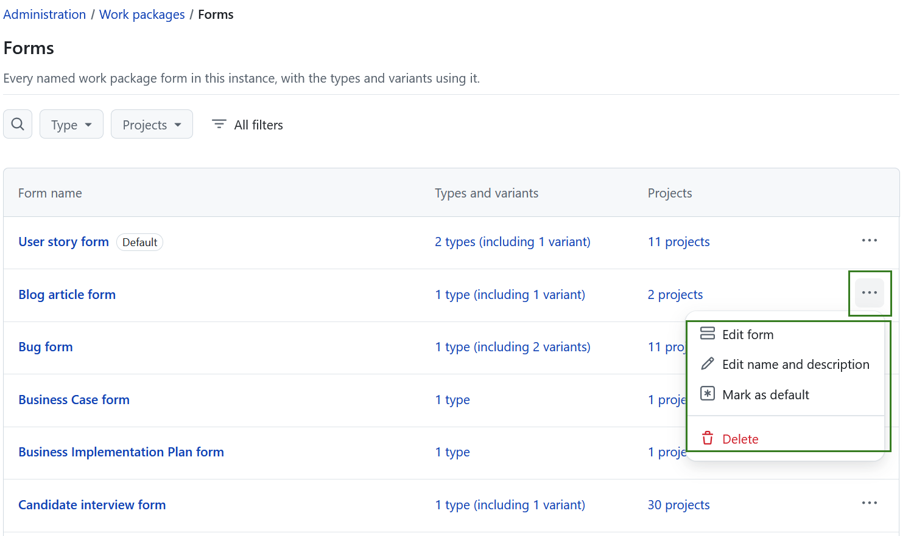
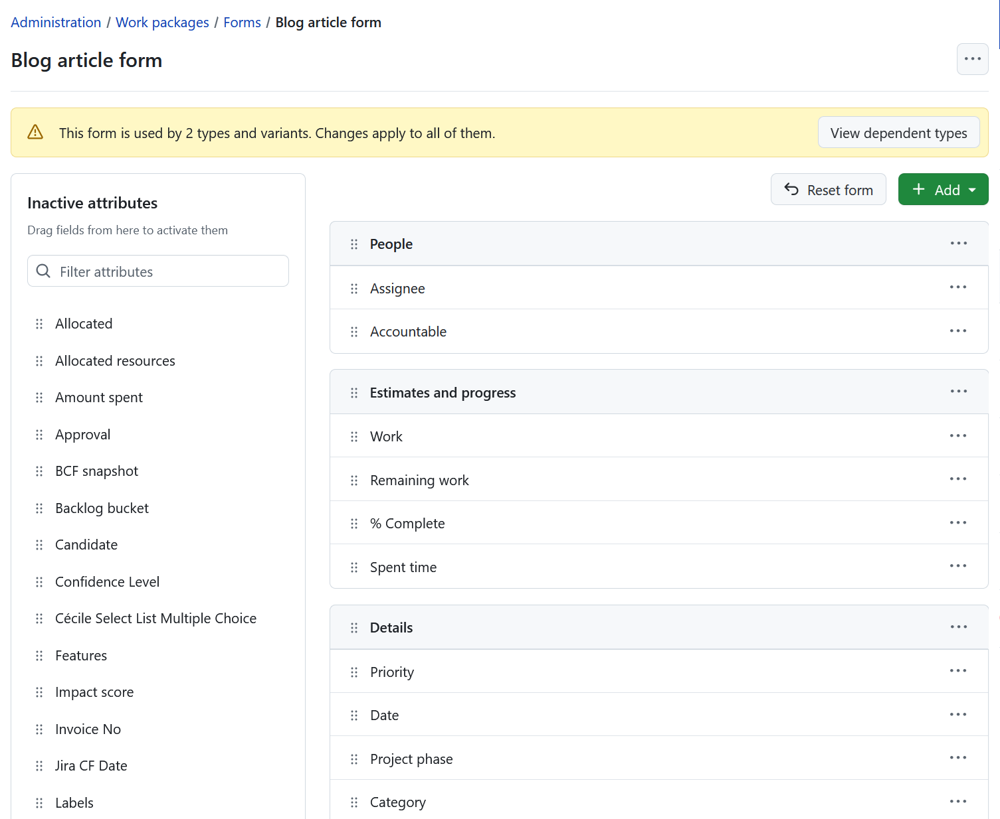
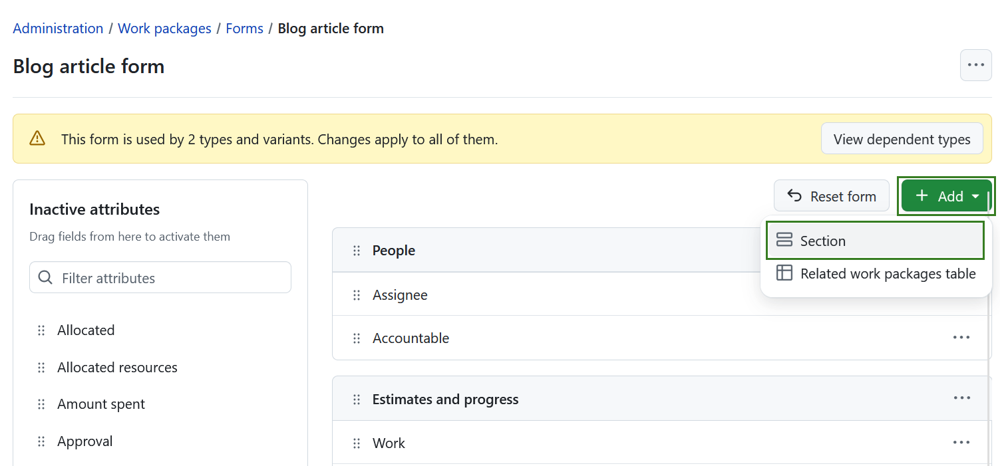
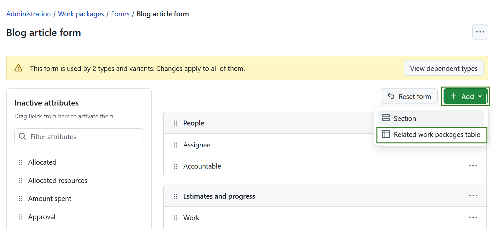
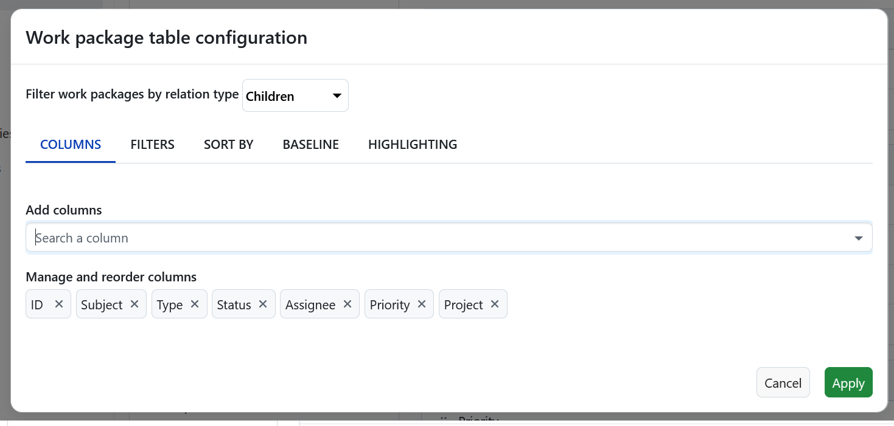
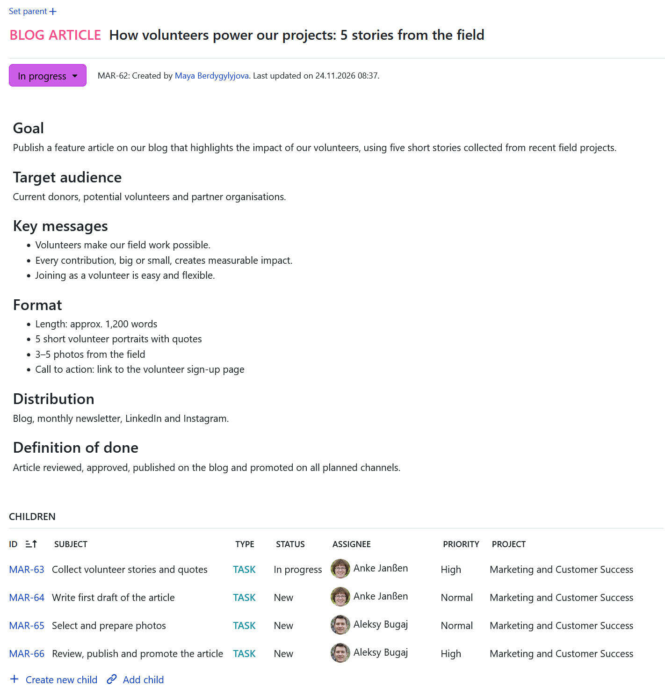

---
sidebar_navigation:
  title: Forms
  priority: 700
description: Create, manage, and configure reusable work package forms in OpenProject.
keywords: work package forms, reusable forms, form configuration, attributes, custom fields, related work packages, work package types
---

# Manage work package forms

Work package forms determine which attributes and sections are displayed when users create, view, or edit work packages. By customizing a form, you can organize the information users need and adapt the layout to different kinds of work.

In OpenProject 18.0, forms are standalone and reusable. The same form can be used by several work package types or variants, so you no longer need to maintain separate copies of an identical configuration. Changes to a shared form are reflected wherever that form is used.

To manage forms, navigate to *Administration → Work packages → Forms*.

## Overview of work package forms

The Forms overview lists all named forms in your OpenProject instance, along with the types, variants, and projects using them. This makes it easier to see where a form is used before changing its configuration.

Each row shows the form's name, the number of types and variants using it, and the number of associated projects. The instance's default form is identified by a **Default** label.

You can search for a particular form or narrow the list using the **Type**, **Projects**, and **All filters** controls. Click a form's name to open its configuration.

### Manage existing forms

To manage an existing form, open its **More (three dots)** menu in the Forms overview.

The menu provides the following actions:

- **Edit form:** Open the form editor to change its layout and attributes.
- **Edit name and description:** Update the form's name and description.
- **Mark as default:** Make the selected form the default for the instance. Only one form can be the default at a time, so this option is available only for forms that are not currently marked as default.
- **Delete:** Remove a form that is no longer needed. A form can only be deleted if it is not assigned to any work package type or variant.

Because forms can be shared, changing a form's layout may affect several types and variants. Before making changes, check the **Types and variants** column to understand where the form is used.

## Create and assign forms to types and variants

Every work package type or variant uses a form to determine which attributes are available and how they are displayed. Several types and variants can share the same form, while others may need a separate layout to accommodate different requirements.

For example, different types might use a common form with standard project information, while a Bug variant uses a more detailed form with additional fields for reporting issues.

New forms are created through the configuration of work package types and variants rather than directly from the Forms overview.

To create a new form or change the form associated with a type or variant, navigate to *Administration → Work packages → Types*, select the relevant type or variant, and open the **Form** tab. You can also select a form when creating a type or variant using the configuration wizard.

For more information, see [Manage work package types](../work-package-types/) and [Create a type or variant](../work-package-types/create-type-or-variant/).

## Configure a work package form

The form editor lets you decide which attributes and custom fields appear in a work package and how they are arranged. The current form layout is displayed in sections, while available attributes and [custom fields](../work-package-custom-fields/) that are not yet included can be added as needed.

Built-in attributes and user-created custom fields are distinguished by their labels, making it easier to identify the fields you want to use.

### Add and arrange attributes

You can drag attributes and custom fields into the appropriate sections of the form, rearrange them using drag and drop, or use the available move options in the **More (three dots)** menu. To remove an attribute from the layout, open its menu and select the corresponding removal option.

Removing an attribute or custom field from a form does not delete the field itself. It remains available in the list of attributes and can be added again later.

### Edit attribute groups (Enterprise add-on)

[feature: edit_attribute_groups ]

You can create and rename sections to group related attributes. To add a section, click **+ Add**, select **Section**, and enter a name. You can then drag attributes into the new section and rearrange the sections as needed.

### Reset the form layout

If you want to return to the default layout, click **Reset form**. This resets the form configuration, including its sections and attribute assignments. Changes to the form layout are saved automatically.

## Custom fields in work package forms

Custom fields can be added to a form alongside built-in attributes and arranged in the same way. The form determines which custom fields appear and where they are displayed, while the individual custom field settings determine how users interact with them, including whether a value is required.

Starting with OpenProject 18.0, custom fields are no longer activated or deactivated individually for each project. Adding a custom field to a form makes it available to all types and variants using that form, across the projects in which those types and variants are enabled.

If you need different custom fields for different types or variants, you can configure separate forms to accommodate these requirements.

For instructions on creating and configuring custom fields, reviewing where they are used, and managing project-specific values, see [Manage work package custom fields](../work-package-custom-fields/).

## Add a table of related work packages (Enterprise add-on)

[feature: work_package_query_relation_columns ]

You can add a related work packages table to a form to display work packages connected to the current work package. For example, a table might show child work packages or work packages connected through a particular relation.

To add a table, click **+ Add** and select **Related work packages table**.

You can configure which related work packages appear in the table and how they are presented. The table supports filtering, grouping, and sorting, much like a regular [work package table](../../../user-guide/work-packages/work-package-table-configuration/).

Once you are satisfied with the configuration, click **Apply** to add the table to the form. The table will display work packages matching the configured relations and filters, and users can create new related work packages directly from it.

## Further reading

For more information about configuring work packages, see:

- [Manage work package types](../work-package-types/)
- [Create a type or variant](../work-package-types/create-type-or-variant/)
- [Configure workflows](../work-package-workflows/)
- [Manage work package custom fields](../work-package-custom-fields/)