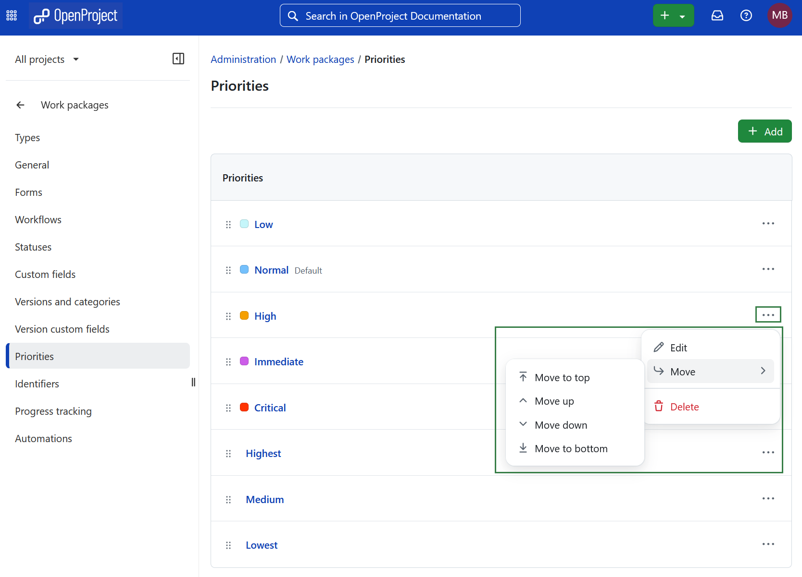
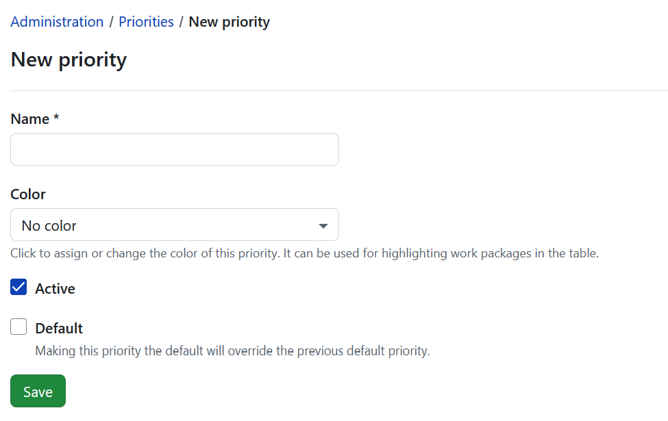
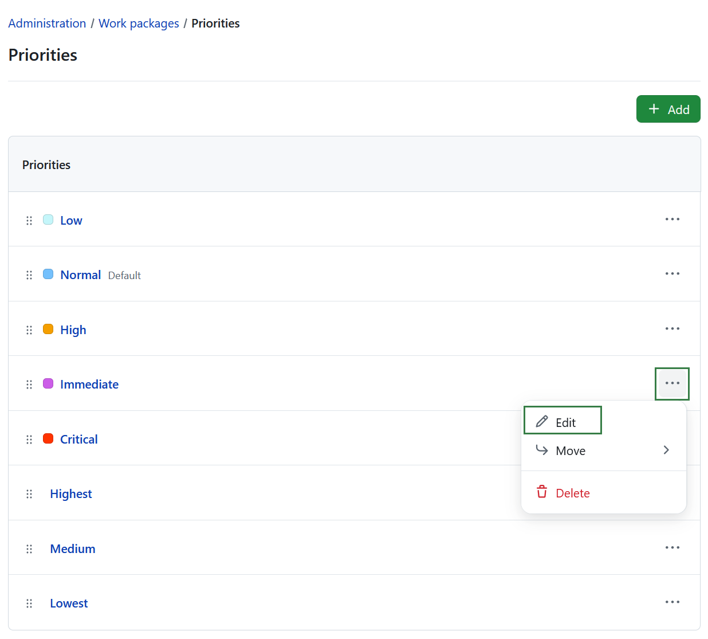

---
sidebar_navigation:
  title: Priorities
  priority: 250
description: Work package priorities in OpenProject.
keywords: work package priorities, work package configuration
---

# Work package priorities

To create or edit work package priorities in OpenProject, navigate to _Administration → Work packages → Priorities_. Here you will see all existing work package priorities.

You can change the order of priorities in two ways:

- Use the **More (three dots)** menu on the right side of a priority to select **Move up** or **Move down**.
- Drag and drop priorities using the handle on the left side of each row.

## Create new work package priority

To create a new work package priority, select the **+ Add** button in the top right corner.

You can configure the following settings:

- **Name:** Enter a name for the priority.
- **Color:** Optionally assign a color to the priority. The color can be used to highlight work packages in the work package table.
- **Active:** Specify whether the priority is active and available for selection.
- **Default:** Set this priority as the default for work packages. Enabling this option overrides the previously configured default priority.

Click **Save** to create the priority.

## Edit or remove work package priority

To **edit** an existing priority, either click on the name of the priority directly or select **Edit** from the **More (three dots)** menu on the right side of the row.

You can also change the default priority by editing an existing priority and enabling **Default**.

To remove a work package priority, open the **More (three dots)** menu on the right side of the row and select **Delete**.