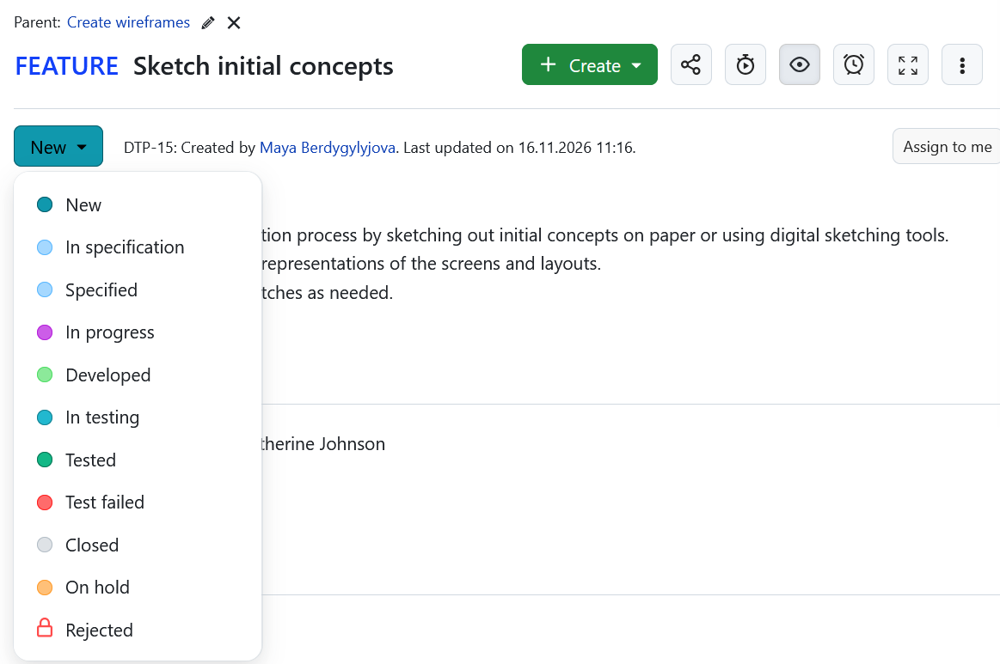
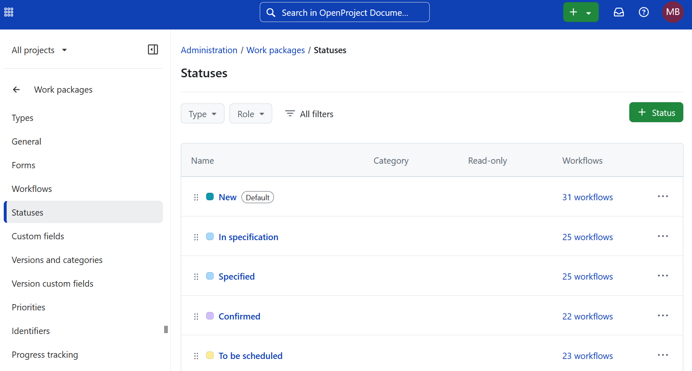
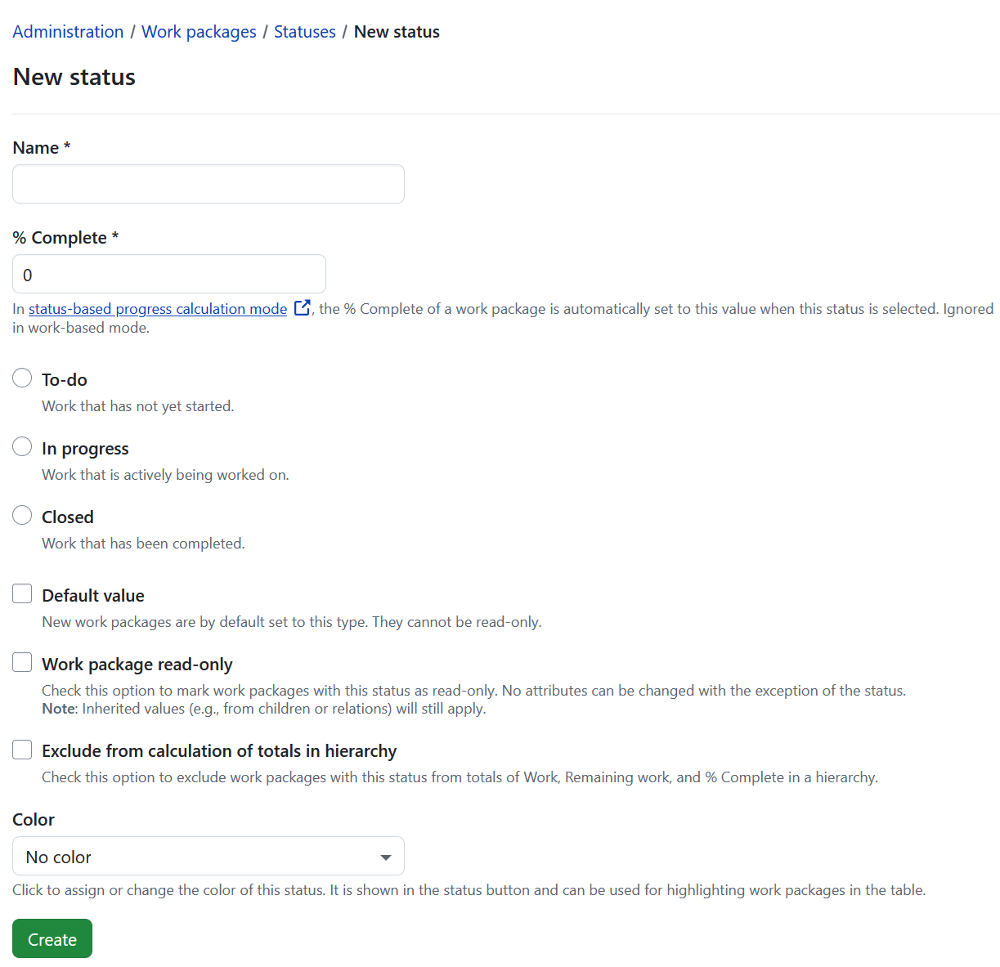
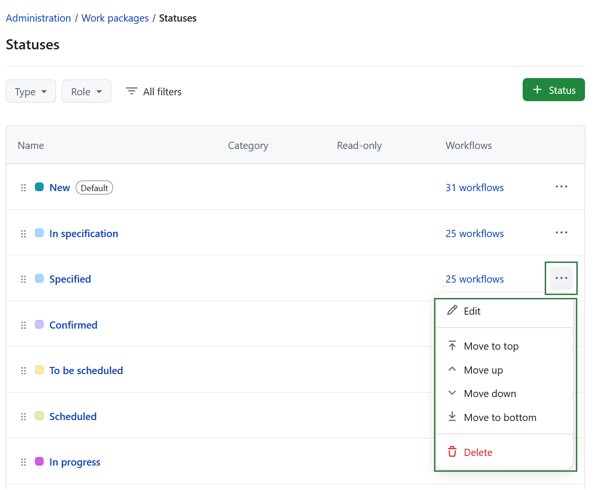

---
sidebar_navigation:
  title: Statuses
  priority: 500
description: Manage work package statuses in OpenProject.
keywords: work package statuses, status categories, work package configuration
---

# Manage work package statuses

Work packages can have different statuses to represent their progress, such as *New*, *In progress*, *On hold*, *Rejected*, or *Closed*.

The available statuses and transitions depend on the [workflows](../work-package-workflows/) configured for the relevant work package types and variants.

The status of a work package can be changed at the top of the work package details view or in the corresponding column of the work package table.

## Overview of work package statuses

To manage work package statuses, navigate to *Administration → Work packages → Statuses*.

The overview displays existing statuses in a table with the following columns:

- **Name:** The name of the status. Click it to edit the status.
- **Category:** The category assigned to the status, such as *To-do*, *In progress*, or *Closed*.
- **Read-only:** Indicates whether work packages with this status are read-only.
- **Workflows:** Shows how many workflows use the status. Click the link to view the corresponding workflows.
- **Actions:** Provides options for managing the status.

You can filter the list of statuses using the **Type** and **Role** filters above the table. Click **All filters** to access additional filtering options.

To configure which status transitions are available, see [Manage work package workflows](../work-package-workflows/).

## Create a new work package status

To create a new work package status, click **+ Status**.

You can configure the following settings:

1. **Name:** Enter a name for the status.

2. **% Complete:** Specify the completion percentage assigned to work packages when this status is selected. This value is used in [status-based progress calculation mode](../work-package-settings/) and ignored in work-based mode. The value can range from 0 to 100.

3. **Category:** Assign the status to one of the following categories:
   - **To-do:** Work that has not yet started.
   - **In progress:** Work that is actively being worked on.
   - **Closed:** Work that has been completed.

4. **Default value:** Make this the default status for newly created work packages. A default status cannot be read-only.

5. **Work package read-only:** Prevent changes to work package attributes while this status is selected. The status itself can still be changed. Inherited values, such as those from child work packages or relations, continue to apply.

   [feature: readonly_work_packages]

6. **Exclude from calculation of totals in hierarchy:** Exclude work packages with this status from totals for Work, Remaining work, and % Complete in a hierarchy. This can be useful for statuses such as *Rejected*.

7. **Color:** Optionally assign a color to the status. The color appears in the status button and can be used to highlight work packages in the table.

Click **Create** to save the new status.

## Set a default work package status

The default status is assigned to newly created work packages.

To change the default status, edit the status you want to use and enable **Default value**.

> [!NOTE]
> If you change the default status, review the relevant workflows to ensure that the new default status is included and that appropriate transitions to other statuses are configured. Otherwise, users may not be able to change the status of newly created work packages.

## Edit, reorder or remove a work package status

To **edit** an existing status, click its name in the status overview or select **Edit** from the **More (three dots)** menu.

The edit form contains the same configuration options as the creation form.

If the status is used by workflows, an information banner at the top of the form displays the number of workflows using it. Click **View workflows** to open the list of workflows that use this status.

You can also access these workflows directly from the **Workflows** column in the status overview.

To **reorder** statuses, you can either:

- Drag and drop a status using the handle on the left side of its row.
- Open the **More (three dots)** menu and select **Move up** or **Move down**.

To **remove** a status, open the **More (three dots)** menu and select **Delete**.

> [!NOTE]
> A newly created status must be included in the relevant [workflows](../work-package-workflows/) before it becomes available in the status dropdown of a work package.