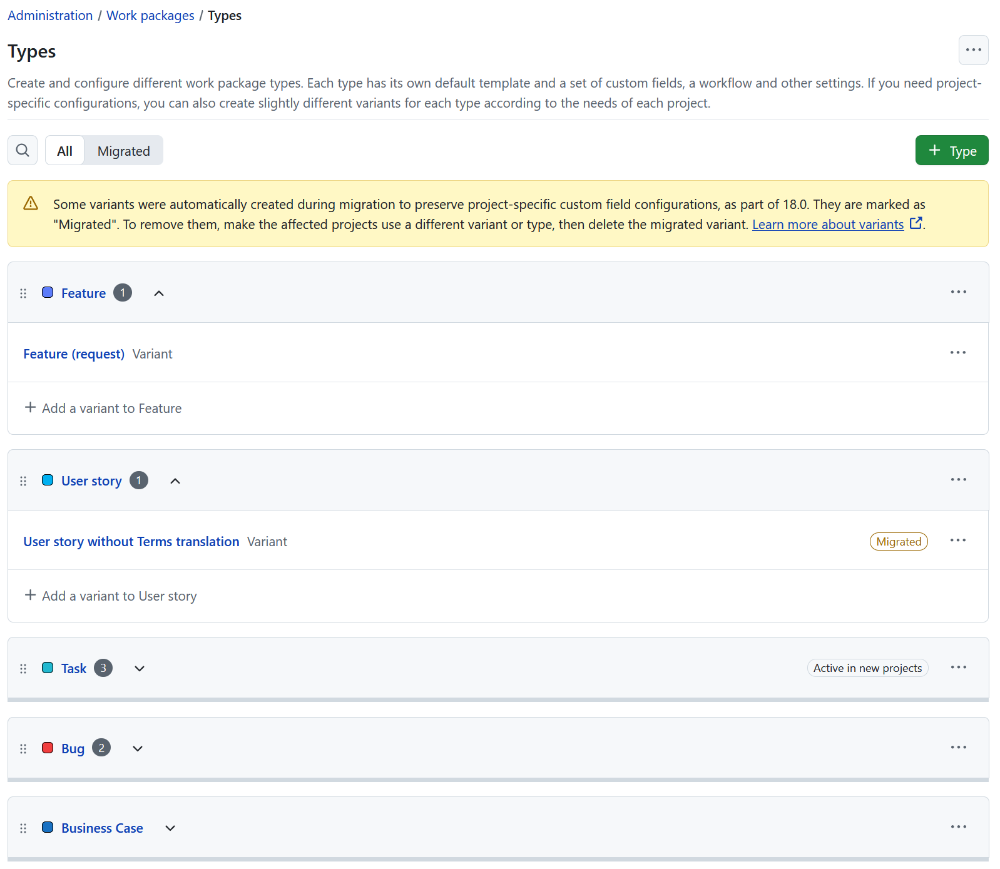
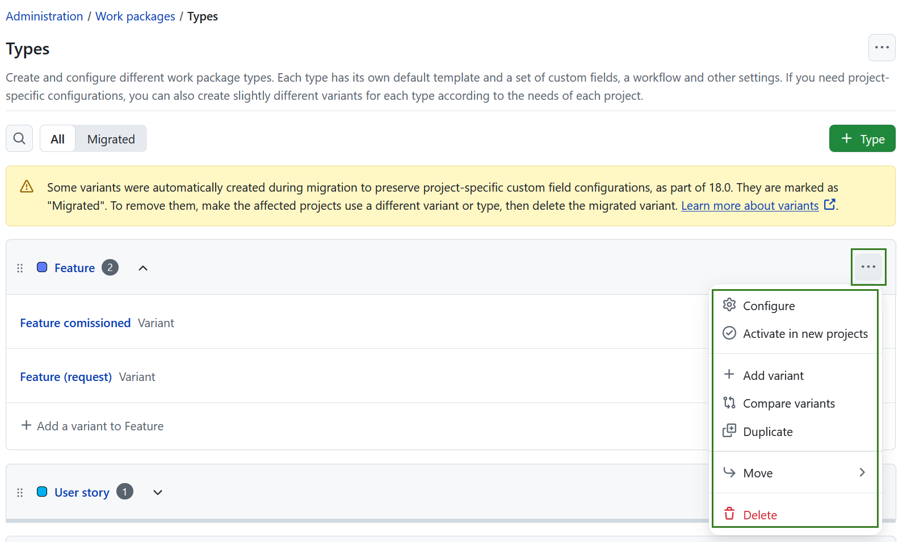
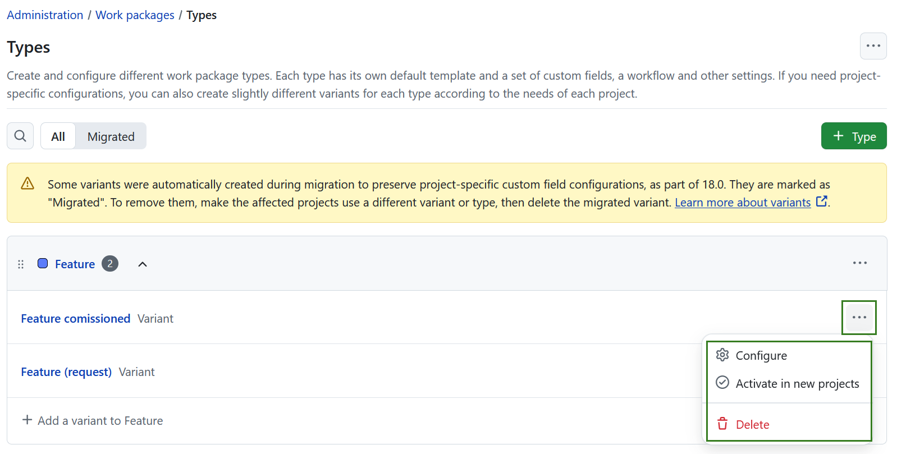
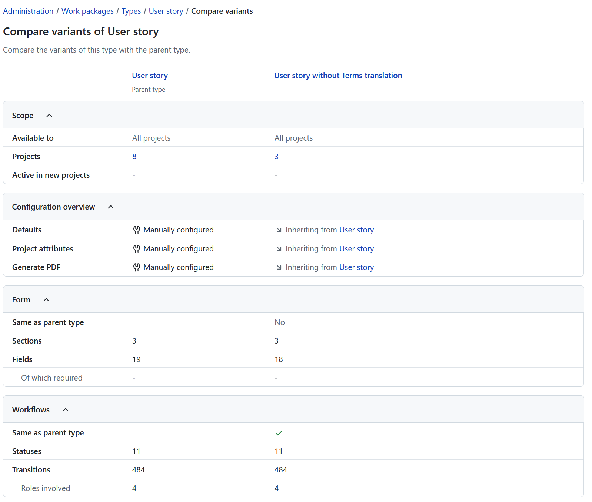
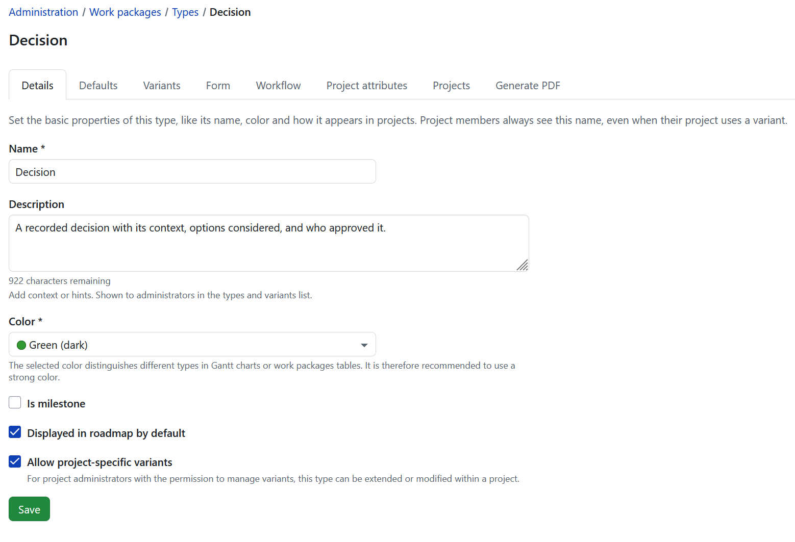

---
sidebar_navigation:
  title: Types
  priority: 900
description: Create and manage work package types and variants in OpenProject, including their configuration, workflows, forms, and project availability.
keywords: work package types, type variants, work package configuration, reusable forms, workflows, migrated variants, project-specific configuration
---

# Manage work package types

> [!NOTE]
> [OpenProject 18.0](https://www.openproject.org/docs/release-notes/18-0-0/) introduced type variants and reusable forms and workflows, changing how work package types are configured. Existing configurations are preserved during the upgrade, and variants may be created automatically to retain project-specific settings.

Work package types help you organize different kinds of work in OpenProject, such as tasks, bugs, features, and milestones. Each type has its own configuration, including default values, forms, workflows, and other settings.

You can also create **variants** of a type to adapt its configuration to the needs of individual projects without creating an entirely new work package type.

To manage types and variants, navigate to *Administration → Work packages → Types*.

Watch this tutorial on types and variants in OpenProject. 

## When to create a type or a variant

Create a **new type** when you need to represent a different kind of work, such as a Bug, Feature, or Risk. If you want to keep the same type but use a different configuration in certain projects, create a **variant** instead.

For example, two projects might both use the *Bug* type but require different forms, workflows, or default values. Rather than creating two separate bug types, you can create variants of the existing Bug type. These variants retain their parent type's identity, allowing work packages to be grouped and filtered by type across projects.

Variants are optional. If the same configuration works for all projects, you can continue using the original type without creating any variants.

## Overview of types and variants

The Types overview displays all work package types and their variants. Each type appears as an expandable group, allowing you to see its variants and add new ones. The number beside a type indicates how many variants it has.

You can search for types and variants or use the **Migrated** filter to display variants created during migration. To open the configuration of a type or variant, click its name in the list.

### Create a type or variant

To create a new work package type, click **+ Type** in the upper-right corner. To create a variant, expand the relevant type and click **+ Add a variant to [type]**, or select **Add variant** from the type's **More (three dots)** menu.

Both actions open an eight-step configuration wizard, where you can define the details, defaults, form, workflow, project attributes, project availability, and PDF export settings.

For step-by-step instructions, see [Create a work package type or variant](create-type-or-variant/).

### Manage existing types and variants

You can manage types and variants using the **More (three dots)** menu beside each entry.

For a **type**, the menu provides options to configure it, activate it in new projects, add or compare variants, duplicate it, change its position in the list, or delete it. You can also reorder types directly using the drag-and-drop handles beside their names.

For a **variant**, the menu allows you to configure it, activate it in new projects, or delete it.

### Compare variants

When a type has multiple variants, you can compare their configurations to understand how they differ.

In the Types overview, open the parent type's **More (three dots)** menu and select **Compare variants**. This opens a comparison view that helps you review the configurations of the variants belonging to that type.

Comparing variants can be useful when deciding whether separate configurations are still needed or when reviewing differences introduced during migration.

### Delete a variant

If a variant is no longer needed, open its **More (three dots)** menu and select **Delete**.

Before deleting a variant, check which projects use it and make sure those projects have been assigned another suitable type or variant. This helps avoid removing a configuration that is still needed.

### Migrated variants

When upgrading to OpenProject 18.0, OpenProject may automatically create variants to preserve project-specific custom field configurations. These variants are labeled **Migrated** in the overview, making them easy to identify.

You can use the **Migrated** filter to find these variants and review their configurations alongside manually created variants.

Migrated variants help preserve existing project settings during the upgrade. Before changing or deleting one, check which projects use it and whether they still need its configuration.

## Configure a type or variant

To configure an existing type or variant, click its name in the overview or select **Configure** from its **More (three dots)** menu.

The configuration is organized into the following tabs:

| Tab | Description |
| --- | --- |
| **Details** | Configure the basic properties of the type or variant. |
| **Defaults** | Configure default values and, where available, automatically generated subjects. |
| **Variants** | View and manage variants of a type. |
| **Form** | Select or configure the reusable form associated with the type or variant. |
| **Workflow** | Select or configure the reusable workflow associated with the type or variant. |
| **Project attributes** | Configure which project attributes are displayed in work packages. |
| **Projects** | Manage the projects in which the type or variant is available. |
| **Generate PDF** | Configure PDF export settings. |

### Details

The **Details** tab contains the basic properties of a work package type or variant. You can use it to review and update the information that identifies the type or variant.

### Defaults

The **Defaults** tab lets you define content that should be available when users create new work packages. For example, you can add default text to the description field to provide a consistent template for bug reports or risk assessments.

In the Enterprise edition, you can also configure automatically generated work package subjects.

[feature: work_package_subject_generation ]

For detailed instructions, see [Configure automatic work package subjects](automatic-subjects/).

### Variants

The **Variants** tab allows you to view and manage alternative configurations of a work package type.

When creating a variant, you can choose whether it should inherit its configuration from the parent type or use independent settings.

With **Use same settings as type**, the variant follows the parent type's configuration. Changes to inherited settings on the parent type are automatically reflected in the variant. This is useful when several projects should use the same configuration without maintaining separate copies.

With **Manual configuration**, the variant uses its own settings, which can be initialized from an existing configuration or created from scratch. Later changes to the parent type are not automatically applied to independently configured settings.

For example, a software development project and a support project might both use the *Bug* type but need different forms or workflows. Each project can use a suitable variant while retaining the shared work package type.

To manage where a variant is available, open its **Projects** tab. You can also use **Activate in new projects** from the variant's **More (three dots)** menu to control its availability in newly created projects.

For more information, see [Activate work package types for projects](projects/).

### Form and workflow

Forms determine which attributes and sections are displayed when viewing or editing work packages, while workflows define which status transitions are available to users with different project roles.

In OpenProject 18.0, forms and workflows are standalone objects that can be reused across multiple types and variants. The **Form** and **Workflow** tabs let you select or configure the objects associated with a particular type or variant.

For detailed instructions, see [Manage work package forms](../work-package-forms/) and [Configure workflows](../work-package-workflows/).

### Project attributes and projects

The **Project attributes** tab lets you configure which [project attributes](../../projects/project-attributes/) are displayed in work packages. This makes it possible to access project-level information directly from a work package, provided the user has the necessary permissions.

The **Projects** tab controls where a type or variant is available. For detailed instructions, see [Display project attributes in work packages](project-attributes/) and [Activate work package types for projects](projects/).

### Generate PDF

The **Generate PDF** tab lets you configure how work packages of a particular type or variant are exported as PDF documents. For detailed instructions, see [Configure PDF exports for work package types](pdf-export/).

## Workflow summary

You can access the workflow summary directly from the Types overview by opening the **More (three dots)** menu in the upper-right corner and selecting **Workflow summary**. This provides an overview of the configured status transitions for work package types and project roles.

For more information, see [Workflow summary](../work-package-workflows/#workflow-summary).

## Further reading

For additional explanations, examples, and tutorials about configuring work package types and variants, see:

1. **Video (Introduction):** [Project-specific workflows and forms through type variants](https://www.youtube.com/watch?v=FvT0_uS_LJY)
2. **Video (Tutorial):** [Project-specific workflows and forms through type variants](https://www.youtube.com/watch?v=gvvXmlisLo8)
3. **Blog article:** [Project-specific workflows and forms for work package types and their variants](https://www.openproject.org/blog/type-variants-workflows-forms/)
