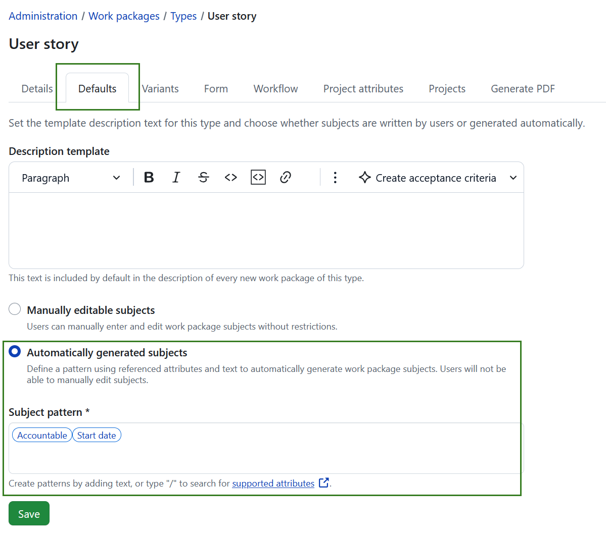
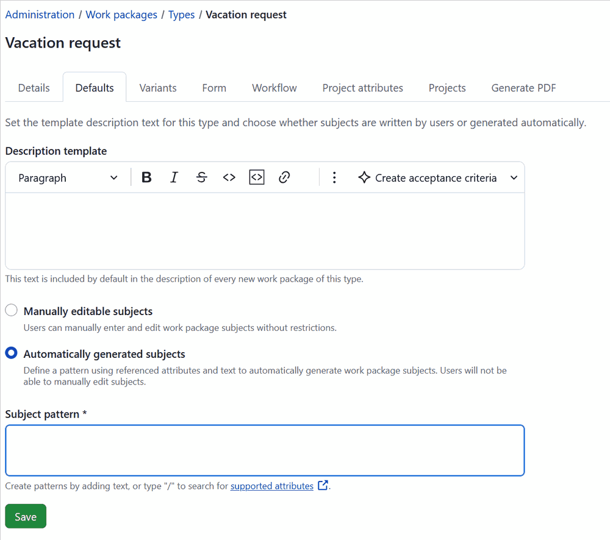

---
sidebar_navigation:
  title: Automatic subjects
  priority: 900
description: Configure automatic work package subjects in OpenProject.
keywords: work package subject, automatic subject, subject pattern, work package types, type variants
---

# Configure automatic work package subjects (Enterprise add-on)

[feature: work_package_subject_generation ]

Automatic subject patterns combine static text with dynamic attributes, such as dates, author names, or custom fields, to automatically generate consistent and informative work package subjects.

Automatic subject patterns help teams quickly identify tasks, reduce manual errors, and standardize naming conventions across projects. Different patterns can be defined for individual work package types and variants.

For more information on using automatic subjects within projects, see the [user guide on automatic work package subjects](../../../../user-guide/work-packages/automatic-subjects/).

## How subject patterns work

A subject pattern includes a combination of:

- **Static text** (e.g., `Invoice`, `Vacation Request`)

> [!TIP]
> Use the company-approved language for static text, as it is not translated into the language users select for their personal accounts.

- **Dynamic attribute placeholders** (e.g., `[Author]`, `[Start date]`, `[Custom Field: Invoice ID]`)

> [!TIP]
> Dynamic attribute placeholders are displayed in the default language defined globally for all users in your organization under *Administration → Users and permissions → User settings*. Individual language preferences do not affect automatic work package subjects.

When users create or edit work packages, OpenProject automatically replaces these placeholders with the corresponding attribute values.

## Configure automatic subjects

To configure automatic subjects, navigate to *Administration → Work packages → Types*, select the relevant type or variant, and open the **Defaults** tab.

You can choose between two options:

- **Manually editable subjects:** Users can enter and edit work package subjects manually.
- **Automatically generated subjects:** Work package subjects are generated from a predefined pattern and cannot be edited manually.

Select **Automatically generated subjects** to define a **Subject pattern**.

## Add, edit and delete attributes

You can combine static text and attribute placeholders in the **Subject pattern** field.

### How to add attributes

1. Type `/` in the **Subject pattern** field to open the attribute search.
2. Search for and select an attribute from the dropdown. The selected attribute appears as a placeholder (e.g., `[Start date]`).
3. Add further attributes or static text as needed.
4. Click **Save** to apply your changes.

> [!TIP]
> Some attributes can be selected not only for the current work package but also for its parent work package.

### How to edit attributes

- Click an existing attribute placeholder to open the attribute search again.
- Search for and select a different attribute from the dropdown. The placeholder updates automatically.

### How to delete attributes

Delete an attribute placeholder as you would regular text, for example, using the Backspace key.

## Supported attributes and limitations

### Work package attributes

Subject patterns can include placeholders referencing the following work package attributes:

| Attribute Name            | Data Type             | Example    |
| ------------------------- | --------------------- | ---------- |
| Accountable               | User name             | Jon Doe    |
| Assignee                  | User name             | Jon Doe    |
| Author                    | User name             | Jon Doe    |
| Category                  | String                | Category A |
| Created on                | Date                  | 2025-01-10 |
| Finish date               | Date                  | 2025-01-15 |
| ID                        | Integer               | 3000       |
| Observed in versions      | List of version names | 1.0, 2.0   |
| Priority                  | String                | Normal     |
| Project                   | Project ID            | 30         |
| Remaining work            | Hours (float)         | 8.0        |
| Start date                | Date                  | 2025-01-12 |
| Status                    | String                | New        |
| Type                      | Work package type     | Task       |
| Version (Target versions) | List of version names | 1.0, 2.0   |
| Work                      | Hours (float)         | 10.0       |

**Custom fields:** Supported custom fields include Text, Integer, Float, List, Date, Boolean, User, and Version.

**Unsupported attributes:** Long text and Link custom fields are excluded to keep subjects concise.

> [!NOTE]
> Make sure the referenced attributes are available in the [work package form](../../work-package-forms/) used by the relevant type or variant to avoid displaying "N/A" in automatically generated subjects.

### Project attributes

| Attribute Name         | Data Type   | Example  |
| ---------------------- | ----------- | -------- |
| Project: Active        | Boolean     | true     |
| Project: Name          | String      | HR       |
| Project: Status        | Status code | on_track |
| Project: Subproject of | ID          | 123      |
| Project: Public        | Boolean     | false    |

**Custom project attributes:** Supported attributes include Integer, Float, List, Date, Boolean, User, and Version.

**Unsupported project attributes:** Long text and Link custom fields are excluded to keep subjects concise.

## Update automatic subjects

Automatic subjects update whenever an attribute referenced in the **current work package** changes and the work package is saved.

> [!IMPORTANT]
> Changes to referenced parent work package attributes or project attributes do not trigger immediate updates. These changes are reflected in the subject only when the work package itself is updated and saved again.

## FAQs

### Why does "N/A" appear in subjects?

"N/A" indicates that an attribute referenced in the subject pattern is unavailable. Typical causes include:

- The referenced attribute is not included in the form used by the work package type or variant.
- The attribute was removed from the form after the subject pattern was configured.
- A parent attribute is referenced, but the parent work package does not contain that attribute.

### Why does [Attribute Name] appear in subjects?

An attribute name displayed in square brackets indicates that the referenced attribute has no value. Typical causes include:

- The attribute has not been filled in.
- A parent attribute is referenced, but no parent work package is set.
- A project attribute is referenced, but has not been filled in.

## Tips for effective patterns

Good subject patterns should be:

- **Concise:** Keep subjects short and readable.
- **Relevant:** Include only the essential attributes needed for quick identification.
- **Descriptive:** Use clear static text (e.g., `Invoice`, `Bug Report`) to identify the kind of work.
- **Consistent:** Use the company-approved language for static text to maintain consistent naming across projects.

See our [example subject patterns](https://www.openproject.org/blog/automatically-generated-work-package-subjects/) for inspiration.