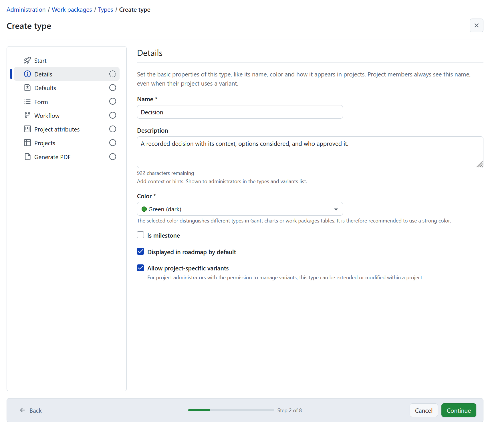
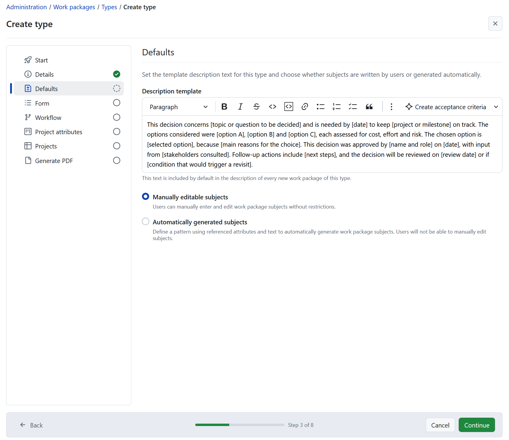
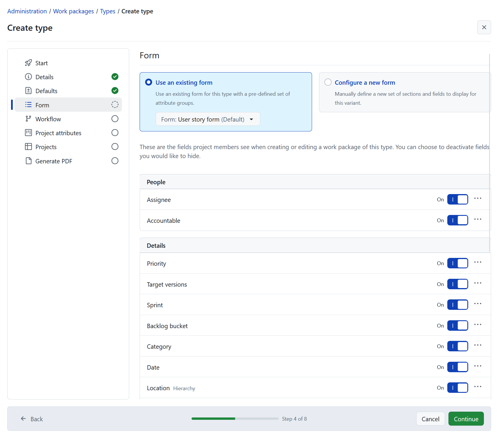
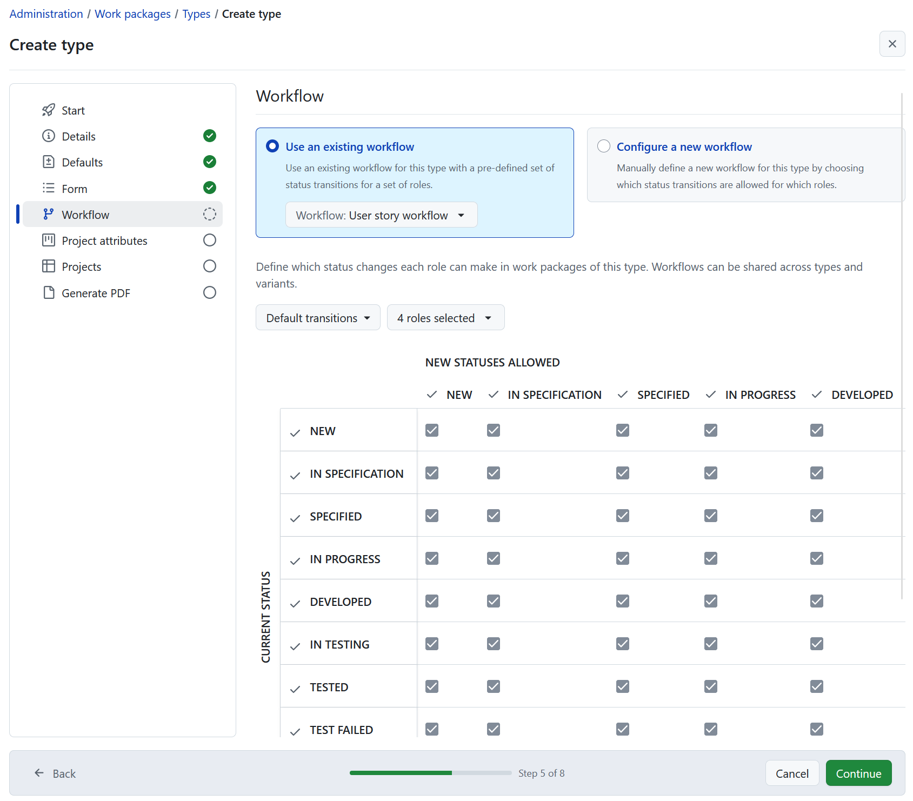
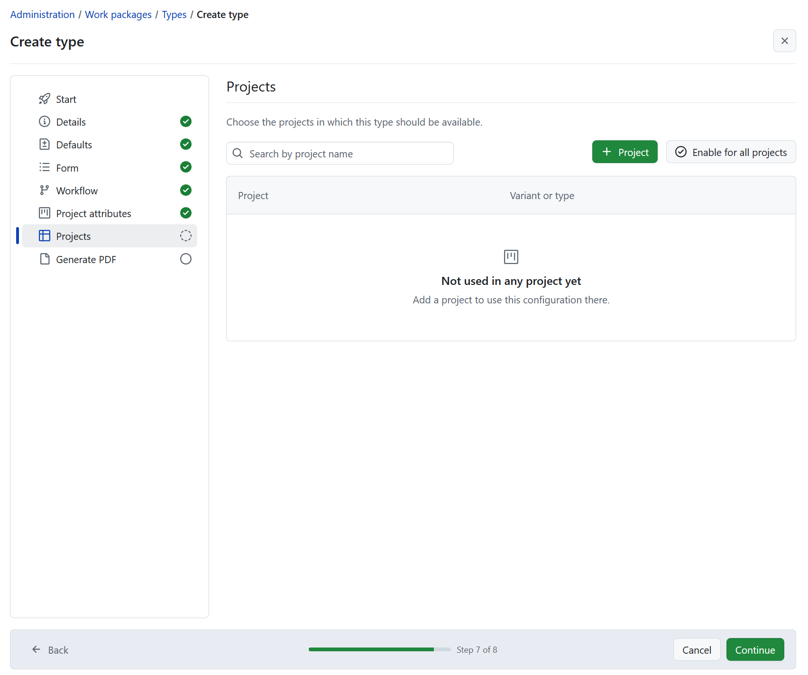
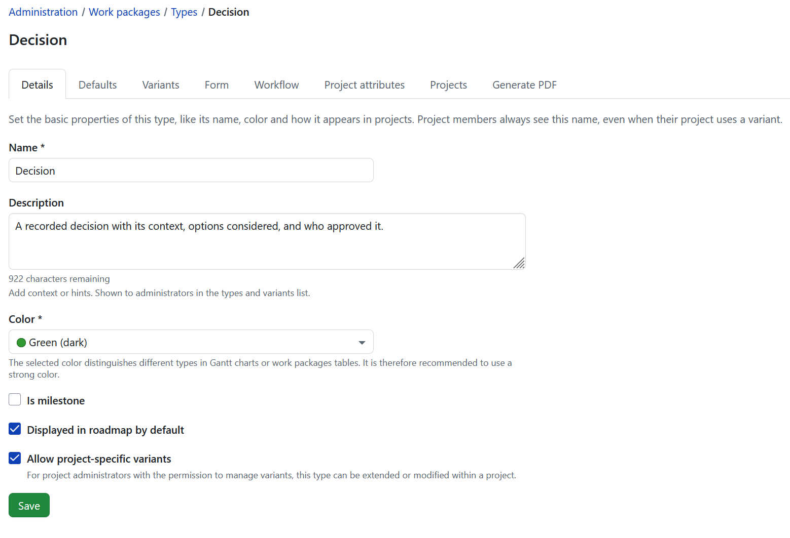

---
sidebar_navigation:
  title: Crate a type or variant
  priority: 999
description: Configure for which projects a work package type is activated in OpenProject.
keywords: work package types, projects, activate work package type, project settings
---

tbd

After clicking **Finish**, the new type or variant appears in the Types overview. Click its name to open the configuration view, where you can review and update its settings using the available tabs.

