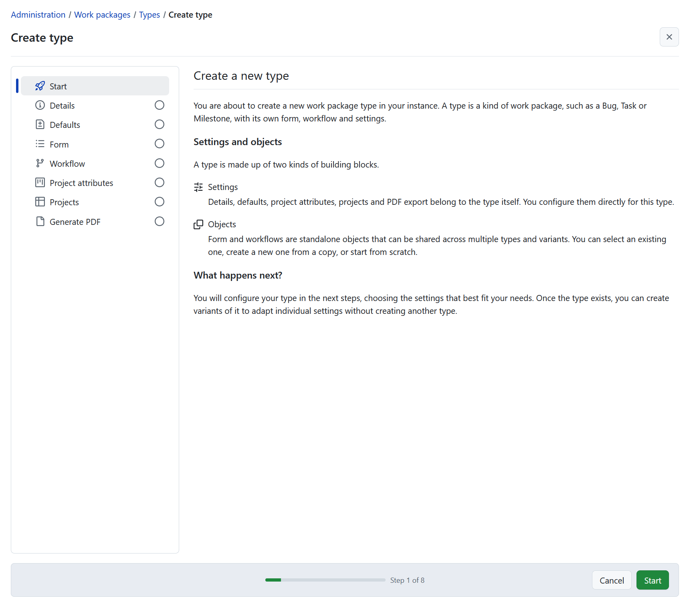
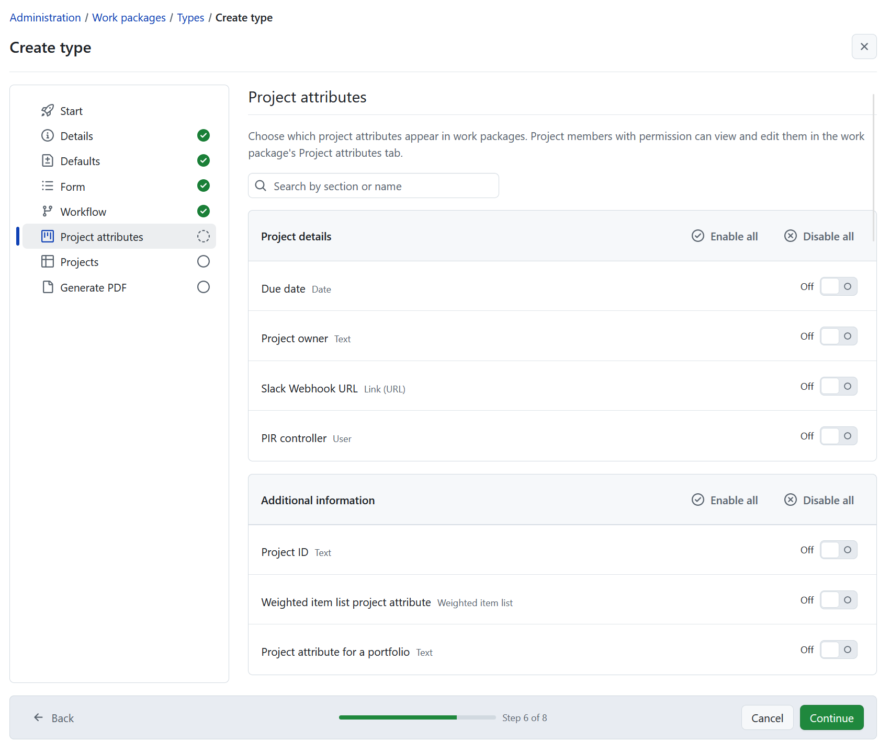
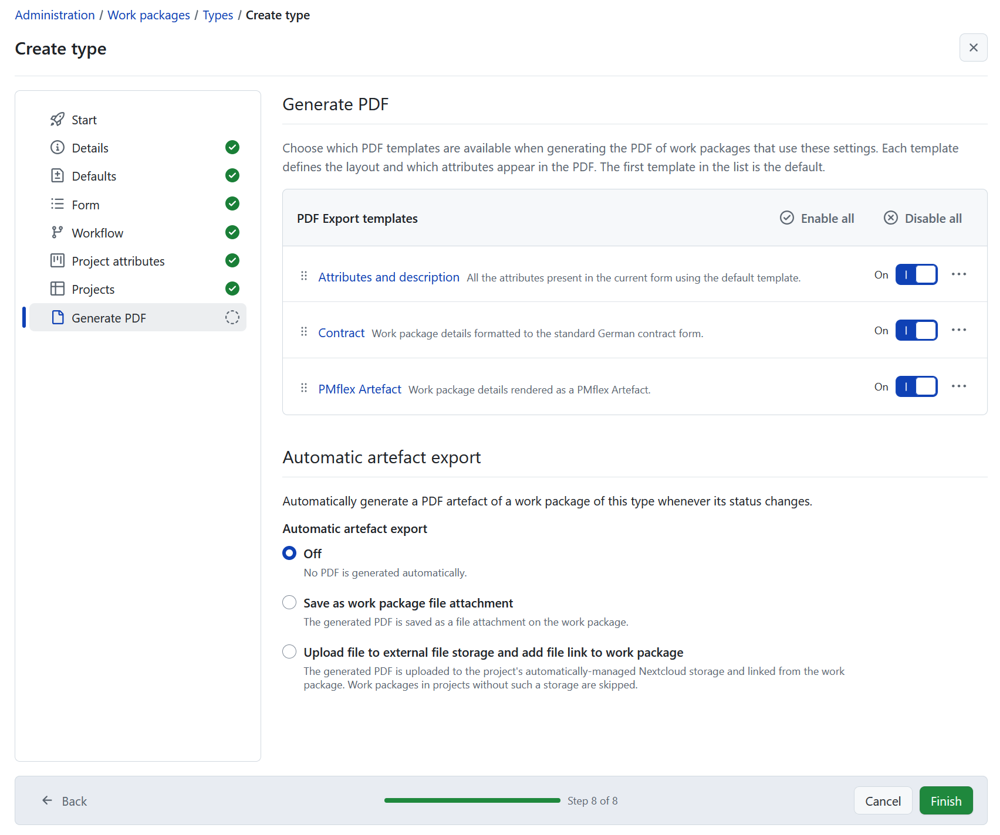

---
sidebar_navigation:
  title: Create a type or variant
  priority: 999
description: Create a work package type or variant in OpenProject using the configuration wizard.
keywords: create work package type, create type variant, work package configuration, forms, workflows, project attributes
---

# Create a work package type or variant

You can create new work package types and variants in OpenProject to configure how different kinds of work are organized and managed. A type represents a category of work, such as a task, bug, or milestone, while a variant lets you use a different configuration of an existing type in selected projects.

Both are created using the same eight-step wizard. The main difference is how their initial settings are configured.

To get started, navigate to *Administration → Work packages → Types*.

- To create a **type**, click **+ Type** in the upper-right corner.
- To create a **variant**, expand the relevant type and click **+ Add a variant to [type]**. You can also select **Add variant** from the type's **More (three dots)** menu.

For guidance on choosing between them, see [Manage work package types](../).

## Step 1: Start

The **Start** step lets you choose how to configure the new type or variant.

When creating a **type**, you can configure its settings and choose whether to use existing forms and workflows, copy an existing configuration, or start from scratch.

When creating a **variant**, you can choose to use the same settings as its parent type or configure the variant independently:

- **Use same settings as type:** The variant inherits its configuration from the parent type. Changes to inherited settings are reflected in the variant.
- **Manual configuration:** The variant uses its own configuration, which you can initialize by copying existing settings or starting from scratch. Later changes to the parent type are not automatically applied.

Forms and workflows are reusable objects that can be shared between types and variants.

Choose the appropriate configuration option and continue to the next step.

## Step 2: Details

In the **Details** step, configure the basic properties of the type or variant. These settings help users identify it when creating or working with work packages.

Enter the required information and continue to **Defaults**.

## Step 3: Defaults

The **Defaults** step lets you define values and content that should be available when users create work packages of this type or variant.

For example, you can provide default description text to guide users when creating bug reports, feature requests, or other work packages. These defaults help establish a consistent starting point without requiring users to enter the same information each time.

Configure the defaults you need and continue to **Form**.

## Step 4: Form

In the **Form** step, select or configure the form associated with the new type or variant.

Forms determine how attributes and sections are arranged when users view or edit work packages. In OpenProject 18.0, forms are reusable objects, so the same form can be used by multiple types and variants.

Depending on your configuration choice, you can use an existing form or create a separate configuration.

For more information, see [Manage work package forms](../../work-package-forms/).

## Step 5: Workflow

The **Workflow** step lets you select or configure the workflow associated with the type or variant.

Workflows define which status transitions are available to users with different project roles. Like forms, workflows can be reused across multiple types and variants, making it easier to maintain consistent processes.

Choose the workflow configuration you want to use and continue to **Project attributes**.

For more information, see [Configure workflows](../../work-package-workflows/).

## Step 6: Project attributes

In the **Project attributes** step, configure which project-level attributes should be displayed in work packages of this type or variant.

This allows users to access relevant project information directly from a work package, provided they have the necessary permissions.

For more information, see [Display project attributes in work packages](../project-attributes/).

## Step 7: Projects

The **Projects** step controls where the new type or variant is available.

Configure the project availability according to where the type or variant should be used. This is particularly useful for variants, which allow different projects to use different configurations of the same parent type.

For more information, see [Activate work package types for projects](../projects/).

## Step 8: Generate PDF

The final step, **Generate PDF**, lets you configure the PDF export settings for work packages of this type or variant.

Review the available settings and click **Finish** to complete the creation process.

For more information, see [Configure PDF exports for work package types](../pdf-export/).

## Finish creating the type or variant

After clicking **Finish**, the new type or variant appears in the Types overview. Click its name to open the configuration view, where you can review and update its settings using the available tabs.

You can return to this view at any time to adjust the configuration. To learn more about managing existing types and variants, see [Manage work package types](../) and [Manage type variants](../variants/).
