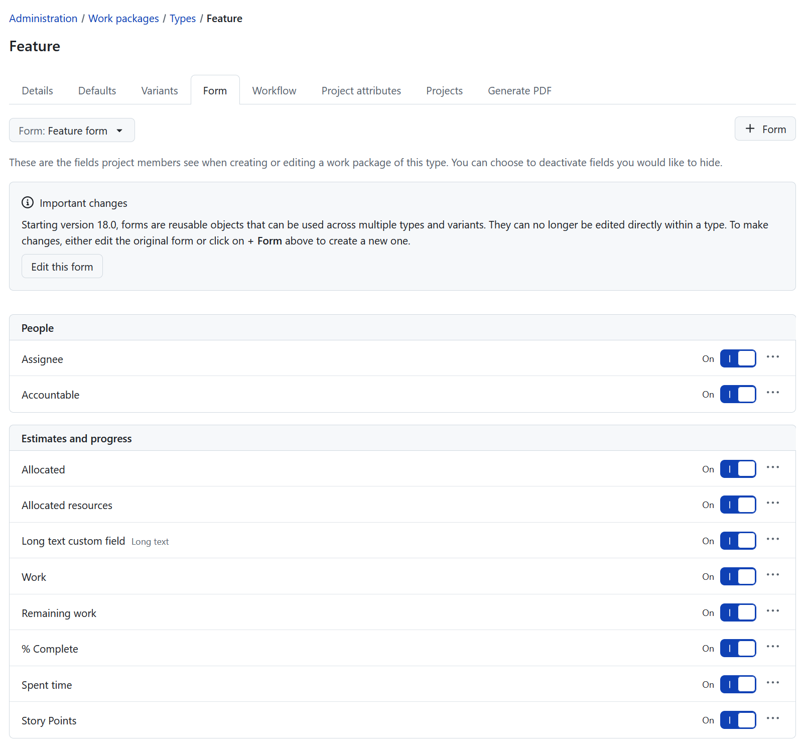

---
sidebar_navigation:
  title: Form
  priority: 800
description: Assign work package forms and configure field visibility for work package types and variants in OpenProject.
keywords: work package form, form configuration, work package types, type variants, reusable forms, attributes, custom fields, field visibility
---

# Configure forms for work package types and variants

Forms determine which attributes, custom fields, and sections are displayed in work packages. Starting with OpenProject 18.0, forms are reusable and can be shared across multiple work package types and variants.

To manage the form associated with a type or variant, navigate to *Administration → Work packages → Types*, select the relevant type or variant, and open the **Form** tab.

## Assign a form to a type or variant

Use the **Form** dropdown at the top of the page to select an existing form. Using a shared form allows you to maintain a consistent layout across multiple types and variants without having to configure each one individually.

If you need a separate form, click **+ Form** and configure the new form in the dialog. Once you click **Create**, you are taken to the form editor under *Administration → Work packages → Forms*.

Forms can also be selected or created when [creating a work package type or variant](../create-type-or-variant/).

## Configure field visibility

The **Form** tab displays the attributes and custom fields included in the assigned form, organized into their respective sections.

Use the toggle next to a field to enable or disable it for the selected type or variant. Alternatively, open the **More (three dots)** menu next to the field and select **Enable** or **Disable**.

This allows you to hide individual fields without removing them from the shared form or affecting other types and variants using the same form.

## Edit the assigned form

To change the layout, attributes, or sections of the assigned form, click **Edit this form**. This takes you directly to the form editor under *Administration → Work packages → Forms*.

Changes to the shared form affect all types and variants using it. If you need a different form layout without affecting other types or variants, create a separate form instead.

For detailed instructions on arranging attributes, configuring attribute groups, and adding tables of related work packages, see [Configure a work package form](../../work-package-forms/#configure-a-work-package-form).

## Custom fields in work package forms

Starting with OpenProject 18.0, work package custom fields are no longer activated or deactivated individually for each project. Instead, their availability is determined by the forms and field visibility settings of the types and variants used in a project.

To make a custom field available in work packages, add it to the relevant form and make sure it is enabled for the corresponding type or variant.

For more information, see [Make custom fields available in work packages](../../work-package-custom-fields/#make-custom-fields-available-in-work-packages).

## Further reading

- [Manage work package forms](../../work-package-forms/)
- [Manage work package types](../)
- [Activate work package types and variants for projects](../projects/)