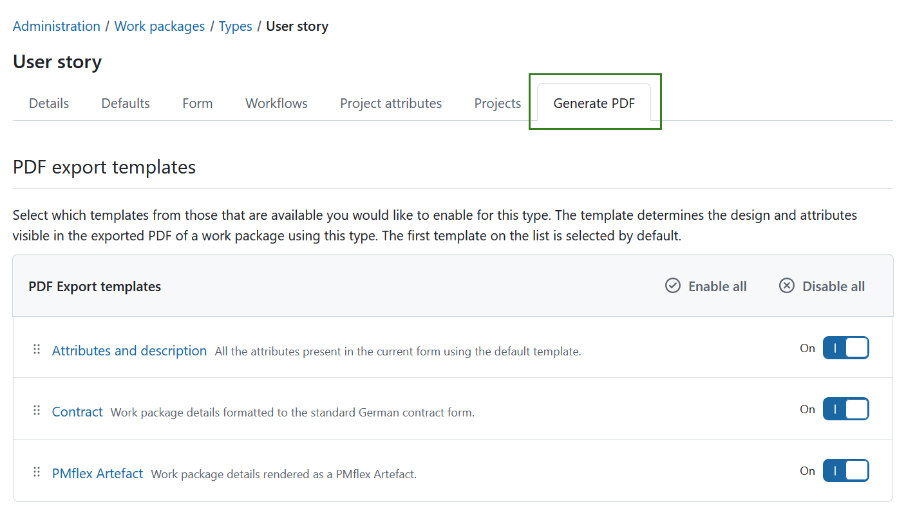
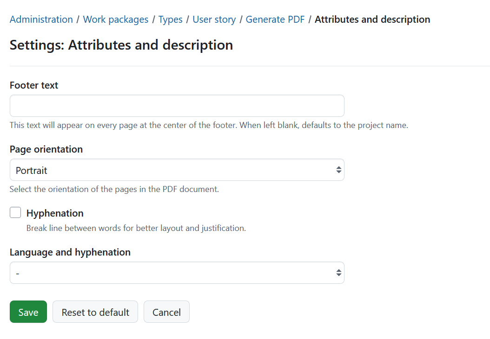
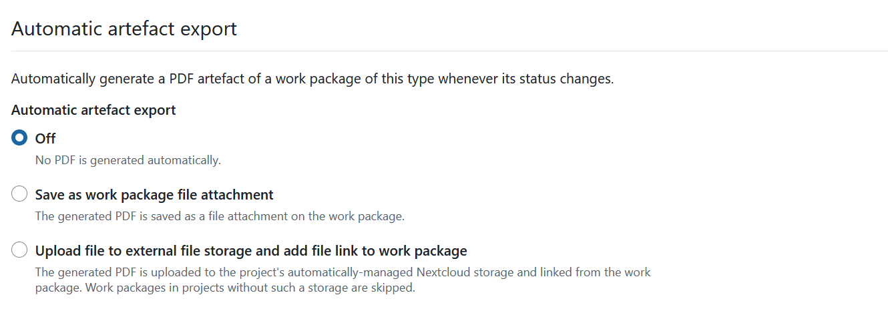

---
sidebar_navigation:
  title: Generate PDF
  priority: 400
description: Configure PDF exports for a work package type in OpenProject.
keywords: work package PDF, PDF export, work package types, PDF templates, PMflex Artefact, automatic artefact export, wiki pages
---

# Configure PDF exports for work package types

Under **Administration → Work packages → Types**, select a work package type and open the **Generate PDF** tab to configure how a single work package of this type is exported as a PDF. The tab contains two sections: the available export templates and the automatic artefact export.

## Activate templates for PDF exports

Here you can select which PDF export templates are available for this work package type.

The template determines the design and attributes visible in the exported PDF of a work package using this type. The first template on the list is selected by default.

Use the toggle next to a template to enable or disable it, or use **Enable all** and **Disable all** to switch every template at once. Changes are saved immediately.

Drag a template by its handle to change the order of the list. The order determines the sequence in the **Template** dropdown menu of the export dialog, and the first enabled template is preselected there.

If no template is enabled, users cannot generate a PDF for a work package of this type: the export dialog states that no template has been enabled and the download button stays disabled.

> [!TIP]
> See [work package PDF export guide](../../../../user-guide/work-packages/exporting/work-package-pdf/) for more details on what each of the templates contains.

The following templates are available:

- **Attributes and description** – Work package attributes present in the current form together with the description.
- **Contract** – Work package details formatted according to the standard German contract form.
- **PMflex Artefact** – Work package details rendered as a PMflex Artefact.

### Configure a PDF export template

Click the name of a template to open its configuration page. Each PDF export template has its own settings, so you can configure the templates independently.

The available settings depend on the selected template. This is an example of the template for Attributes and descriptions. 

Click **Save** to apply your changes.

Click **Reset to default** to restore the default settings for this template, or **Cancel** to leave the configuration page without saving your changes. 

### Include wiki pages in the PMflex Artefact

The configuration page of the **PMflex Artefact** template additionally lets you append wiki pages to every artefact of this work package type. Use it to keep recurring content such as legal information or data privacy terms in one place instead of repeating it in each work package.

Under **Add wiki pages**, click **Select a wiki page** to open the page picker. Search by name or browse the wikis of the projects you have access to, select a page and click **Add**. The page is appended to the list under **Manage and reorder wiki pages**. Add a further page by opening the picker again.

Each entry in that list can be removed with the **×** next to its name, and dragging an entry changes its position. The order of the list is the order in which the pages are appended to the end of the exported PDF, each under its own title and, where the table of contents is enabled, listed in it.

As with every other setting on this page, your changes take effect when you click **Save**. **Reset to default** also empties the list.

> [!IMPORTANT]
> Adding a wiki page here makes its content, embedded images included, visible to everyone who can export this artefact - including people who are not allowed to open that wiki page in OpenProject. Treat adding a page as granting access to it.

A page that was deleted in the meantime, or whose project has been archived, is listed as unavailable. Such an entry is skipped when the PDF is generated; remove it and save to clean up the list.

> [!NOTE]
> Only pages of OpenProject's own wiki can be selected. The list applies to the PMflex Artefact template only, and the [automatic artefact export](#automatic-artefact-export) uses it unchanged.

Users exporting a work package of this type see the configured pages prefilled in the Generate PDF dialog, where they can remove them, reorder them and add further pages they are allowed to read. Those changes affect that single export and are never written back here. See the [work package PDF export guide](../../../../user-guide/work-packages/exporting/work-package-pdf/#pmflex-artefact) for the user side.

## Automatic artefact export

In addition to exporting on demand, OpenProject can generate a PMflex Artefact PDF automatically whenever the status of a work package of this type changes. Select one of the following options:

- **Off** - no PDF is generated automatically. This is the default.
- **Save as work package file attachment** - the generated PDF is saved as a file attachment to the work package. The new attachment is also recorded in the work package Activity.
- **Upload file to external file storage and add file link to work package** - the generated PDF is uploaded to the project's automatically-managed Nextcloud storage and linked from the work package. Work packages in projects without such an external storage configured are skipped. This option can only be selected if an [automatically-managed Nextcloud storage](../../../files/external-file-storages/) is configured for the instance.

The selection is saved immediately.

> [!NOTE]
> The automatic export always uses the PMflex Artefact template, regardless of which templates are enabled for manual exports above.