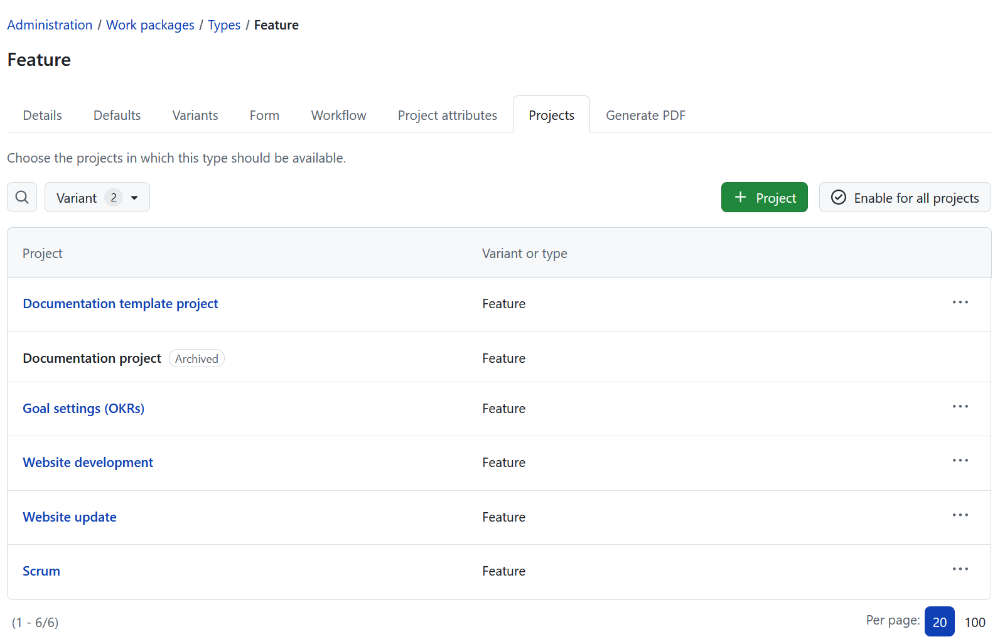
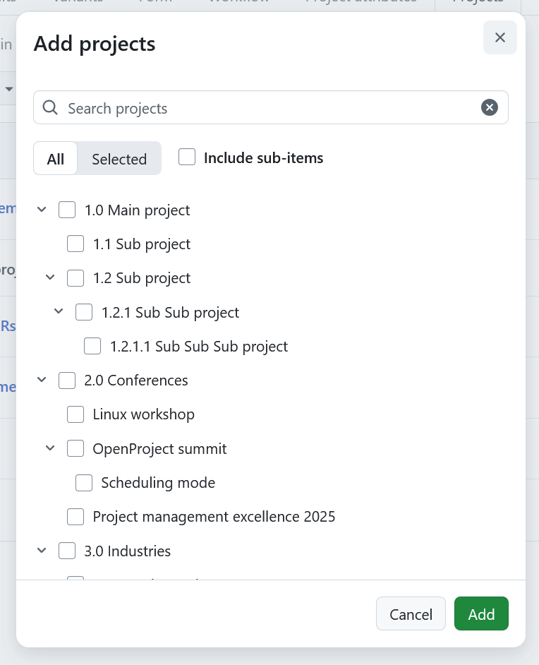
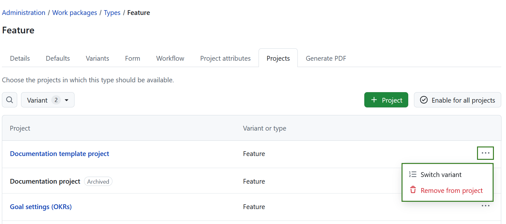

---
sidebar_navigation:
  title: Projects
  priority: 500
description: Configure the projects in which work package types and variants are available in OpenProject.
keywords: work package types, type variants, projects, activate work package type, project settings
---

# Activate work package types and variants for projects

To manage the projects in which a work package type or variant is available, navigate to *Administration → Work packages → Types*, select the relevant type or variant, and open the **Projects** tab.

Each project can use either the original work package type or one of its variants. This allows different projects to use different configurations of the same work package type.

The overview lists the associated projects and shows which type or variant each project uses in the **Variant or type** column. You can search for specific projects or narrow down the list using the **Variant** filter. Archived projects are identified by an **Archived** label.

## Enable a type or variant for selected projects

To make a work package type or variant available in additional projects, click **+ Project**.

In the **Add projects** dialog, select the projects in which the type or variant should be available. You can use the search field to find specific projects or expand the project hierarchy to select individual subprojects.

Select **Include sub-items** to include subprojects when selecting a parent project. Switch between **All** and **Selected** to review your selection.

Click **Add** to confirm.

## Enable or disable a type for all projects

To make a work package type available in all projects, click **Enable for all projects** in the **Projects** tab.

The changes take effect immediately, and the button changes to **Disable for all projects**, allowing you to disable the type across all projects.

## Manage existing project assignments

To change the configuration used by a project or remove a type from a project, open the **More (three dots)** menu next to the relevant project.

The menu provides the following actions:

- **Switch variant:** Change which variant of the work package type the project uses.
- **Remove from project:** Remove the work package type from the selected project.

## Activate types and variants in new projects

To make a work package type or variant available by default in newly created projects, navigate to *Administration → Work packages → Types*, open the **More (three dots)** menu next to the relevant type or variant, and select **Activate in new projects**.

This setting applies only to newly created projects and does not change the configuration of existing projects.

## Manage types and variants in project settings

Work package types and variants can also be managed directly in individual projects. For more information, see [Work package settings](../../../../user-guide/projects/project-settings/work-packages/).

## Further reading

- [Manage work package types](../)
- [Create a type or variant](../create-type-or-variant/)