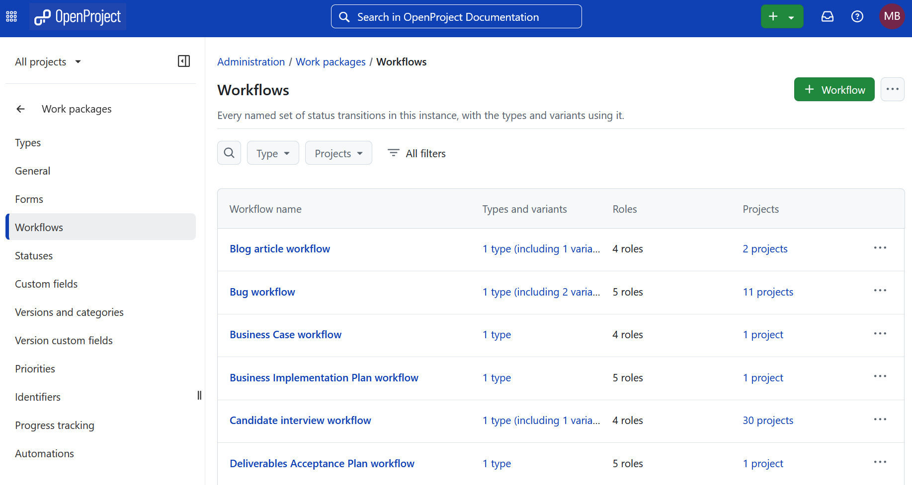
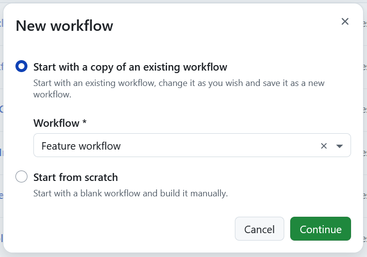
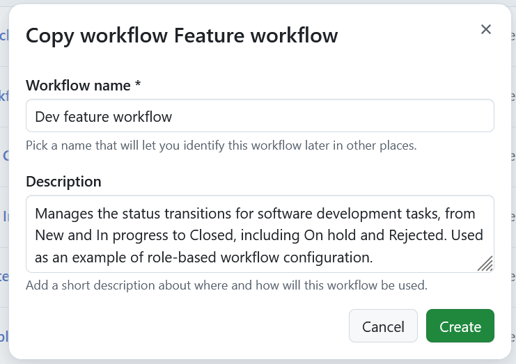
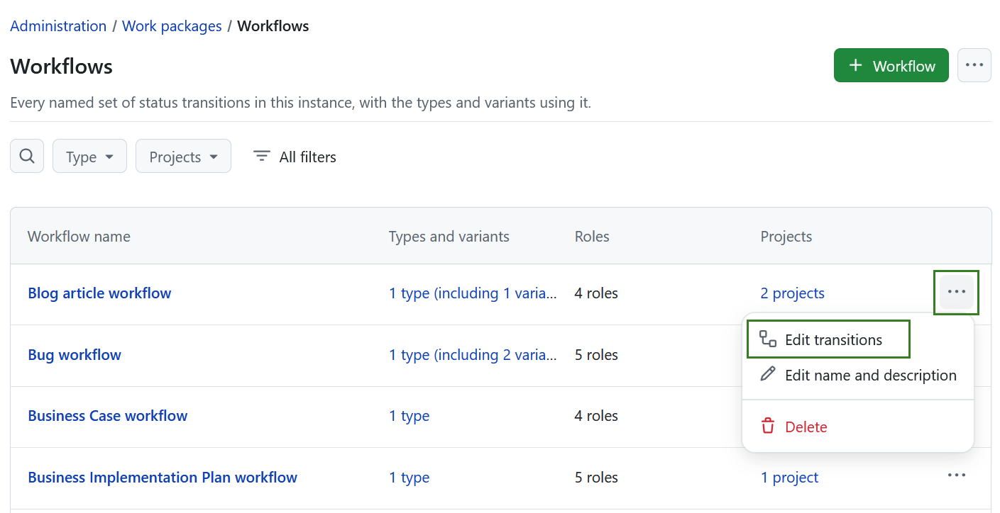
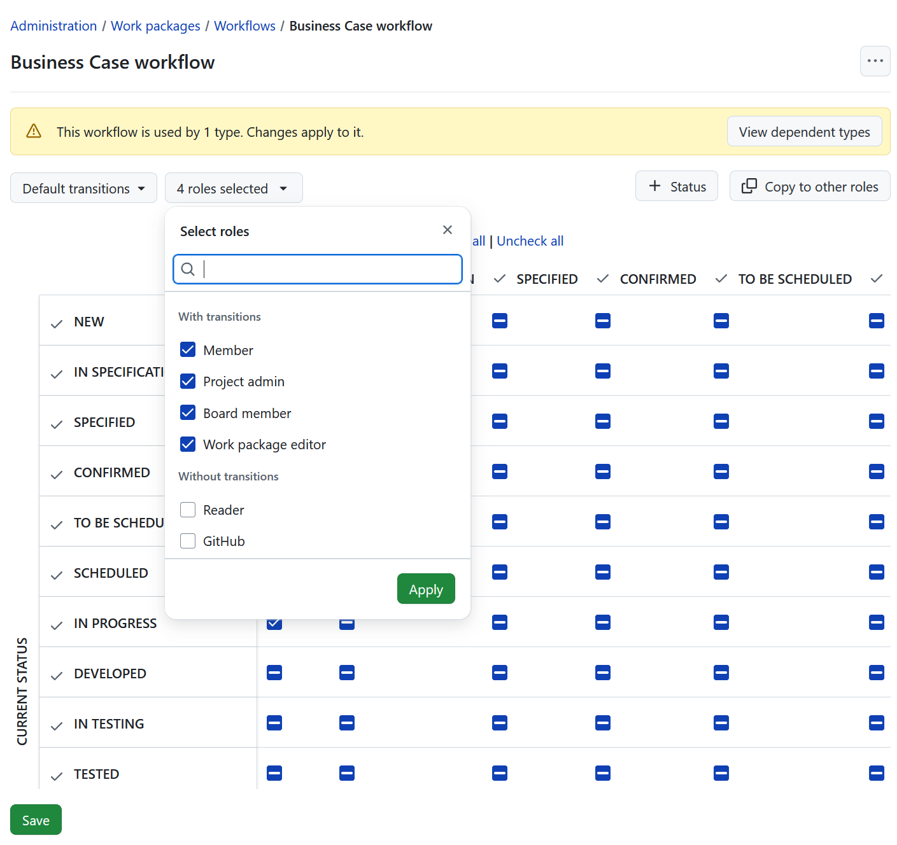
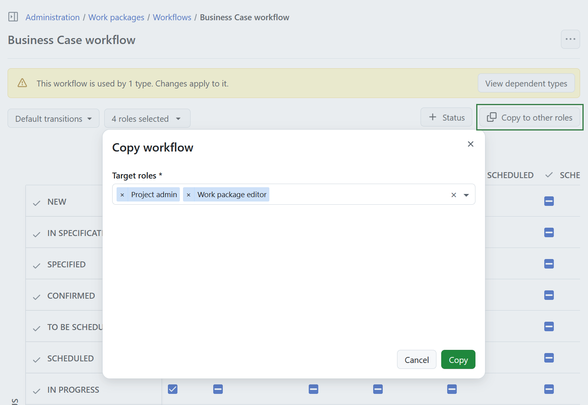
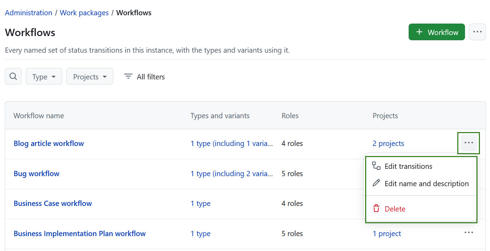
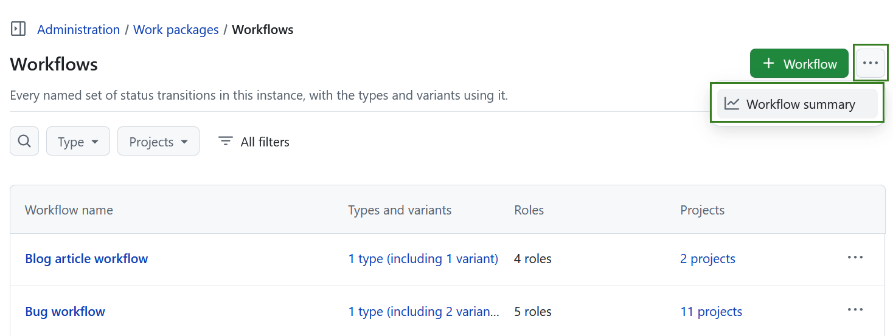

---
sidebar_navigation:
  title: Workflows
  priority: 600
description: Configure and manage reusable work package workflows in OpenProject.
keywords: work package workflows, status transitions, workflow configuration, type variants
---

# Configure workflows

A **workflow** in OpenProject defines which transitions between work package statuses are allowed for different project roles.

In OpenProject 18.0, workflows can be reused across multiple work package types and variants. This allows administrators to define status transitions once and apply them to different types of work. The available status transitions depend on the workflow assigned to the work package type or variant and the user's role in the project.

Changes to a shared workflow affect all work package types and variants that use it. Before modifying a workflow, check where it is used. If you need different transitions for a particular type or variant, create a separate workflow instead.

## Manage workflows

To manage workflows, navigate to *Administration → Work packages → Workflows*.

The overview lists all workflows in the instance and shows which work package types, variants, roles, and projects use them. You can search for workflows or narrow down the list using the **Type** and **Projects** filters. Click **All filters** to access additional filtering options.

## Create a new workflow

To create a workflow, click **+ Workflow** in the workflows overview.

In the **New workflow** dialog, choose how you want to start:

- **Start with a copy of an existing workflow:** Select an existing workflow to use its configuration as a starting point. This is useful when you need a workflow similar to one already in use, but with different transitions.
- **Start from scratch:** Create a blank workflow and configure its status transitions manually.

Click **Continue**, enter a **Workflow name** and, optionally, a **Description** explaining where and how the workflow will be used. Click **Create** to create the new workflow.

The newly created workflow opens in the transition editor, where you can review and configure its status transitions.

Creating a workflow does not automatically assign it to a work package type or variant. You must [assign the workflow](#assign-workflows-to-types-and-variants) before it can be used by work packages.

## Configure status transitions

To configure an existing workflow, find it in the workflows overview and select **Edit transitions** from its **More (three dots)** menu. The transition editor also opens automatically after creating a workflow.

### Select transition rules and roles

Use the **Workflow transitions** dropdown to choose which transitions to configure:

- **Default transitions:** Define the status changes that users with the selected project roles can make.
- **User is author:** Define additional transitions available when the user is the author of the work package.
- **User is assignee:** Define additional transitions available when the user is the assignee of the work package.

Select the role or roles for which you want to configure transitions using the **Roles selected** dropdown.

When multiple roles are selected, changes to the transition matrix apply to all selected roles. A partially selected checkbox indicates that the transition is currently allowed for only some of the selected roles.

### Add statuses to the workflow

Click **+ Status** to select which work package statuses should be available in the workflow. Newly added statuses appear in the transition matrix, where you can configure the allowed transitions.

Removing a status from the workflow also removes its configured transitions within that workflow.

> [!NOTE]
> If a status has no transitions configured, it is automatically removed from the workflow when saving.

For more information on creating and managing statuses, see [Work package statuses](../work-package-statuses/).

### Define allowed transitions

The transition matrix shows the **Current status** in the rows and the **New statuses allowed** in the columns.

Select the checkbox at the intersection of a row and column to allow a transition between the corresponding statuses. For example, selecting the checkbox in the **New** row and **In progress** column allows a work package to change from *New* to *In progress*. To allow transitions in both directions, select both corresponding checkboxes.

Review the transitions for each relevant project role and transition rule, then click **Save** to apply your changes.

## Copy transitions to other roles

If several project roles should have the same status transitions, you can copy the configuration instead of setting up each role separately.

Open the relevant workflow in the transition editor, click **Copy to other roles**, and select the target roles to which you want to copy the transitions.

> [!IMPORTANT]
> If a target role already has configured transitions, these are overwritten by the copied configuration.

You can modify the transitions for individual roles afterwards.

## Assign workflows to types and variants

A workflow must be assigned to a work package type or variant before it can be used. Types and variants can share the same workflow or use different workflows depending on their requirements.

To assign a workflow, navigate to *Administration → Work packages → Types*, select the relevant type or variant, and open the **Workflow** tab. You can also select a workflow when creating a type or variant using the configuration wizard.

For more information, see [Manage work package types](../work-package-types/) and [Create a type or variant](../work-package-types/create-type-or-variant/).

## Edit or delete a workflow

To manage an existing workflow, open its **More (three dots)** menu in the workflows overview.

The menu provides the following actions:

- **Edit transitions:** Change the allowed status transitions.
- **Edit name and description:** Update the workflow's name or description.
- **Delete:** Remove the workflow.

When editing transitions, the workflow detail view indicates whether the workflow is used by any work package types or variants. If it has not been assigned, the message *No type or variant uses this workflow yet* is displayed.

Before deleting a workflow, check the **Types and variants** and **Projects** columns in the overview to understand where it is used.

## Workflow summary

The workflow summary provides an overview of the configured status transitions across work package types and project roles.

To open it, navigate to *Administration → Work packages → Workflows*, open the **More (three dots)** menu in the upper-right corner and select **Workflow summary**.

Select a work package type and role to view the corresponding status transitions. The summary displays the current status in the rows and the possible new statuses in the columns. Checkmarks indicate which transitions are allowed for the selected configuration.

