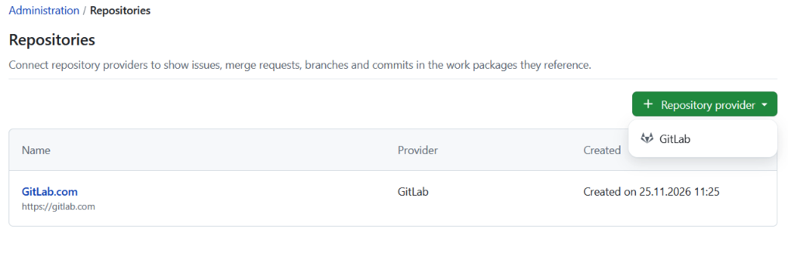

---
sidebar_navigation:
  title: Repositories
  priority: 839
description: Configure repository providers and manage repository integrations in OpenProject.
keywords: repository, repositories, repository provider, GitLab, source code integration
---

# Repositories

OpenProject integrates with source code repositories to connect software development activities with work packages. Linked issues, merge requests, branches, and commits are displayed in the **Code** tab of a work package.

Starting with OpenProject 18.0, repository providers are managed centrally under *Administration → Repositories*. Currently, GitLab is the supported repository provider.

## Manage repository providers

Navigate to *Administration → Repositories*.

The overview lists all configured repository providers, including their name, URL, provider type, and creation date.

To add a new repository provider, click **+ Repository provider** and select **GitLab**.

You can configure multiple GitLab providers, for example to connect both GitLab.com and a self-managed GitLab instance.

To edit the configuration of an existing provider, click its name in the overview.

For detailed setup instructions, see [GitLab integration](../integrations/gitlab-integration/).

## Enable the Repositories module

To display repository information in work packages, enable the **Repositories** module under *Project settings → Modules* in each relevant project.

Users also need the **Show repository content** permission to access the **Code** tab in work packages. This permission can be configured under [Roles and permissions](../users-permissions/roles-permissions/).

## Upgrading from the previous GitLab integration

Prior to OpenProject 18.0, GitLab integration settings were managed under *Administration → Integrations → GitLab*.

When upgrading to OpenProject 18.0, the existing GitLab configuration is automatically migrated to a repository provider. Existing linked development activities are preserved, and projects using the former GitLab module are switched to the Repositories module.

For more information and recommended steps after upgrading, see [Updating from the previous GitLab integration settings](../integrations/gitlab-integration/#updating-from-the-previous-gitlab-integration-settings).
