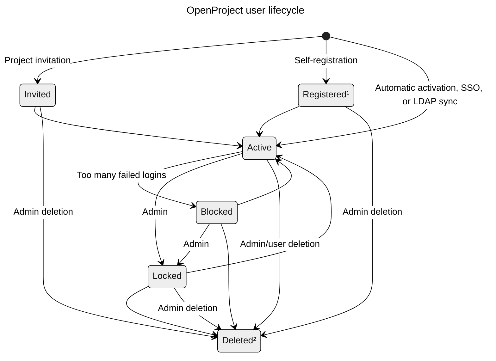

---
sidebar_navigation:
  title: Users and permissions
  priority: 990
description: Manage users and permissions.
keywords: users, permissions, roles, groups, avatars
---
# Users and permissions

In this section of the System Administration guide you can learn how to manage users, placeholder users and permissions in OpenProject.

## Overview

| Topic                                      | Content                                                      |
| ------------------------------------------ | :----------------------------------------------------------- |
| [Settings](settings)                       | Configure user settings, e.g. default language, time zone, and more. |
| [Users](users)                             | Manage users: View all users, invite new users, lock users, and more. |
| [User attributes](user-attributes)         | Create and manage user attributes.                           |
| [Placeholder users](placeholder-users)     | Create and manage placeholder users.                         |
| [Groups](groups)                           | View groups, create new groups, add users to groups.         |
| [Organization](organization)               | Define your company’s structure within OpenProject.          |
| [Roles and permissions](roles-permissions) | See / manage roles and permissions and add new roles.        |
| [User visibility](user-visibility)         | Understand which users and groups a user can see.            |
| [Permissions report](permissions-report)   | View and edit permissions assigned to currently existing roles. |
| [Avatars](avatars)                         | Activate / deactivate user avatars (profile pictures).       |

## User lifecycle

The following diagram shows the lifecycle of a user in OpenProject.

¹ Requires the [self-registration setting](users/#create-user-via-self-registration)
² Requires the [user or admin deletion setting](users/#delete-users)
