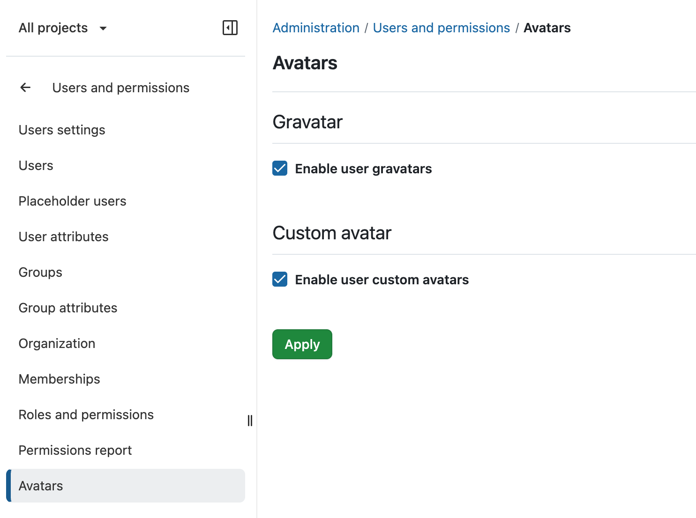

---
sidebar_navigation:
  title: Avatars
  priority: 940
description: Manage Avatars in OpenProject
keywords: Avatars
---
# Manage avatars in OpenProject

Administrators can configure which avatar types are available to users and groups in OpenProject.

To manage avatar settings, navigate to **Administration → Users and permissions → Avatars**.

## Available avatar options

The following settings determine which avatar types are available in the **Edit avatar** dialog:

- **Enable user gravatars**: Allows users to display their Gravatar image associated with their email address. Gravatars are not available for groups.
- **Enable user custom avatars**: Allows users to upload their own avatar images. Administrators can also upload custom avatars for users and groups.

## Initials

The **Initials** option is always available, even when Gravatars and custom avatars are disabled.

Users and groups can customize their initials by entering up to two characters and selecting a background color.

> [!TIP]
> If an administrator disables an avatar type that is currently in use, OpenProject automatically displays the user's or group's initials instead.

Previously uploaded custom avatar images are not deleted. If custom avatars are enabled again, the previously selected images are displayed again.

## Change an avatar

Users can change their own avatar in their [account settings](../../../user-guide/account-settings/account/#set-an-avatar). 

Administrators can change avatars for other users and groups through [user administration](../users/#avatar) and the [group administration](../groups/#change-the-group-avatar), respectively.
