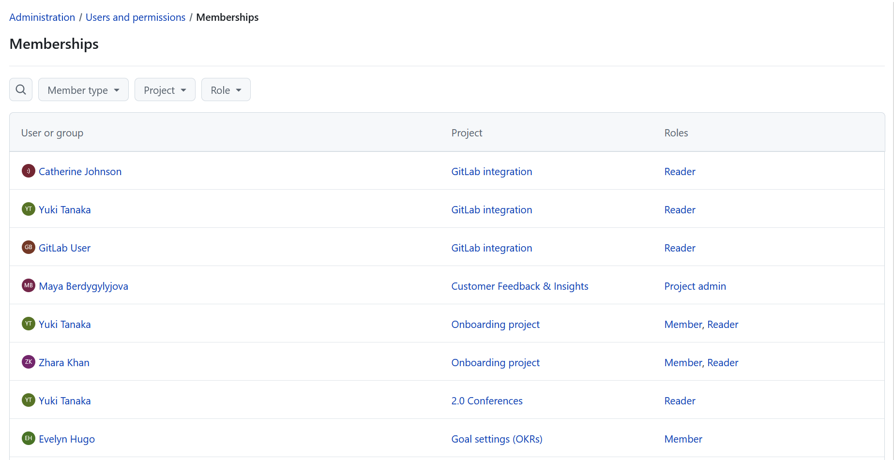

---
sidebar_navigation:
  title: Memberships
  priority: 968
description: View and filter all memberships across projects in OpenProject.
keywords: memberships, members, roles, projects, administration
---

# Memberships

The **Memberships** page lists every membership across all projects in one filterable list. This way, system administrators can find out who holds a given role, including in archived projects, without opening the member list of each project.

To open the page, navigate to _Administration_ > _Users and permissions_ > _Memberships_.

## Memberships list

Each row in the list shows one membership, with the columns **User or group**, **Project**, and **Roles**. If a member has several roles in a project, all of them are listed in the same row.

- If a role comes from a group membership, the group is shown next to the role, for example *Member (via: Group Customer Support)*. This indicates that the member did not get the role directly.
- A global role is indicated by the word **Global** in the project's column.
- Memberships in archived projects are included in the list. Their project names are shown as plain text, since archived projects have no page that can be opened.
- User and group names link to the user or group, project names link to the project, and each role name links to the role's edit page in [Roles and permissions](../roles-permissions/).

The list is paginated.

## Search and filter memberships

Above the list, you can narrow down the memberships:

- **Search:** Click the search icon and enter a name to filter the list by the member's name.
- **Member type:** Shows only users, groups, or placeholder users. You can select several types.
- **Project:** Shows only memberships in the selected projects.
- **Role:** Shows only memberships with the selected roles.

The number next to a filter shows how many values are selected in it.

> [!TIP]
> Before you [delete a role](../roles-permissions/#edit-and-delete-roles), filter the list by that role to see which members are still using it.
