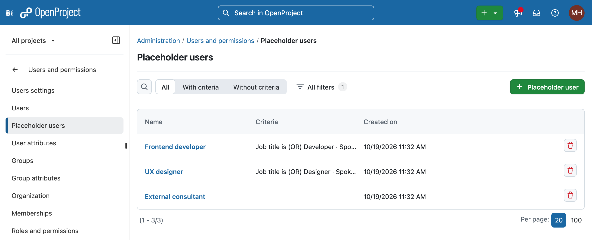
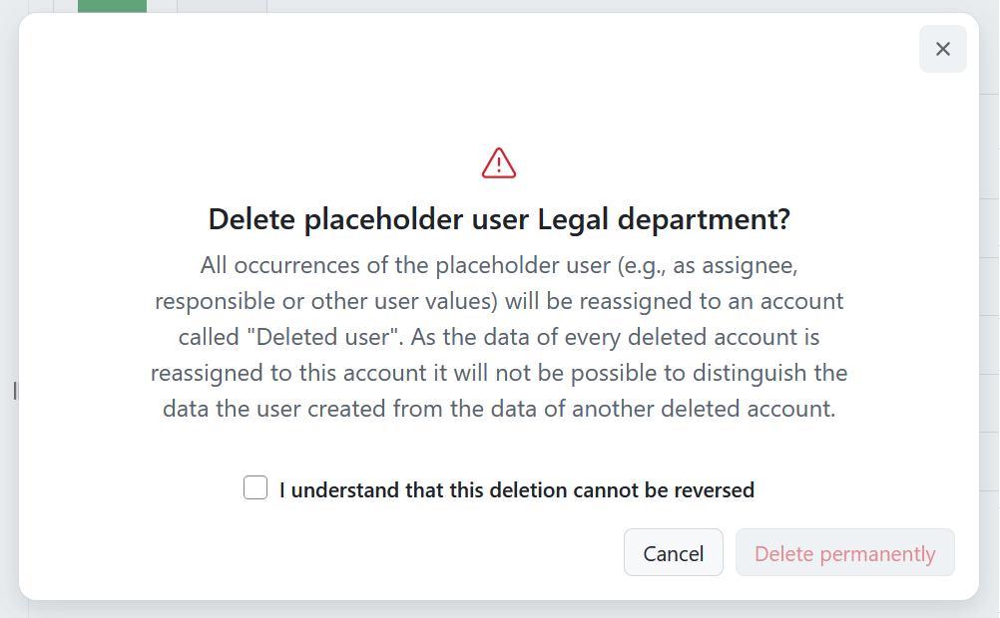
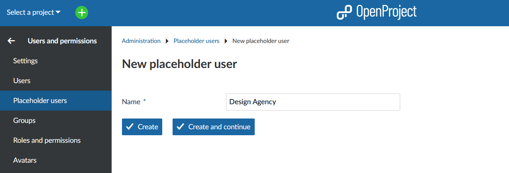
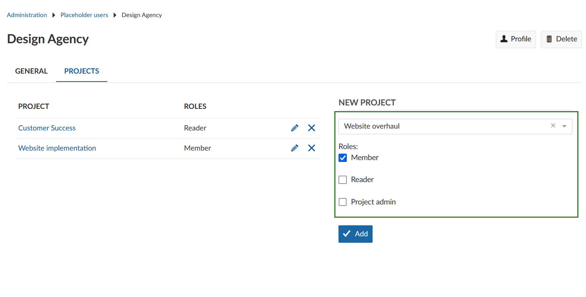
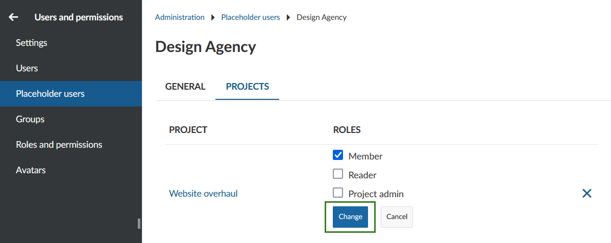
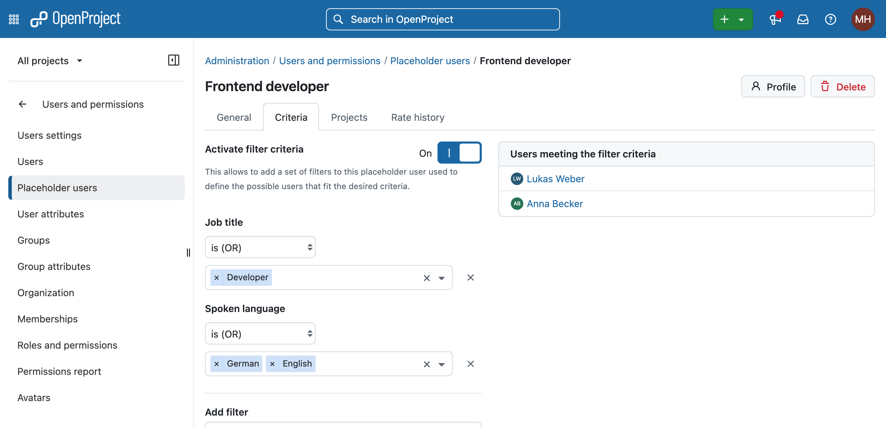
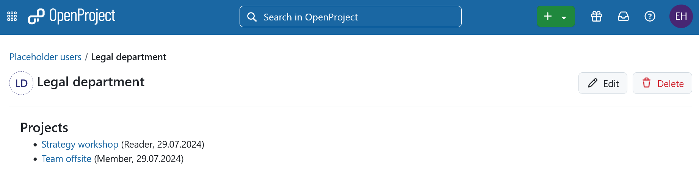

---
sidebar_navigation:
  title: Placeholder users
  priority: 980
description: Manage placeholder users in in OpenProject.
keywords: placeholder user, example, wildcard, place holder, criteria, resource management
---

# Placeholder users (Enterprise add-on)

[feature: placeholder_users ]

In OpenProject you can add placeholder users to your instance. They can be created without an email address and do not need license seats.

Placeholder users can be used to plan a project with or for users who haven't been added to that project yet. This way you can set up projects before staffing them.
Another use case would be to include customers, vendors or partners in your planning without them knowing it.

In [Resource management](../../../user-guide/resource-management/), placeholder users with [criteria](#placeholder-user-criteria) describe the kind of person you need, for example a developer who speaks German and English. You can allocate work to such a placeholder user and later assign a matching user in the [Staffing](../../../user-guide/resource-management/#staffing) view.

Placeholder users can be managed by system admins and by users with the [role](../roles-permissions/#global-role) "Create, edit and delete placeholder users".

| Topic                                                                 | Content                                              |
|-----------------------------------------------------------------------|------------------------------------------------------|
| [Placeholder user list](#placeholder-user-list)                       | Manage placeholder users in OpenProject.             |
| [Create placeholder users](#create-placeholder-users)                 | Add new placeholder users.                           |
| [Manage placeholder user settings](#manage-placeholder-user-settings) | Change names, hourly rates and add placeholders users to projects. |
| [Placeholder user criteria](#placeholder-user-criteria)               | Describe which users match a placeholder user.       |

## Placeholder user list

To manage placeholder users navigate to **Administration -> Users and permissions -> Placeholder users**. The placeholder user list gives you an overview of all placeholder users with their names, [criteria](#placeholder-user-criteria) and creation dates. From here you can also [add](#create-placeholder-users) placeholder users, [edit](#manage-placeholder-user-settings) them and [delete](#delete-placeholder-users) them.

The column headers can be clicked to toggle sort direction. Arrows indicate sort order, up for ascending (a-z/0-9) and down for descending (z-a/9-0).

### Filter placeholder users

Use the search icon to filter the list by name. You can enter any part of a placeholder user name.

Select **With criteria** or **Without criteria** to only show placeholder users that have criteria set or that have none. Select **All** to show all placeholder users again.

### Delete placeholder users

To delete a placeholder user open the [placeholder user list](#placeholder-user-list). Click on the trash can symbol on the right to choose the placeholder user that you want to remove.

You will then be asked to type in the placeholder user name to confirm the deletion.

> [!CAUTION]
> Deleting a placeholder user account is an irreversible action and cannot be revoked. The previous activities from this user will still be displayed in the system but reassigned to **Deleted user**.

A placeholder user that is still used in resource allocations cannot be deleted. In this case OpenProject shows the message *This placeholder user is still used in resource allocations. Reassign or remove these allocations before deleting it.* Assign a user to these allocations in the [Staffing](../../../user-guide/resource-management/#staffing) view or delete the allocations first.

## Create placeholder users

To add a new placeholder, user click on **+ Placeholder user** in the upper right corner of the [placeholder user list](#placeholder-user-list).
Enter a name and optionally a description. To describe which users match this placeholder user, select **Match users by criteria** and add one or more filters (see [Placeholder user criteria](#placeholder-user-criteria)).
Click on **Create** to save or on **Create and continue** to save and create another placeholder user.

It is not possible to create two placeholder users with the exact same name.

## Manage placeholder user settings

You can change a placeholder user's name and add it to a project if you click on its name in the [placeholder user list](#placeholder-user-list).

Under the **General** tab you can change the placeholder user's name.

In order to be assigned to work packages and participate in a project, a placeholder user has to be a member of a project and needs to be added with a certain role to this project.
On the **Projects** tab, select a project from the drop-down list, choose the [role(s)](../roles-permissions) for the placeholder user in this project and click the green **Add** button.

To change a placeholder user's role in a project or to remove it from the project use the **edit button (pen)** or **delete button (X)**, respectively.

If you edit the placeholder user's role(s) don't forget to use the **Change** button to save your changes.

**Note**: You can also use a project's [member list](../../../user-guide/members) to manage a placeholder user's participation in a project.

### Hourly rates

On the **Rate history** tab you can define hourly rates for a placeholder user, the same way as for [users](../users/#rate-history). This tab is visible for users with the **Manage default hourly rates** permission.

With an hourly rate, placeholder users can be used for planned labor costs in [budgets](../../../user-guide/budgets/#add-planned-labor-costs). This way you can plan the costs of a project before you know who will do the work.

### Additional settings

Placeholder users cannot be added to groups and cannot be assigned global roles. The avatar currently looks like that of users without a profile picture.

## Placeholder user criteria

Criteria describe which users can fill a placeholder user. They are used in [Resource management](../../../user-guide/resource-management/): when you allocate work to a placeholder user, the [Staffing](../../../user-guide/resource-management/#staffing) view only suggests project members that match its criteria.

Only placeholder users with criteria can be selected when allocating work in Resource management.

To set criteria, open the placeholder user and select the **Criteria** tab. Turn on **Activate filter criteria** and add filters. You can filter by the standard user attributes, such as name, group membership or status, and by [user attributes](../user-attributes/) like job title, skills or spoken languages.

Changes are saved automatically. On the right side you see the users that currently meet the criteria. If more than 50 users match, select **Show all matching users** to open the full list.

To remove the criteria, turn off **Activate filter criteria**.

## Placeholder user profile

Similar to users, placeholder users have a profile page which shows their name and project memberships.

The projects are only visible for users who are allowed to see the project (e.g. user has permission to see this placeholder user in a common project or has a sufficient global role (e.g. system administrator)).

The profile page can be accessed via the [placeholder user settings](#manage-placeholder-user-settings) and via the overview page of projects the placeholder user is a member of.
