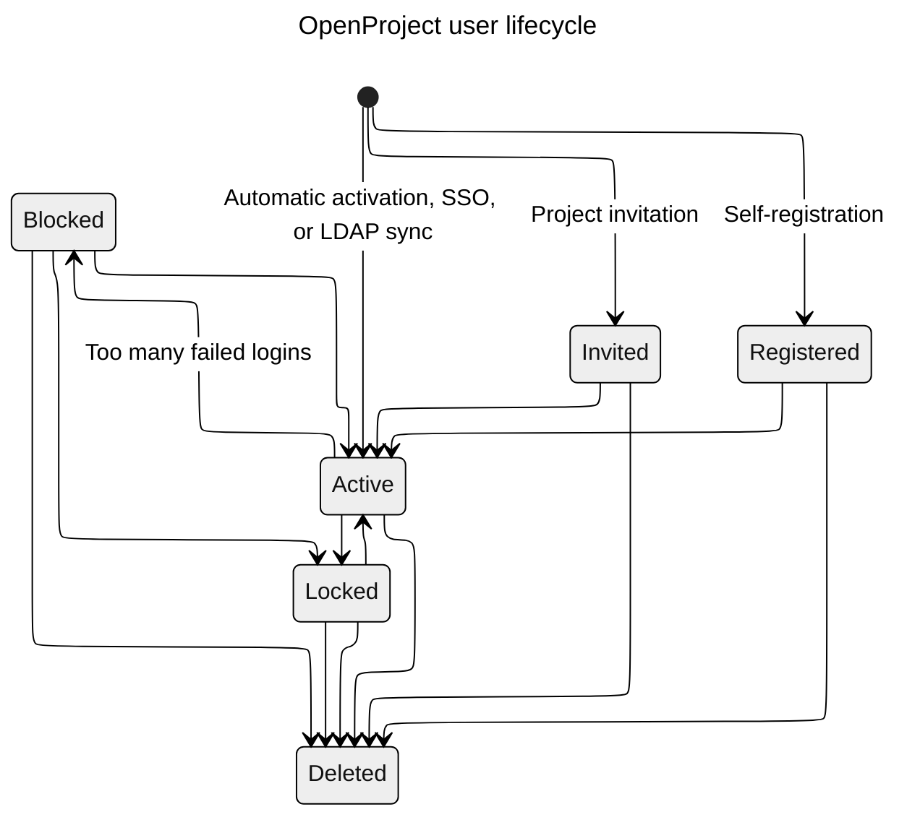

---
sidebar_navigation:
  title: User lifecycle
  priority: 999
description: An overview of how users are created and deleted in OpenProject.
keywords: users, lifecycle, scim, active, invited, registered, blocked, deleted
---

# User lifecycle

As a general overview, the following flowchart gives you an overview of a user's lifecycle in
OpenProject.

The table below details how each status transition works.

| From status                                  | To status  | Description                                                                                                                                                                                                                                                                                              |
|----------------------------------------------|------------|----------------------------------------------------------------------------------------------------------------------------------------------------------------------------------------------------------------------------------------------------------------------------------------------------------|
|                                              | Invited    | If enabled, a project administrator can invite a user to their project. See [invite members](../../../getting-started/invite-members) for details.                                                                                                                                                       |
|                                              | Registered | If self-registration is enabled, a user can register themselves. See [login and registration settings](../../authentication/login-registration-settings) for details.                                                                                                                                    |
|                                              | Active     | When [automatic activation is enabled](../../authentication/login-registration-settings), the user is created via [LDAP](../../authentication/ldap-connections)/[SCIM](../../authentication/scim), or the user logs in via [OpenID](../../authentication/openid-providers), the user is created in this state. |
| Invited                                      | Active     | An invited user can activate their own account by following the invitation link.                                                                                                                                                                                                                             |
| Registered                                   | Active     | If email verification is configured, a user can click the link to activate their account. An administrator can also activate an account.                                                                                                                                                                        |
| Active                                       | Blocked    | If the user has too many failed login attempts, they will be blocked. See [login and registration settings](../../authentication/login-registration-settings) for details.                                                                                                                               |
| Blocked                                      | Active     | The inverse of the above, the user will be unblocked after the configured period.                                                                                                                                                                                                                          |
| Active, Blocked                              | Locked     | An administrator can lock an account. This prevents the user from logging in to OpenProject but does not delete their account. See [lock and unlock users](../users#lock-and-unlock-users) for details.                                                                                                           |
| Locked                                       | Active     | An administrator can [unlock a user](../users#lock-and-unlock-users), allowing them to log in again.                                                                                                                                                                                                     |
| Invited, Registered, Active, Locked, Blocked | Deleted    | If the [appropriate settings](../users#delete-users) are enabled, an administrator can delete a user, or the users can delete their own accounts. The user record will remain as a deleted user, but their personal details will be deleted.                                                                        |
