---
sidebar_navigation:
  title: Access tokens
  priority: 400
description: Learn how to manage access tokens in OpenProject.
keywords: my account, account settings, change language
---

# Access tokens

Access tokens allow external applications to securely access resources in OpenProject or enable OpenProject to connect to external services.

To view and manage your access tokens, navigate to **Account settings** and select **Access tokens** from the menu.

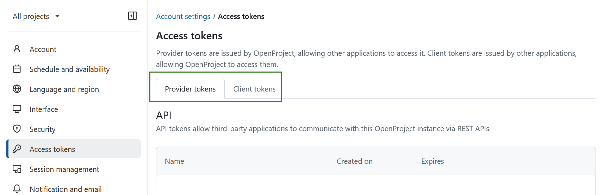

Access tokens are organized into two tabs:

- **Provider tokens:** Generated by OpenProject to allow external applications to connect to OpenProject.
- **Client tokens:** Generated by external applications to allow OpenProject to connect to them.

## Provider tokens

Provider tokens are generated in OpenProject and allow external applications to access OpenProject resources.

OpenProject supports the following types of provider tokens: API, iCalendar, iCalendar for meetings, OAuth, and RSS.

### API

API tokens allow third-party applications to communicate with your OpenProject instance through the REST API.

To use API tokens, the REST API must be enabled. Administrators can configure the REST API and Cross-Origin Resource Sharing (CORS) under [Administration → API and webhooks](../../../system-admin-guide/api-and-webhooks/).

If you have not created any API tokens yet, the list will be empty.

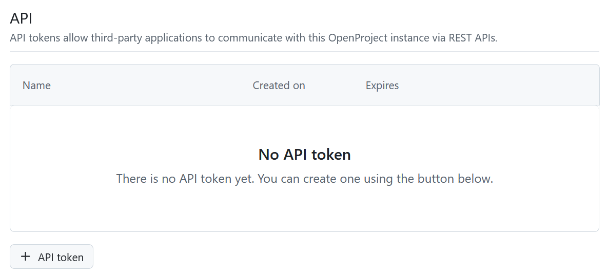

#### Create an API token

To create a new API token:

1. Click the **+ API token** button.
2. Enter a descriptive name for the token to help you identify its purpose later.
3. Select an expiration period.
4. Click **Create**.

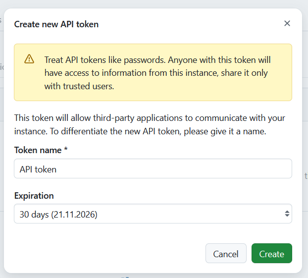

You can choose from the following expiration options:

- **7, 30, 60, or 90 days:** The token remains valid until the end of the selected expiration date. The default is 30 days.
- **Custom date:** Select a future date. The token remains valid until the end of that day.
- **No expiration:** The token remains valid until you manually delete it.

> [!TIP]
> **Set an expiration date for better security.**
> We recommend choosing an expiration date rather than creating tokens without an expiration. This limits how long a token can be used if it is accidentally exposed or compromised.

#### Copy and store your API token

Once you create an API token, OpenProject generates and displays it.

**Make sure to copy the token and store it securely.** For security reasons, the token is displayed only once, immediately after creation. You cannot view it again later.

If you lose a token, you will need to delete it and create a new one.

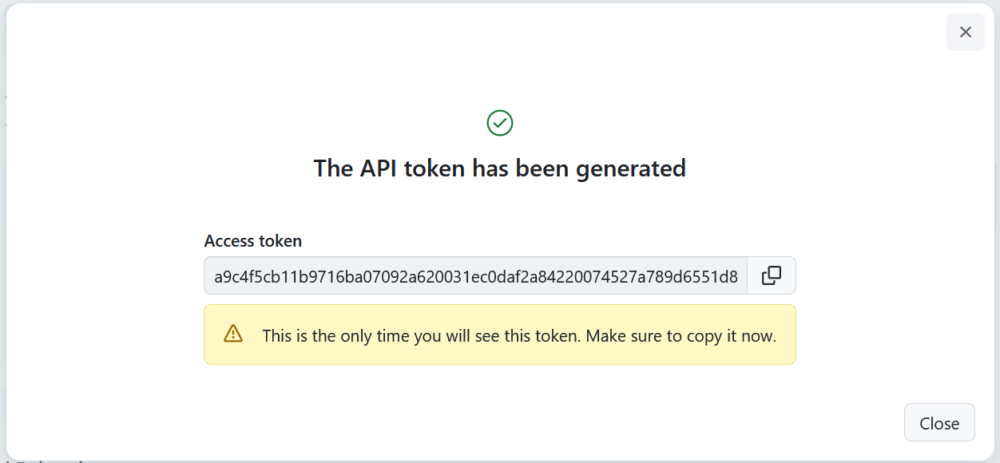

> [!TIP]
> **Use a separate token for each application or purpose.**
> This makes it easier to identify and revoke individual tokens without affecting other integrations.

#### Manage and delete API tokens

All your API tokens are listed in the **API** section, along with their expiration dates.

When a token expires, OpenProject automatically rejects any API requests that use it. Expired tokens are marked with **Expired on**, followed by the expiration date.

An expired token cannot be reused or renewed. To restore access for an application using an expired token, create a new token and update the application's configuration.

You can also delete tokens you no longer need. Deleted tokens become invalid immediately and can no longer be used to access OpenProject.

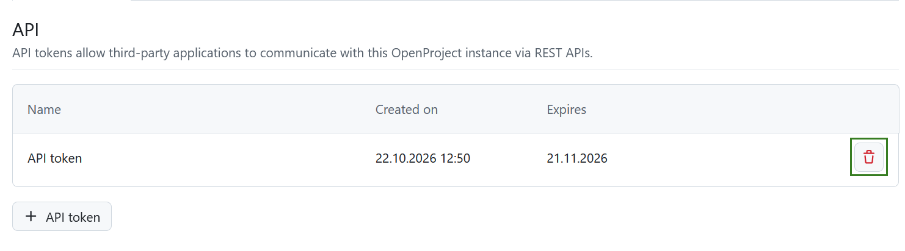

### iCalendar

iCalendar tokens allow users to subscribe to OpenProject calendars and view up-to-date work package information in external calendar applications.

This list will be empty if you have not subscribed to any OpenProject calendars yet.

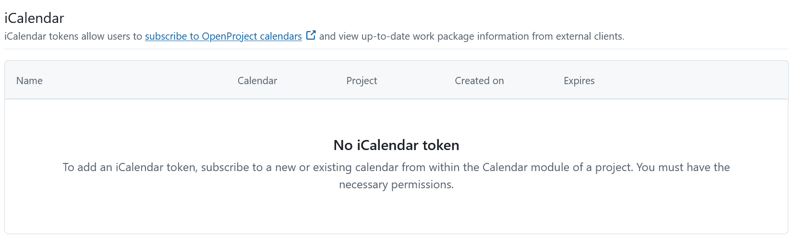

Once you [subscribe to a calendar](../../calendar/#subscribe-to-a-calendar), it will appear in this list. Click a calendar name to open the corresponding calendar in OpenProject.

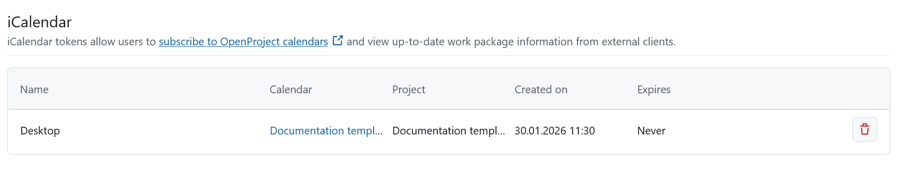

To delete an iCalendar token, click the **Delete** icon next to the corresponding entry. A confirmation message will appear asking you to confirm the deletion.

Deleting a token will prevent all external calendar applications using it from accessing the associated OpenProject calendar.

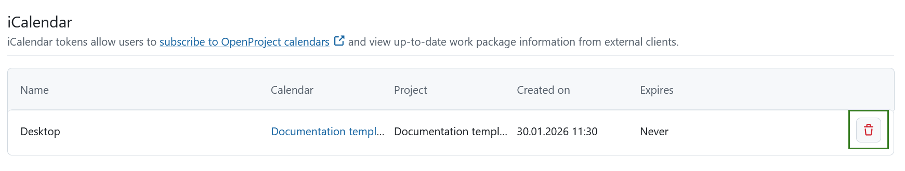

A confirmation message will inform you that the token and the associated iCalendar URL are no longer valid.

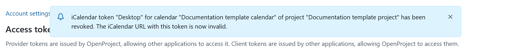

### iCalendar for meetings

iCalendar meeting tokens allow users to subscribe to all their meetings and view up-to-date meeting information in external calendar applications.

This list will be empty if you have not subscribed to a meetings calendar yet. Once you create a subscription, the corresponding iCalendar meeting token will appear here.

To subscribe, click the **Subscribe to calendar** button in your account settings or in the [meetings module](../../meetings/#subscribe-to-meetings).

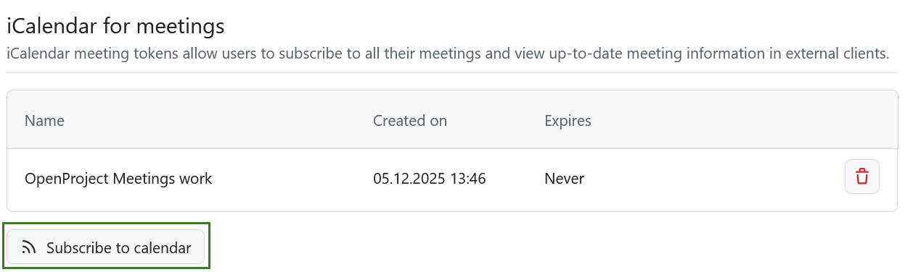

Enter a name for the meeting subscription token and click **Create subscription**.

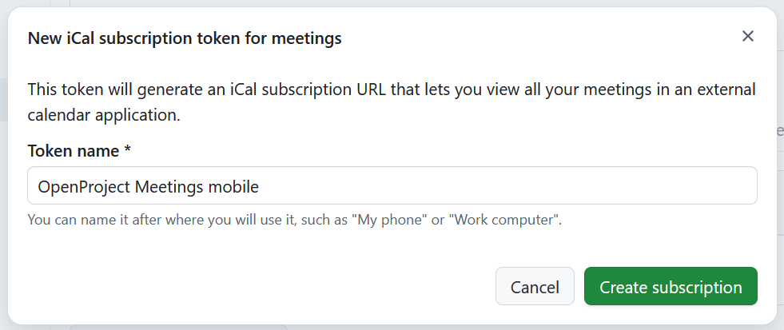

OpenProject will generate and display your new token.

> [!IMPORTANT]
> The token is displayed only once, immediately after creation. Make sure to copy and store it securely.

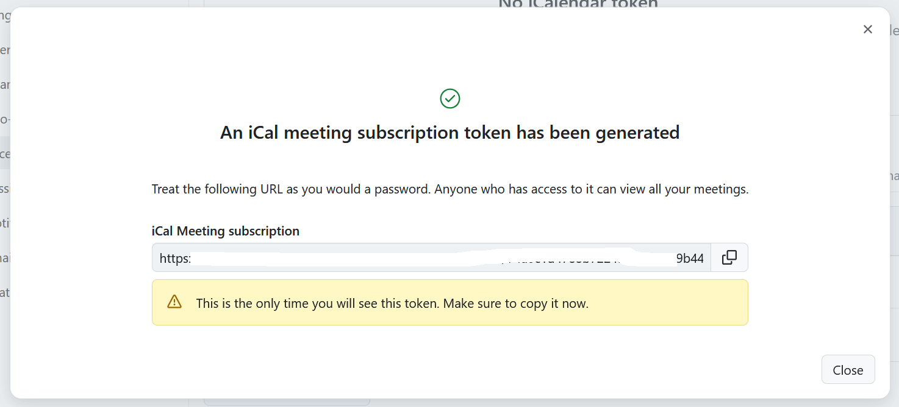

To delete an iCalendar meeting token, click the **Delete** icon next to the corresponding token in your account settings.

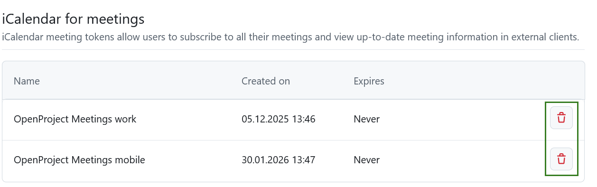

### OAuth

OAuth tokens allow external applications, such as Nextcloud, to connect to your OpenProject instance. For setup instructions, see the [Nextcloud integration guide](../../file-management/nextcloud-integration/).

Administrators can configure OAuth applications under [Administration → Authentication](../../../system-admin-guide/authentication/).

OAuth tokens cannot be created manually from this page. Instead, the authorization process is initiated by the external application. During setup, you will be redirected to OpenProject to authorize access and then returned to the external application to complete the connection.

If you have not authorized any external applications yet, this list will be empty. Contact your administrator if you need help setting up an integration.

Once you have authorized an application, its token will appear here.

You can revoke access at any time by clicking the **Delete** icon next to the corresponding token. This immediately revokes the application's permission to act on your behalf, preventing it from making API requests in your name.

To use the integration again, you will need to authorize the application again.

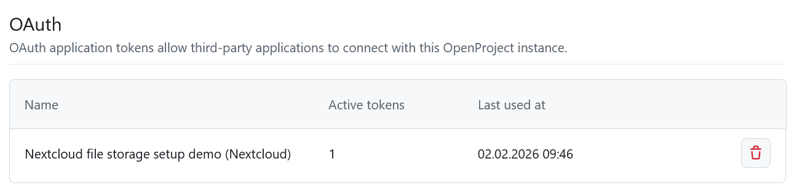

### RSS

RSS tokens allow users to stay up to date with the latest changes in their OpenProject instance through an external RSS reader.

You can have only one active RSS token at a time.

To create a token, click the **RSS token** button.

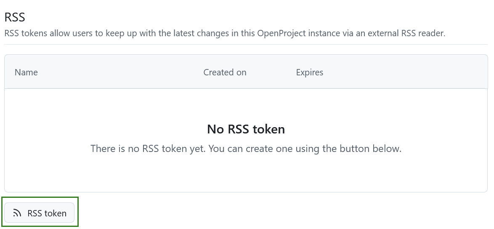

OpenProject will generate and display your new RSS token.

> [!IMPORTANT]
> The RSS token is displayed only once, immediately after creation. Make sure to copy and store it securely.

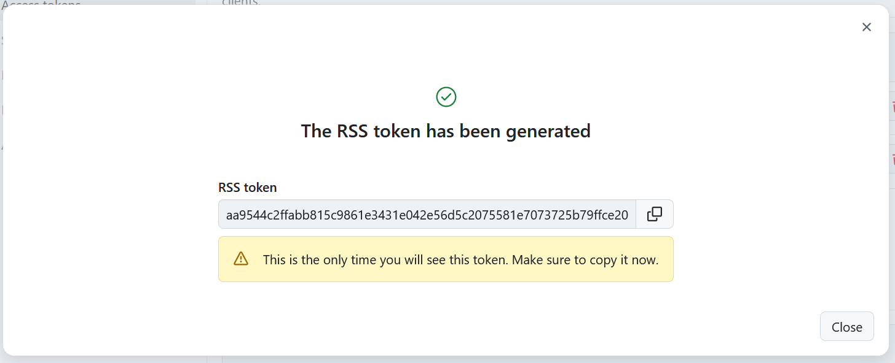

Once you have created an RSS token, its details will appear here. To delete it, click the **Delete** icon.

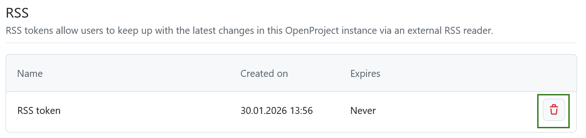

## Client tokens

Client tokens are generated by external applications and allow OpenProject to connect to them.

### OAuth

OAuth client tokens allow your OpenProject instance to connect to external applications.

If you have not connected your account to any of the integrations enabled for your instance, this list will be empty.

To revoke access to an external application, click the **Delete** icon next to the corresponding token.

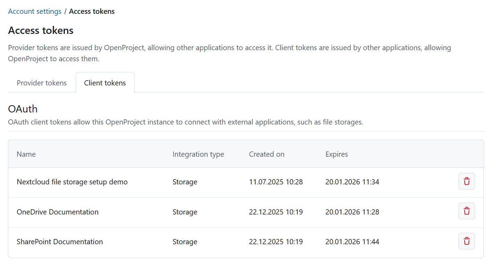