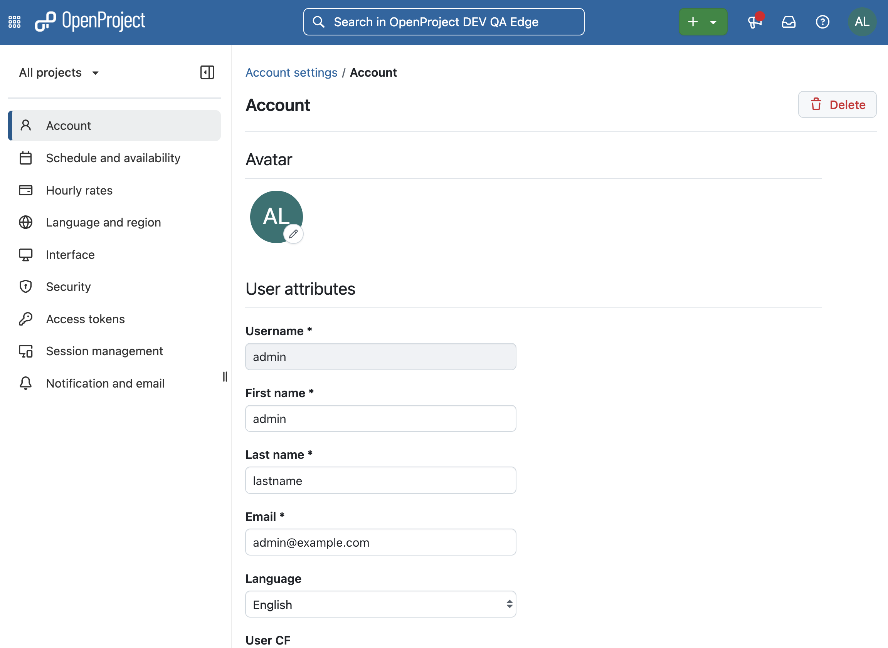
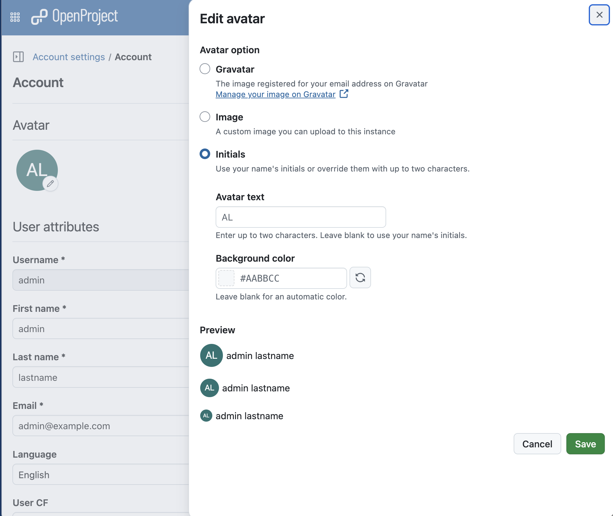
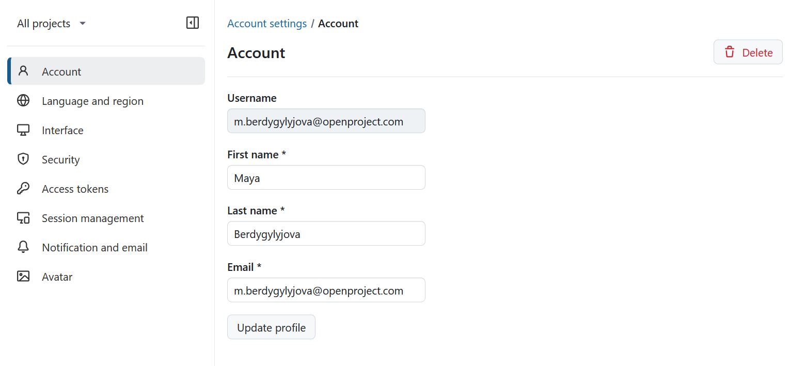
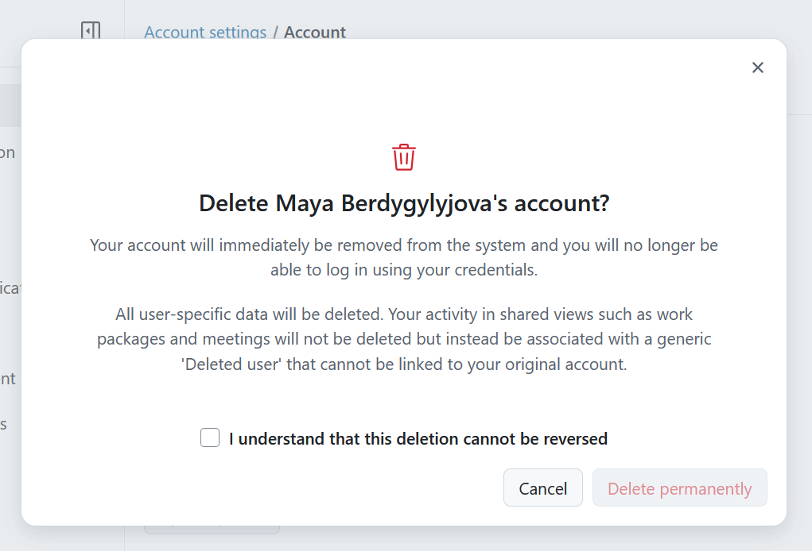

---
sidebar_navigation:
  title: Account settings
  priority: 900
description: Learn how to configure user attributes and avatar in OpenProject.
keywords: my account, account settings, avatar
---

# Account

## Set an avatar

Your avatar is shown next to your name across OpenProject. To change it, navigate to **Account settings** and select **Account** from the left-hand menu. Your current avatar is shown at the top of the page, with a pencil icon. Click the avatar to open the **Edit avatar** dialog.

Under **Avatar option**, select the type of avatar you want to use. The options shown depend on what your OpenProject administrator has enabled in the [avatar settings](../../../system-admin-guide/users-permissions/avatars/):

- **Gravatar**: If enabled by an administrator, OpenProject shows the image you registered for your email address at [gravatar.com](https://documentation.openproject-edge.com/external_redirect?url=https%3A%2F%2Fgravatar.com%2F). Use the **Manage your image on Gravatar** link to change that image. If no Gravatar image is available, Gravatar shows its configured default avatar.
- **Image**: If enabled by an administrator, you can upload a custom image to OpenProject here.
- **Initials**: OpenProject generates an avatar from your initials. This option is always available.

The **Preview** at the bottom of the dialog shows your avatar in the sizes used across OpenProject. It updates while you make changes. Click **Save** to apply your changes, or **Cancel** to close the dialog without saving.

> [!NOTE]
> If you have never selected an option, OpenProject uses your uploaded image first, then your custom initials, then your Gravatar. If your administrator later disables the option you selected, OpenProject shows your initials instead.

### Upload a custom image

1. Select **Image**.
2. Click **Choose Avatar from file** and select a JPG, PNG, or GIF file.
3. Check the preview, then click **Save**. OpenProject saves the image only when you click **Save**.

To remove an uploaded image, select **Image** and click **Delete image**.

If you change to **Initials** or **Gravatar** later, OpenProject keeps your uploaded image. You can select **Image** again at any time to use it.

> [!TIP]
> For the best results, use a square image of 128 × 128 pixels. OpenProject scales larger images down to this size automatically.

### Customize your initials

When you select **Initials**, you can change the text and the background color of your avatar:

- **Avatar text**: Enter up to two characters to replace your initials, for example a nickname, letters with accents, characters from other scripts such as kanji, or an emoji. Combined emoji, such as flags or a family emoji, count as one character. Only visible characters are allowed. Leave the field blank to use the initials of your name.
- **Background color**: Enter a hex color code, such as #1A7F37, or pick a color with the color picker. Click the **Randomize color** button (the icon with two arrows) next to the field to get a random color. Leave the field blank to use an automatic color. OpenProject selects dark or white text automatically, so that the text is easy to read on the background.

## User attributes

To change your email address or your name, navigate to **Account** on the left side menu of **Account settings** page and scroll to **User attributes** section.

Here you can **update** or delete your profile. If you're changing the email address of your account, you will be requested to confirm your account password before you can continue. 

> [!NOTE] 
> This applies only to internal accounts where OpenProject can verify the password.

> [!TIP]
> Please note that 'Hide my email' checkbox was removed from account settings with OpenProject 15.0.  The function was replaced by [the new Standard global role](../../../system-admin-guide/users-permissions/roles-permissions/#standard), which regulates this permission on an instance level. 

## Delete account

You can delete your own account in **Account settings**.

To delete your account, navigate to _Account settings_ -> _Account_ and click the **Delete** button in the top right corner.  You will be asked to confirm that you understand that this deletion is permanent. 

> [!WARNING]
> Deleting a user account is permanent and cannot be reversed.

If you cannot see the entry **Delete** button under your **Account settings**, make sure the option "Users allowed to delete their account" is [activated in the administration](../../../system-admin-guide/users-permissions/settings/#deletion).
