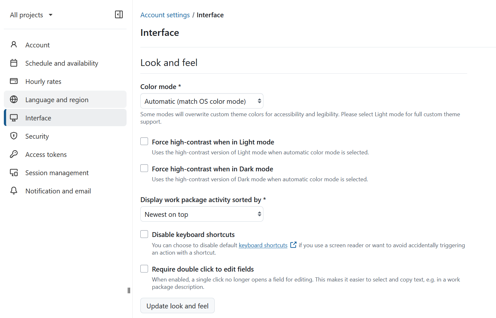
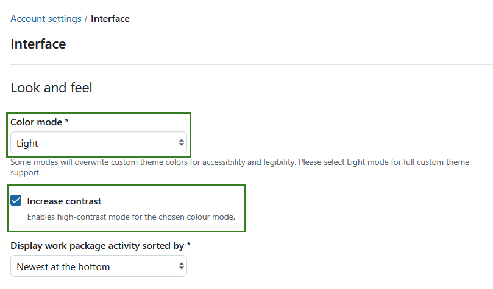
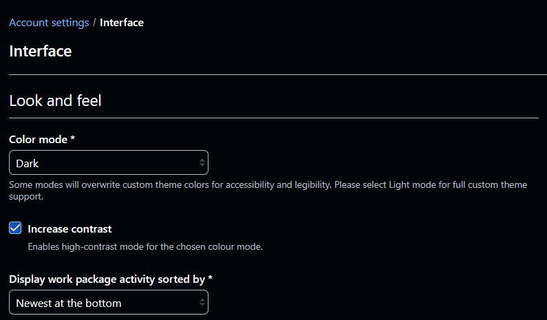
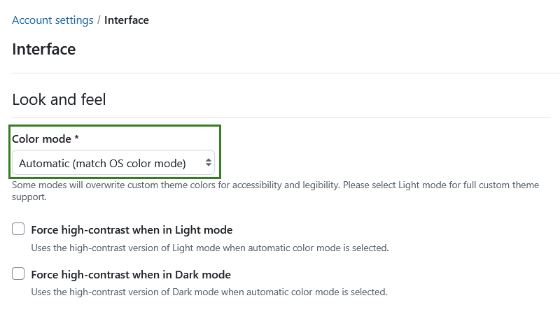
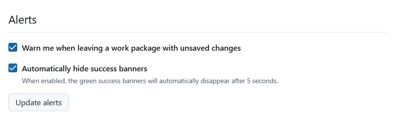

---
sidebar_navigation:
  title: Interface
  priority: 600
description: Learn how to configure the user interface in OpenProject.
keywords: my account, account settings, change language
---

# Interface

Under the **Interface** section of your account settings, you can adjust the color mode, activate alerts, and configure how comments are displayed. Settings are grouped into two sections: *Look and feel* and *Alerts*.

## Look and feel

In the **Look and feel** section under **Interface** in your account settings (accessible via the left-hand menu), you can select your preferred display color mode and adjust the order in which comments appear in the **Activity list** for work packages.

You can also **disable keyboard shortcuts**. This is useful if you rely on a screen reader or want to avoid triggering actions accidentally.

If you often select and copy text from work packages, you can **require a double click to edit fields**.

Click **Update look and feel** to save your changes.

### Select the high contrast color mode

In the **Color mode** dropdown menu, you can select your preferred color mode. The default setting is **Light mode**. You can increase the contrast by activating the **Increase contrast** setting, which significantly increases the contrast and overrides the color theme of your OpenProject instance.

This mode is recommended for users with visual impairments.

### Select the dark mode

In the **Color mode** dropdown menu, you can select your preferred color mode. The default setting is **Light mode**. Alternatively, you can select **Dark** mode and activate the **Increase contrast** setting to enable **Dark high contrast** mode.

> [!NOTE]
> Custom colors and themes are only supported in Light mode. Changing color modes may override most or all custom configurations. Only some colors (such as the accent and primary button colors) are retained, but they may be adapted to ensure appropriate contrast in modes such as dark mode.

### Select automatic color mode

In the **Color mode** dropdown menu, you can also select **Automatic**, which matches the color mode of your operating system.

If this option is selected, OpenProject automatically matches your operating system's light or dark theme, including its contrast settings. You will also see additional settings to force high contrast in Light or Dark mode. These settings ensure that OpenProject always increases contrast in automatic mode, regardless of your system's contrast settings.

If your operating system is set to high contrast mode, OpenProject automatically switches to the corresponding high contrast mode (light or dark).

> [!NOTE]
> This is a user-specific preference and only affects your own account.

### Change the order in which comments are displayed

You can select the order in which comments are displayed, for example, in the Activity tab of a work package. You can choose **newest at the bottom** or **newest on top**.

If you choose **newest on top**, the latest comment appears at the top of the Activity list.

### Disable keyboard shortcuts

If you use a screen reader or want to avoid accidentally triggering an action with a shortcut, you can disable the default [keyboard shortcuts](../../keyboard-shortcuts-access-keys/) by selecting the corresponding option.

### Require double click to edit fields

By default, a single click on an editable field, such as the description of a work package, opens it for editing. This can get in the way when you only want to select and copy text.

If you activate **Require double click to edit fields**, a single click no longer opens a field for editing. Instead, you need to double-click it to start editing. This applies to the work package details and full-screen views, the work package table, and editable attributes on the project overview page. In the work package table, a single click on a field selects the work package instead.

You can still open a field using the keyboard by focusing on it and pressing **Enter**.

This setting is disabled by default and only affects your own account.

## Alerts

Under the **Alerts** section, you can activate a **warning when leaving a work package with unsaved changes**.

Additionally, you can enable **Auto-hide success notifications**. This means that green pop-up success notifications automatically disappear after five seconds.

> [!TIP]
> Even if auto-hide is enabled, notifications remain visible while you hover over them with your mouse pointer. This gives you more time to read the message before it disappears.

