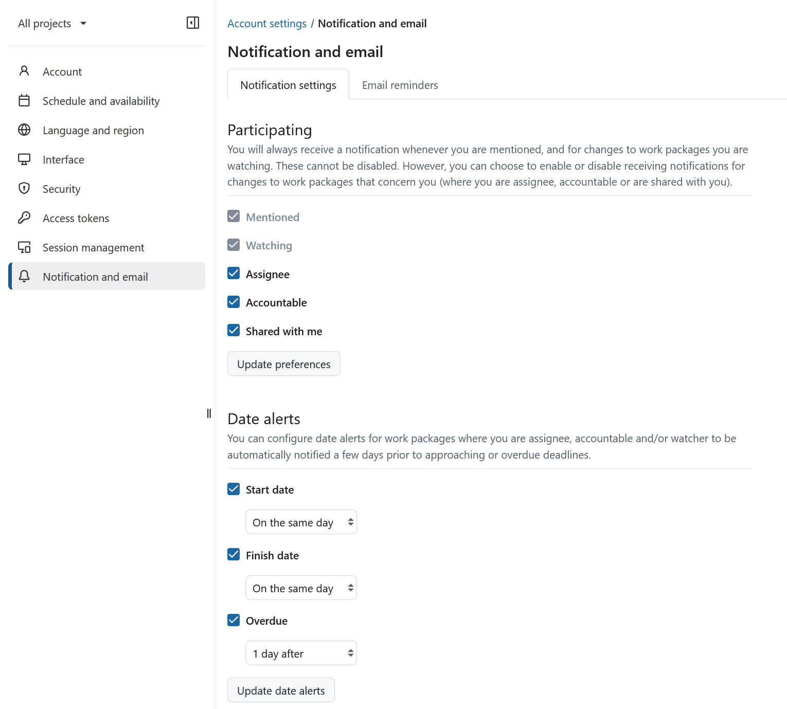
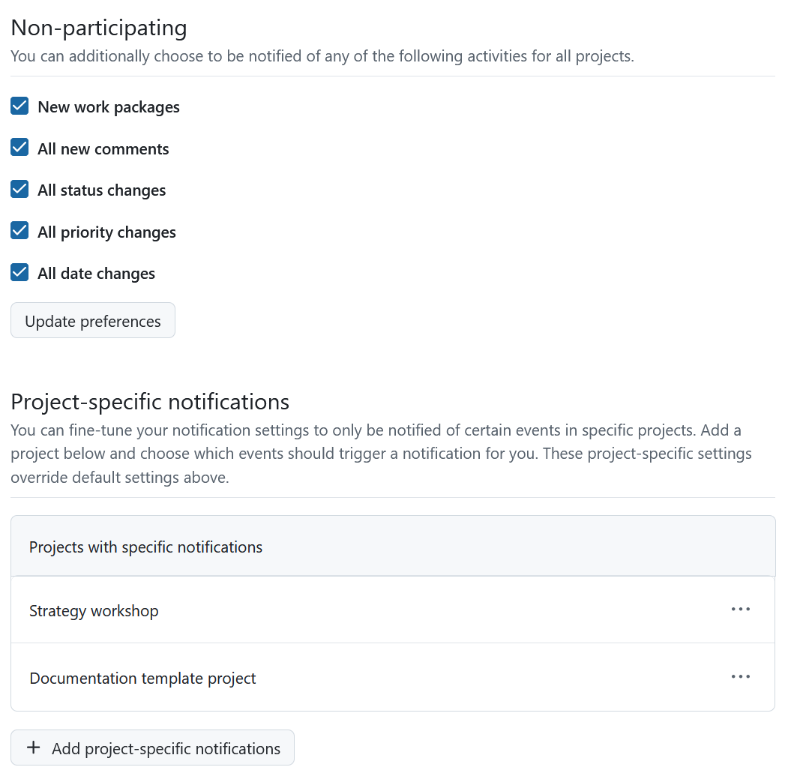
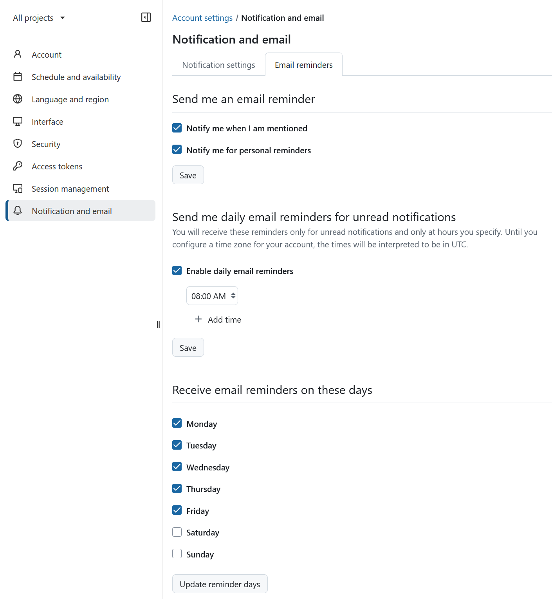
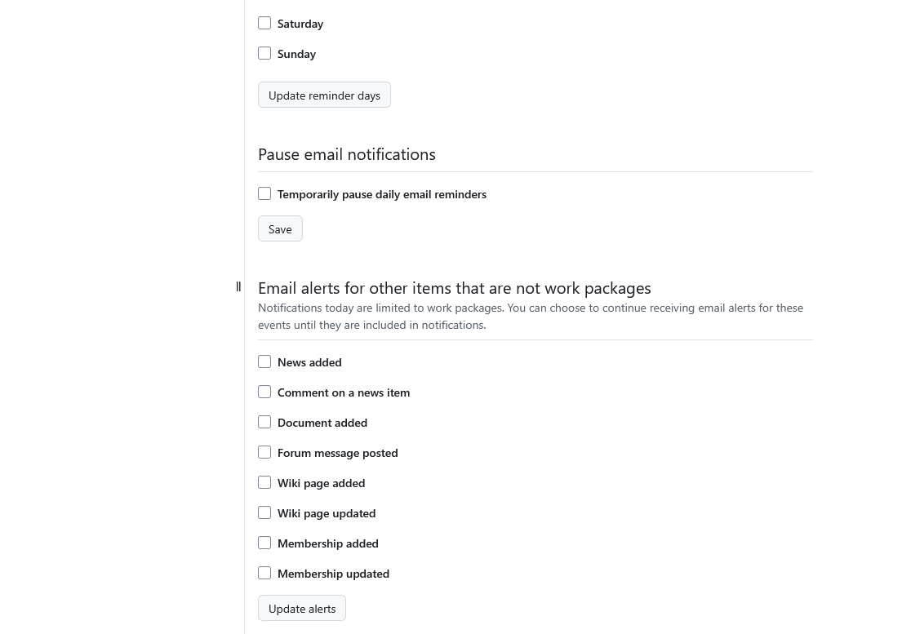

---
sidebar_navigation:
  title: Notification and email
  priority: 200
description: Learn how to configure notifications and email alerts in OpenProject.
keywords: my account, account settings, notifications, email, alert, update, reminder, email reminder
---

# Notification and email

To configure the notification settings which you receive from the system, navigate to **Account settings** and choose **Notification and email** from the menu.

## Notification settings

In-app notifications can be configured and customized various ways. For a detailed guide, [click here](../../notifications/notification-settings/).

Please also see our detailed [in-app notifications](../../notifications/) guide to gain a general understanding.

## Email reminders

To configure the email reminders which you receive from the system, switch to the **email reminders tab.** Your system administrator can also set them for you or change the global default settings.

You can choose between several email reminders.

Default: Enable daily email reminders: 2am, Monday - Friday.

You can choose to receive emails immediately, or only on certain days and times, temporarily pause reminder emails, or opt for no reminders at all.

> [!IMPORTANT]
> If you have selected the _immediately when someone mentions me_ option, you will only be notified once, i.e. this reminder will not be duplicated in a daily reminder.

You can also opt-in to receive **email alerts for other items (that are not work packages)** whenever one of your project members:

- **News added** - ...adds or updates news in the [News Page](../../news/)
- **Comment on a news item** - ...adds a comment on a news item
- **Documents added** - ...adds a document somewhere in the project (i.e. a work package)
- **New forum message** - ...sends a new message into the [Forum](../../forums/)
- **Wiki page added** - ...adds a new [Wiki page](../../wiki/)
- **Wiki page updated** - ...updates a [Wiki page](../../wiki/)
- **Membership added** - ...adds you to a new [Work package](../../../getting-started/work-packages-introduction/)
- **Membership updated** - ...updates your membership associations

## Browser notifications

The **Browser notifications** tab is shown when your administrator allows browser notifications and you have installed OpenProject as a desktop application. This works in Chrome, Edge and Safari on macOS. Firefox on desktop does not install web applications, but it supports browser notifications from a normal browser tab while Firefox is running.

If the tab shows **Browser notifications are temporarily unavailable on this instance**, they cannot be used right now. Please contact your administrator.

A banner at the top of the tab tells you whether this browser receives notifications in the current session, which means the subscription belongs to the sign in this browser is using right now. It offers the one action that applies: enable, disable or try again. Browsers that block notifications or do not support them see the state without an action. Click **Enable for this browser** and accept the browser prompt asking for permission to show notifications.

The list below the banner shows each device on which you have enabled browser notifications. The row for the browser you are using is labeled **This session**, and every other row has a **Revoke** button.

If notifications stop arriving on a device (browsers rotate push endpoints from time to time), turn browser notifications off and on again on that device.

When you have unread notifications, the application shows a notification for the latest one. The operating system notification shows who triggered it and the work package subject.

Pausing your email reminders also pauses browser notifications.

Signing out pauses browser notifications on that device, and the list shows it as **Signed out**. When you sign in again on that device, browser notifications turn back on without asking again. Select **Revoke** to stop them for good.
