---
sidebar_navigation:
  title: Backlogs (Scrum)
  priority: 850
description: Manage backlogs, plan sprints, prioritize work packages, and track sprint progress in OpenProject.
keywords: backlogs, scrum, backlog, agile, sprint, sprint bucket, backlog bucket, sprint report, story points, velocity
---

# Backlog and sprints

OpenProject supports agile project management and Scrum methodology through the Backlogs module. You can organize and prioritize work packages in backlog buckets, plan and manage sprints, track progress on automated sprint boards, and analyze sprint results using sprint reports.

To use Backlogs in a project, activate the **Backlogs** module under [Project settings → Modules](../projects/project-settings/modules/). Activating the Backlogs module also automatically activates the Boards and Work packages modules.

You can configure project-specific backlog and sprint behavior under [Backlogs project settings](../projects/project-settings/backlogs-settings/).

For more information, please refer to the OpenProject [agile and Scrum features](https://www.openproject.org/collaboration-software-features/agile-project-management/) page.

## Manage the backlog

The Backlog and sprints view is divided into two sides: on the left, you'll find the **Backlog**, consisting of the **Inbox backlog** at the bottom and **Backlog buckets** above it (if created). On the right side, **Sprints** are displayed. If no backlog buckets have been created, only the Inbox backlog is shown on the left.

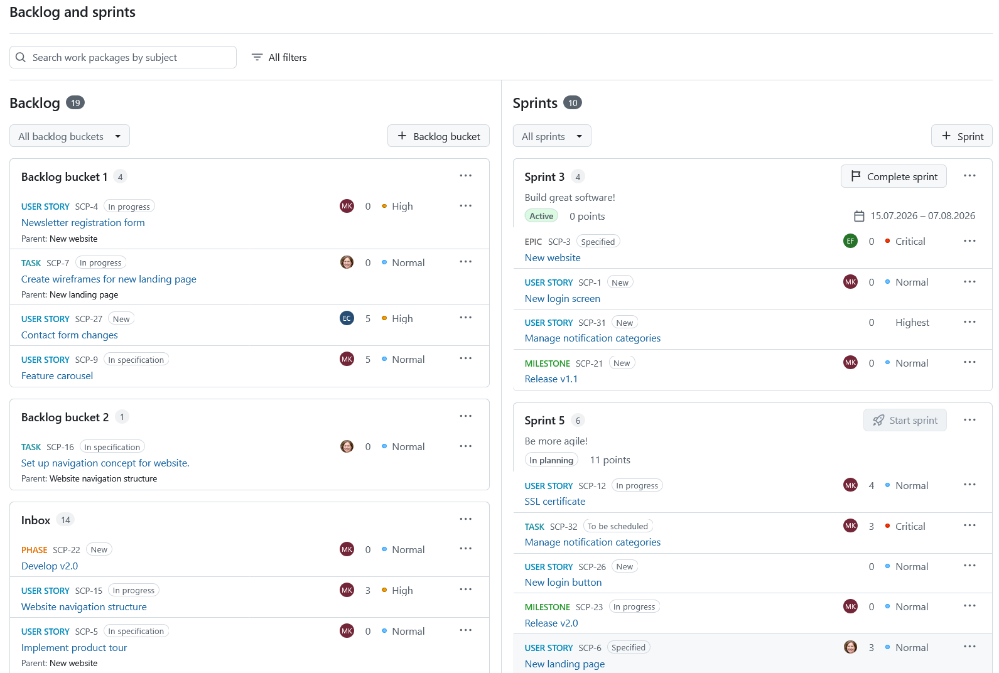

### Backlog and sprint filters

At the top of the Backlog and sprints page, you can search and filter work packages to focus on specific items during backlog refinement or sprint planning.

Enter text in the **Search by name** field to show only work packages with a matching subject. The results are updated as you type across sprints, backlog buckets and the Inbox backlog.

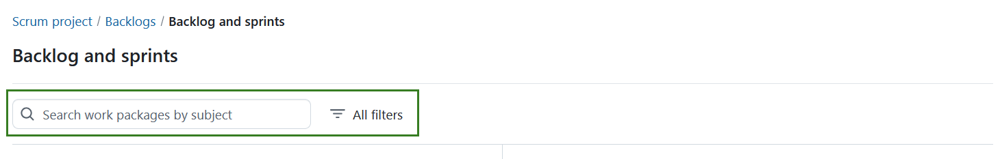

Click the **All filters** button to further narrow down the displayed work packages.

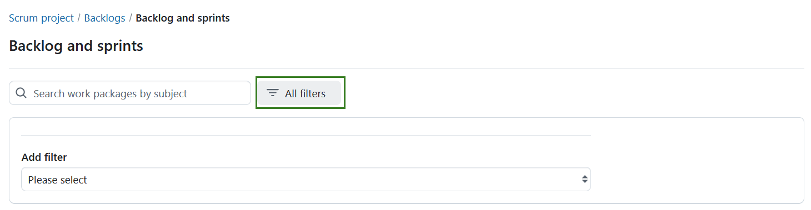

In the filter panel, you can add filters for type, subject, assignee, status, other available work package attributes and custom fields. [Filtering work packages](../work-packages/work-package-table-configuration/#filter-work-packages) works the same way as throughout the application.

The Backlog and sprints view is updated automatically when filters are applied. A loading indicator is displayed while the results are being updated.

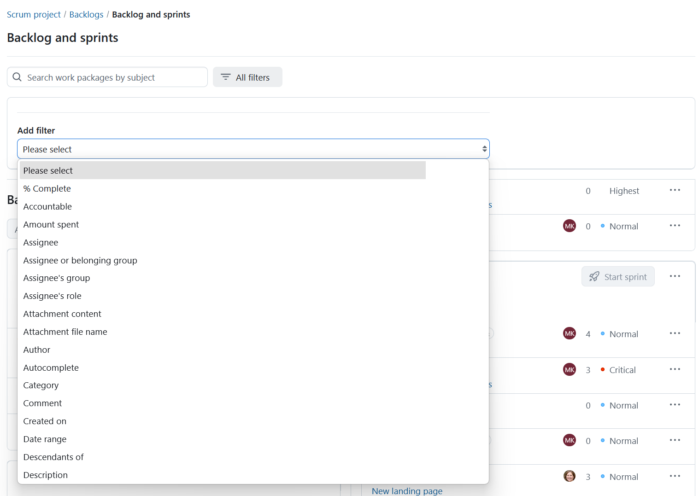

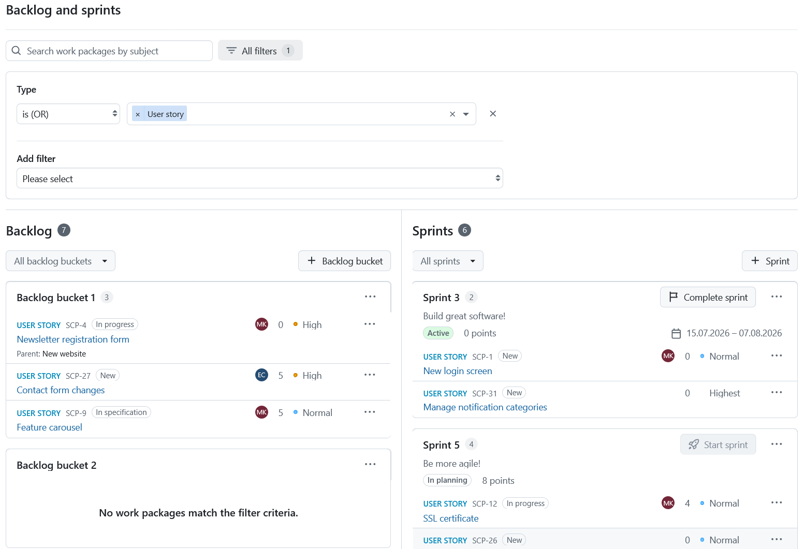

Search and filters apply to work packages in all containers: sprints, backlog buckets and the Inbox backlog. Work packages that do not match the current criteria are temporarily hidden.

The work package count and effort estimates shown for each container are adjusted to reflect the currently visible work packages. If no work packages in a container match the current criteria, the container remains visible but indicates that there are no matching work packages.

> [!NOTE]
> Searching and filtering only changes which work packages are displayed. It does not change their assignment to a sprint, backlog bucket or the Inbox backlog.

Click the **All filters** button again to close the filter panel.

> [!NOTE]
> Filtered Backlogs views cannot yet be saved. You can bookmark the URL of a filtered view to return to it later or share the URL with others.

### Sprint containers

Each sprint is displayed in a dedicated container showing key planning information, including the sprint name, status, start and finish dates, number of work packages, and total effort according to the [configured unit](#effort-estimation).

If defined, the **Sprint goal** is displayed in the sprint header below the sprint name.

Depending on the sprint status, either a **Start sprint** (for sprints in planning) or **Complete sprint** (for active sprints) button is displayed.

> [!NOTE]
> The **Start sprint** button is disabled by default if another sprint is already active or if no sprint dates have been defined. It might also not be available if you do not have the **Start/complete sprints** permission.
>
> By default, only one sprint can be active at a time. If your project is configured to allow [multiple active sprints](../projects/project-settings/backlogs-settings/#multiple-active-sprints), additional sprints can be started.

### Backlog buckets

Backlog buckets help you organize and prioritize work packages within the backlog. A backlog bucket is a named list of work packages that can be refined independently from the Inbox backlog. The Backlog and sprints view displays the backlog buckets within the current project, including the bucket name and the number of contained work packages.

> [!NOTE]
> Backlog buckets are project-specific and are not shared across projects.

#### Create a backlog bucket

To create a backlog bucket, click the **+ Backlog bucket** button in the Backlog and sprints view. Enter the bucket name and click **Create**.

> [!NOTE]
> Creating and deleting backlog buckets requires the appropriate project permissions.

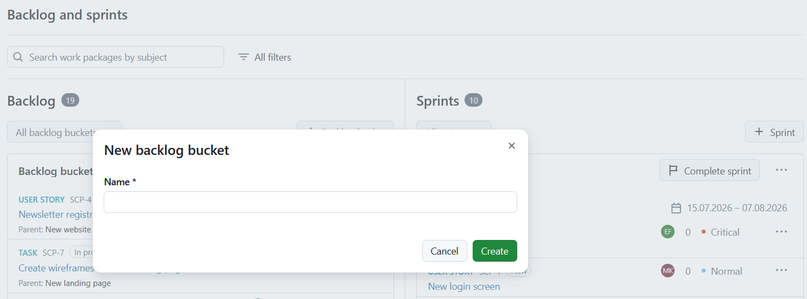

#### Edit or delete a backlog bucket

You can edit or delete a backlog bucket through the **More** (three dots) menu in the bucket header.

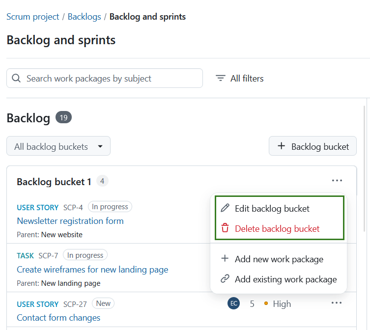

When deleting a backlog bucket, all contained work packages are automatically moved to the bottom of the Inbox backlog.

Work packages can be moved directly into a backlog bucket from the work package's **More** menu. If multiple backlog buckets exist, OpenProject lets you choose the target bucket. The work package is placed at the bottom of the selected bucket.

Changes to a work package's backlog bucket are recorded in the work package **Activity** tab. This allows you to see when a work package was moved into, out of or between backlog buckets.

> [!NOTE]
> Backlog bucket changes are only visible in the Activity tab if you have the required permissions to view sprint and backlog information.

#### All backlog buckets

Use the **All backlog buckets** dropdown to select which backlog buckets are displayed. Select one or more backlog buckets and click **Apply**.

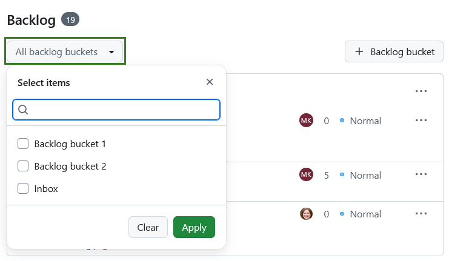

### Work packages in backlogs

Work package cards in the Backlog and sprints view display the following information:

- Type
- ID
- Status
- Subject
- Parent work package
- Assignee
- Priority
- Effort estimate, depending on the configured unit. If the unit is set to **None**, no estimate is displayed.

On smaller screens, assignee names and priority names may be hidden to preserve space while remaining available through tooltips.

> [!NOTE]
> If a parent work package is not visible to a user due to permissions, **Undisclosed** is displayed instead.

A work package can only belong to one backlog bucket or sprint at a time. Work packages assigned to a backlog bucket or sprint are not displayed in the Inbox backlog.

#### Open work package details

Click a work package card to open its split-screen details view. This allows you to view and edit work package attributes without leaving the Backlog and sprints page.

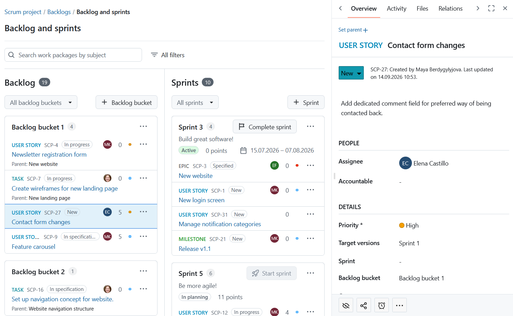

The **More** (three dots) menu of an individual work package card also allows you to open the work package in fullscreen view or copy its link or ID.

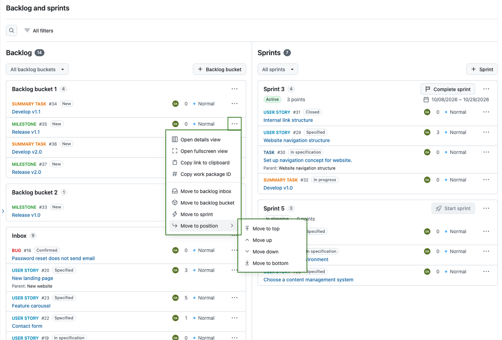

### Inbox backlog

The Inbox backlog is automatically populated with all work packages in a project that are not assigned to a sprint or backlog bucket and are not excluded by the project's backlog settings. When a work package is added to a sprint or bucket, or closed, it is removed from the Inbox.

> [!NOTE]
> Closed work packages are removed from the Inbox backlog and backlog buckets, but continue to be visible in sprints.

When there are too many items in the backlog, a **Show more items** link appears in the middle of the Inbox backlog. This collapses the middle section so that you always see the top and the bottom of the Inbox backlog.

If search or filters are active, the number of hidden work packages is adjusted accordingly. Clicking **Show more items** only displays work packages that match the current criteria.

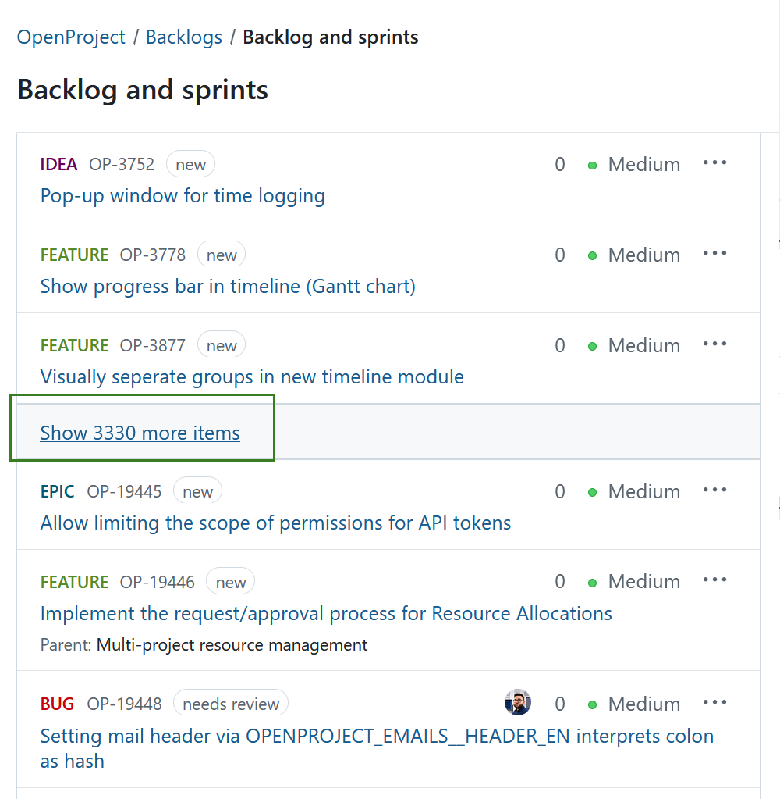

## Sort and move work packages

You can prioritize work packages within the Inbox backlog, a backlog bucket, or a sprint by dragging and dropping them to the desired position. The entire work package card can be used as a drag-and-drop area.

You can also move work packages between backlog buckets, sprints, and the Inbox backlog.

Alternatively, open the **More** (three dots) menu of a work package card and select one of the available move actions:

- **Move to backlog inbox**
- **Move to backlog bucket**
- **Move to sprint**
- **Move to position**

The **Move to position** option allows you to change the position of a work package within its current container. Depending on its current position, you can move it to the top, up, down, or to the bottom.

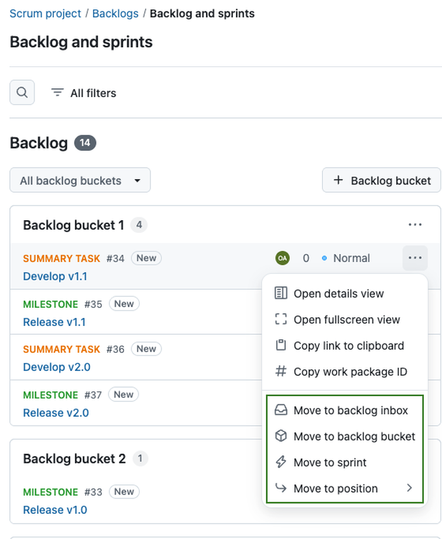

When search or filters are active, sorting and move actions consider only the currently visible work packages. If you reorder a work package while the view is filtered, its new position is retained after clearing the search or filters.

If filtering leaves a sprint or backlog bucket with no visible work packages, a work package dragged into that container is placed at the top.

### Select and move multiple work packages

To select several work packages, hold down **Ctrl** (Windows, Linux) or **Cmd** (Mac) and click the individual work package cards. To select a range of cards, hold down **Shift** and click the first and last card. To select all work packages in a backlog bucket, a sprint, or the Inbox backlog, click into the container and press **Ctrl** + **A** (**Cmd** + **A** on Mac).

Selected cards are highlighted in blue. You can select work packages within the same container or across different backlog buckets, sprints, and the Inbox backlog. To clear the selection, press **Esc**.

Drag and drop the selected work packages together or open the **More** (three dots) menu of one of the selected cards to move them to another backlog bucket, sprint, or the Inbox backlog.

If all selected work packages are within the same container, you can also use **Move to position** to change their position within that container.

The available move options depend on the current position and location of the selected work packages.

### Drag work packages into external applications

You can also drag a work package card out of OpenProject and drop it into an external application that supports browser drag and drop. Depending on the target application, this can:

- insert the work package URL as plain text,
- open the work package URL when dropped onto another browser window's address bar or tab strip,
- insert a hyperlink with the work package subject as link text when dropped into a rich-text editor.

The URL is the same URL available through **More (three dots) → Copy link to clipboard**.

> [!NOTE]
> How a dropped work package is handled and displayed depends on the target application, browser and operating system. Some applications may not accept drag and drop from all browsers.

### Excluded work package types and statuses

Depending on the project configuration, certain work package types and statuses can be excluded from the Inbox backlog and backlog buckets. This can be configured under [Backlogs project settings](../projects/project-settings/backlogs-settings/#types-and-statuses).

Excluded work packages do not appear in the Inbox backlog or backlog buckets but continue to appear in sprints and on sprint boards.

If a work package is moved to the Inbox backlog or a backlog bucket and its type or status is excluded, the move is completed successfully. A confirmation message explains that the work package was moved successfully but is hidden because its type or status is excluded from backlog views.

## Create and manage sprints

> [!IMPORTANT]
> Starting with OpenProject 17.3, sprints are separate objects and are no longer linked to versions.

A **Sprint** is a planned and time-boxed period in which a Scrum team completes a defined set of tasks. Work packages can be assigned to sprints from the Inbox backlog or backlog buckets.

### Create a sprint

To create a sprint, click the **+ Sprint** button in the top right corner of the Backlogs module. Enter the sprint name, planned start date, planned finish date, and an optional sprint goal. The duration is automatically calculated. Click **Create** to proceed.

The naming of sprints is number-based by default (e.g. Sprint 1, Sprint 2). These names can be edited according to your team's work rhythm.

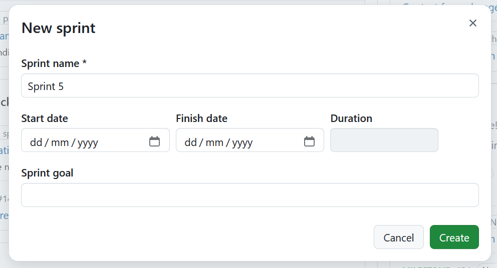

### Sprint goals

The sprint goal helps communicate the primary objective of the sprint to the team. It can be entered when creating or editing a sprint and is displayed in the sprint header and on the sprint report page.

For shared sprints, sprint goals are project-specific. This means each project using the shared sprint can define its own goal without affecting other projects.

When editing a shared sprint, OpenProject indicates which fields are shared across projects and which are project-specific. Depending on your permissions in the sharing project and the current project, some fields may be read-only.

### Start or complete a sprint

Click the **Start sprint** button in the sprint header to start the sprint and open its sprint board.

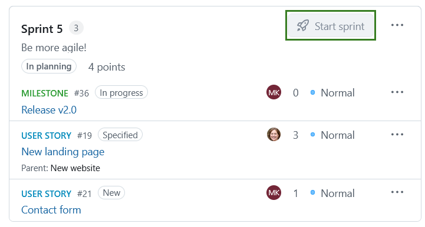

Once a sprint has started, it is considered active. To finish the sprint, click the **Complete sprint** button in the sprint header.

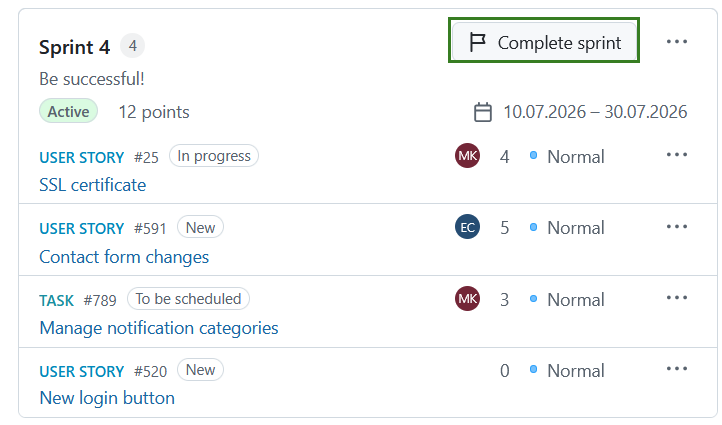

If there are still unfinished work packages in the sprint, a dialog will open prompting you to decide what should happen to them. You can choose to:

- Move them to the top of the Inbox backlog
- Move them to the bottom of the Inbox backlog
- Move them to another sprint

Work packages in statuses configured as closed under [Backlogs project settings](../projects/project-settings/backlogs-settings/#statuses-considered-closed) are not moved when a sprint is completed.

If you choose to move work packages to another sprint, select the target sprint from the list. Click **Complete sprint** to finish the sprint.

> [!NOTE]
> Work packages moved to the Inbox backlog may not be displayed if their type or status is excluded from backlog views.

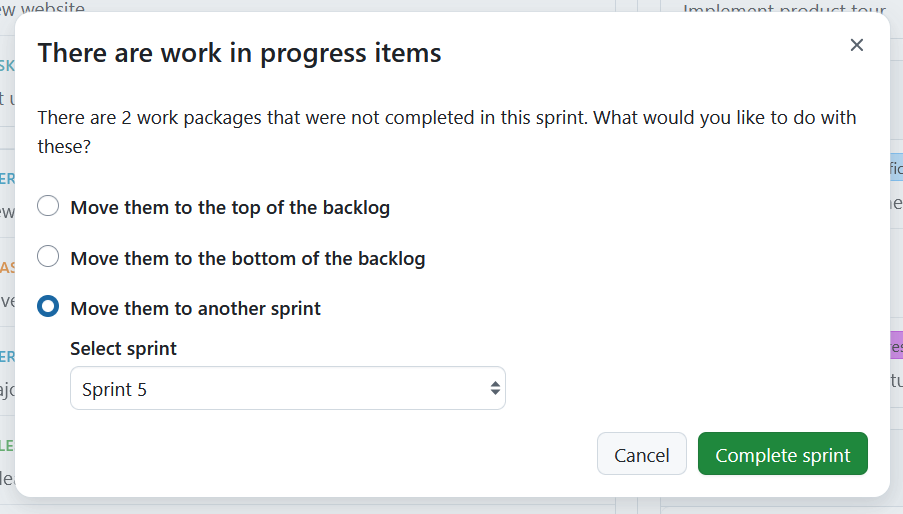

OpenProject records the actual start and completion dates when a sprint is started or completed. These dates may differ from the planned sprint dates and are reflected in the [All sprints](#all-sprints) view and [sprint reports](sprint-reports/).

Additional sprint actions are available through the **More** (three dots) menu in the sprint header, including access to the sprint board and sprint report.

Sprint details, including the sprint goal, can be edited through the **Edit sprint** dialog.

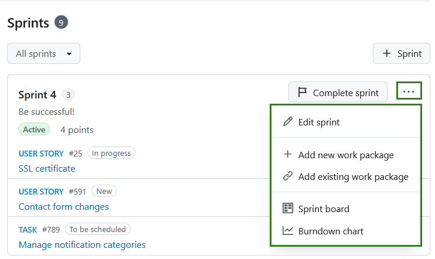

#### All sprints filter

Use the **All sprints** dropdown in the Backlog and sprints view to select which sprint containers are displayed. Select one or more sprints and click **Apply**.

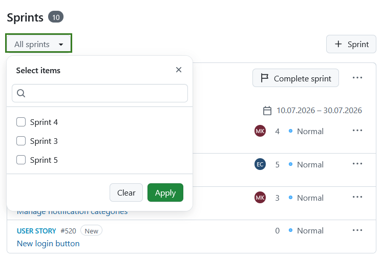

### Add a new work package

To create a work package directly in a sprint, backlog bucket or the Inbox backlog, open the **More** (three dots) menu in the container header and select **Add new work package**.

Specify the work package type, subject, and description in the dialog and click **Create**.

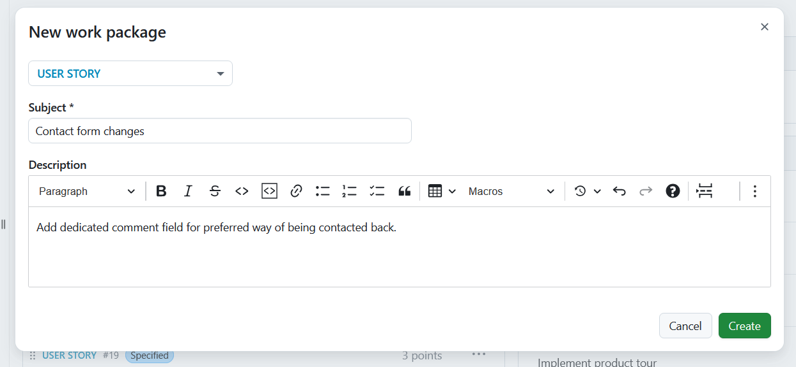

The new work package is added to the selected container.

### Add existing work package

To add an existing work package to a sprint, backlog bucket or the Inbox backlog, open the **More** (three dots) menu in the container header and select **Add existing work package**.

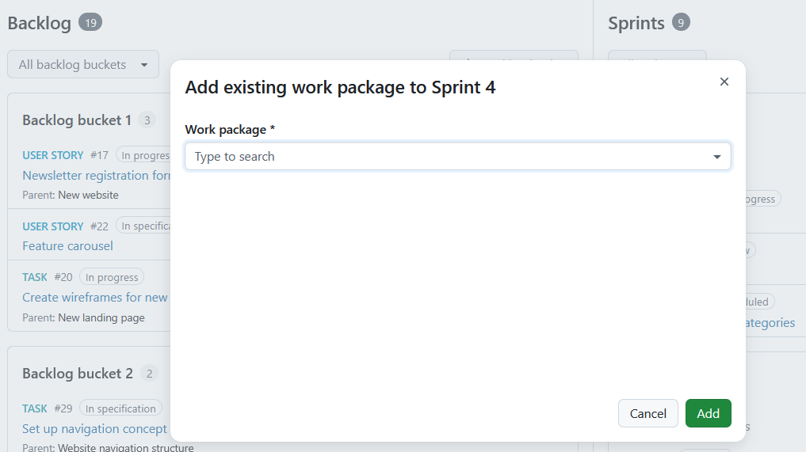

Search for the work package by type, subject or ID. Select the work package and click **Add**.

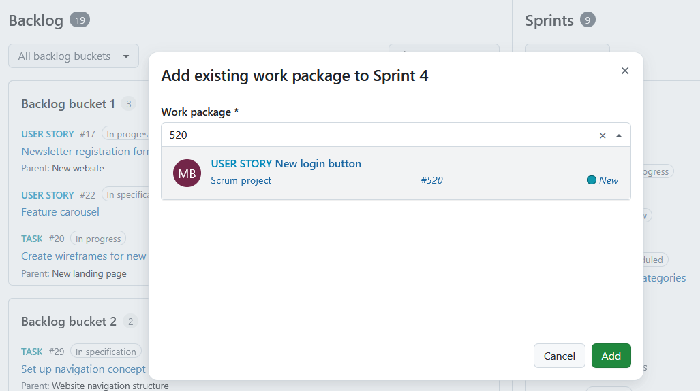

### Prioritize stories

Work packages can be prioritized individually or as a group. See [Sort and move work packages](#sort-and-move-work-packages) for the available options.

### Effort estimation

Story points are defined as numbers assigned to a work package used to estimate (relatively) the size of the work.

You can choose how effort, velocity, and capacity are measured in each project under [Backlogs project settings → Units](../projects/project-settings/backlogs-settings/#units).

Depending on your team's estimation method, you can use story points or work time estimates, or work without effort estimates.

The configured unit determines which effort estimates are displayed on work package cards, in sprint headers, and in sprint reports.

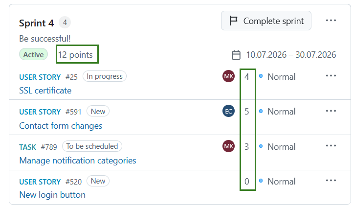

To update an effort estimate, click the work package card and edit the corresponding attribute in its details view.

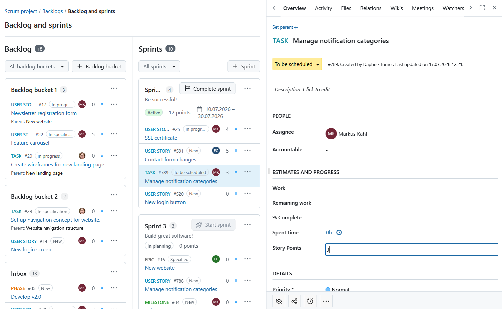

### Sprint boards

Sprint boards help teams visualize and track work package progress during a sprint.

When you click the **Start sprint** button in a sprint header, a dedicated sprint board is automatically created and you are forwarded to the active sprint board. Boards are named using the pattern **Project name: Sprint name**, for example **Scrum project: Sprint 1**.

The sprint board inherits project permissions automatically.

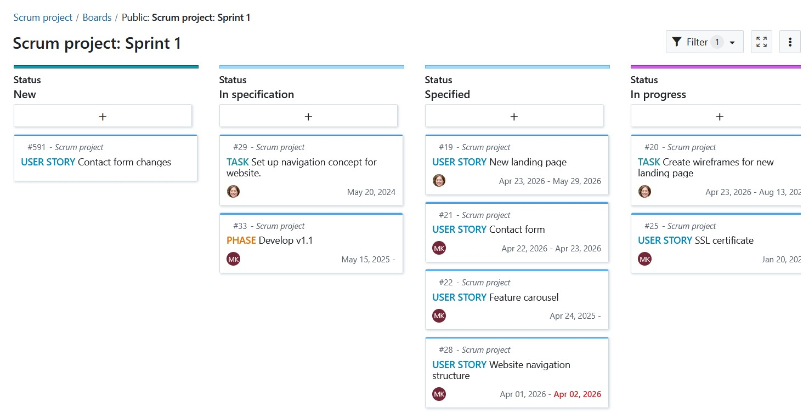

You can return to an active sprint board through the **More** (three dots) menu in the sprint header or by clicking the sprint name in the [All sprints](#all-sprints) view.

For more information on working with boards, see [Boards](../agile-boards/).

### Sprint field in work package tables

The Sprint property can also be used in work package tables. You can:

- display the Sprint column,
- sort by Sprint,
- group work packages by Sprint.

> [!NOTE]
> Viewing Sprint information in work package tables requires the appropriate project permissions.

You can also change the Sprint or Backlog assignment of multiple work packages at once using [bulk edit](../work-packages/edit-work-package/#bulk-edit-work-packages).

### Sprint reports

Sprint reports bring together sprint progress, scope changes, agile reporting charts, and work package tables on a dedicated page. Sprint reports help teams monitor progress during active sprints, review completed work, and use historical sprint data to improve future planning.

To open a sprint report, select **Sprint report** from the **More** (three dots) menu in the sprint header or from the corresponding menu in the All sprints view.

For detailed information on the available metrics and charts, including burndown, burnup, and velocity charts, see [Sprint reports](sprint-reports/).

### Sprint sharing

[feature: sprint_sharing ]

Sprint sharing allows multiple projects to use the same sprint structure. A sprint can be shared with other projects, subprojects, or not shared. This is configured under [Backlogs project settings](../projects/project-settings/backlogs-settings/#sharing-sprints).

Shared sprints can help teams coordinate planning across projects and support scaled agile frameworks such as SAFe.

### Multiple active sprints

[feature: multiple_active_sprints ]

You can have more than one sprint active at the same time. This setting needs to be activated under [Backlogs project settings](../projects/project-settings/backlogs-settings/#multiple-active-sprints).

Sprint sharing and enabling multiple active sprints are mutually exclusive.

## All sprints

The **All sprints** view provides an overview of every sprint in the project, including sprints in planning, active sprints, and completed sprints.

The start and finish date columns reflect the actual dates once a sprint has been started or completed. Dates that are still planned are marked with **(planned)**.

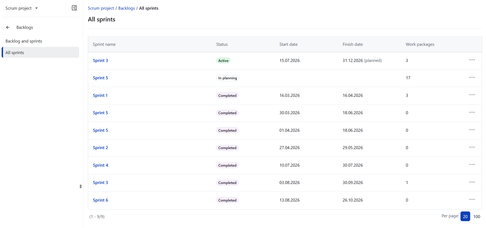

Clicking a sprint name opens a different view depending on its status:

- **In planning:** Opens the Backlog and sprints view.
- **Active:** Opens the sprint board.
- **Completed:** Opens a work package table filtered to that sprint in the Work packages module.

To access a sprint report, open the **More** (three dots) menu next to the sprint and select **Sprint report**. This also allows you to review historical sprint results after a sprint has been completed.

For more information, see [Sprint reports](sprint-reports/).