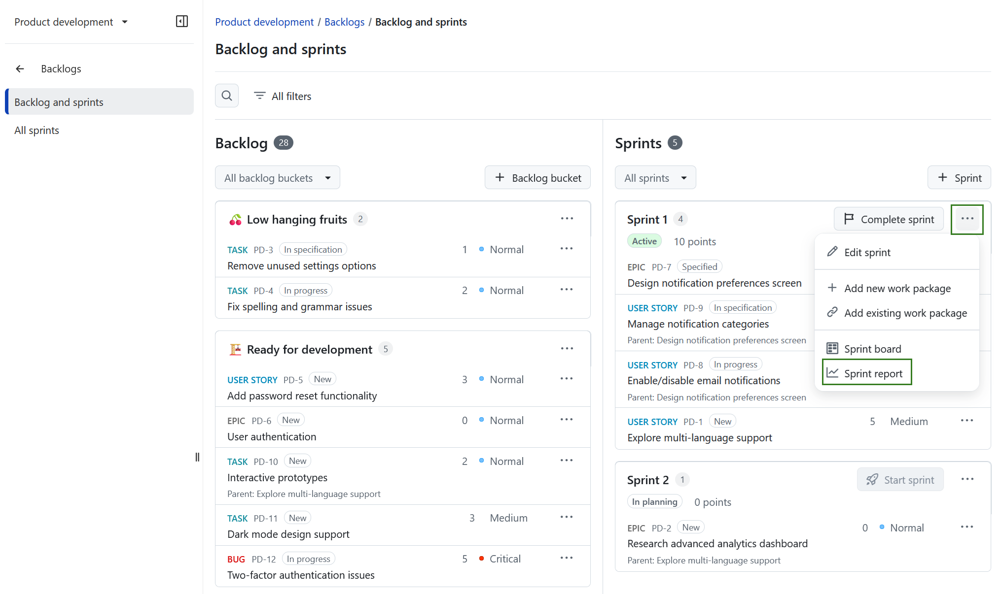
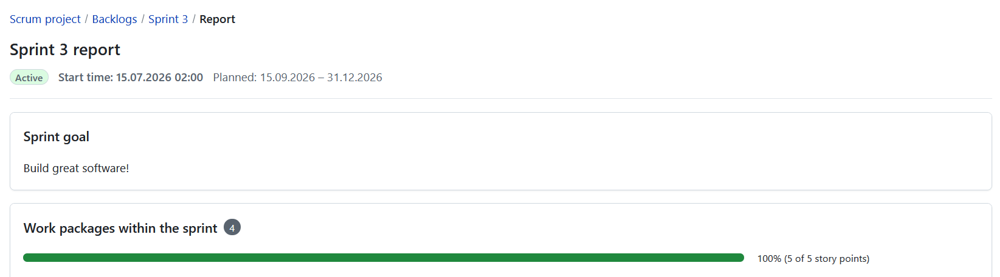
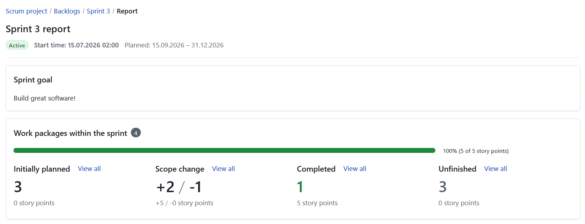
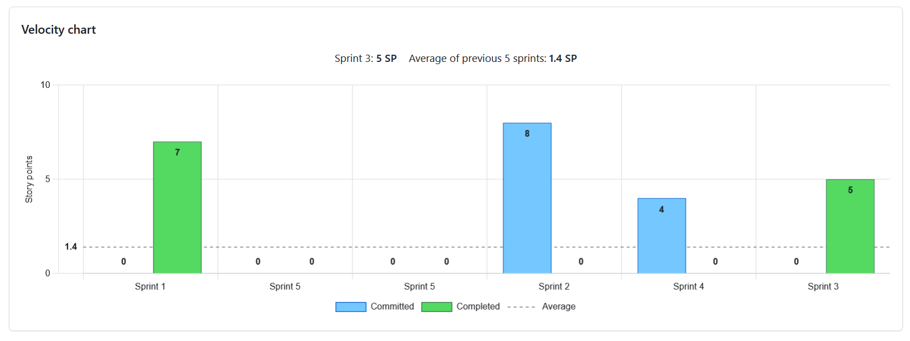
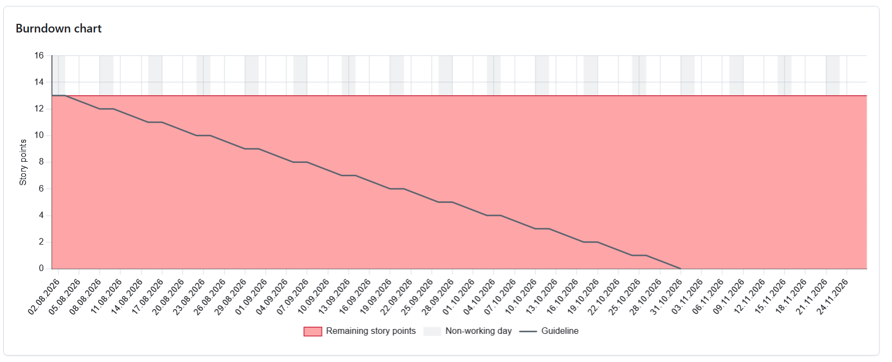
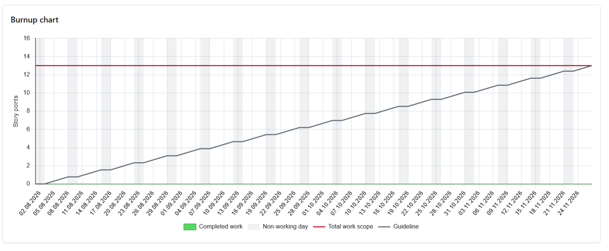
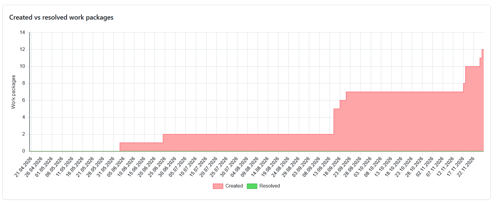
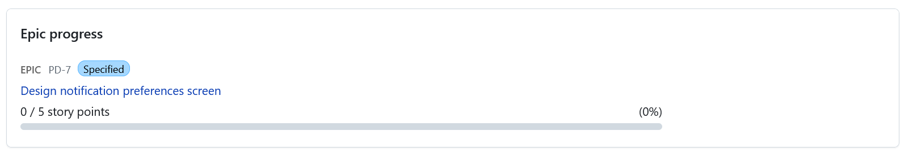
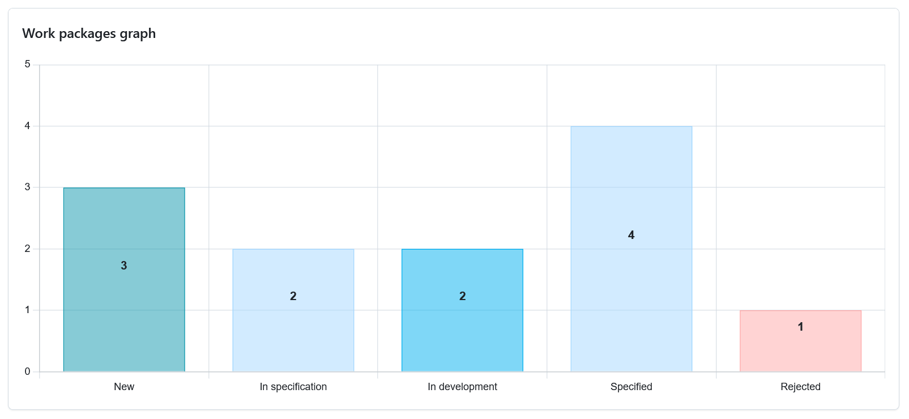
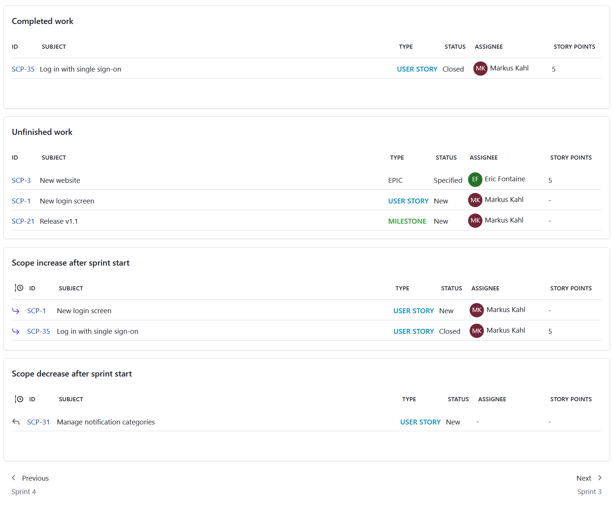

---
sidebar_navigation:
  title: Sprint reports
  priority: 100
description: Track sprint progress, analyze scope changes, and evaluate team performance with agile reporting in OpenProject.
keywords: sprint, scrum, report, sprint report, agile, agile reporting, burndown, burnup, velocity, epic progress, story points, scope change
---

# Sprint reports

Starting with OpenProject 18.0, sprint reports provide a detailed overview of sprint progress, completed and remaining work, and changes in sprint scope. They help agile teams monitor their progress during a sprint, evaluate the results during sprint reviews and retrospectives, and use insights from previous sprints to improve future planning.

Sprint reports bring together several metrics, charts, and work package tables on a single page.

The sprint report page, including the work package overview, burndown chart, burnup chart, and work packages graph, is available in the Community edition. Additional charts and detailed work package tables are available as an Enterprise add-on.

## Access sprint reports

To open a sprint report, navigate to **Backlogs → Backlog and sprints** in your project. Open the **More** (three dots) menu in the header of the relevant sprint and select **Sprint report**.

You can use sprint reports to monitor active sprints and review the results of completed sprints.

## Sprint report overview

At the top of the sprint report page, you can see the sprint name, its status, and its planned and actual dates.

If a sprint goal has been defined, it is also displayed on the report page. This provides context for the metrics and charts below and helps the team evaluate its progress against the sprint objective.

### Reporting units

The units displayed in sprint reports depend on the project-specific configuration under **Project settings → Backlogs → Units**.

Depending on your team's approach to estimating work, you can use story points or work time estimates. If neither estimation method is used, select **None** to use the number of work packages as the default unit in charts.

Some charts are not displayed when **None** is selected.

For more information, see [Configure reporting units](../../projects/project-settings/backlogs-settings/#units).

## Work packages within the sprint

The **Work packages within the sprint** section summarizes the sprint scope, its changes, and the amount of work completed.

The progress bar shows how much of the sprint's work has been completed.

The overview includes four metrics:

| Metric            | Description                                                  |
| ----------------- | ------------------------------------------------------------ |
| Initially planned | Work packages and effort committed to the sprint at its start. |
| Scope change      | Work added to or removed from the sprint after it started, including changes to effort estimates. |
| Completed         | Work packages completed within the sprint.                   |
| Unfinished        | Work packages within the sprint that have not been completed. |

Scope changes are displayed separately as increases (+) and decreases (-). Changes to story point estimates are also reflected in the scope change metric, even if no work packages have been added to or removed from the sprint.

Click **View all** next to a metric to view the corresponding work packages.

> [!NOTE]
> Whether a work package is considered completed depends on the statuses configured under [Statuses considered closed](../../projects/project-settings/backlogs-settings/#statuses-considered-closed) in the Backlogs project settings.

## Velocity chart (Enterprise add-on)

[feature: sprint_report_pro_widgets ]

The velocity chart helps teams understand how much work they typically complete within a sprint and use this information to plan future sprints.

The chart displays the selected sprint and up to six preceding sprints, comparing:

- **Committed:** The amount of work initially planned for the sprint.
- **Completed:** The amount of work completed within the sprint.

Comparing committed and completed work across several sprints helps teams identify recurring differences between planned and delivered work and make more realistic estimates for future sprints.

For example, if a team consistently completes around 20 story points per sprint, this can serve as a reference when planning the next sprint.

Velocity is most useful when comparing sprints of the same team using a consistent estimation method. It should not be used to compare the productivity of different teams.

## Burndown chart

The burndown chart shows how much work remains in a sprint over time. It helps teams monitor whether they are on track to complete the planned work.

The horizontal axis represents the sprint timeline, while the vertical axis represents the amount of remaining work.

The chart includes:

- **Remaining work:** The red area represents the amount of work that has not yet been completed.
- **Guideline:** A reference line representing the expected reduction of remaining work over the sprint.
- **Non-working days:** Shaded areas indicate non-working days.

As work packages are completed, the amount of remaining work decreases. Adding work to the sprint or increasing effort estimates can cause the remaining work to increase.

If the remaining work is consistently above the guideline, the team may need to review its progress or sprint scope. A flat section of the chart indicates that the amount of remaining work has not changed during that period.

## Burnup chart

The burnup chart shows how much work has been completed over time in relation to the total scope of the sprint.

Unlike the burndown chart, which focuses on remaining work, the burnup chart displays completed work and total sprint scope separately. This makes it easier to distinguish progress from changes in scope.

The chart includes:

- **Completed work:** The green area represents the amount of completed work.
- **Total work scope:** The red line represents the total amount of work included in the sprint.
- **Guideline:** A reference line representing the expected progress over the sprint.
- **Non-working days:** Shaded areas indicate non-working days.

As work is completed, the green area increases. When work is added to or removed from the sprint, the total work scope line changes accordingly.

The gap between completed work and total work scope represents the work that remains to be completed.

Using the burndown and burnup charts together helps teams understand whether changes in remaining work result from completed work or changes in sprint scope.

## Created vs resolved work packages (Enterprise add-on)

[feature: sprint_report_pro_widgets ]

The **Created vs resolved work packages** chart compares the number of work packages created and resolved over time.

The chart includes:

- **Created:** The cumulative number of created work packages, shown in red.
- **Resolved:** The cumulative number of resolved work packages, shown in green.

This chart helps teams understand whether new work is being resolved at a similar rate to which it is created.

If the number of created work packages increases faster than the number of resolved work packages, outstanding work is accumulating. If the number of resolved work packages increases faster, the team is reducing outstanding work.

Unlike effort-based charts, this chart measures the number of work packages rather than story points or work time estimates.

## Epic progress (Enterprise add-on)

[feature: sprint_report_pro_widgets ]

The **Epic progress** section helps teams understand how the work performed within a sprint contributes to larger objectives.

It displays the epics associated with work packages in the sprint, together with their status and a progress bar indicating how much work has been completed.

Click an epic's subject to open the corresponding work package.

This overview is particularly useful when an epic spans several sprints and its work is completed incrementally.

## Work packages graph

The **Work packages graph** shows how work packages within the sprint are distributed across different statuses.

Each bar represents a work package status and shows the number of work packages currently associated with that status.

The graph helps teams identify where work is concentrated within their workflow. For example, a large number of work packages in a review status may indicate that additional review capacity is needed.

## Work package tables (Enterprise add-on)

[feature: sprint_report_pro_widgets ]

The sprint report includes detailed work package tables that provide additional context for the metrics and charts above.

The tables are read-only and display information such as the work package ID, subject, type, status, assignee, and effort estimate, depending on the configured reporting unit.

Click a work package ID to open the corresponding work package.

### Completed and unfinished work

The work packages are grouped into two tables according to their completion status:

- **Completed work:** Work packages that have been completed within the sprint.
- **Unfinished work:** Work packages within the sprint that have not been completed.

These tables help teams review individual work packages during sprint reviews and retrospectives.

### Scope changes after sprint start

Two additional tables provide details about changes to the sprint scope:

- **Scope increase after sprint start:** Work added to the sprint after it started.
- **Scope decrease after sprint start:** Work removed from the sprint after it started.

These tables help teams understand which changes contributed to differences between the initially planned and actual sprint scope.

## Navigate between sprint reports

At the bottom of the sprint report page, use the **Previous** and **Next** links to navigate between sprint reports in chronological order.

The name of the corresponding sprint is displayed below each link.

This allows you to review and compare consecutive sprints without returning to the sprint overview.

## Reporting on completed sprints

Sprint reports remain available after a sprint has been completed, allowing teams to review historical sprint results.

For completed sprints, the actual completion date is used instead of the planned finish date as the reporting cutoff. This ensures that the report reflects the period during which the sprint was actually active, even if it was completed earlier or later than originally planned.

> [!TIP]
> Reports are frozen once a sprint is completed. Changing a work package's status, estimate, or sprint afterwards no longer affects the report. This keeps the results reliable for sprint reviews and for comparing sprints over longer periods.

## Reports without sufficient data

Depending on the sprint status, available work package data, and project configuration, some charts or tables may not contain any data.

In this case, OpenProject displays a message explaining why no data is available or which information will appear in the corresponding section once it becomes available.

## Further reading

- [Backlog and sprints](../)
- [Backlogs project settings](../../projects/project-settings/backlogs-settings/)
- [Boards for agile project management](../../agile-boards/)
