---
sidebar_navigation:
  title: Documents
  priority: 770
description: Create documents and attach files in OpenProject.
keywords: documents
---

# Documents

The Documents module allows you to write or upload documents directly to the project.

> [!NOTE]
> Use the Documents module to create, write, or upload documents directly in your projects. If you need to manage files stored externally, please take a look at the [file storages integrations](../file-management).

> [!IMPORTANT]
>
> With 17.0 release, real-time documents collaboration was introduced. It is automatically available for the following installation types: 
>
> - Containerized installations
> - Cloud-hosted installations
>
> **Packaged installations (DEB/RPM) require additional manual setup**. Please refer to the [system administration guide for more details](../../system-admin-guide/documents/#real-time-collaboration-in-documents). 

## Document index

To use the Documents module, make sure it is enabled in the Project settings of your project (Project settings → Modules). 

Once it is enabled, you can navigate to the _Documents_ module in the sidebar of your project to get to the Documents index that lists all available documents:

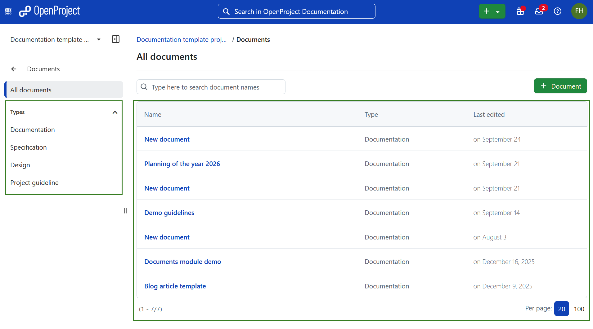

The Documents index page lets you:

1. View all documents

2. Filter by document type

> [!TIP]
> If no document types were specified by you yet, default document types are seeded. They include: _Note, Idea, Proposal, Specification, Report and Documentation_.

3. Quick-filter the list of documents based on the document title

4. Add a new document

5. View a list of all available documents, including their type and the date they were last edited. Documents created prior to 17.0 release will be marked by _Legacy_ label. 

   

A document in OpenProject can be:

- a text written directly in the editor of a document
- a file uploaded and attached to a document
- both a file uploaded and attached to a document, with a text note that describes it

## View a document 

To view a document, simply click on the name of a document in the index. You will then see the document:

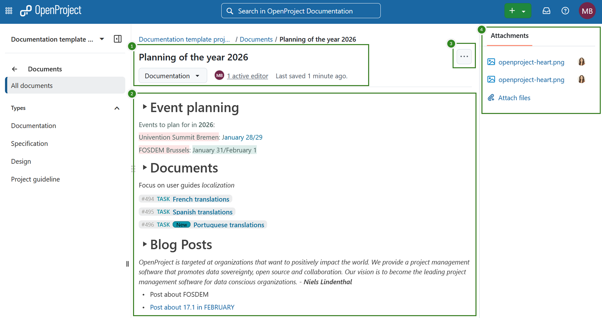

A document has:

1. A title, a category, number of active editors and last saved date
2. _More_ menu with options to edit, copy link and delete a document
3. The document text itself
4. Attachments

## Add a new document to the project 

To create a new document, you can either click on the _+ Document_ button or click the **+ button** in the header navigation.

- **Using the +Document button**

In the form that appears, select the document category, give it a title and an optional description. You can optionally also attach a file to the document.

Please note that these document categories are created by the administrator of your instance.

The uploaded documents are visible to all project members who have the necessary permissions.

> [!NOTE]
> There is no versioning of documents. An edit of any field or the contents of the document is visible to all members.

- **Using the + button in the header navigation**

  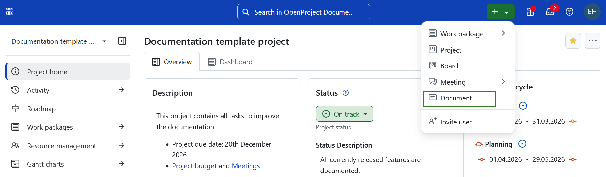

## Edit a project document 

You can edit a document anytime. 

To edit a document title, click on the _More (three dots)_ menu and select _Edit title_. 

To edit the document itself simply click anywhere in the document and you can directly start editing. Simply start entering text or use **/** to add headings, blocks, media elements, emojis and link to work packages. 

> [!TIP]
> You can also open this menu by clicking the **+** icon to the left of a line, which is especially useful on mobile devices. To find a command quickly, keep typing after the **/** to filter the list. For example, **/att** shows **Work package attribute**, **/create** shows **Create new work package**, and **/link** shows **Link existing work package**. Type **/wp** to show only work package commands, or **/op** to show all commands provided by OpenProject.

### Collaborative editing

Multiple project members can edit a document at the same time. If they do, you will see what changes are made by which user in real time.

Take a look at this example for an illustration. 

### Add and format tables

To add a table, type **/** and select **Table** from the slash menu. A table with three columns and two rows is inserted.

You can then adjust the table in several ways:

- **Add rows or columns:** Hover over the table and click the **+** that appears to the right or below it.
- **Use the row and column menus:** Hover over a row or column, or select a cell, and click the **six-dot icon**. The menu offers options such as adding or deleting rows and columns and changing colors.
- **Set a header column:** Hover over the first column and select the header column option. The text in that column is then formatted in bold, so it stands out as a header.
- **Use the formatting toolbar:** Select one or more cells to format their text. To merge cells, select them and click the merge icon. To split a merged cell again, select it and click the same icon.

The available options depend on where you hover or click and on how many cells you select. Among others, you can set a header column and change the background and text color of cells.

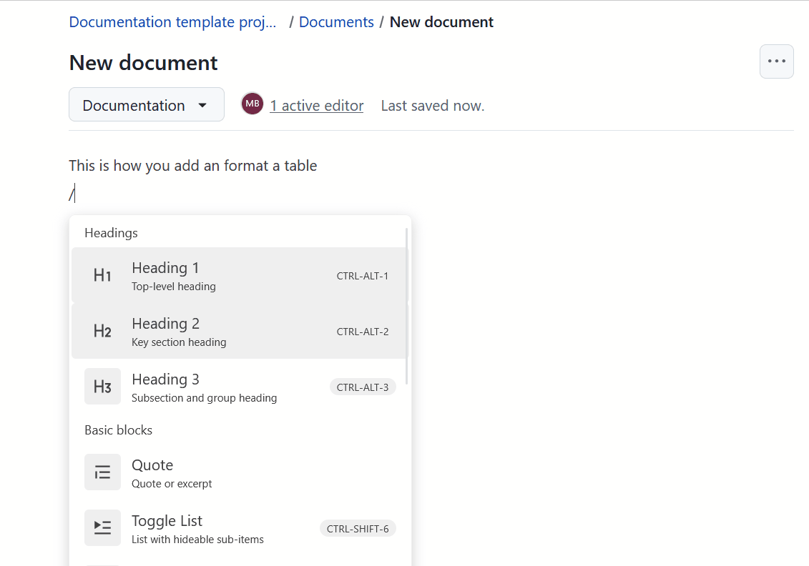

### Link to a section of a document

Each heading in a document has its own anchor, so you can link directly to a specific section. This works for all heading levels.

To copy a link to a section, hover over its heading. A link icon appears to the right of the heading. Click it to copy the link. The copied link contains both the document and the heading. When someone opens the link, the document opens and scrolls directly to that section.

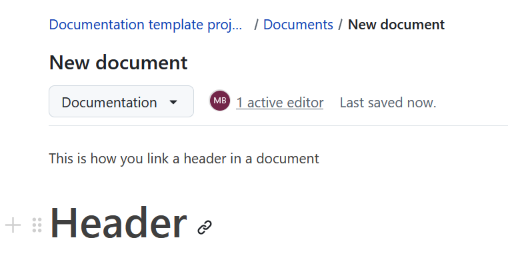

### Link work packages to documents

You can link existing work packages to a document in three ways:

1. **Using the slash menu**

Start editing a document, type **/** to open the slash menu, then select **Link existing work package** from the list of available options.

Enter the work package ID or subject and it will automatically be linked, as shown below:

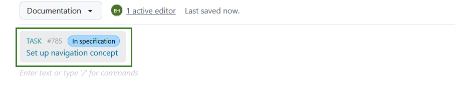

> [!NOTE]
> When you use the slash command on an empty line, the work package is displayed as a full-width card. You can also create a card with **####**, see below.

2. **Using inline work package links**

You can also link work packages directly within a line of text or a paragraph. Type **#**, **##**, or **###**, followed by a work package ID or part of the subject. Matching work packages will be suggested automatically.

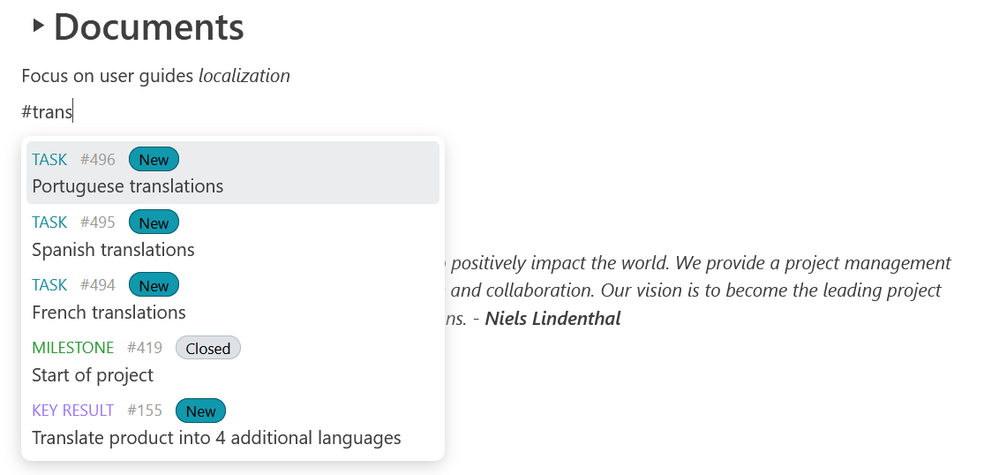

The amount of work package information shown depends on the display format used:

- **#** displays the work package identifier.
- **##** displays the work package type, identifier, and subject.
- **###** displays the work package status, type, identifier, and subject.
- **####** inserts the work package as a block-style card instead of an inline link.

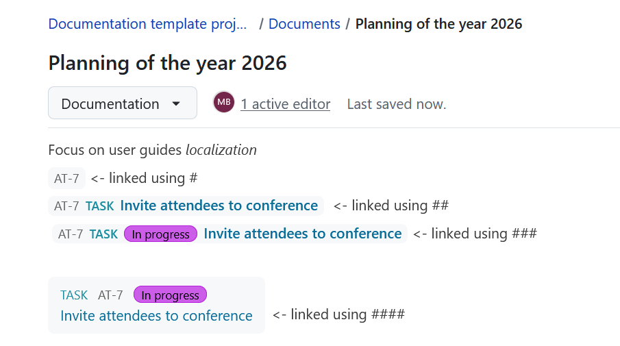 

Inline work package links behave like regular links and can be placed naturally within a paragraph, without adding a line break. If you type **####** in the middle of a line or sentence, the line is split and the card is placed on its own line. If you type more than four **#**, they are shown as regular text and no work package search is started.

Click the work package title to open it in a new browser tab. To change the display style of the linked work package, click the work package ID on the left to open the context menu. You can choose one of the available display options: **Tiny**, **Compact**, **Regular**, or **Compact card**.

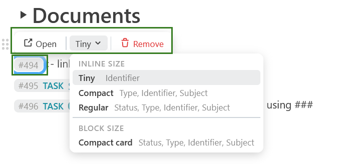

> [!TIP]
> If you are working with tiny work package links, you can hover over the linked work package identifier to see a preview with additional details, such as type, status and subject. For the mobile screens use a long tap instead.

3. **Pasting a work package URL**

Copy a work package URL and paste it directly into a document. You can use either the browser URL or **Copy link to clipboard**:

- Open a work package, click the **More (three dots)** menu 
- Select **Copy link to clipboard**, then paste the link into your document.

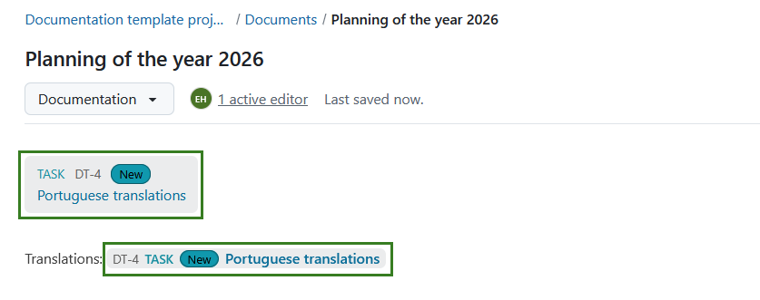

> [!NOTE]
> The way you paste the link determines how it is displayed. If you paste into an empty paragraph, the work package is linked as a card. If it is pasted into an existing paragraph, the work package is linked as a regular inline link (the same as using **###**).

### Insert work package attributes

You can show individual attributes of a work package directly in a document, for example its status, assignee, or the value of a custom field.

1. Type **/** to open the slash menu and select **Work package attribute**. You find it at the end of the menu, in the **OpenProject** section.
2. Search for the work package by its ID, identifier, or subject.
3. Select the attribute or custom field you want to show. The list depends on the selected work package.
4. Choose whether to show the **label**, the **value**, or **label and value**. The value is preselected. A preview shows how the attribute will look in the document.
5. Confirm to insert the attribute into the document.

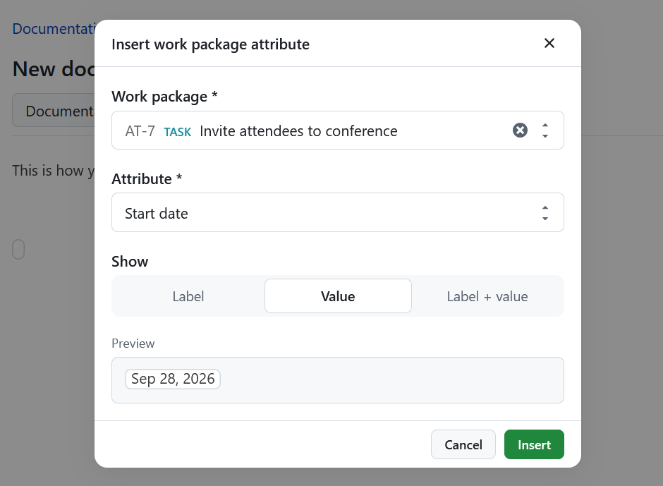

The attribute is inserted inline into your text. To change what it shows, open its context menu and switch between label, value, and label and value. The description and other long text fields are inserted as a separate block instead of inline.

You can also insert an attribute by pasting its macro, for example `workPackageValue:1234:status` or `workPackageLabel:1234:status`, using a real work package ID and attribute name. For custom fields, use the field name in quotes, for example `workPackageValue:1234:"Name of the custom field"`. This is useful for copying attributes between documents and work package descriptions. See the [list of available attributes](../wysiwyg/#available-attributes-for-work-packages) for all supported attribute names.

> [!TIP]
> When you insert another work package attribute in the same document, the dialog is prefilled with your previous selection, as long as you have not left the document in between.

### Create a new work package from within a document

To create new work packages from within a document, type **/** to open the slash menu, then select **Create new work package** from the list of available options.

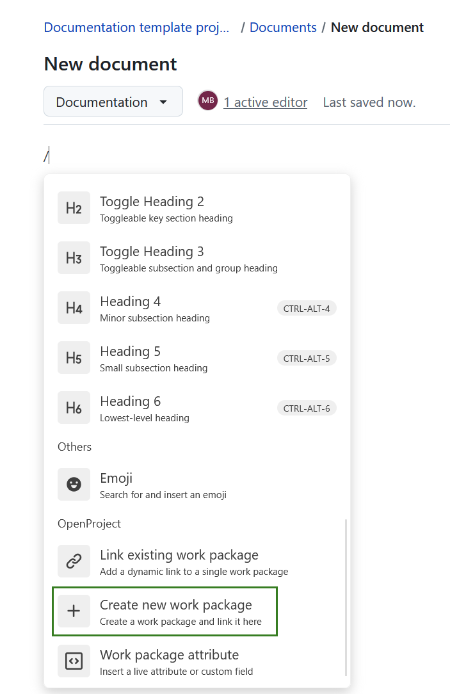

In the form that is displayed, enter the **Subject** for the work package, choose a **Project** in which the work package should be created, pick an **Assignee** (optional) and the **Type**. Click **Create** to create the work package and automatically add a link to the document.

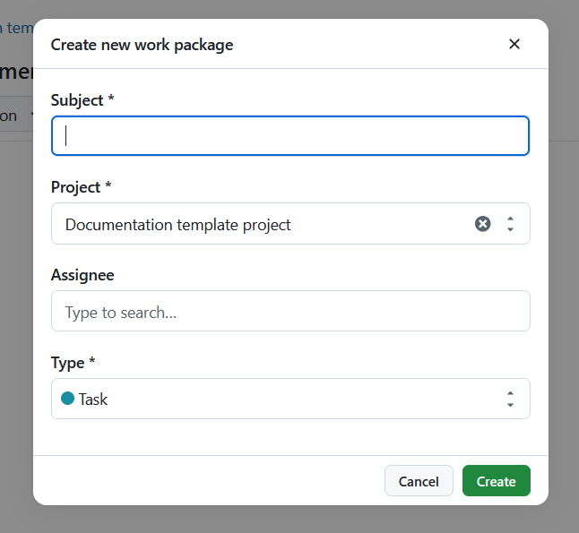

For a quicker way to create a work package, you can use existing text in your document as the work package subject:

- Highlight the text you want to use as the work package subject.
- In the formatting toolbar that appears, click the **+** icon on the right.

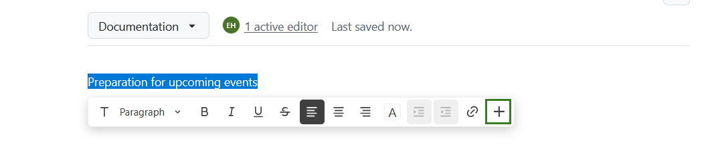

This can save time, as the highlighted text is automatically used as the work package subject. 

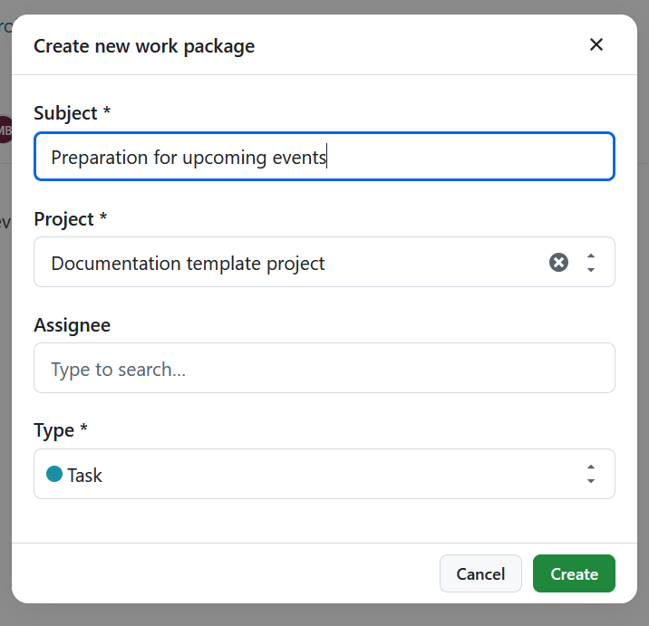

You can also create a work package while searching for one. When you try to link a work package via the slash menu or with **#**, and the search does not return the work package you are looking for, select **Create new work package** at the bottom of the search results. Your search text is used as the subject, and the other fields are prefilled with their default values or with the values of the last work package you created in the same document.

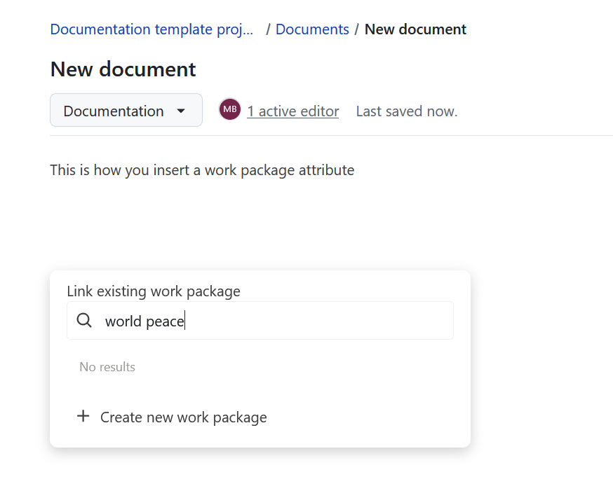

## Delete a project document

You can easily delete a document in OpenProject. 

To delete a document, click on the _More (three dots)_ menu and select _Delete_. 

## Frequently asked questions (FAQ)

### Why can't I edit documents in real-time?

Real-time document collaboration is available in OpenProject starting with version 17.0, but whether you can use it depends on how your OpenProject instance is set up. In cloud-hosted and containerized setups, real-time editing is enabled by default. For packaged installations (DEB/RPM), additional configuration is necessary. Please contact your OpenProject administrator and/or refer to the [system administration guide for more details](../../system-admin-guide/documents/#real-time-collaboration-in-documents). 

### Is there a size limit for uploading documents to the OpenProject Enterprise cloud edition?

There is no limit in OpenProject in terms of the number of files that you can upload and work with in OpenProject. There is only a restriction in terms of the maximum file size: A file can have a size up to 256 MB.
