---
sidebar_navigation:
  title: Meeting agenda
  priority: 600
description: Prepare and edit meeting agendas, sort and vote on agenda items in OpenProject.
keywords: meetings, agenda, agenda items, sections, work packages, backlog, voting, vote-based sorting, attachments
---

# Meeting agenda

The features described on this page apply to all [meeting types](../../meeting-types/), i.e. one-time meetings and individual occurrences of recurring meetings.

| Topic | Content |
| --- | --- |
| [Add an agenda section](#add-an-agenda-section) | How to group agenda items into sections. |
| [Add an agenda item](#add-an-agenda-item) | How to add agenda items. |
| [Link a work package to a meeting](#link-a-work-package-to-a-meeting) | How to add work packages to the agenda. |
| [Convert agenda items to work packages](#convert-agenda-items-to-work-packages) | How to turn an agenda item into a work package. |
| [Edit a meeting agenda](#edit-a-meeting-agenda) | How to edit, move and re-order agenda items. |
| [Sort agenda items and vote](#sort-agenda-items-and-vote) | How to choose a sorting mode and vote on agenda items. |
| [Agenda backlogs](#agenda-backlogs) | How to use an agenda backlog. |
| [Meeting attachments](#meeting-attachments) | How to add attachments to a meeting. |

You can edit a meeting agenda by adding sections, agenda items or existing work packages by selecting the desired option under the green **+ Add** button. You can then add notes to each agenda item.

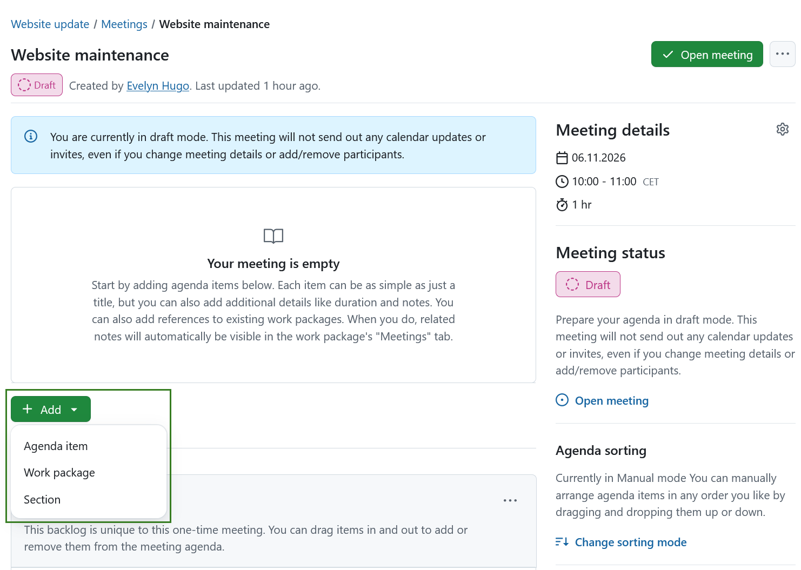

## Add an agenda section

Sections allow you to group agenda items into blocks for better organization.

To add a section, click on the **+ Add** button at the bottom of the agenda items and select the **Section** option. 

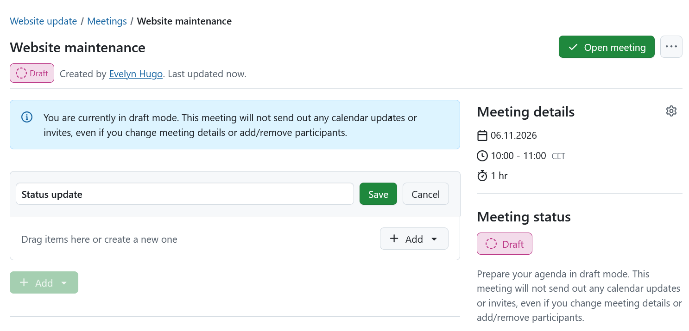

If, prior to creating your first section, your meeting already had existing [agenda items](#add-an-agenda-item), they will automatically be contained in a section called **Untitled section**. You can rename this section if you wish. 

> [!NOTE]
> If you use sections, all agenda items must have sections.

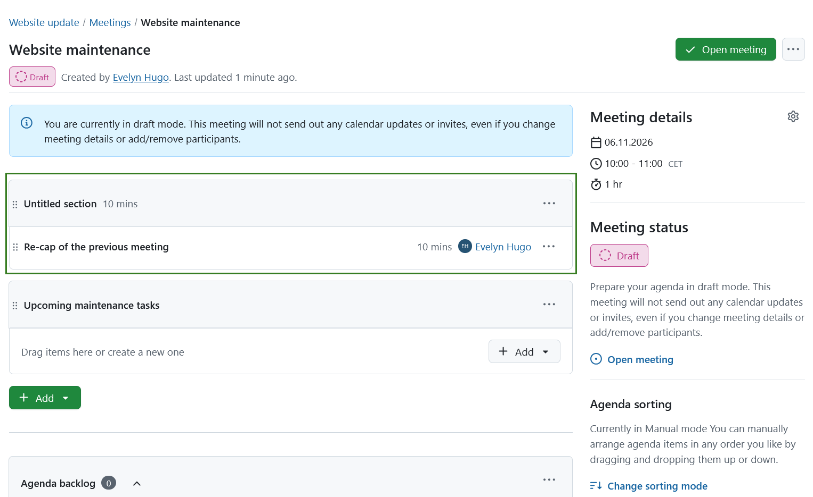

After adding a section, you can specify it further by [adding agenda items](#add-an-agenda-item) or [work packages](#link-a-work-package-to-a-meeting) to it. 

In manual sorting mode, you can also add agenda items to specific sections by dragging and dropping items into each section. In either sorting mode, you can move items between sections by clicking on the **More** button (⋯) and choosing your desired action.

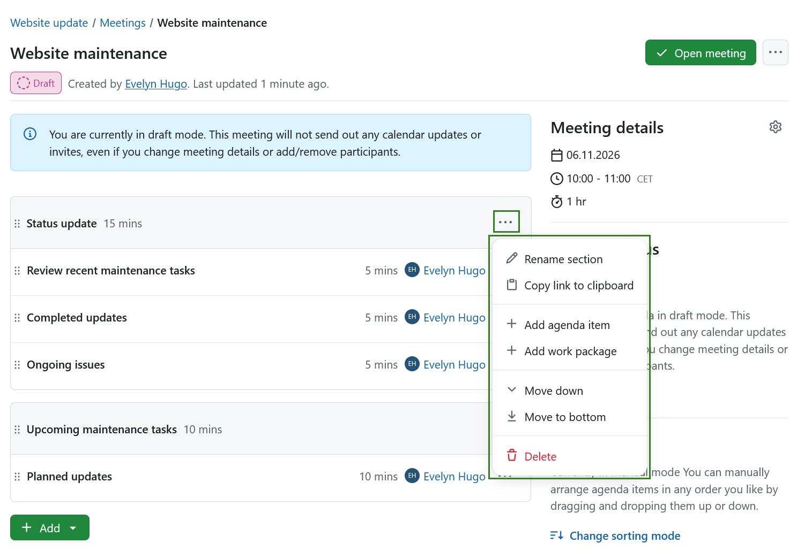

The section's **More** (⋯) menu on the right side also lets you rename a section, move it, copy a link to it or delete the entire section. If a section is moved, the agenda items will move along with it. 

Select **Copy link to clipboard** to share a direct link to a section. Opening the link highlights the entire section in the meeting.

> [!TIP]
> You can also re-arrange sections by dragging and dropping sections up and down.

> [!IMPORTANT]
> Deleting a section will delete all containing agenda items. If a section contains agenda items, you will be asked for confirmation before deletion.

## Add an agenda item

If you select the **Agenda item** option, you can name that item, add notes, set the anticipated duration in minutes and select a user to be displayed next to the agenda item. This could for example be a meeting or a project member that is accountable for the item or someone who will present that particular topic. To show long notes as multiple slides in presentation mode, separate them with horizontal lines (see [Split an agenda item into multiple slides](../meeting-modes/#split-an-agenda-item-into-multiple-slides)).

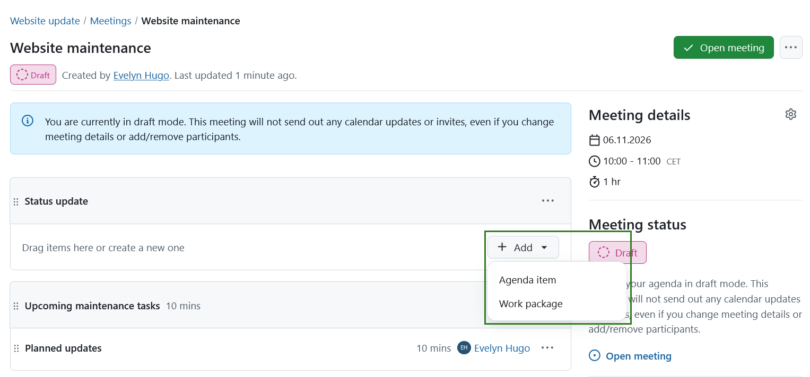

By default, when creating an agenda item, this will be pre-filled with the name of the user adding the agenda item, but it can either be removed or replaced by one of the other meeting participants.

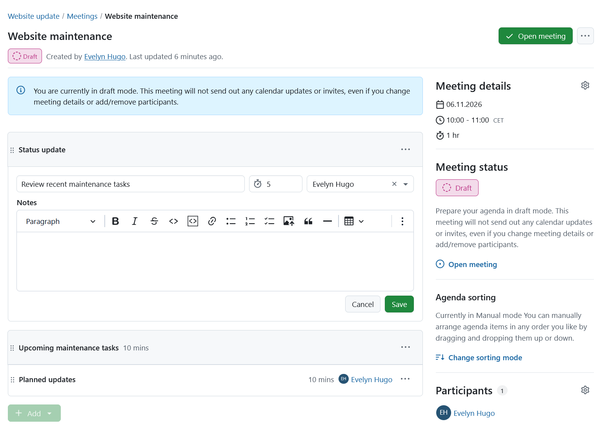

Sections will show the sum of all the durations of all containing items (or at least, those that have a duration specified).

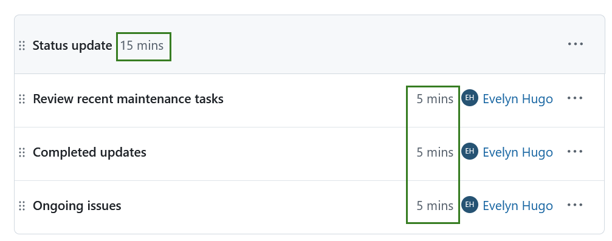

> [!TIP]
> If you need to store the agenda outside of OpenProject, you can generate an optimized PDF using the print function (Ctrl/Cmd + P).

## Link a work package to a meeting

To link a work package to a meeting, click the **+ Add** button and select the **Work package** option. Enter a work package ID, type, status or a keyword, this will open a list of work packages for you to choose from.

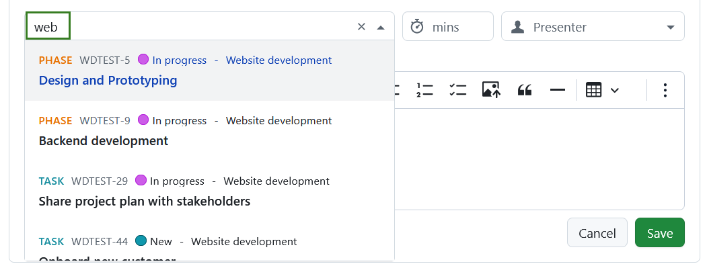

The meeting will appear under the _Meetings_ tab of the linked work package. 

You can also include work packages into the description section of other agenda items, by using # mention, same as in the CKEditor. In this case the meeting will not be linked to the work package and will not be displayed under the _Meetings_ tab of mentioned work packages.

### Add a work package from the work package view

There are two ways to add a work package to a meeting agenda.

- **From the Meetings module**: using the **+ Add** button [add a work package agenda item](#link-a-work-package-to-a-meeting) or
- **From a particular work package**: using the **+ Add to meeting** button on the [Meetings tab](../../../work-packages/add-work-packages-to-meetings)

You can add a work package to both upcoming or past meetings as long as the work package is marked **open**.

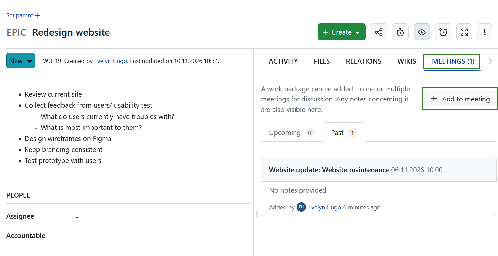

> [!TIP]
> The upcoming meetings are displayed in chronological order, from the nearest meeting to the most distant. 
> The past meetings are displayed in reverse chronological order, from the most recent meeting to the oldest.

The **Activity tab** records every action taken around a work package. This includes when a work package is added to a meeting agenda, removed from the agenda or moved to another meeting occurrence. The action taken is displayed next to the meeting title and date.

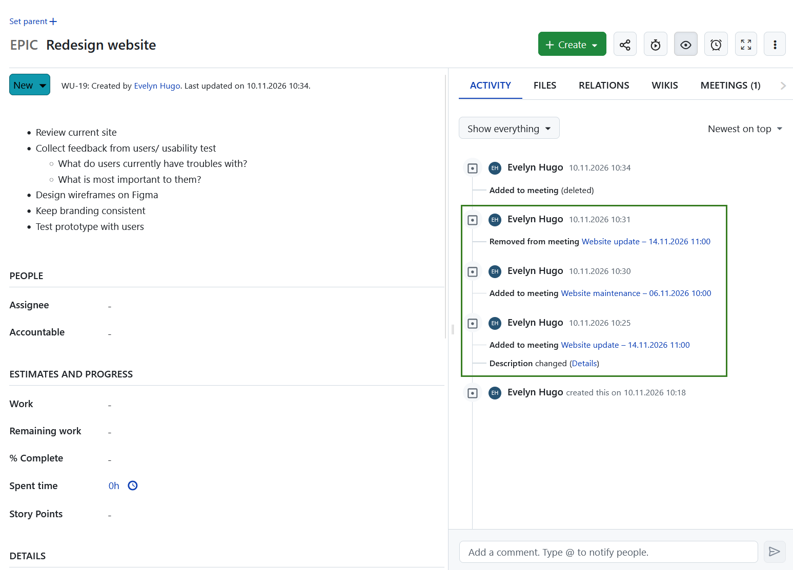

> [!NOTE]
> Meeting related work package updates appear in the Activity tab only for users who have access to both the work package and the meeting.

To hide all meeting related work package updates, scroll to the top of the **Activity tab** and select the appropriate option from the drop-down menu.

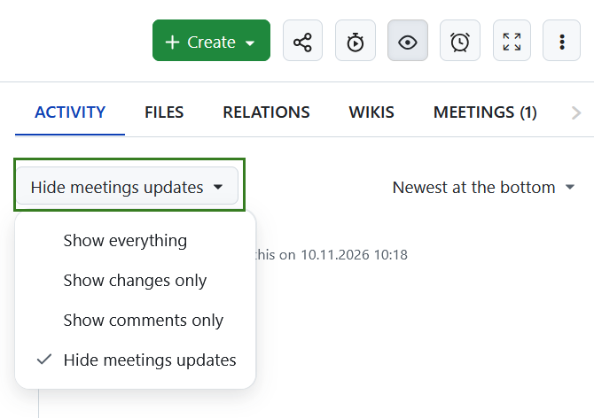

## Convert agenda items to work packages

You can convert an agenda item into a work package to turn a discussion topic into an actionable task within your project.

To do so, open the **More** menu (three dots) of an agenda item and select **Convert to work package**.

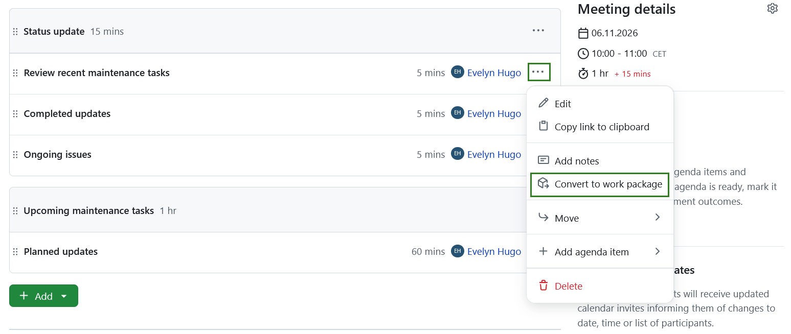

A **Convert to work package** dialog will open. The agenda item title is used as the work package subject, and the agenda item notes are added as the work package description. You can review and adjust these values before creating the work package.

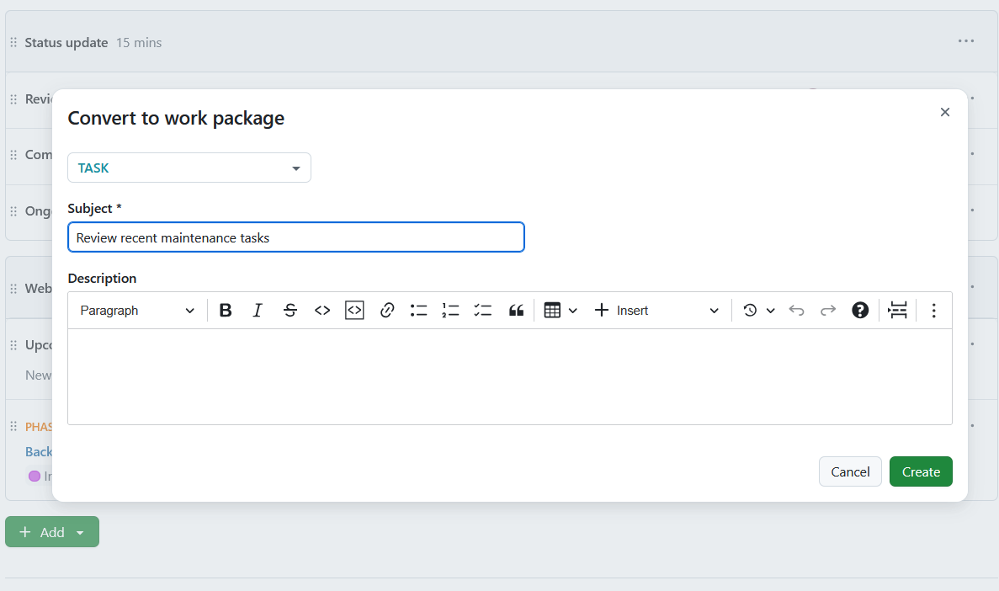

Click **Create** to create the work package in the same project as the meeting. 

After creation, the agenda item is converted into a work package agenda item and becomes the newly created work package within the meeting agenda. The original agenda item notes are preserved in the work package description.

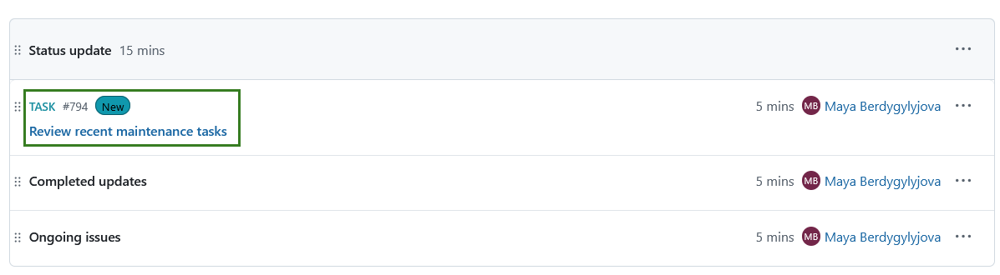

## Edit a meeting agenda

After you have finalized the agenda, you can still edit agenda items, add notes or delete items. Clicking on the **More** (three dots) menu icon on the right edge of each agenda item will display a menu of available options, including editing, copying a link to the clipboard, moving the agenda item to another section or to the backlog, or deleting it. In manual sorting mode, you can also add a new item directly above or below it, or move the item up or down.

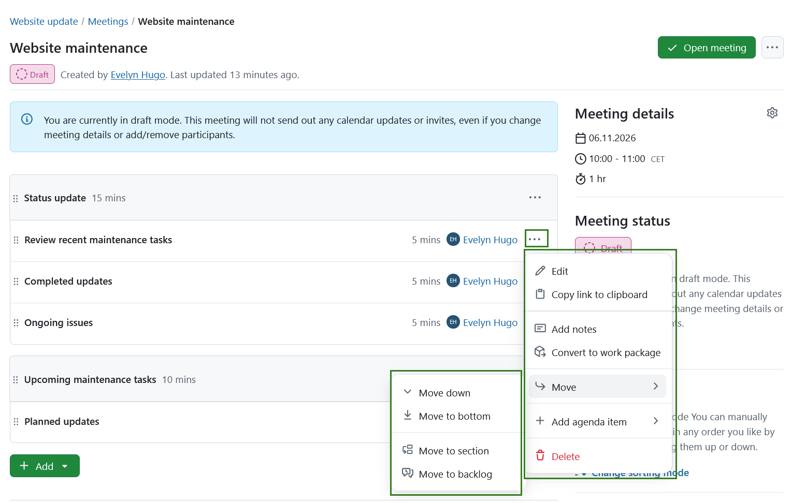

In manual sorting mode, you may also re-order agenda items by clicking on the drag handle (the icon with six dots) on the left edge of each agenda item and dragging that item above or below. To prioritize items through voting instead, use [vote-based sorting](#sort-agenda-items-and-vote).

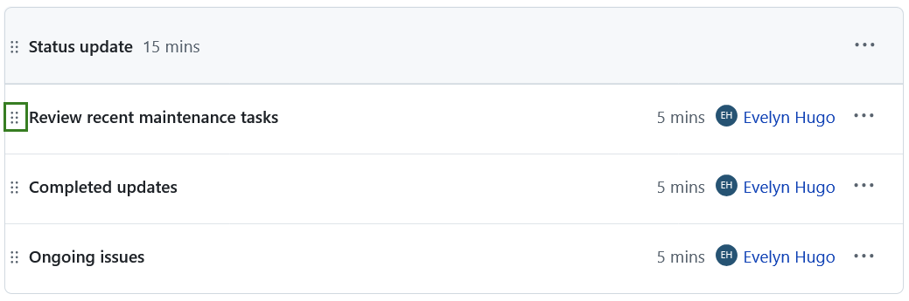

The durations of each agenda item are automatically summed up. If that sum exceeds the planned duration entered in _Meeting Details_, the duration of those agenda times that exceed the planned duration will appear in red to warn you of the fact.

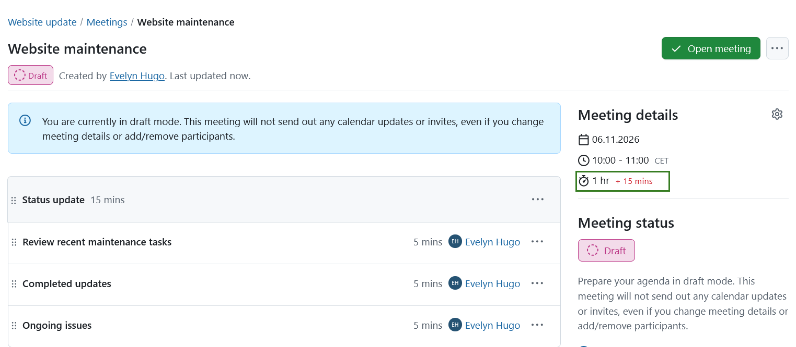

## Sort agenda items and vote

Choose **Manual** sorting to arrange the agenda yourself, or **Vote-based** sorting to prioritize topics by participant preference. The current sorting mode is shown in the **Agenda sorting** section of the sidebar. In vote-based mode, the meeting subheader also shows **Agenda sorted by votes**.

### Change the sorting mode

1. Click **Change sorting mode** in the **Agenda sorting** section of the sidebar, or open the meeting's **More** (three dots) menu and select **Sorting mode**.

   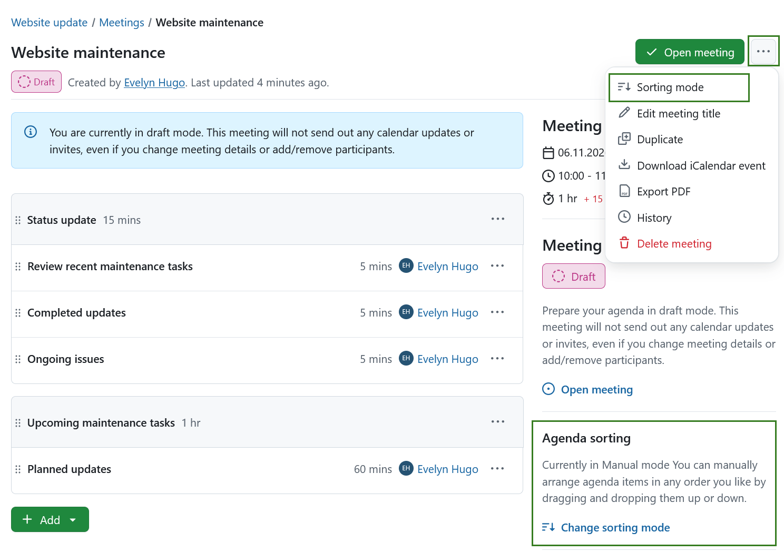

2. In the dialog that opens, select **Manual** or **Vote-based**.
3. Click **Apply** to save your selection. 

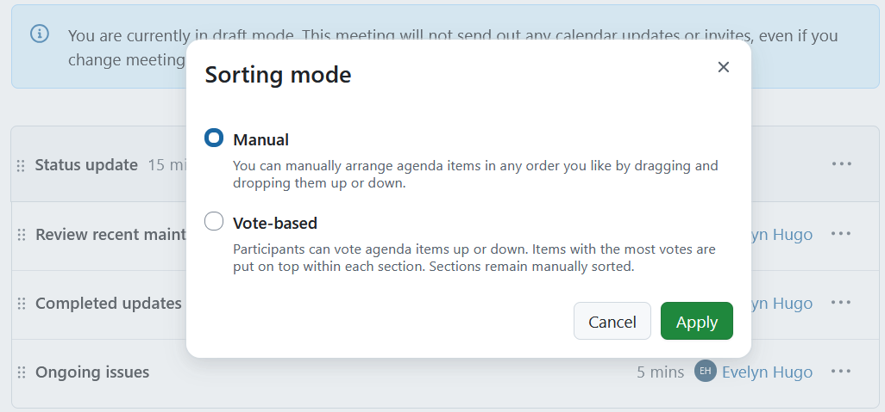

> [!NOTE]
> Changing the sorting mode requires the **Edit meetings** permission in the project and is only available while the meeting is editable. Users with **View meetings** permission can see the current mode, even if they cannot change it.

With vote-based sorting:

- Agenda items are ordered from the highest to the lowest vote count within each section. The count is the number of upvotes minus downvotes: for example, 15 upvotes and 2 downvotes result in **Votes: 13**.
- Items with equal counts retain their manual order.
- Sections remain manually sorted. Votes do not move items between sections.
- Drag-and-drop, the actions to move agenda items up or down, and the options to add an item above or below are disabled. You can still move an item to another section through its **More** menu.
- Backlogs remain manually sorted and do not support voting.

> [!NOTE]
> Switching back to **Manual** restores the manual item order and hides the vote counts and voting controls. Existing votes are retained and used again if you switch back to **Vote-based**.

### Vote on agenda items

In a vote-based meeting, hover over an agenda item or move keyboard focus into it to reveal its **Votes** count and small **thumbs up** (👍) and **thumbs down** (👎) buttons. On mobile, the vote count remains visible, but the inline buttons are hidden. Use the item's **More** (three dots) menu to vote instead.

Click 👍 to upvote or 👎 to downvote. Alternatively, open the item's **More** (three dots) menu and select **Upvote** or **Downvote**.

Each user can have one vote per item. Clicking your selected vote again removes it; selecting the opposite vote replaces your previous vote. The count and agenda order update after voting. Counts can be positive, zero or negative, for example **Votes: 13** or **Votes: -2**.

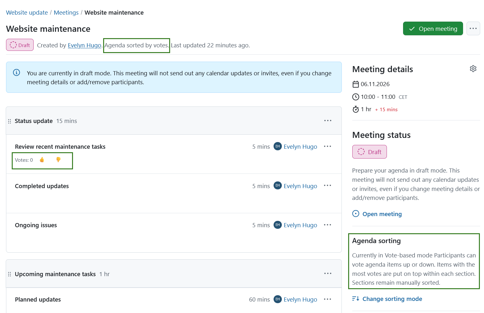

> [!NOTE]
> Voting requires the **View meetings** permission in the project; you do not need permission to edit the agenda or be listed as a meeting participant. Voting is available in draft, open and in-progress meetings, but not in closed or cancelled meetings, meeting templates, backlogs or [presentation mode](../meeting-modes/#present-a-meeting).
>
> Votes stay with an item when it is moved between sections of the same meeting. Moving an item to another meeting resets its votes.

## Agenda backlogs

An **agenda backlog** is a special pre-existing section below the actual meeting agenda where additional agenda items can be listed before being added to that particular meeting. This allows users to propose topics that are then picked up by the meeting organizer either before or during the actual meeting. 

Backlog items remain manually sorted, even when the meeting uses [vote-based sorting](#sort-agenda-items-and-vote). Move an item into the agenda before voting on it.

The backlog can be expanded or collapsed by clicking on the title.

> [!TIP]
> By default, the backlog is expanded when the meeting status is _open_, collapsed if the meeting status is _in progress_, and hidden if the meeting is _closed_.

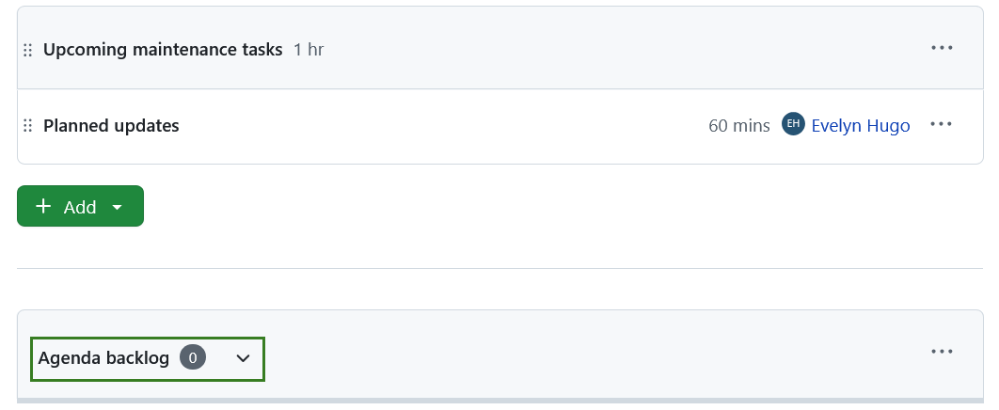

### Add and edit items to agenda backlogs

You can add agenda items and link work packages in the same way as you would within the meeting agenda, by dragging and dropping agenda items elsewhere in the meeting or by using the dropdown options of the More (three dots) icon on the right. 

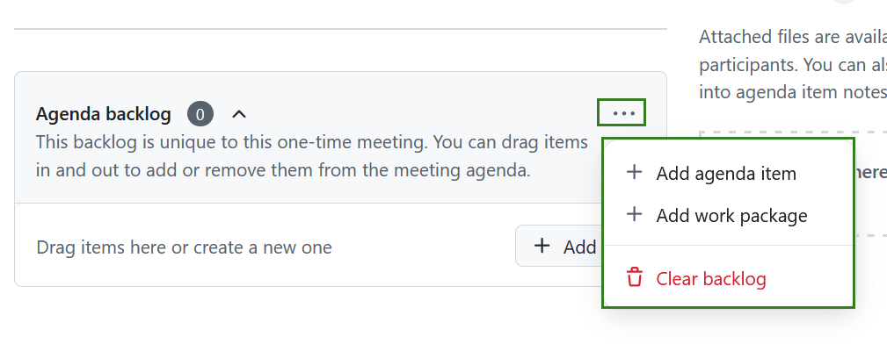

That same _More_ menu also allows editing, reordering, adding notes or deleting an item in the agenda backlog. 

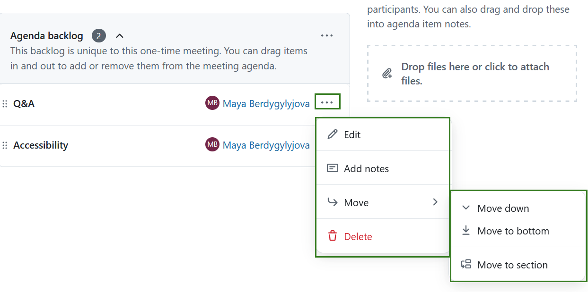

### Clear agenda backlogs

You can either remove single items from an agenda backlog or clear an entire backlog by clicking the _Clear backlog_ option under More (three dots) menu next to the backlog name. Use this option with caution, as the action cannot be undone.

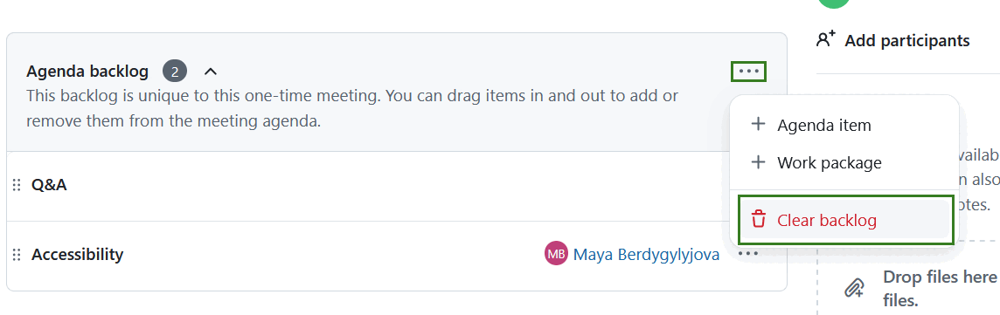

## Meeting attachments

You can add attachments in the meetings in the **Attachments** section in the bottom right corner. You can either use the **+Attach files** link to select files from your computer or drag and drop them.

Added attachments can be added to the Notes section of agenda items by dragging and dropping them from the Attachments section.

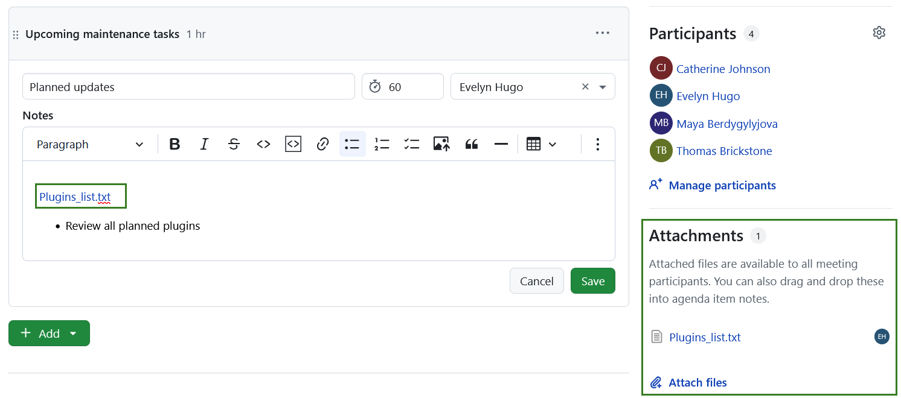
