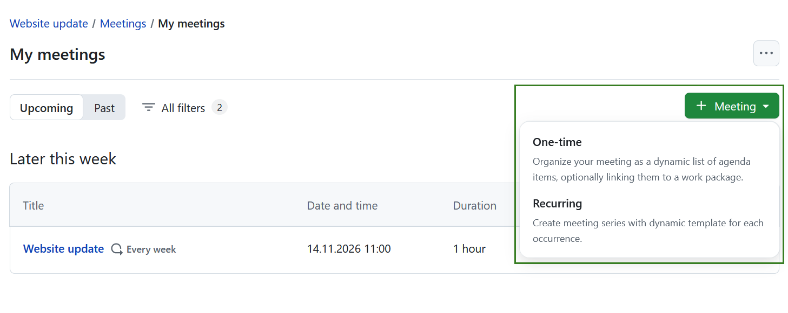
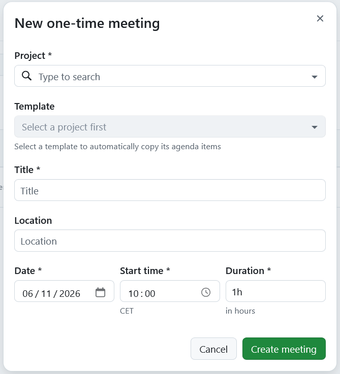
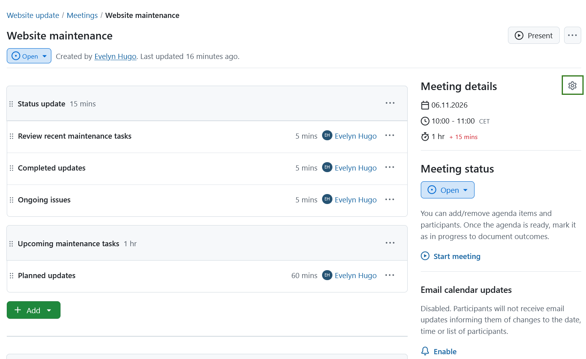
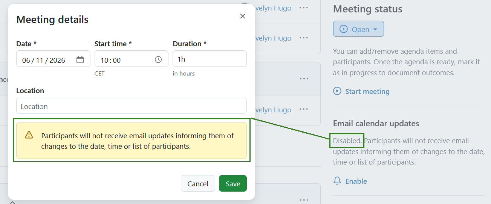
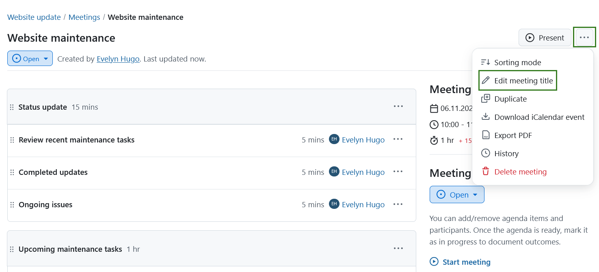
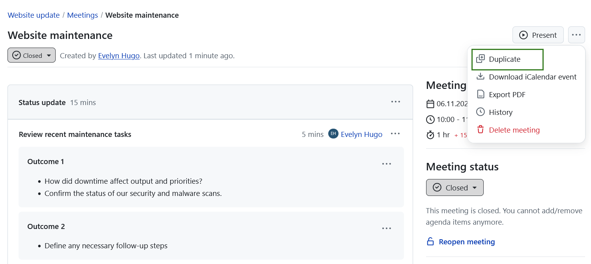
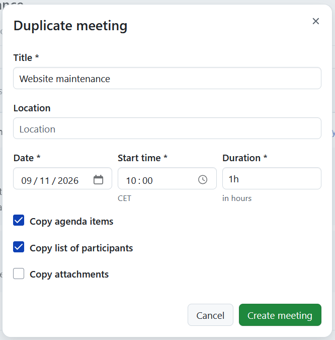
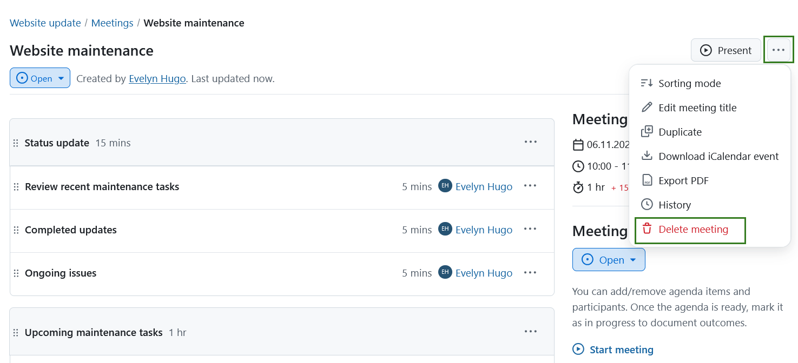
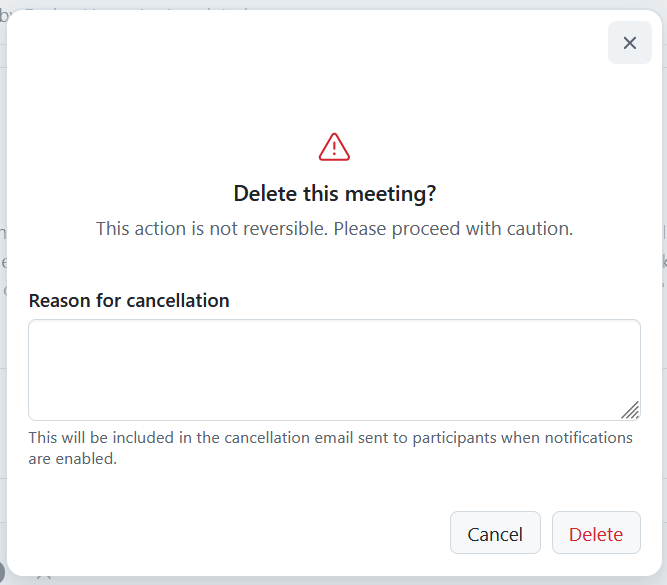

---
sidebar_navigation:
  title: Meeting setup
  priority: 900
description: Set up, edit, copy and delete meetings in OpenProject.
keywords: meetings, create meeting, one-time meeting, edit meeting, copy meeting, delete meeting
---

# Meeting setup

This page explains how to create a meeting and how to edit, copy or delete it. For an overview of the differences between one-time and recurring meetings, see [Meeting types](../../meeting-types/). For setting up a meeting series, see [Recurring meetings](../../meeting-types/recurring-meetings/).

> [!NOTE]
> The **Meetings module needs to be activated** in the [Project settings](../../../projects/project-settings/modules/) to be able to create and edit meetings.

| Topic | Content |
| --- | --- |
| [Create a new meeting](#create-a-new-meeting) | How to create a new one-time meeting. |
| [Edit meeting details](#edit-meeting-details) | How to change the date, time, location or title of a meeting. |
| [Copy a meeting](#copy-a-meeting) | How to copy a meeting. |
| [Delete a meeting](#delete-a-meeting) | How to delete a meeting. |

## Create a new meeting

You can create a meeting from within a project, from the global **Meetings** module, or using the **+** button in the header navigation.

To create a new meeting, click the green **+ Meeting** button in the upper right corner and select what type of meeting you want to create. You can choose between **one-time and recurring meetings**. 

> [!TIP]
> You can also create a meeting from anywhere in OpenProject using the **+** button in the header navigation. Click **+**, select **Meetings**, then choose **One-time meeting** or **Meeting series**. After selecting the meeting type, follow the same creation steps as above.

For steps on setting up recurring meetings please consult [this page](../../meeting-types/recurring-meetings/).

If you choose the **one-time** option, enter your meeting's title, location, start date and time, and duration. 

If you are creating a meeting from a global module you will first need to select a project to which the meeting is attributed. 

If you are using [reusable meeting templates](../meeting-templates/), you can also select a template. 

> [!TIP] 
> Duration can be entered both in hours and minutes. For example for a meeting that should last for 1.5 hours, you can enter:
>
> - 1.5h
> - 90m
> - 90min
> - 1:30

> [!NOTE]
>
> The date is set to the present day by default, while the start time is automatically rounded up to the next half-hour. For example, if the current time is 10:09, the start time is set to 10:30.

Click the **Create meeting** button to save your changes. A new meeting will be created. It will initially be in [**draft mode**](../meeting-modes/#meeting-draft-mode), as indicated by the status message and the corresponding banner. You can then proceed to add more details to the meeting.

## Edit meeting details
If you want to change the details of a meeting, for example its time or location, open the meetings details view by clicking the cogwheel icon next to the **Meeting details**.

An edit screen will be displayed, where you can adjust the date, time, duration and location of the meeting. Depending on whether email calendar updates are enabled or disabled, a corresponding banner in the form will indicate whether an update will be sent after the changes are saved.

Do not forget to save the changes by clicking the **Save** button. Cancel will bring you back to the details view.

> [!TIP]
> If someone else edits or updates the current meeting page at the same time and saves their changes, you and all other users on the same page will be notified of this with a small banner at the top of the page. Click the **Reload** button to load the updated version of the page. 
>
> If you are in the [presentation mode](../meeting-modes/#present-a-meeting), changes will load automatically, without the banner being displayed.

In order to edit the title of the meeting select the dropdown menu behind the three dots and select the **Edit meeting title**.

## Copy a meeting

You can copy an existing meeting. This is useful if you have recurring meetings. To copy a meeting, click on the three dots in the top right corner and select **Duplicate**.

A modal will open, which will allow you adjust the title, time, location and further details of the copied meeting. By default, the date for the copied meeting will be set to the next day. You also have an option of copying the agenda, attachments and the list of participants. 

The copy inherits the meeting's sorting mode. If you copy the agenda, its items start without votes; votes from the original meeting are not copied.

If you copy a closed meeting, the new meeting status will automatically be set to open. Don't forget to **save** the copied meeting by clicking the **Create meeting** button.

## Delete a meeting

You can delete a meeting. To do so, click on the three dots in the top right corner and select **Delete meeting**.

In the dialog that opens, you can optionally add a reason for cancellation before clicking **Delete**. If email notifications are enabled, the reason is included in the cancellation email sent to participants.

