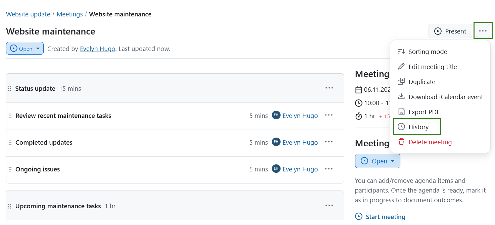
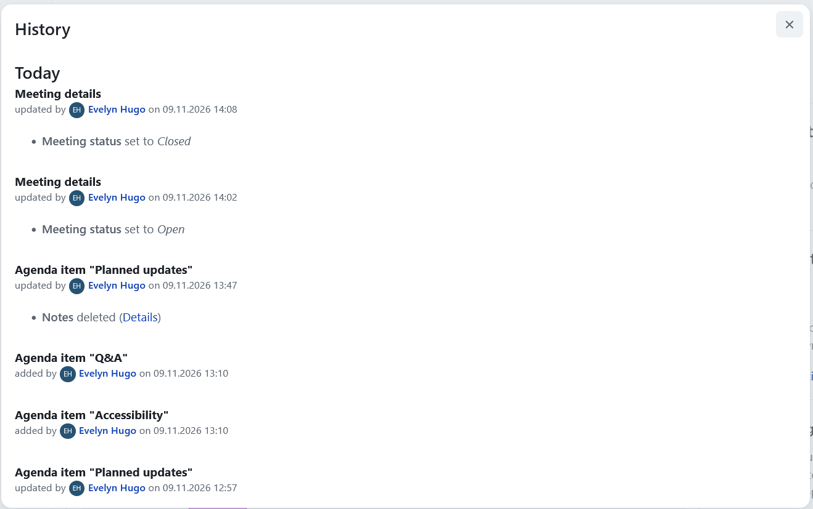
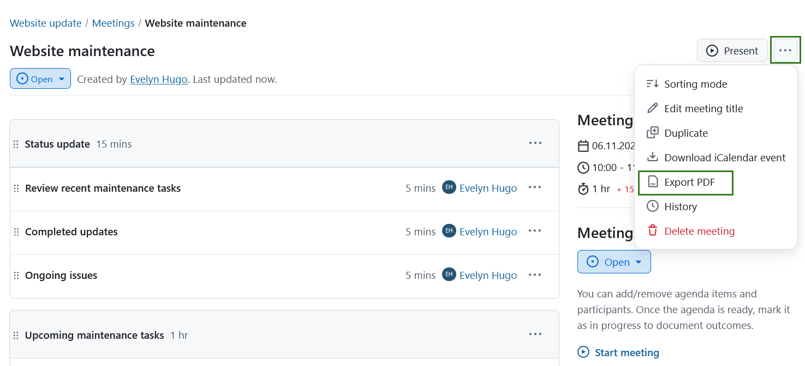
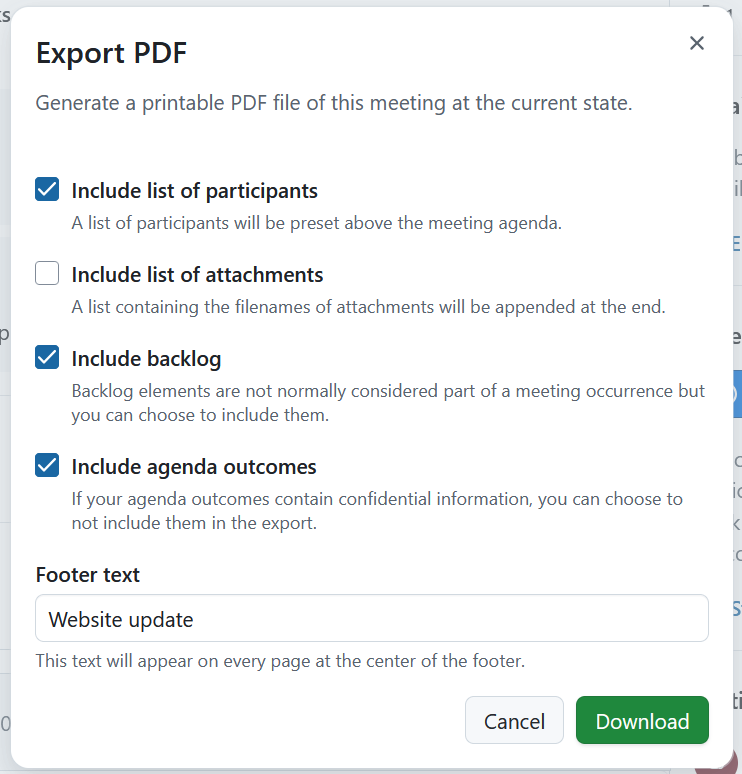
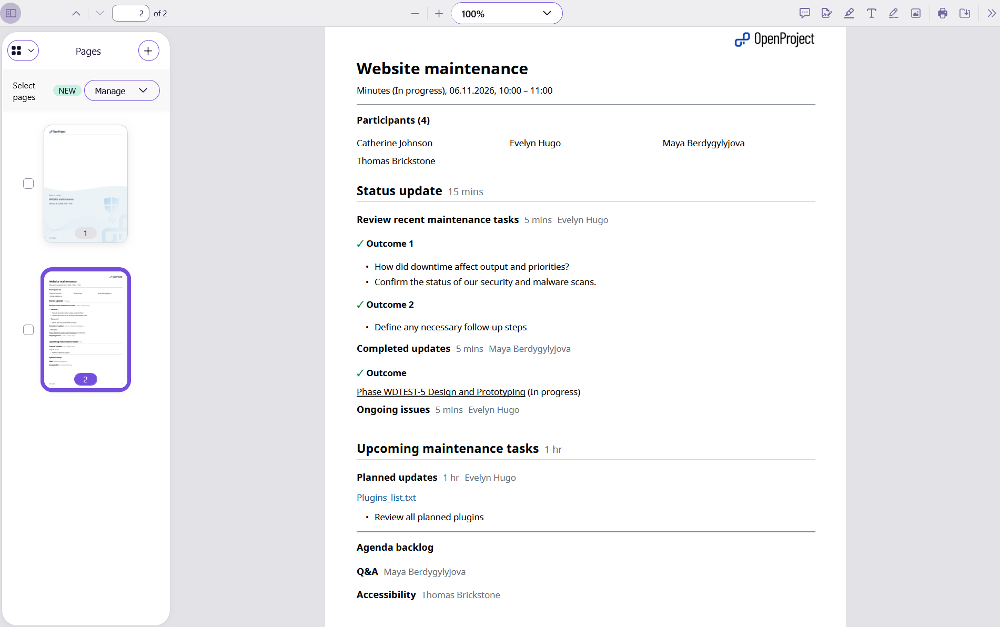

---
sidebar_navigation:
  title: Meeting follow-up
  priority: 300
description: Review the history of a meeting and export meetings as PDF in OpenProject.
keywords: meetings, history, export, pdf
---

# Meeting follow-up

The features described on this page apply to all [meeting types](../../meeting-types/), i.e. one-time meetings and individual occurrences of recurring meetings.

To follow up on tasks that were created or discussed during a meeting, see [Agenda outcomes in work packages](../meeting-outcomes/#agenda-outcomes-in-work-packages).

| Topic | Content |
| --- | --- |
| [Meeting history](#meeting-history) | How to see what changed in a meeting. |
| [Export a meeting](#export-a-meeting) | How to export a meeting as a PDF. |

## Meeting history

You can track what changes were made to a meeting and by which user. Select the dropdown by clicking on the **More** (three dots) icon in the top right corner and select **Meeting history**.

This will display meeting history details.

## Export a meeting

You can export a meeting in OpenProject in a PDF format. A meeting can be exported regardless of the meeting state (open, in progress or closed). 

To export a meeting select the dropdown by clicking on the **More** (three dots) icon in the top right corner and select **Export PDF**. 

The **Export PDF** dialogue will open. Here you can specify what elements should be included into the PDF and specify the footer text. Options include: 

- Include list of participants: a list of participants will be preset above the meeting agenda (**this option is selected by default**)
- Include list of attachments: a list containing the filenames of attachments will be appended at the end
- Include backlog: includes list of backlog elements
- Include agenda outcomes: includes agenda outcomes (**if your agenda outcomes contain confidential information, you can choose to not include them in the export**).

You can also specify the **Footer text**, which will appear on the bottom of every page. The default text for the PDF export footer is the project name.

Click the **Download** button to generate a PDF. First page of the PDF is the title page. The generated PDF will include all the meeting details and agenda. Meeting participants, agenda outcomes, a list of attachments and backlog items will only be included if selected for the export. 

> [!NOTE]
> Macros from the editor macros dropdown are not supported in the PDF.

